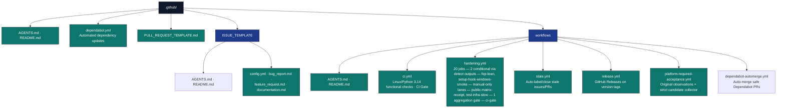

## Fast functional CI

`ci.yml` runs on main pushes, pull requests and manual dispatch. It uses Linux
and Python 3.14: lint/types and public data/security guards, complementary pipeline smoke
shards and required selected full-module contract jobs, standalone wheel builds and focused behavioral tests,
and the required `CI Gate`. `.github/project-smoke.json` names the actual tests;
the smoke runner refuses missing projects, empty selections and escaping paths.
These are functional checks, with no full-suite coverage or native acceptance claim.

Main/manual runs select every public project. Exact project-only PRs include
transitive consumers; shared, unknown or ambiguous changes select the full roster.
Infrastructure includes changed tests and declared Source owners without dropping
the legacy union. `CI Gate` requires both test lanes and checks their original
pytest selection/outcome receipts for an exact disjoint union. JUnit is diagnostic.
Routine work uses at most ten jobs, with dedicated jobs for the selected process
measurement and Root acceptance modules, retaining the 540-second job-body clock.
Full contract jobs explicitly clear marker and keyword filters, refuse any
deselection, and use the established 120-second infrastructure pytest default;
explicit family/module markers and original operation deadlines retain authority.
The CLI setting does not alter timeout defaults in nested producer environments.
`platform-native-preflight.yml` adds an incomplete cold installed diagnostic;
its bounded one-exemplar result never qualifies full release acceptance.

The former cross-version/full-suite matrix remains in `hardening.yml`, invoked
manually. `platform-required-acceptance.yml` is also manual-only; its original
custody requirements remain mandatory for formal release acceptance. Further
hardening choices and the local commands are in [`docs/development/ci.md`](../docs/development/ci.md).

Required Linux auxiliary qualification uses the Source-derived project matrix.
Each complete public project and the separate Root checks own one serial
`--matrix-cell` operation with `--auxiliary-workers 1` and 1,800 seconds.
This versioned partition changes aggregate scheduling and compute allowance;
it never qualifies an earlier failed global invocation. Root preparation/admission stay
serial, with one complete gate at a time per project. The gates within each
cell share its original deadline. Fresh installed candidate and release readers
live-authenticate every exact producer job, artifact and attempt and require the
complete disjoint gate union. Passing auxiliary observations require verified
guardian cleanup; deadline refusals retain absent child IDs and exit codes.
Cleanup admission also requires a successful final token census: an observation
error cannot stand in for verified absence.

Functional infrastructure smoke and selected contract jobs, complete Linux Root
observations, and Linux auxiliary acceptance prepare a fresh unprivileged
execution account before custody. The strict census keeps its global process
view and same-owner rule. Setup detaches shared cache hardlinks before scoped
ownership changes and forwards only declared runtime inputs. Original commands
retain their arguments and exit status; an always-run export copies readiness
bytes for the runner's artifact reader without changing captured permissions.
Source-declared disposable pytest scratch is excluded from that transport;
the exclusion record grants no observation or receipt authority.
Prepared model services keep their original runner-owned cleanup. Hosted checks
must verify the profile; setup and local tests alone establish no Linux or release
acceptance.

# GitHub Integration

## Overview

The `.github/` directory contains GitHub-specific configuration and automation for the Research Project Template. This includes continuous integration workflows, issue templates, PR templates, and other GitHub integrations that ensure code quality and collaborative development.

**Human entry point:** [README.md](README.md) — GitHub overview, doc map, and [Agent & automation entry point](README.md#agent--automation-entry-point). **This file (`AGENTS.md`):** job names, paths, and thresholds for automation and agents.

## Publication

**Title**: *A template/ approach to Reproducible Generative Research: Architecture and Ergonomics from Configuration through Publication*
**DOI**: [10.5281/zenodo.19139090](https://doi.org/10.5281/zenodo.19139090)
**Record**: [zenodo.org/records/19139090](https://zenodo.org/records/19139090)
**License**: Apache 2.0

Public exemplar GitHub/Zenodo records are generated into [`.github/README.md`](README.md#published-exemplars--pipeline-productivity-advanced-provenance-and-autopoiesis) from [`../docs/_generated/publication_records.md`](../docs/_generated/publication_records.md). Refresh them with:

```bash
uv run python scripts/docgen/publication_records.py --refresh-external
```

## Directory Structure



## Continuous Integration (CI/CD)

### Optional exhaustive hardening (`workflows/hardening.yml`)

**Triggers:** manual **`workflow_dispatch`** only.
**Concurrency:** Each manual hardening run retains its unique run group so later commits or dispatches cannot cancel exact-commit verification.

**Pipeline jobs** (job ids in `hardening.yml`; display names differ — use `name:` for branch protection):

**20 jobs total; 2 depend on optional-project presence (fep-lean, setup-hook-windows-smoke), gated by the `detect` job's outputs
(`needs.detect.outputs.*`) — NOT a job-level `hashFiles()` (that is invalid
in a job `if:` and rejects the whole workflow at parse). 2 further jobs
(`public-matrix-receipt`, `test-infra-slow`) run only on the manual dispatch.**

| # | Job id | Display name (representative) | Depends on | Python | Runner |
| --- | --- | --- | --- | --- | --- |
| 1 | `detect` | Detect optional projects | — | — | ubuntu (always) |
| 2 | `detect-projects` | Detect public capability matrix | — | manifest-owned 3.12 + 3.13 + 3.14 | ubuntu (always) |
| 3 | `actionlint` | Actionlint | — | — | ubuntu (always) |
| 4 | `lint` | Lint & Type Check | — | 3.14 | ubuntu |
| 5 | `health` | Static Health Report | — | 3.14 | ubuntu |
| 6 | `verify-no-mocks` | Verify No Mocks Policy | — (parallel with `lint`) | 3.14 | ubuntu |
| 7 | `setup-hook-windows-smoke` | Setup hook (Windows smoke) | verify-no-mocks, detect | 3.14 | windows · runs iff `needs.detect.outputs.setup_hook == 'true'` |
| 8 | `test-infra` | Infra Tests (matrix) | verify-no-mocks, detect-projects | 3.12–3.14 | ubuntu (×3.12/3.13/3.14) + macOS (3.14 only) — four complete shards per pair, 16 cells on every event; dynamic `infra_matrix` output from `detect-projects` |
| 9 | `test-regression` | Regression Tier (claim-binding pins) | verify-no-mocks | 3.14 | ubuntu |
| 10 | `test-project` | Project Tests (per-project matrix) | verify-no-mocks, detect-projects | capability-manifest versions | ubuntu only — exact project/Python include matrix from `public_capabilities.py` |
| 11 | `fep-lean` | fep_lean (gauss + lake) | verify-no-mocks, detect | 3.14 | ubuntu · runs iff `needs.detect.outputs.fep_lean == 'true'` |
| 12 | `validate` | Validate Manuscripts | — | 3.14 | ubuntu |
| 13 | `security` | Security Scan | — | 3.14 | ubuntu |
| 14 | `docs-lint` | Documentation Lint | — | 3.14 | ubuntu |
| 15 | `performance` | Performance Check | — (no `needs:`; CI-FAST-PERF-1) | 3.14 | ubuntu |
| 16 | `public-matrix-receipt` | Public Matrix Receipt (receipt-bearing full matrix) | — | 3.14 | ubuntu · schedule/manual only |
| 17 | `test-infra-slow` | Infra Slow Lane (`pytest.mark.slow`) | verify-no-mocks | 3.14 | ubuntu · schedule/manual only — exercises the slow-marked suite PR lanes deselect |
| 18 | `test-integration` | Integration Tier (run.sh + pipeline CLI) | verify-no-mocks | 3.14 | ubuntu — runs the registered `tests/integration/` suite on manual full-suite runs |
| 19 | `coverage-infra` | Infrastructure Union Coverage | test-infra | 3.14 | ubuntu · validates all four transferred selections/data hashes and requires ≥60% union coverage |
| 20 | `ci-gate` | Hardening Gate | all 19 upstream jobs (`if: always()`) | — | ubuntu · aggregation — fails if any upstream job failed or was cancelled; skipped counts as intentional |

**Lint job** also runs `uv run python -m infrastructure.skills check-all-exports` (MED5 `__all__` gate), `scripts/audit/check_tracked_generated_artifacts.py` (rejects generated outputs and local `.codegraph/` indexes), **`scripts/audit/check_template_drift.py --strict`** (exemplar doc/script drift against Layer-1 contracts), and **`scripts/audit/check_tracked_all.py`** — the **confidentiality guard** that fails CI if any path outside the public allowlists for `projects/`, `fonds/`, `rules/`, or `tools/` is git-tracked (this is a public repo; confidential/rotating resources are local-only). **`validate`** runs manuscript markdown validation (one dir per invocation, looped over `projects/*/manuscript/`), `scripts/docgen/api_reference.py --check`, and imports each `projects.{name}.src`. **`security`** runs blocking **`pip-audit`** (IDs from [`.github/pip-audit-ignore.txt`](pip-audit-ignore.txt), up to 3 retries on failure) and **`bandit -c bandit.yaml -r -ll`** over `infrastructure/`, `scripts/`, and `projects/`. Path exclusions (`projects/working/`, `projects/ongoing/`, `projects/published/`, `projects/archive/`, `projects/other/`, plus `.venv`, `site-packages`, `.lake`, the vendored `infrastructure/steganography/kmyth` submodule, and named rotating research projects such as `projects/BeeStack` — **not** the rendered `projects/active/` mirror) live in [`bandit.yaml`](../bandit.yaml) (`exclude_dirs`).

**Display name (branch protection):** the optional fep_lean job is reported as **`fep_lean (gauss + lake)`** (`hardening.yml` `name:` on job id `fep-lean`). It runs only when the `detect` job sets `fep_lean == 'true'` (`if: needs.detect.outputs.fep_lean == 'true'`) — a job-level `hashFiles()` is **invalid** in a job `if:` and would reject the whole workflow at parse, which is why the `detect` job exists. When fep_lean lives under `projects/working/`, `detect` reports `false` and the job is skipped. Promote with `mv projects/working/fep_lean projects/active/fep_lean` to activate CI. **Branch protection must NOT mark the two conditional jobs (`fep-lean`, `setup-hook-windows-smoke`) as required** — they are skipped (not failed) when their project is absent, so requiring them would wedge every PR.

Infrastructure and project coverage are uploaded to **Codecov** only from their
Python 3.14 / `ubuntu-latest` cells; upload failures do not fail CI.

The `verify-no-mocks` job runs [`scripts/audit/verify_no_mocks.py`](../scripts/audit/verify_no_mocks.py) at the repository root (not under `.github/`).

### Stale Workflow (`workflows/stale.yml`)

Runs daily. Issues → stale after 60 days, closed after 14 more. PRs → stale after 30 days, closed after 14 more. Exempt labels: `pinned`, `security`, `in-progress`, `blocked`, `do-not-close`.

### Release Workflow (`workflows/release.yml`)

Triggered by `v*.*.*` tag pushes or manual dispatch with a tag. It resolves the
requested tag before checkout, checks out that exact ref, proves `HEAD` matches
the dereferenced tag commit, and explicitly prepares the locked public-exemplar
and installed-build environment before offline admission or checks. It runs the
root release contract, bounded pipeline-smoke infra test lane plus no-mocks gate on the tagged SHA,
the fail-closed capability manifest, the complete Python 3.12–3.14 installed
wheel matrix outside source checkouts, and strict rendered publication audit
across the canonical public roster. Root 4+ additionally requires an explicit
same-repository successful hosted run and artifact bound to that exact revision,
the aggregate receipt hash, and every required candidate acceptance gate.
The candidate includes
[`platform-required-acceptance.yml`](workflows/platform-required-acceptance.yml):
six original Root minor/platform units, common and native observations, and a
strict collector that uploads only the passed complete exact-source bundle.
Its presence does not establish successful hosted acceptance, integration into
`main`, or publication; ordinary CI uploads cannot authorize this handoff.
Tag pushes without the explicit handoff stop. The 4.0.2 candidate remains Unreleased during development. Final changelog and
release-intent metadata must be frozen before exact-revision acceptance; those
bytes do not establish publication. The prepared 4.0.0 candidate was not published.
The release uses `softprops/action-gh-release@v3.0.3` with
**`generate_release_notes`** off. Root 4+ reads `docs/releases/<tag>.md` for its
actual tag, such as the [4.0.2 candidate notes](../docs/releases/v4.0.2.md), and
adds accepted-commit, hosted-run and receipt-hash bindings. It publishes the
admitted installed wheel, exact final source distribution, tag-selected overview
PNG and byte manifest, then verifies retrieved asset hashes. Earlier major tags
retain the short git-log excerpt.

### Dependabot Automerge Workflow (`workflows/dependabot-automerge.yml`)

Triggered by `pull_request_target` on Dependabot PRs only (`github.actor == 'dependabot[bot]'`). Enables GitHub native auto-merge (`gh pr merge --auto --squash`) for `semver-minor` and `semver-patch` updates. Major bumps are left for human review. The workflow never checks out or executes PR HEAD code — it only reads update metadata and calls the GitHub API — so the elevated `pull_request_target` trigger does not expose secrets to untrusted code. Auto-merge must also be enabled in repository settings (Settings → General → "Allow auto-merge").

## Dependabot (`dependabot.yml`)

[`dependabot.yml`](dependabot.yml) at the repository root: **GitHub Actions** (`package-ecosystem: github-actions`, `directory: /`) and **Python** (`package-ecosystem: pip`, `directory: /`) both read the root **`pyproject.toml`** / lockfile — compatible with **uv**. Weekly **Monday 09:00 UTC**, max **5** open PRs per ecosystem. Groups: **`actions-minor`** (Actions minor/patch), **`dev-tools`** and **`scientific-core`** (Python).

## Quality Gates

| Gate | Threshold |
| --- | --- |
| Ruff lint | zero violations |
| Ruff format | zero diffs |
| mypy strict gate | zero errors across the generated public source scope |
| Mock-framework lexical gate | zero prohibited imports/calls (`--inventory` debt remains advisory) |
| Public capability parity | exact public roster and CI matrix; unique normalized package identities; complete moving-patch Python series; parseable source/tests; compiled/confined direct hydration; reason-bearing skips |
| Infrastructure coverage | ≥ 60% |
| Project coverage (per-project standalone) | ≥ 90% |
| Combined-union public-project gate (`DEFAULT_FAIL_UNDER`) | ≥ 75% via local `scripts/pipeline/stage_01_test.py --project-only --all-projects --public-projects` (CI `test-project` enforces per-exemplar 90% only) |
| pip-audit | zero known vulns not listed in `.github/pip-audit-ignore.txt` |
| Bandit MEDIUM+ (`-c bandit.yaml`) | zero findings |
| Mermaid diagrams render under `mmdc` | zero failures |
| Markdown cross-links resolve on disk | zero broken links |
| Permanent-template folders carry `AGENTS.md` + `README.md` | zero missing pairs |
| `N Python (sub)packages` claims match reality | zero stale counts |
| Rotating projects in long-lived docs are conditional | zero ghost references |
| Import time | ≤ 5 s |
| Module line count (`scripts/gates/module_line_count_check.py`) | warn ≥ 800 / fail ≥ 950 for `infrastructure/` + `scripts/`; warn ≥ 150 / fail ≥ 250 for `projects/*/scripts/` |

## Local Pre-Push Parity (`.pre-commit-config.yaml`)

The repo ships a [`.pre-commit-config.yaml`](../.pre-commit-config.yaml) with
**seven pre-push hooks** that mirror (or partially mirror) CI gates so pushes
that would fail CI fail locally first:

| Hook id | Mirrors CI step | Typical runtime |
| --- | --- | :-: |
| `pre-push-quick` | `verify-no-mocks` + `check_tracked_all` + `tests/infra_tests/git_hook_smoke/` | ~3 s |
| `docs-contract-guard` | `check_template_drift.py --strict` + AGENTS personal-memory test | ~5 s |
| `bandit-quick` | `security` job Bandit step (`-c bandit.yaml -r -ll`) | ~5–30 s |
| `skills-check` | `infrastructure.skills check` (manifest freshness) | <1 s |
| `operations-check` | `infrastructure.skills operations-check` (operation-manifest freshness) | <1 s |
| `all-exports-check` | `infrastructure.skills check-all-exports` (lint job MED5 gate) | <1 s |
| `skill-reachability-check` | docs-lint skill front-door and index completeness gate | <1 s |

As of 2026-10-13, `docs-contract-guard` does not run `COUNTS.md`
synchronization and dated coverage provenance checks on every push. All its
other documentation commands remain
blocking, alongside the separate security, public tracking, no-mocks and
behavioral hooks. A branch may need to be pushed to obtain genuine hosted
coverage when its required local tools are unavailable.

`uv run python scripts/docgen/counts.py --check` still rejects stale coverage
provenance in the owning `counts` health gate and full-hardening documentation
job. The counts writer and explicit provenance refresh retain their existing
validation. A requested hosted measurement must pass its job, CI Gate and the
whole workflow; verify the retrieved artifact's exact source commit and project
input hash before refreshing the dated snapshot. Functional CI passing alone
does not promote older coverage measurements to a current claim. Release's
exact-source acceptance and coverage custody requirements remain separate and
unchanged.

The lint job also runs the deterministic source-only publication audit across
the generated public roster:

```bash
uv run python -m infrastructure.validation.cli publication-audit --all-public --strict --format json
```

For release sign-off, add `--rendered` after running each exemplar's canonical
pipeline; that mode makes artifact manifests, evidence registries, and figure
registries blocking requirements. Subjective editorial findings remain
`review_required` and are reported without weakening deterministic failures.

The lint hooks (`ruff-ci`, `mypy-ci`) run on the **pre-commit** stage, not
pre-push, to keep `git commit` fast. A separate manual-stage `bandit-low`
hook provides a stricter LOW+MEDIUM+HIGH sweep against `bandit.yaml`'s
allow-list — invoke with `pre-commit run --hook-stage manual bandit-low`. To
run the full pre-push gate manually:

```bash
pre-commit run --hook-stage pre-push --all-files
```

A new MEDIUM Bandit finding fails `git push` locally with the same scope and
severity as the CI `security` job, so contributors hear it before CI does.

## Branch Protection

Verified against GitHub on 2026-10-03: `main` is protected and requires the
**`CI Gate`** check from GitHub Actions (app ID `15368`). Administrator
enforcement is enabled, force pushes are disabled, and the required-check
policy has `strict: false`. GitHub currently has no required PR-approval or
CODEOWNERS-approval rule for this branch, and no additional branch rulesets
were reported. These are observed settings; recheck the external control before
integration rather than treating this snapshot as permanent configuration.

[`workflows/ci.yml`](workflows/ci.yml) defines `CI Gate` as the aggregate of
all fast functional jobs. Every one must succeed; missing, skipped, failed or
cancelled results are refused. The manual full matrix has a separate
`Hardening Gate` in `hardening.yml`. Before updating
`main`, verify a successful `CI Gate` for the exact candidate commit. An older
successful main run does not establish acceptance for a new revision. CI success
also does not replace the complete required-acceptance handoff for a root 4+
release described above.

[`CODEOWNERS`](CODEOWNERS) routes review requests; it does not configure branch
protection. Changes under the sensitive workflow/configuration paths listed in
[`sensitive-ownership.yaml`](sensitive-ownership.yaml) must receive the review
required by that repository policy. Its single-maintainer exceptions require
recorded independent adversarial review and green blocking CI; they do not
authorize bypassing status checks or review obligations.

## Issue Templates

| Template | Labels | Use for |
| --- | --- | --- |
| Bug Report | `bug`, `needs-triage` | Reproducible errors with log output |
| Feature Request | `enhancement`, `needs-triage` | New capabilities and improvements |
| Documentation Update | `documentation`, `needs-triage` | Incorrect or missing docs |

Blank issues are disabled. General questions should go to **GitHub Discussions**.
See [`ISSUE_TEMPLATE/AGENTS.md`](ISSUE_TEMPLATE/AGENTS.md) for local editing rules.

## Troubleshooting

```bash
# Fix linting locally
uv run python -m infrastructure.project.public_scope lint-paths | xargs uv run ruff check --fix
uv run python -m infrastructure.project.public_scope lint-paths | xargs uv run ruff format

# Run tests locally (safe macOS coverage lane; CI uses auto on Linux)
uv sync --locked --group public-exemplars --group installed-build
# Prepare Poppler explicitly: brew install poppler (macOS), or
# sudo apt-get install poppler-utils (Linux).
COVERAGE_FILE=.coverage.infra uv run pytest tests/infra_tests/ \
  -n 2 --dist loadscope --benchmark-disable \
  --cov=infrastructure --cov-report=term-missing --cov-fail-under=60 \
  --durations=10 \
  -m "not requires_ollama and not requires_docker and not network and not slow and not bench and not benchmark and not performance" \
  --timeout=120
# Uncached serial diagnostic oracle: remove the xdist flags above.
uv sync --group public-exemplars
COVERAGE_FILE=.coverage.project uv run python scripts/pipeline/stage_01_test.py --project-only --all-projects --public-projects --non-strict --include-slow
uv run coverage xml -o coverage-project.xml

# Security scan locally (mirror CI)
IGNORE_ARGS=()
while IFS= read -r raw; do [[ "$raw" =~ ^[[:space:]]*# ]] && continue; line="${raw%%#*}"; line="$(echo "$line" | xargs)"; [ -z "$line" ] || IGNORE_ARGS+=(--ignore-vuln "$line"); done < .github/pip-audit-ignore.txt
uv run pip-audit "${IGNORE_ARGS[@]}"
uv run bandit -c bandit.yaml -r -ll infrastructure/ scripts/ projects/
# Module line count (also in `uv run python -m infrastructure.core.health --gates=module-line-count`):
uv run python scripts/gates/module_line_count_check.py
# Strict LOW+MEDIUM+HIGH sweep against the documented allow-list:
uv run bandit -c bandit.yaml -r --severity-level low infrastructure/ scripts/

# Check workflow status via GitHub CLI
gh workflow list
gh run list --workflow=CI --limit=5
gh run view <run-id> --log
```

## See Also

- [`README.md`](README.md) — Contributor-oriented GitHub integration guide
- [`workflows/AGENTS.md`](workflows/AGENTS.md) — Detailed CI/CD workflow documentation
- [`../AGENTS.md`](../AGENTS.md) — Root system overview
- [GitHub Actions Documentation](https://docs.github.com/en/actions)
- [uv Documentation](https://docs.astral.sh/uv/)

The infrastructure partition changes execution placement only. The required `coverage-infra` job consumes every 3.14/Linux shard, validates their complete disjoint case union and source/data identities, and enforces the unchanged 60% floor. The existing `ci-gate` complete-job policy includes this job; an unsuccessful or skipped merge prevents optional exhaustive hardening acceptance. Root 4 release evidence remains separately required.
