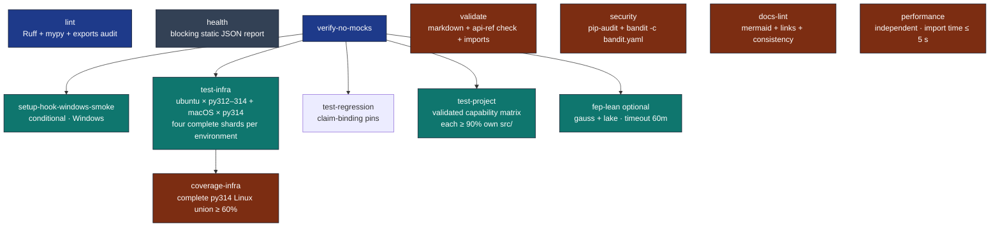

## Fast functional CI

`ci.yml` runs on main pushes, pull requests and manual dispatch. It uses Linux
and Python 3.14: lint/types and public data/security guards, pipeline smoke,
a standalone wheel build and focused behavioral tests for every public template,
and the required `CI Gate`. `.github/project-smoke.json` names the actual tests;
the smoke runner refuses missing projects, empty selections and escaping paths.
These are functional checks, with no full-suite coverage or native acceptance claim.

Manual CI dispatch accepts an optional exact public `coverage-project` and calls
`exemplar-coverage.yml` for its own locked release-profile measurement. The
**Public exemplar coverage** workflow calls the same job across the complete
Source-derived roster in one dispatch, with four concurrent projects and separate
commit/input-hash bound artifacts. Its optional project input selects exactly
one public exemplar. Require every selected measurement and the final matrix
gate, then verify the retrieved artifacts before updating coverage provenance.
The ordinary `CI Gate` also requires both complementary infrastructure lanes and
accepts the optional coverage job's skip only when unrequested.

The lint job resolves its public lint/type scopes once and passes nonempty Bash
arrays to Ruff and mypy. A failed scope producer stops before either tool runs.
Infrastructure smoke exercises that failure, corrupt model-cache refusal,
fixture preparation and source binding, native source copying and the TeX
admission boundary without preparing a model or native tools. These focused
tests keep preparation and gate regressions on the ordinary push path.

The former cross-version/full-suite matrix remains in `hardening.yml`, invoked
manually. `platform-required-acceptance.yml` is also manual-only; its original
custody requirements remain mandatory for formal release acceptance. Further
hardening choices and the local commands are in [`docs/development/ci.md`](../../docs/development/ci.md).

# workflows/ — CI/CD Pipelines

GitHub Actions workflows for automated quality assurance, testing, and deployment. Enforces development standards across Python versions and environments.

For Dependabot, issue/PR templates, and the full GitHub integration picture, see **[`../README.md`](../README.md)** in the parent `.github/` folder.

## Workflows

| File | Trigger | Purpose |
|---|---|---|
| [`ci.yml`](ci.yml) | main push, pull request, or manual | Linux/Python 3.14 functional checks, all public project wheel builds and focused behavioral tests, aggregated by `CI Gate` |
| [`hardening.yml`](hardening.yml) | manual only | **20 jobs** (2 conditional via the `detect` job's outputs — `needs.detect.outputs.*`: **`fep-lean`** and **`setup-hook-windows-smoke`**; manual-only lanes: **`test-infra-slow`** and **`public-matrix-receipt`**; see [`AGENTS.md`](AGENTS.md)) |
| [`stale.yml`](stale.yml) | Daily 01:00 UTC | Auto-label and close stale issues/PRs |
| [`release.yml`](release.yml) | `v*.*.*` tag push or manual | Generate GitHub Release with changelog |
| [`platform-required-acceptance.yml`](platform-required-acceptance.yml) | manual only | Original required-profile observations and strict exact-source acceptance bundle |
| [`dependabot-automerge.yml`](dependabot-automerge.yml) | `pull_request_target` (Dependabot only) | Auto-merge safe (minor/patch) Dependabot PRs after all required checks pass |

## Optional exhaustive hardening (`hardening.yml`)

### Job Graph

`health`, `validate`, `security`, and `docs-lint` run independently alongside **`lint`**; `verify-no-mocks` gates the test matrix. Every job remains required by **`ci-gate`**. See [`AGENTS.md`](AGENTS.md).



`test-infra` retains its 90-minute hosted budget and unchanged per-case
timeouts. Its Linux/macOS cells invoke the shared
[`setup-acceptance-documents`](../actions/setup-acceptance-documents/action.yml)
once before the tests; pinned archive verification, native package preparation,
and actual executable probes remain required.

### Quality Gates

| Gate | Threshold |
|---|---|
| Ruff lint | zero violations |
| Ruff format | zero diffs |
| mypy strict gate | zero errors across the generated public source scope |
| `check-all-exports` | zero violations |
| Mock-framework lexical gate | zero prohibited imports/calls |
| Semantic stand-in gate | zero dependency replacements; environment isolation classified separately |
| Public capability parity | exact roster/project-Python matrix; unique normalized package identities; full-minor Python compatibility; parseable source/tests; compiled/confined direct hydration entrypoints; reason-bearing skips |
| Infrastructure coverage | ≥ 60% |
| Per-project coverage (standalone) | ≥ 90% |
| Combined-union public-project coverage | ≥ 75% |
| pip-audit | blocking (ignore IDs from `.github/pip-audit-ignore.txt`; retries in CI) |
| Bandit MEDIUM+ (`bandit.yaml`) | zero findings |
| Docs lint | mermaid + cross-links + consistency + doc-pair coverage clean |
| Import time | ≤ 5 s total |

Each `test-project` cell has a 135-minute hosted-job backstop. Within that job,
the directly invoked Stage-01 application gives generic pytest one total
6,900-second subprocess-wait and retry-admission deadline, or gives an
explicitly declared verifier one 6,900-second attempt. Post-timeout process-tree
cleanup may complete outside that inner boundary. The hosted command does not
pass through the full pipeline's separate 7,200-second stage wrapper; the
remaining 1,200 seconds are setup, descendant-cleanup, and upload margin. These
ceilings are capacity controls, not evidence that tests passed, coverage met
its floor, or a structured verifier receipt was produced.

### Local CI Simulation

```bash
# Lint
uv run python -m infrastructure.project.public_scope lint-paths | xargs uv run ruff check
uv run python -m infrastructure.project.public_scope lint-paths | xargs uv run ruff format --check
uv run python -m infrastructure.project.public_scope source-paths | xargs uv run mypy

# Infrastructure tests
uv run pytest tests/infra_tests/ \
  --cov=infrastructure --cov-datafile=.coverage.infra --cov-fail-under=60 \
  -m "not requires_ollama"

uv sync
npm ci
export PATH="$PWD/node_modules/.bin:$PATH"
COVERAGE_FILE=.coverage.project uv run python scripts/pipeline/stage_01_test.py --project-only --all-projects --public-projects --non-strict --include-slow
uv run coverage xml -o coverage-project.xml

# Security (mirror CI — ignores file + bandit.yaml)
IGNORE_ARGS=()
while IFS= read -r raw || [ -n "$raw" ]; do
  [[ "$raw" =~ ^[[:space:]]*# ]] && continue
  line="${raw%%#*}"; line="$(echo "$line" | xargs)"
  [ -z "$line" ] || IGNORE_ARGS+=(--ignore-vuln "$line")
done < .github/pip-audit-ignore.txt
uv run pip-audit "${IGNORE_ARGS[@]}"
uv run bandit -c bandit.yaml -r -ll infrastructure/ scripts/ projects/
```

## Stale Workflow (`stale.yml`)

| Item | Stale after | Closed after |
|---|---|---|
| Issues | 60 days | + 14 days |
| PRs | 30 days | + 14 days |

Exempt labels: `pinned` · `security` · `in-progress` · `blocked` · `do-not-close`

## Release Workflow (`release.yml`)

Triggered on `v*.*.*` tag push or `workflow_dispatch`. The workflow resolves
the tag before checkout, checks out that exact ref, proves `HEAD` matches the
dereferenced tag commit, runs the root release contract, and requires the
no-mocks gate, bounded pipeline-smoke infra lane, public capability manifest,
complete installed-wheel matrix on supported runtimes, and
`publication-audit --all-public --strict --rendered` before building. Root
major versions 4 and later additionally require an explicit hosted acceptance
handoff before those checks: the successful run ID, exact
`platform-required-acceptance` artifact ID, and aggregate receipt SHA256.
Tag pushes without this handoff stop; use manual dispatch after acceptance.
The artifact must come from this repository at the tagged SHA and contain only
bounded, previously absent `output/readiness` files. Its canonical
`output/readiness/release-candidate/receipt.json` must bind that commit and pass
every source-owned candidate requirement, including live, sandbox, macOS,
runtime, domain, installed-package, and format evidence. Partial matrices or
green static checks cannot substitute for missing requirements.

For root 4+, the fresh installed reader authenticates the complete installed
matrix from that exact hosted candidate. Release asset admission revalidates
its source, versions, full roster, three runtimes, original process and Code
observations, dependency providers, and wheel bytes, then publishes that already
tested wheel from the reader mirror. It does not rebuild the installed matrix
after the handoff. Earlier majors still run the complete installed matrix in
the release job. Both paths build and admit a fresh source distribution and
recheck the selected assets before and after publication.

The candidate implementation includes
[`platform-required-acceptance.yml`](platform-required-acceptance.yml). Its four
jobs cover six original Root units (Python 3.12/3.13/3.14 on macOS/Linux), common
installed/export/runtime and auxiliary observations, the native-format
inventory, and an independent collector. The collector uploads
`platform-required-acceptance` only after every required exact-source gate passes.
The workflow's presence does not establish a successful hosted run, integration
into `main`, or publication. Ordinary CI uploads cannot substitute for this
handoff, and a version heading does not authorize release. The 4.0.2 candidate
has frozen release-intent metadata and remains unpublished; the prepared 4.0.0
candidate was not published.
The evidence handoff verifies custody and required acceptance; it does not
perform sandbox or production transfers itself.

For root 4+, the release body uses `docs/releases/<tag>.md` for its actual tag,
such as the [4.0.2 candidate notes](../../docs/releases/v4.0.2.md), and appends
the accepted commit, hosted run and receipt SHA256. Assets are the admitted
installed wheel, exact final source distribution, tag-selected overview PNG and
byte manifest; retrieved asset hashes must match. Earlier major tags retain the
git-log excerpt. The workflow uses
`softprops/action-gh-release@v3.0.3` with `generate_release_notes: false`.
Tags containing `-rc`/`-beta`/`-alpha` are auto-marked as pre-release.

The pinned [checkout action](https://raw.githubusercontent.com/actions/checkout/3d3c42e5aac5ba805825da76410c181273ba90b1/action.yml) and
[release action](https://raw.githubusercontent.com/softprops/action-gh-release/efb35369e0ad2afab669f228072c1b0d510eae64/action.yml) use the Node 24 JavaScript action runtime.
The JavaScript action runtime is independent of the Node 24 document toolchain selected by
[`setup-docs-lint`](../actions/setup-docs-lint/action.yml).
GitHub-hosted runners satisfy the documented runtime requirement; self-hosted
runners must be Actions runner `v2.327.1` or newer.

## Troubleshooting

```bash
# Fix linting
uv run python -m infrastructure.project.public_scope lint-paths | xargs uv run ruff check --fix
uv run python -m infrastructure.project.public_scope lint-paths | xargs uv run ruff format

# View CI run logs
gh run list --workflow=CI --limit=5
gh run view <run-id> --log-failed

# Re-run failed jobs
gh run rerun <run-id> --failed

# Debug specific test
uv run pytest tests/infra_tests/test_foo.py::TestClass::test_method -s --pdb

# Coverage HTML report
uv run pytest projects/templates/template_code_project/tests/ --cov=projects/templates/template_code_project/src --cov-report=html
open htmlcov/index.html
```

## Adding New Jobs

```yaml
jobs:
  new-job:
    runs-on: ubuntu-latest
    needs: [lint]
    permissions:
      contents: read
    steps:
      - uses: actions/checkout@9c091bb21b7c1c1d1991bb908d89e4e9dddfe3e0 # v7.0.0
      - uses: ./.github/actions/setup-python-env
      - name: Sync dependencies
        run: uv sync
      - name: Custom check
        run: uv run python scripts/custom_check.py
```

## See Also

- [`../README.md`](../README.md) — Full `.github/` guide (templates, Dependabot, CI overview)
- [`AGENTS.md`](AGENTS.md) — Full CI/CD technical documentation
- [`../AGENTS.md`](../AGENTS.md) — GitHub integration overview
- [`../../AGENTS.md`](../../AGENTS.md) — Root system overview
