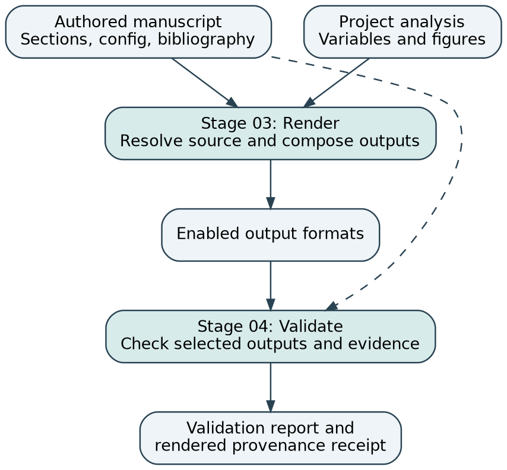

# Manuscript source and rendering

The source resolver examines the project root for a populated
`manuscript/` directory, then `docs/manuscript/`. A conventional
directory containing only configuration does not shadow authored
sections under `docs/`. The rendering and output-validation stages
use the same source resolver. Each project can select its own formats
in the manuscript configuration [@template-source].

Ordered source sections carry prose, citation keys, and figure references.
For projects that generate variables, analysis writes a machine-readable
variable map under `output/data/`; rendering can hydrate section tokens into
derived manuscript copies under `output/manuscript/`. This lets re-renders
use fresh analysis artifacts without changing authored sections. Figure
producers normally stage asset bytes under `output/figures/`, where
the renderer can find them.

{#fig:pipeline_evidence width=48% fig-alt="Authored sections and analysis outputs feed rendering. Rendered formats and authored source feed validation, which writes reports and provenance."}
