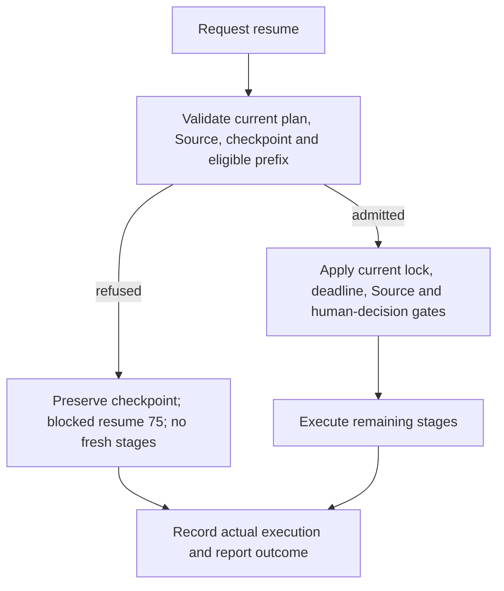

# Checkpoints and fail-closed resume

A checkpoint records local pipeline progress. It is not an acceptance receipt,
a publication grant, an analysis cache, or a human approval. Resume only reuses
an eligible completed prefix whose current identities and evidence validate.

## Run from a prepared checkout

Prepare the Root interpreter using [START_HERE](../../../START_HERE.md) first.
Run these commands from the repository root. `--no-sync --offline` prevents uv
from repairing or downloading the environment; it does not change stage policy.
Choose the actual discovered project name, not its filesystem path.

```bash
PROJECT=template_storybook

# Request verified continuation; a refusal is not an automatic fresh run.
uv run --no-sync --offline python -m infrastructure.orchestration pipeline \
  --project "$PROJECT" --mode core --resume
```

For the discovered project set, use the same admission path:

```bash
uv run --no-sync --offline python -m infrastructure.orchestration pipeline \
  --all-projects --mode core --resume
```

The [script entry point](../../../scripts/runner/execute_pipeline.py) also accepts
`--project`, `--mode`, and `--resume`. The prepared
[shell wrapper](../../../run.sh) forwards flat `--pipeline` arguments to the same
orchestrator; select a project explicitly rather than relying on an interactive
selection in automation.

Exported, non-Git inputs must provide an explicit `SOURCE_DATE_EPOCH` when build
identity requires it. Missing preparation is an admission error, not permission
to use a test clock, alter evidence, or bypass the requested resume.

## Admission and execution



Validation covers the current schema, typed stage history, stable stage keys,
exact plan and Source bindings, consumed inputs, stable output identity, and
applicable receipt/tool-reuse requirements. A file that parses successfully is
not sufficient. Recorded analysis completion does not authorize numerical
analysis reuse; the analysis/tool capability guards can require a fresh run.

The originating run ID is retained for admitted continuation. Any pending human
decision must independently match its run, plan, and stage. A checkpoint cannot
approve it, and another run's approval is not a substitute.

## Storage and authority

`PROJECT_DIR` is the actual discovered project directory. Canonical public
exemplars live under `projects/templates/`; other layouts may differ.

| Record | Location and meaning |
| --- | --- |
| Checkpoint | `<runtime_output_dir>/.checkpoints/pipeline_checkpoint.json`; defaults to `<PROJECT_DIR>/output/.checkpoints/pipeline_checkpoint.json` for ordinary execution. |
| Execution outcome | `<runtime_output_dir>/.pipeline/execution.json`; records actual completion, exit status, stage outcomes, and diagnostics. A blocked resume is incomplete. |
| Deliverables | `<PROJECT_DIR>/output/`; independently fingerprinted for checkpoint reuse even when runtime metadata uses a separate namespace. |

Use the actual runtime namespace when one is selected. Do not confuse an old
checkpoint or execution record with another run's current outputs. A refused
project-lock attempt must not overwrite an active holder's execution record.

Checkpoint writes use confined atomic replacement. Save failures are reported
and leave resume unavailable for that progress; they do not make an unpersisted
stage reusable. Invalid or unsafe loads return no admitted checkpoint and
preserve the original file. Successful execution does **not** imply that the
checkpoint file has been deleted: presence is neither failure nor reuse proof.

## Current checkpoint contract

The runtime owns schema version `4`; do not manufacture or edit its payload.

| Fields | Required interpretation |
| --- | --- |
| `schema_version` | Exact supported integer schema, not a boolean or an unversioned legacy record. |
| `pipeline_start_time`, `checkpoint_time` | Nonnegative finite measurements. |
| `last_stage_completed`, `total_stages`, `stage_results` | Consistent counts and ordered completed-prefix records; the prefix count is not a zero-based stage index. |
| `plan_digest`, `source_digest`, `run_id` | Bound execution contract and originating run identity. Copying values into a new file does not establish current admission. |
| `output_digest` | SHA-256 identity of stable deliverables; a nonempty completed prefix needs the recorded identity to match current outputs. |
| Stage status and `context` | Stable stage key, consumed-input identity, genuine child/attempt history, completion classification, and required validated receipts. Cached or skipped status is not self-authorizing. |

Inspect the original record without changing it:

```bash
PROJECT_DIR=projects/templates/template_storybook
uv run --no-sync --offline python -m json.tool \
  "$PROJECT_DIR/output/.checkpoints/pipeline_checkpoint.json"
```

For library consumers,
[`CheckpointManager`](../../../infrastructure/core/runtime/checkpoint.py)
accepts `project_dir`, explicit `checkpoint_dir`, and independent `output_dir`.
`load_checkpoint()` is a confined data read; `checkpoint_exists()` means the
record is loadable, not that current resume is authorized.
`load_validated_checkpoint()` and `validate_checkpoint()` require the expected
plan/Source bindings installed by the pipeline executor. Do not derive those
expected bindings from the untrusted checkpoint being checked. `save_checkpoint`
and `clear_checkpoint` are explicit low-level operations, not recovery bypasses.

## Refusal and deliberate fresh execution

For a missing, corrupt, legacy-schema, mismatched, or otherwise ineligible
checkpoint, retain its bytes, execution record, diagnostics, and original child
streams. Inspect the refusal before deciding whether continuation remains valid.
Changing Source, dependencies, inputs, outputs, or the requested stage plan can
invalidate a previously usable checkpoint.

A refused resume returns blocked status `75` without silently rerunning stages.
It can still write the actual blocked execution outcome and run report
finalization. Do not delete the checkpoint, clear an active lock, fabricate a
receipt, or loop with automatic retries to force acceptance.

If the work's owner explicitly chooses a new execution, preserve the old evidence
and run a **separate command without `--resume`**:

```bash
uv run --no-sync --offline python -m infrastructure.orchestration pipeline \
  --project "$PROJECT" --mode core
```

Fresh execution can replace project outputs and progress records. A failed stage,
missing provider, timeout, or pending approval remains its actual outcome; fresh
execution is not a waiver of those requirements.

## Implementation and recovery references

- [Checkpoint schema, confined persistence and validation](../../../infrastructure/core/runtime/checkpoint.py)
- [Resume admission and completed-prefix checks](../../../infrastructure/core/pipeline/resume.py)
- [Exact-plan execution, lock ownership and reporting](../../../infrastructure/core/pipeline/execution_session.py)
- [Operational recovery runbook](../runbook.md)
- [Troubleshooting](../troubleshooting/)

