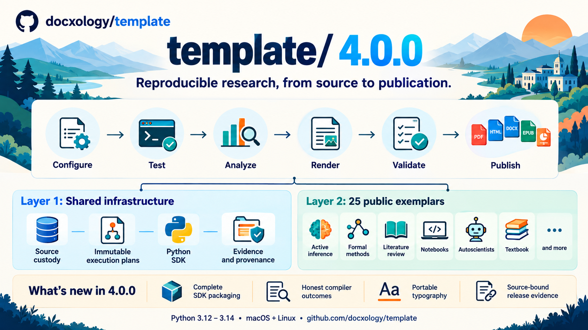

# Research Project Template 4.0.0

**Unpublished historical candidate.** These notes preserve the prepared
4.0.0 update. No 4.0.0 root release was published; current release intent
is listed in the [release-note index](README.md). The following assets and behaviors were planned
for that candidate and do not assert completed acceptance or publication.

`template/` is an open-source platform for reproducible research. Layer 1 supplies
shared infrastructure, a Python SDK and provenance. Layer 2 supplies 25 public
exemplars covering code and prose projects, active inference, formal methods,
literature synthesis, notebooks, autonomous experiments, textbooks and more.
The declared pipeline connects configuration, tests and analysis to validated
PDF, HTML, DOCX, EPUB and slide outputs.

## Changes in 4.0.0

- **Immutable execution and custody:** resolved stage contracts bind plans,
  source, recursive inputs, runtime selection and bounded child outcomes. The
  selected interpreter freezes admitted provider roots for execution and coverage
  validation. Cache
  and checkpoint reuse refuse stale or incompatible evidence. PDF hydration may
  refresh only its two named generated metadata records; research datasets and
  manuscript inputs keep their existing immutable custody.
- **Complete SDK distributions:** root wheels and source exports preserve every
  authored SDK member, native source and typing marker, with exact source bytes
  and complete RECORD validation. Local native build products stay outside the
  authored package surface. Root runtime version follows package metadata.
  The release publishes the wheel tested by the installed matrix and verifies
  every distribution's exact bytes before upload and after retrieval.
- **Honest rendering outcomes:** a failed final compiler process or invalid PDF
  fails the stage. Recovery counts only after its compiler succeeds and the PDF
  validates. Formal and notebook manuscripts resolve the installed JuliaMono
  family while retaining Unicode and mathematical content.
- **Genuine release evidence:** runtime, coverage, installed-wheel, clean export,
  native format, portable pipeline, live tool/model and hosted transfer evidence
  are bound to the candidate source. Readers preserve original exits and refuse
  omitted, stale or altered observations. Hosted release handoffs authenticate
  repository, workflow run, artifact bytes and exact source revision.
- **Portable preparation:** hosted producers and readers use immutable public
  fixture revisions, identical genuine seeded benchmark bytes, source-pinned
  submodules and authenticated native tools. Formal may consume a pinned TLC jar
  through an explicit external provider without adding it to authored exports.
  The selected local model runs in an owned temporary loopback process group.

- **Verified dependency preparation:** locked security fixes update pypdf,
  urllib3, virtualenv and Werkzeug. Counts and static health prepare Advanced's
  declared Meta engine as a genuine wheel with the selected locked backend.
  The replaced upstream TLC asset retains exact hash and size checks; its
  internal TLC2.0 build identity is recorded separately from the download tag.

## Runtime and release boundary

Python **3.12, 3.13 and 3.14** are supported; Python 3.14 remains the local default.
Required macOS and Linux observations, the complete public project matrix and
unchanged coverage floors gate publication. Local-model workflows require a
prepared selected model; they do not imply access to paid providers. Formal
finite models and native/reference checks retain their documented scope and do
not establish universal correctness or accessibility certification.

The release workflow attaches the root wheel, source distribution, this
illustration and `template-v4.0.0-artifacts.json`. The manifest binds their
SHA256 hashes to the accepted source and installed-wheel receipt. Its published
release links identify the exact accepted commit and hosted acceptance run. Per-exemplar historical publication versions and DOI
records remain distinct from this root platform version.

Repository: [docxology/template](https://github.com/docxology/template).
