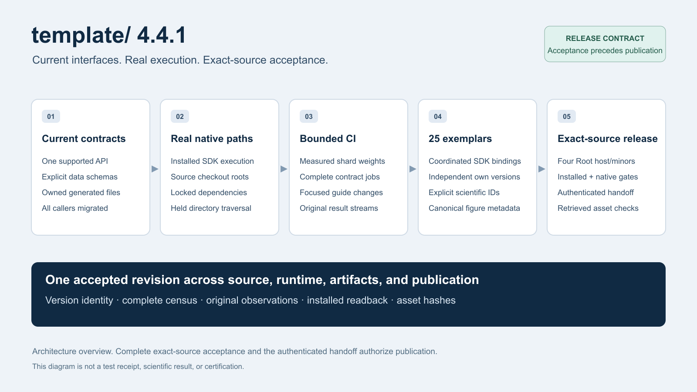

# Research Project Template 4.4.1

Historical unpublished preparation, superseded by [4.5.0](v4.5.0.md).
The implementation described here is carried forward, not a published release.

4.4.1 completes the current implementation and release path after the unpublished
4.4.0 candidate. The existing `v4.4.0` tag is preserved. Root package metadata,
all 25 exemplar SDK requirements, lock roots, and publication platform bindings
move together through the reviewed coordinated patch transaction. Exemplar own
package versions remain independent.

The [editable overview source](template-v4.4.1-overview.svg) illustrates the
release contract; it does not establish acceptance or publication.

## Current interfaces

- Agent discovery uses `.agents/` and the version-2 skill manifest's `agent_ref`.
  Memory uses canonical state and retains unrelated local runtime originals.
- Security callers use `SecurityViolation`; lexical test-policy callers use the
  structured `scan_lexical_mock_policy` result. Rendering uses its canonical CLI.
- Output validation requires `enabled_formats` and derives PDF requirements from
  the selected formats. Accessible Beamer overflow checks call the canonical
  geometry validator directly.
- The MCP server uses the 2026-07-28 per-request protocol and its discovery
  metadata contract. Requests must carry the current protocol metadata.
- Root acceptance uses the current case policy, canonical census, explicit
  prerequisites, original lane observations, and branch coverage bundle.
- Artifact manifests require explicit inventory modes. Search-cache records
  require schema and query identity. Backlog records require explicit status
  and next action. Hydration removes only unchanged files identified by its
  prior ownership manifest.
- arXiv preparation accepts its output directory, packages the canonical rendered
  TeX root or an authored manuscript TeX tree, and retains deterministic archive
  and path checks.

## Exemplar contracts

Madlib uses `CONFIGURATION_FIGURES`. Advanced literature review exposes distinct
retrieved, phase, and analyzed corpus counts. Configured hypotheses have explicit
stable IDs, knowledge-graph requests specify their task prompt, and citation
counting uses `references`. Sparse bibliographic records retain genuinely optional
fields. Figure registries declare `alt_text` directly or through the current
FigureManager metadata shape. AutoResearch uses one canonical review-packet
builder and validator for its current schema; readiness cannot grant human
publication approval.

## Installed and native execution

The render and validation entrypoints pass their source checkout root to the
independently installed SDK. Fresh-export hydration uses the shared exact locked
dependency normalization on Python 3.14 and 3.15. Mermaid execution uses the
admitted package profiles and real browser controls. Source-manifest traversal
reuses held directory descriptors while retaining file, inode, replacement,
no-follow, and directory-closure checks.

## Test and CI execution

Guide-only pull requests omit the exemplar matrix while retaining complete
documentation contracts. Functional shards use measured durations for job count
and balancing; file sizes only balance work when measurements are absent.
Contract modules execute serially within independent parallel jobs, preserving
one original collection and result stream per module. Repeated structural tests
and superseded producer tests are removed; distinct timeout, exit, coverage,
custody, and replay controls exercise the current implementation.

Ubuntu preparation supports the reviewed Azure and EC2 regional mirror lists
while retaining signed repositories, strict file custody and atomic priority
updates. Its small byte-policy suite runs in the regular infrastructure
baseline. The vendored skills lock records the existing formatting overlays,
and installed-acceptance fixtures declare the current Root policy explicitly.

## Release contract

The publication gate requires each audit child to exit successfully, validates
its current report structure and project identity, and records the original exit
in its per-project receipt. Passing JSON cannot override a failed process.

Publication is a manual exact-tag handoff requiring a successful same-repository
Required acceptance run, its exact complete artifact, and the aggregate receipt
SHA-256. The independently installed reader revalidates the candidate before
wheel/source distribution admission. Publication then verifies downloaded asset
bytes. The workflow has one current release path.

This source describes the prepared candidate. Only the successful exact-revision
hosted acceptance and authenticated GitHub Release establish delivery; local test
results, generated counts, illustrations, and metadata do not substitute for them.
