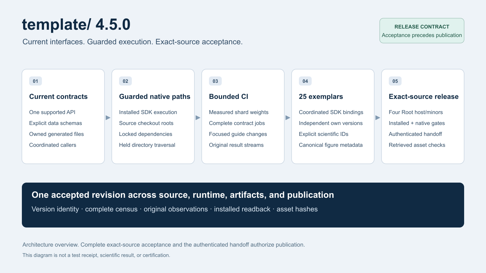

# Research Project Template 4.5.0

4.5.0 is the current minor release candidate. It absorbs the unpublished 4.4.1
preparation and adds the native-execution guard and bounded-diagnostics work that
followed it. Root metadata, all 25 canonical exemplar SDK requirements, lock roots
and manuscript platform bindings move together; exemplar package and publication
versions stay independently owned.

Date: 2026-11-01.



The [editable diagram](template-v4.5.0-overview.svg) illustrates the release
contract. It is not an acceptance receipt, a test result or a publication record.

## Coordinated metadata preparation

`pyproject.toml` declares 4.5.0, and `infrastructure/_version.py` keeps its single
metadata provider that reads the root package version instead of maintaining an
independent constant. `CITATION.cff`, the `CHANGELOG.md` heading, this note and the
release artwork move with it.

Every canonical exemplar declares `research-project-template==4.5.0` and
`platform_version: "4.5.0"` in its manuscript publication binding, and each
exemplar `uv.lock` root record is refreshed accordingly. Exemplar own package
versions, DOIs, provider declarations and declared Python floor are unchanged by
the metadata step.

4.4.1 was prepared but never tagged or published, so 4.5.0 carries its
implementation rather than shipping it twice. The existing `v4.3.0` and `v4.4.0`
tags remain where they are; neither is moved, reused or retroactively released.

## Current interfaces, carried forward

[4.4.1](v4.4.1.md) consolidated one interface per responsibility. This release
retains that consolidation instead of restoring compatibility shims:

- Agent discovery reads `.agents/` and the version-2 skill manifest's `agent_ref`.
  `.cursor/` and `.cursorrules` are removed; the latter was already a deprecated
  compatibility pointer rather than an authority.
- `infrastructure/rendering/render_all_cli.py` and
  `infrastructure/reporting/release_readiness_pipeline.py` are removed with no
  remaining caller in the tree. Rendering runs through the canonical
  `infrastructure.rendering` stage implementation, and release readiness through
  `infrastructure.reporting.release_readiness`.
- Output validation requires explicit `enabled_formats` and derives PDF
  requirements from the selected formats. Artifact manifests declare their
  inventory mode; search-cache records carry schema and query identity.
- Installed render and validation entrypoints resolve the source checkout instead
  of treating the installed SDK directory as the exemplar workspace.
- Code analysis and Experiment Tree hydration require their declared SDK. A
  missing or broken import fails rather than reporting degraded success, and Code
  analysis completion requires a persisted validation report.
- AutoResearch uses one review-packet builder and validator. Readiness never
  substitutes for human publication approval.

## Native execution guards

- PDFium Source verification is consolidated inside the opening and closing source
  guards, so a restored or substituted file still fails the closing check.
  `infrastructure/project/pdfium_fixture_preparation.py` prepares Source-locked
  public wheel DATA and is explicitly not native execution authority.
- `infrastructure/reporting/native_worker_startup_diagnostics.py` adds
  Source-owned inline worker diagnostics with fixed begin/returned/raised phases.
  The record budget is bounded at 96 records, 32 KiB total and 512 bytes per
  record, and anchored frames are DATA rather than custody.
- No public native API gains an arbitrary callback or new admission authority, no
  deadline is increased, and diagnostics never replace the original supervisor
  custody. A missing or dropped record stays unknown rather than being inferred.
- These changes are instrumentation. They do not establish native success, and
  they do not by themselves localize the deadline overrun recorded below.

## Test ownership and CI

- Ubuntu mirror preparation used by the acceptance documents moved into
  `.github/actions/setup-acceptance-documents/ubuntu_apt_mirrors.py` with its own
  control suite (`tests/infra_tests/core/test_ubuntu_apt_mirrors.py`). Supported
  regional mirrors are validated without relaxing signed repositories, strict file
  custody or atomic priority updates.
- Root source and runtime controls gained dedicated suites
  (`tests/infra_tests/project/test_root_source_controls.py`,
  `tests/infra_tests/project/test_root_runtime_controls.py`), and hydration script
  ownership gained its own control
  (`tests/infra_tests/rendering/test_pipeline_hydration_scripts.py`).
- Native guard and diagnostic controls are owned by their producing modules
  (`tests/infra_tests/reporting/test_native_pdfium_runtime_guard.py`,
  `test_native_pdfium_verify_current.py`, `test_native_source_wheel_guard.py`,
  `test_native_worker_execution_diagnostics.py`,
  `test_native_worker_startup_diagnostics.py`).
- Tests for retired interfaces were removed with them
  (`test_pipeline_override_scripts.py`, `test_render_all_cli.py`). No behavioural
  control was deleted to make a suite pass.

## Regenerated public evidence

All 25 canonical exemplars had their publication outputs and rendered provenance
regenerated against 4.5.0 sources. Against `main`, this release branch changes
1,349 files: 1,305 modified, 36 added and 8 removed, of which 1,028 are exemplar
trees.

Provenance refresh is not re-measurement. The retained coverage percentages and
dates still bind the measured inputs they were produced from, and a provenance
receipt binds its exemplar's sources and configuration plus the tracked stage
implementation under `infrastructure/` and `scripts/`. Editing either tree
invalidates that exemplar's receipt until its producers run again.

## Retained contracts

- The canonical public output ceiling stays
  `PUBLIC_TEMPLATE_OUTPUT_MAX_TOTAL_BYTES = 224 MiB`
  (`infrastructure/project/git_guards.py`), enforced by
  `scripts/audit/check_tracked_generated_artifacts.py`.
- Root publication still requires one successful same-repository
  `platform-required-acceptance.yml` run at the tagged revision, its exact
  `platform-required-acceptance` primary artifact ID, and the logical aggregate
  receipt SHA-256 over `output/readiness/release-candidate/receipt.json`.
- The installed matrix remains 52 cells: the root plus the 25 exemplars on Python
  3.14 and 3.15, with a lock's exact sdist nominated offline and hash-verified when
  its wheels cannot serve the target minor.
- Every canonical exemplar keeps its forkable surface and its `[tool.template]`
  contract (`platform_version`, `tested_python_versions`,
  `required_unpaid_capabilities`).

## Upgrade notes for projects

Projects declare the SDK they build against through
`[tool.template].platform_version` and the
`research-project-template==<version>` requirement. Both now read 4.5.0, and each
`manuscript/config.yaml` publication binding declares `platform_version: "4.5.0"`.

Re-pin from any 4.4.x value and run `uv sync --locked`. A project's own package
version, publication version and DOI are independent of this number and are not
changed by the metadata step. No third-party requirement changes with it; a project
that pins `torch`, `triton`, `cuda-bindings` or `hypothesis` keeps whatever lock
record it already resolved.

## Verification and publication state

This note records release intent. No `v4.5.0` tag or GitHub Release exists, and
nothing here claims acceptance, native success or publication.

Checks executed against this exact source on 2026-11-01:

```bash
uv run --no-sync --offline python -m infrastructure.publishing.root_release_contract --tag v4.5.0  # pass
uv run --no-sync python scripts/audit/check_release_versions.py                                     # pass, root + 25 exemplars
uv run --no-sync python scripts/audit/lint_docs.py --json --repo-root .                             # 0 broken links, 0 consistency issues
uv run --no-sync python scripts/audit/check_template_drift.py --strict                              # no drift
uv run --no-sync python scripts/docgen/status_evidence.py --check                                   # OK after regeneration
uv run --no-sync python scripts/docgen/exemplar_roster.py --check                                   # OK, 25 exemplars
uv run --no-sync python scripts/docgen/api_reference.py --check                                     # up to date, 28 packages
uv run --no-sync python scripts/docgen/active_projects.py --check                                   # OK, 25 projects
uv run --no-sync python scripts/docgen/publication_records.py --check                               # in sync
uv run --no-sync python scripts/docgen/stage_table.py --write                                       # up to date, 7 targets
uv run --no-sync python -m infrastructure.skills check                                              # ok
uv run --no-sync python -m infrastructure.skills check-contracts                                    # ok
```

Not run for this revision, and therefore not claimed:

- `scripts/docgen/counts.py --check`. Its coverage-provenance validation passes
  against this source, so `docs/_generated/coverage_snapshot.json` still binds the
  measured inputs. The live collection comparison is what is blocked: collection
  in this worktree needs the genuine `template-literature-meta-analysis` provider
  wheel in the root test environment (`P4-ADVANCED-PROVIDER-CI-1`), and without it
  `template_advanced_literature_review` fails collection. The gate is blocked by
  the environment, not satisfied.
- `scripts/docgen/architecture_overview.py --check`; `mmdc` is unavailable here.
- The full infrastructure and exemplar suites, the 52-cell installed matrix, the
  native preflight, and `platform-required-acceptance.yml`.

Recorded blockers:

- Native preflight run `41195432366` failed under the unchanged 900-second
  operation deadline at development head
  `b37e77ee8a2bd48cbf3b048f0280667a6e091fe6`. Artifact `13040473873` is
  authenticated against that run and head with SHA-256
  `762234ee4cba1a3c26e0656df56a001211e8394ddca8ea8af49be478b7dd19b4`. The worker
  entered execution with 206.754 seconds remaining, the real Node probe completed
  successfully, and **137.030 seconds after that operation remain unlocalized**.
  Node completion does not establish ToolAPI retention, Mermaid admission or
  PDFium entry.
- Hosted required acceptance on main
  `8227dc8e805ea0f950125b974abf226cdeb7419d` failed on 2026-10-30: Root policy
  admission was stale, project runtime hydration failed on Python 3.15, and native
  rendering selected the installed SDK directory. Installed and export
  verification completed before the runtime failure.
- The latest published root release remains `v3.8.0`. `v4.3.0` and `v4.4.0` exist
  as tags without GitHub Releases, and 4.2.0 and every 4.x candidate after 3.8.0
  remain unpublished.

Acceptance evidence required before any tag:

| Handoff field | Required source |
| --- | --- |
| `acceptance_run_id` | one successful same-repository `platform-required-acceptance.yml` run at the frozen release revision |
| `acceptance_artifact_id` | that run's exact `platform-required-acceptance` primary artifact |
| `acceptance_receipt_sha256` | SHA-256 of that run's logical aggregate `output/readiness/release-candidate/receipt.json` |

The primary archive must contain `candidate-index.json` binding the exact source,
that receipt and every ordered `platform-required-acceptance-shard-NNNN` artifact.
The installed reader revalidates the indexed collection and its logical readiness
bytes; a flat rebuilt archive or an index alone cannot replace that admission. Only
then does `release.yml` accept the handoff:

```bash
gh workflow run release.yml --repo docxology/template --ref v4.5.0 \
  -f tag=v4.5.0 \
  -f acceptance_run_id="$ACCEPTANCE_RUN_ID" \
  -f acceptance_artifact_id="$ACCEPTANCE_ARTIFACT_ID" \
  -f acceptance_receipt_sha256="$ACCEPTANCE_RECEIPT_SHA256"
```

Verify the remote commit ID, the retrieved artifact hashes, publication
identities, licenses and working URLs afterwards. A matrix subset, ordinary CI
result, later commit or rebuilt wheel cannot substitute for that tuple. Local
results, generated counts and this document do not either.

See [the release boundary](../maintenance/release-boundary.md) for the ordered
procedure and [STATUS.md](../../STATUS.md) for the current subsystem record.
