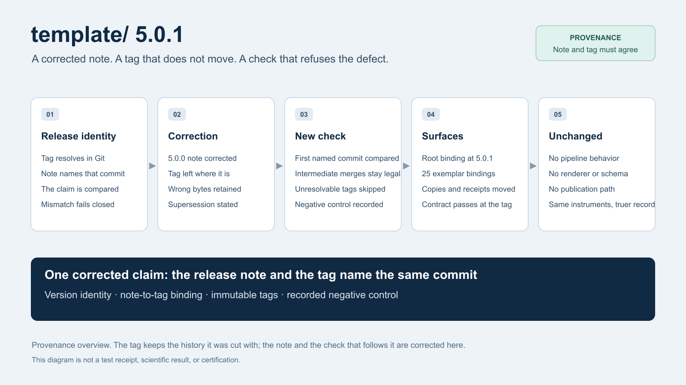

# 5.0.1 — release notes

Cut from the `v5.0.1` tag: the tagged commit is `git rev-parse v5.0.1^{commit}`, the merge of the
release-train pull request that carries this note into `main`. This release carries one correction
and one new check, and it changes no behavior.

## What the `v5.0.0` note got wrong, and what 5.0.1 does about it

The `v5.0.0` tag is `e932a5d2a4f5c75f354352b43e54039eac9f63cf` (annotated tag object
`9829f410cf1d4edddcefb5374363f11ef366044d`), the merge of pull request `#223`. The copy of
[`v5.0.0.md`](v5.0.0.md) that the tag carries names
`c5af32a18560ca12267484b182a94b826b47cf47` as the tagged commit. That commit is the `#215` merge:
an intermediate release-train merge, 44 commits before the tag, with `#204`, `#212`, `#213`, `#216`
and `#219` merging after it. The note named the wrong commit.

The tag itself is **not moved and not re-cut**. Its in-tree copy of the note keeps the wrong
sentence, because an immutable tag names one revision and stops being something that can be edited
afterwards. `v5.0.1` supersedes `v5.0.0` for release-note provenance, and the corrected note is in
this tree.

[`v5.0.0.md`](v5.0.0.md) on `main` now names `e932a5d2a4f5c75f354352b43e54039eac9f63cf` as the
tagged commit and keeps `c5af32a18560ca12267484b182a94b826b47cf47` described as the intermediate
merge it is. It also states why the earlier wording was wrong, because the failure was grammatical
before it was factual: "the tagged commit" followed by an appositive colon puts the following
commit in the position that names the tag, and nothing in the repository compared that claim with
what the tag actually resolved to.

## The check that now refuses that defect

`infrastructure/project/release_versions.py` resolves the tag it is given
(`git rev-parse <tag>^{commit}`) and compares it with the **first** backticked 40-hex commit in the
release-note paragraph that claims a tagged commit — the appositive position. A mismatch is an
error finding, so the check fails closed. An intermediate merge named later in the same paragraph
is a different statement and stays allowed. A tag that cannot be resolved (a synthetic checkout, or
a tag that does not exist yet) yields no finding and remains the existing tag rule's business.

The negative control was run against the wrong paragraph before the correction, and it refused it:

```
$ uv run --no-sync python scripts/audit/check_release_versions.py --tag v5.0.0
release versions: root 5.0.0 (tag v5.0.0) + 25 exemplars
status: fail
root: [release-notes-tag-commit] v5.0.0.md names c5af32a18560ca12267484b182a94b826b47cf47 as the tagged commit but v5.0.0 resolves to e932a5d2a4f5c75f354352b43e54039eac9f63cf
```

The same checker without `--tag`, which is what a pull request runs, is unchanged by the new rule.

## Version surfaces

The root version and lock, each of the 25 canonical exemplars' publication `platform_version`
binding, and each exemplar lock move to 5.0.1. The 15 exemplars whose tracked publication copies
move were re-rendered and re-receipted; the other ten were rebound to their unchanged output bytes.
No exemplar's own package version changes, and no published behavior changes.



The [editable diagram](template-v5.0.1-overview.svg) illustrates the correction, the check and the
surfaces that moved. It is not a test receipt.

## Tooling defects observed while preparing this release

Neither is fixed here. Both are recorded because the next operator will meet them, and both are the
same shape: a failure that reports its symptom and discards its cause.

- `refresh_rendered_provenance.py --project` accepts both a bare exemplar name and the qualified
  `templates/<name>` form, but writes the name it was given into
  `output/reports/rendered_provenance.json` and `output/reports/manuscript_composition.json`. A bare
  name therefore produces receipts that the publication gate refuses with
  `PUBLICATION.RENDERED_PROVENANCE_MALFORMED: receipt project must be templates/<name>`, and a rebind
  cannot repair them because the composition file is wrong too; only a re-render with the qualified
  name can. Pass `templates/<name>`.
- A rebind that raises inside the worker pool dies as
  `concurrent.futures.process.BrokenProcessPool`, because `RenderedSnapshotError` is not picklable (its
  `__init__` requires `message`) and the pool discards the real reason. Re-running the same command
  with `--jobs 1` surfaces it directly.

## What this release does not claim

Acceptance and publication for this tag are established by the hosted lanes and the release record,
not by this note. The rendered-provenance receipts in this tree were rebound to unchanged output
bytes under the current stage closure; they record what the current inputs produce, not a change in
what the exemplars publish.
