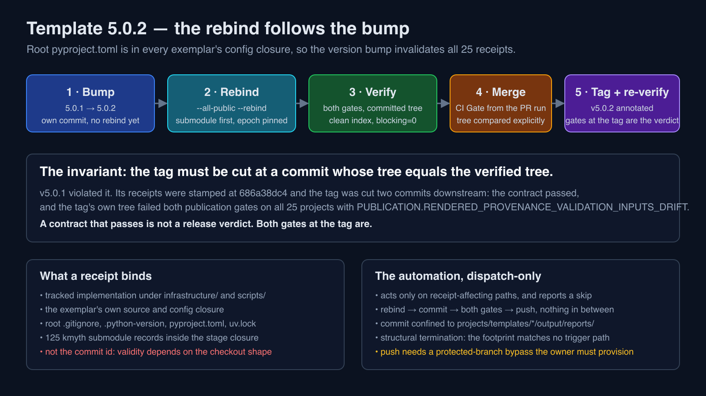

# 5.0.2 — release notes

Cut from the `v5.0.2` tag: the tagged commit is `git rev-parse v5.0.2^{commit}`. No
revision is named in this note, so the tag itself is the only authority for which
commit it is; both publication gates and `check_exemplar_configs.py` pass at that
commit's own tree. This release moves the root and exemplar metadata to 5.0.2 and
adds the automation that keeps rendered-provenance receipts current on `main`; it
changes no rendered behavior.

## The tag treadmill, and the commit a tag may be cut at

A rendered-provenance receipt binds the tracked implementation under `infrastructure/`
and `scripts/` plus its exemplar's own source and config closure. Root `pyproject.toml`
is part of every exemplar's config closure, so a lock bump, an infrastructure edit **or
a version bump** invalidates all 25 receipts without moving a rendered byte.

`v5.0.1` is the worked example. Its receipts were stamped at `686a38dc4`, while the tag
was cut two commits further downstream, after three dependency merges had rewritten
every exemplar lock. `root_release_contract --tag v5.0.1` passes, and the tag's own tree
fails `check_publication_outputs.py --all-public --strict --jobs 4` with
`PUBLICATION.RENDERED_PROVENANCE_VALIDATION_INPUTS_DRIFT` on all 25 projects. That tag
is not moved and not re-cut; 5.0.2 supersedes it for receipt provenance.

This release adopts one sentence as the invariant its ceremony must satisfy: **the tag
must be cut at a commit whose tree equals the verified tree.** The order that satisfies
it is: bump first, in its own commit, because the version bump itself moves every
receipt's config closure; rebind on top of that commit; verify both publication gates on
the committed tree with a clean index; land that through a pull request; and tag the
merge commit only when its tree is byte-identical to the verified tree — then verify
again at the tag. The tag check is not a formality: it is the check whose absence
allowed a green contract to be mistaken for a green release.

## The automation that keeps the receipts current

[`.github/workflows/rebind.yml`](../../.github/workflows/rebind.yml) restamps the receipts
as its own commit, runs both strict gates on the tree that commit contains, and pushes
only after they pass. It is dispatch-only today: `main` requires the `CI Gate` check with
`enforce_admins: true` and no bypass actors, and a status check must pass before any
change reaches a protected branch, so a commit created inside the runner has no status
that would let a direct push succeed. The file records the two-line activation and the
credential the owner would provision; until then a rebind is a dispatch.

Its first real run — dispatch `41880357931` on `main` at
`3336965136ca791f281a5f619bec428632ac47d0`, with `dry_run` at its default — took the
commit path, restamped all 25 exemplars, produced tree
`696dadb8a6a420219d4a30a7542f8386366a2d36`, reported the `kmyth` submodule pin
`cb23c6d94423cbe4f5ef0caf23594d1095ddde79`, and passed both gates on the committed tree
with `blocking=0, review_required=0`. It pushed nothing, by design.

Two properties of that run are worth stating because they were measured rather than
assumed. A rebind measured without the `kmyth` submodule reports drift that is not
there and stamps a digest other checkouts reject, so the workflow initializes
submodules before any measurement and prints the pin. And a receipt is stamped with
whatever the runner measured, so the workflow prints the measured `stage` and `config`
digests beside the ones the receipt records: the stage digest is the value every
developer must share, and it is `968b62217804a499dd8d2d398e073dc78b8a75203d14d2a7293bbbac2484d459`
at 1724 files for this release.

## What moved

The coordinated transaction, reviewed as plan SHA-256
`1915f2b47a00d4eb7437235b229bb2d8b990c0cf5306cadadf2a2517d12a7e77`, moved the root
package version and lock, and each of the 25 exemplars' SDK requirement,
`[tool.template].platform_version` binding and lock, to 5.0.2 while retaining every
exemplar's own package version. The fifteen exemplars that track a publication copy were
re-rendered and re-receipted; the other ten were rebound to unchanged output bytes. No
exemplar's published behavior changes.

## Release status

Root metadata, `CHANGELOG.md`, `CITATION.cff`, this note and its overview art declare
5.0.2, and both publication gates pass at the revision the tag names. The hosted
required-acceptance lane has **not** run at that revision, and ordinary CI is not that
lane, so nothing here establishes acceptance or publication; see the
[release boundary](../maintenance/release-boundary.md).

The [editable diagram](template-v5.0.2-overview.svg) illustrates that order and the
invariant it protects. It is not a test receipt.
