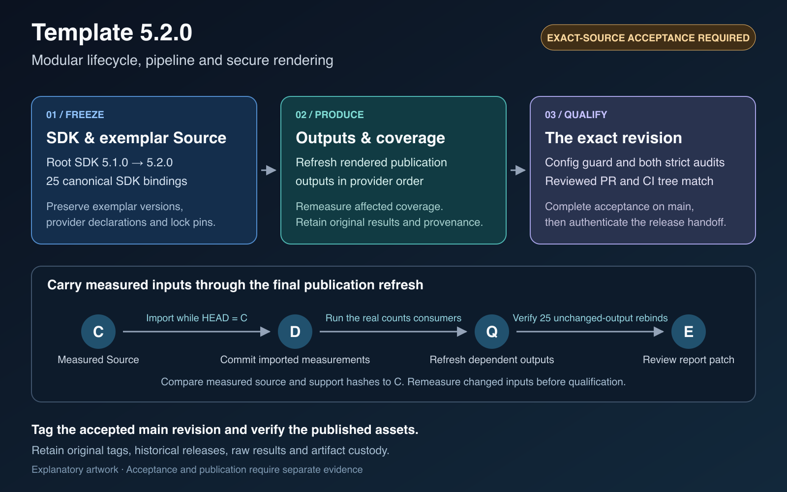

# 5.2.0 — shared pipeline ownership and confined rendering

This minor candidate coordinates the Root SDK and all 25 canonical exemplar
compatibility bindings from 5.1.0 to 5.2.0. Each exemplar keeps its own package
and publication versions, published identifiers, provider declarations and
third-party lock records. The optional docxplus dependency and Kmyth source
retain their separately owned pins. Active Inference's own lock records
`inferactively-pymdp==1.0.5`, `jax==0.11.1`, `jaxlib==0.11.1` and `tzdata==2026.2`;
the advanced literature review lock records `tzdata==2026.3`.

This candidate also incorporates the preceding [5.1.0 preparation](v5.1.0.md),
including its renderer, native custody and publication repairs. Earlier
observations retain their own Source identities; final combined 5.2.0 acceptance
requires fresh qualification.

## Source changes

- Share lifecycle traversal across projects, fonds, rules and tools. Select the
  public exemplar roster directly from its declarations so ordinary public
  selection need only inspect the declared projects.
- Consolidate stage vocabulary, target admission, worker transport, report
  validation and archive readback. Preserve canonical aliases, exact expected
  membership, child outcome custody and original archive checks.
- Render untrusted Stage 3 HTML from confined prepared Markdown and
  bibliography files. Validate the document structure and every scriptless HTML
  page before publication. Direct TeX remains available for trusted input.
- Bind live review configuration to the selected project and confine generated
  review files to its output directory.
- Bind each secure PDF and public manifest to one Git identity and timestamp.
  Use publisher-owned receipts for custom-suffix reruns. Disable signature
  verification during provenance reads, including when checkout configuration
  requests it.
- Build the Active Inference certificate and crosswalk from one claim-ledger
  projection. Regenerate its method inventory from the owning generator.
- Preserve strict guardian census behavior while observing optional process ages
  through portable POSIX elapsed-time metadata on Darwin and Linux.
- Close preview/plugin executor logging lifetimes deterministically. Retain
  complete Source/Python/tool digests on execution-identity refusal,
  without rebaselining the plan or exposing environment values.
- Bound hosted native diagnostic exports to numbered worker/case directories
  and named diagnostic files, not recursive disposable Source trees. Preserve
  actual browser-wrapper streams and outcomes before the original refusal;
  exclude fixture loops, aliases, environments and browser profiles.
- Reuse bounded immutable compilation/canonical-Code derivations only after fresh
  guarded Source consumption. Revalidate every hook, cache and declaration at each
  original admission/completion boundary; no cached admission crosses it.
- Share no-follow native Source-directory ancestor handles only within one fresh
  observation. Preserve nominated identities, search-only access, closing checks
  and every original Source/provider deadline.
- Keep offline skill-evaluation CLI controls on the selected prepared interpreter
  and an owned actual-harness copy, without synchronizing the shared SDK runtime
  or writing its public baseline during parallel frozen-Source controls.
- Run all health gates and required security scanners in the selected prepared
  Python. Verification never reconciles the shared runtime; retire UV-only health
  fixtures and incidental command/wording tests instead of repinning them.
- Treat either a strict held-custody refusal or filesystem error as a failed
  Calibre missing-member observation; preserve every production custody check.
- Require pip-api0.0.35 or newer for pip-audit on supported Python, replacing
  the older vendored parser that imports removed sre_constants. Preserve the
  installer security floor and all other locked package records.
- Retire incidental shell syntax, Source-text, forwarding and dry-run wording
  tests; retain actual root-resolution, listing and execution-refusal contracts.

## Local evidence and release requirements

The refactor was exercised locally on the 5.1.0-based development lane before
the 5.2.0 metadata and generated publication refresh. The matched 499-case
regression suite, the supported 358-case CLI, CI, worker and reporting cohort,
349 rendering and steganography tests, the separate isolated base-install
probe, and 21 focused Active Inference tests passed. Public lint and format,
strict typing, module limits, export and catalog checks, and the scoped
rendering and steganography Bandit scan passed. Real Pandoc and pdfLaTeX
controls exercised out-of-root refusal, and secure-PDF and manifest reruns
produced byte-identical outputs.

The broader offline runs reproduced a baseline report-finalization timeout and
hit process-inspection restrictions for five cleanup cases. The supported
regression count excludes those five cases. Local fixture evidence covers the
tested paths and belongs to its measured development revision. Complete native,
installed, coverage and hosted acceptance evidence for final 5.2.0 is pending.

Later scoped repairs were exercised with real Darwin/Linux process-age
boundaries, frozen health/executor/CLI admission consumers on both supported
Python minors, and the complete native browser controls plus fresh/resume CLI
on Darwin. Their original failures and separate Source identities remain part
of the evidence. Focused success does not replace complete hardening, genuine
PDFium completion, final Root policy, installed-runtime or exact-main acceptance.

The coordinated metadata changes have genuine release-profile measurements for
all canonical exemplars and dependent publication receipts from preceding frozen
5.2.0 Sources. Compare the final Source's actual project-input and measurement-
support tuples with those original payloads: remeasure changed scopes, retain
unchanged original cohorts, and never restamp an old producer's Source identity.
Run the real publication producers for every required canonical scope, including
Pitch analysis before its refresh. Regenerate outputs that consume imported
counts, then perform the all-project unchanged-output rebind and strict
committed-tree audits against the final current Source.
The [release boundary](../maintenance/release-boundary.md) records the source
freeze, producer order, reviewed integration and exact-main acceptance gates.

After the required acceptance succeeds on final `main`, resolve the matching tag
with `git rev-parse --verify 'v5.2.0^{commit}'`. The tag must name the accepted
commit and verified tree. The release workflow adds the authenticated source,
run, artifact and receipt identities to the published release notes.

## Release overview

The [editable SVG](template-v5.2.0-overview.svg) illustrates the required
sequence. Use the actual workflow receipts to verify each completed step.
