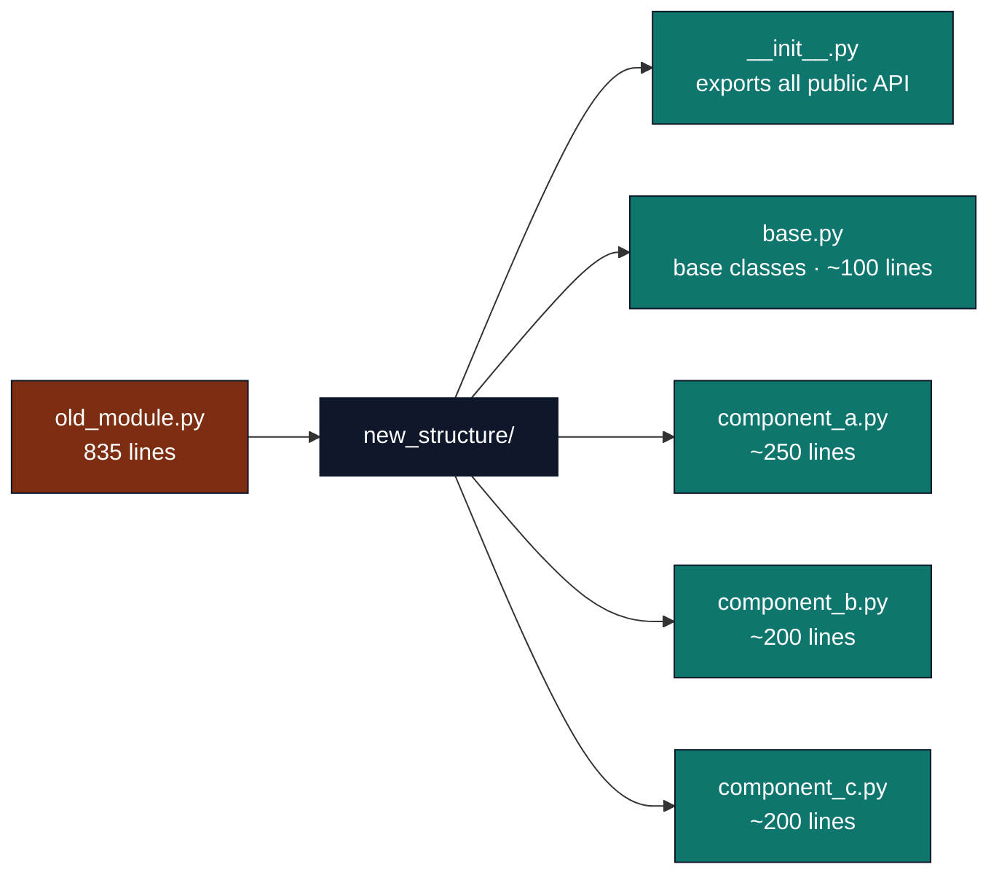

# Refactoring Standards

## Current implementation contract

Refactoring replaces the implementation and migrates its callers in one change.
Keep one supported entrypoint for each operation. Remove superseded wrappers,
parallel implementations, and unused files after all callers have migrated.
Document the resulting API and release impact directly.

### Declared public exports

Package `__init__.py` exports are legitimate APIs when their declared
`__all__` exposes the current implementation. Migrate callers to implementation
modules before deleting redundant facades. Publishing implementations and
their supported exports are documented in
[`infrastructure/publishing/AGENTS.md`](../../infrastructure/publishing/AGENTS.md).
Retired interfaces remain documented in release history, rather than current
usage guidance.

### Refactoring Process

When modularizing or restructuring:

1. **Create new modular structure** with clear separation of concerns
2. **Delete replaced files completely** after migrating every caller
3. **Update ALL imports** across the entire codebase immediately
4. **Update ALL tests** to use new imports
5. **Update ALL documentation** (AGENTS.md, README.md, docstrings)
6. **Run full test suite** to ensure nothing breaks
7. **Commit as single atomic change** with clear migration notes in commit message

### File Organization Best Practices

**Maximum file length**: aim for ≤600 lines as a soft target. The enforced
`module_line_count` gate (`infrastructure/validation/line_count.py`,
`DEFAULT_INFRA_THRESHOLDS`) warns at **800** lines and fails at **950** lines for
infrastructure code (project scripts: warn 150, fail 250).

**When to split a file**:

- Multiple independent classes/functions that could be separate modules
- Mixed concerns that would benefit from separation
- File approaches the gate thresholds (800 warn / 950 fail for infra code; exceeding the fail threshold blocks the module-line-count gate) — negative control: `tests/infra_tests/validation/test_line_count.py::test_scan_line_counts_warn_and_fail` feeds a 960-line infra module and asserts it lands in the failures list
Exceeding the fail threshold fails the gate outright; the warn threshold only invites refactoring review.
These are enforcement numbers: a module over 950 lines fails the gate, while anything between the 800-line warn level and the ceiling emits warnings without blocking.

**How to split**:



### Import Updates

**Before refactoring**, search for all imports:

```bash
rg "from old_module import" .
rg "import old_module" .
```

**After refactoring**, update all imports:

- Infrastructure modules
- Test files
- Scripts
- Documentation examples

### Documentation Updates

Update in this order:

1. Module docstrings in files
2. `__init__.py` exports with clear API
3. `AGENTS.md` with new architecture
4. `README.md` with new import examples
5. Any inline code examples in documentation

### Testing During Refactoring

1. **Before**: Capture current behavior with characterization, edge-case, and
   negative-control tests; meet the applicable project/infrastructure coverage
   gate without treating a percentage as proof of semantic completeness
2. **During**: Update tests to import from new locations
3. **After**: Run full test suite with coverage report
4. **Verify**: No broken imports, all tests pass

### Commit Message Template

```
refactor: modularize [module_name] into focused submodules

BREAKING CHANGE: Split [old_file.py] into [new_structure/]

- Created new modular structure with clear separation
- Moved [Component A] to [new_location]
- Moved [Component B] to [new_location]
- Updated all imports across codebase
- Updated all tests
- Updated documentation (AGENTS.md, README.md)
- All tests passing with maintained coverage

Migration guide:
- OLD: from module.old import Thing
- NEW: from module.new.things import Thing
```

## Modularization Checklist

Before marking refactoring:

- [ ] New modular structure created
- [ ] Old file(s) deleted completely
- [ ] All infrastructure imports updated
- [ ] All test imports updated
- [ ] All script imports updated
- [ ] All documentation examples updated
- [ ] `__init__.py` exports public API clearly
- [ ] AGENTS.md reflects new structure
- [ ] README.md has updated examples
- [ ] Full test suite passes
- [ ] Test coverage maintained or improved
- [ ] No linter errors introduced
- [ ] Commit message documents migration

## See Also

- **[Development Standards](README.md)** — Rule index
- **[Rules AGENTS](AGENTS.md)** — Rules for AI agents
