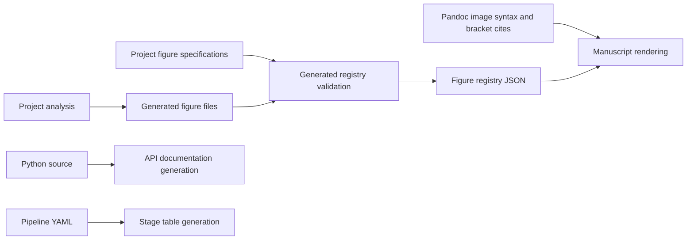

# Documentation Module

Figure metadata, generated-figure registries, and source-derived documentation
for reusable research workflows. Project code owns scientific computation and
plotting; this package validates file inventories and maintains documentation
from declared inputs.

## Architecture



## Module map

| Module | Responsibility |
| --- | --- |
| `figure_manager.py` | Register, retrieve, and persist label-indexed figure metadata. |
| `generated_figure_registry.py` | Validate actual generated files against project-owned specifications and publish registry JSON. |
| `glossary_gen.py` | Parse source APIs and render glossary tables. |
| `api_reference_gen.py` | Resolve declared public package exports into the infrastructure API reference. |
| `stage_table.py` | Derive the pipeline stage table and summary from the canonical YAML DAG. |
| `counts_doc.py`, `counts_coverage.py` | Derive measured counts and source-bound coverage facts. |
| `active_projects_doc.py`, `architecture_overview.py` | Derive public project and architecture documentation. |
| `publication_records.py`, `publication_standalone.py` | Maintain publication records and standalone identity blocks. |
| `backlog.py`, `backlog_normalizer.py` | Validate and normalize future-work contracts. |
| `doc_module_refs.py` | Check documentation references against real infrastructure modules. |

## Pipeline-generated figures

Declare a project's labels, basenames, captions, and qualified generator names
in its own figure specifications. Pass the actual files emitted by that run to
the supported publisher:

```python
from infrastructure.documentation import publish_generated_figures

written = publish_generated_figures(
    output_dir,
    PROJECT_FIGURE_SPECS,
    generated_paths,
    schema_version="my-project-figure-registry-v1",
)
```

The publisher validates the complete source set before creating the destination,
mirrors the files, and writes `figure_registry.json`. Missing or deleted files,
duplicate labels or basenames, empty captions, empty generator names, and an
empty schema identifier raise `FigureRegistryError`. The registry writer stores
`alt_text` under `metadata.alt_text` when the specification supplies it.

Use `build_generated_figure_registry()` to inspect a validated payload, or
`write_generated_figure_registry()` when the files are already at their intended
destination. [Visualization Guide](../../docs/usage/visualization-guide.md)
contains a complete figure-generation example and accessibility checks.

## Figure metadata

`FigureManager` is the metadata registration API used by interactive and
project-owned figure workflows:

```python
from infrastructure.documentation import FigureManager

manager = FigureManager("output/figures/figure_metadata.json")
metadata = manager.register_figure(
    filename="results.png",
    caption="Measured objective value across iterations.",
    label="fig:results",
    section="Results",
    generated_by="project.analysis:generate_results",
)
assert manager.get_figure("fig:results") == metadata
all_records = manager.get_all_figures()
markdown_inventory = manager.generate_figure_list()
```

Registration persists metadata automatically. A newly constructed manager loads
its registry; corrupt JSON or malformed metadata is backed up before the
manager starts a fresh registry. `FigureMetadata.to_dict()` and `from_dict()`
provide the existing metadata serialization contract. Registry identifiers are
internal records; pandoc-crossref assigns visible manuscript figure numbers.

For pipeline publication, use the generated-registry APIs to validate the actual
files. `FigureManager` stores metadata and does not establish that a referenced
image was emitted by the current analysis run.

## Manuscript images and references

Author manuscript figures with Pandoc image syntax:

```markdown
{#fig:results width=80%}

[@fig:results] shows the optimization trajectory.
```

Paths are relative to the manuscript source. Keep labels aligned with the figure
specification and inject changing caption statistics from the same analysis
outputs that produced the plot. See [Image Management](../../docs/usage/image-management.md)
and [Manuscript Semantics](../../docs/guides/manuscript-semantics.md).

## API documentation

`build_api_index` derives signatures and docstrings from Python source;
`generate_markdown_table` formats the resulting `ApiEntry` records:

```python
from infrastructure.documentation import build_api_index, generate_markdown_table
from infrastructure.documentation.glossary_gen import inject_between_markers

entries = build_api_index(source_dir)
table = generate_markdown_table(entries)
updated_text = inject_between_markers(
    text=original_text,
    begin_marker="<!-- API_GLOSSARY_BEGIN -->",
    end_marker="<!-- API_GLOSSARY_END -->",
    content=table,
)
```

Marker-based generation replaces only the owned block and preserves surrounding
authored prose. Generate a project glossary with explicit source and destination
arguments:

```bash
uv run python -m infrastructure.documentation.generate_glossary_cli \
  projects/templates/template_code_project/src \
  projects/templates/template_code_project/manuscript/98_symbols_glossary.md
```

### Pipeline Stage-Table Generator
- `stage_table.build_stage_table(yaml_path)` - Render the canonical
  pipeline stage table from `infrastructure/core/pipeline/pipeline.yaml`
  (4 columns: Stage | Script | Tags | Failure mode)
- `stage_table.inject_stage_table(md_path, table)` - Replace the block
  between `<!-- BEGIN:STAGE_TABLE -->` / `<!-- END:STAGE_TABLE -->`
  and the count line between `<!-- BEGIN:STAGE_SUMMARY -->` /
  `<!-- END:STAGE_SUMMARY -->`
  in a Markdown file (idempotent)
- Driver: [`scripts/docgen/stage_table.py`](../../scripts/docgen/stage_table.py)
  updates `README.md`, `.github/README.md`, `scripts/AGENTS.md`,
  `docs/RUN_GUIDE.md`, and `docs/core/workflow.md` in lockstep

### Public API Reference Generator
- `api_reference_gen.walk_public_api(package_root)` - Parse one
  `infrastructure/<pkg>/__init__.py`, extract `__all__`, resolve each
  symbol to its source-module definition (follows re-export chains),
  and return `ModuleAPI` records (name, kind, signature, summary).
- `api_reference_gen.build_api_reference_markdown(packages)` - Render
  alphabetised per-package sections — fenced Python signatures plus
  first-line docstring as prose.
- `api_reference_gen.inject_api_reference(md_path, content)` - Replace
  the block between `<!-- BEGIN:API_REFERENCE -->` /
  `<!-- END:API_REFERENCE -->` (idempotent).
- Driver: [`scripts/docgen/api_reference.py`](../../scripts/docgen/api_reference.py)
  with `--write` (apply) and `--check` (CI gate) flags. Target:
  [`docs/reference/api-reference.md`](../../docs/reference/api-reference.md).
  Drift fails the `validate` job in `.github/workflows/ci.yml`.

## Verification

```bash
uv run pytest tests/infra_tests/documentation/test_figure_manager.py tests/infra_tests/documentation/test_generated_figure_registry.py
uv run pytest tests/infra_tests/documentation/
uv run python scripts/docgen/api_reference.py --check
uv run python scripts/audit/check_template_drift.py --strict
```

Metadata tests cover real registration, persistence, lookup, and corrupt JSON.
Generated-registry controls cover missing/deleted files, duplicate specifications,
invalid inputs, deterministic writes, and publication refusal before a partial
registry can be created. See [AGENTS.md](AGENTS.md) for generated-fact and
coverage boundaries.
