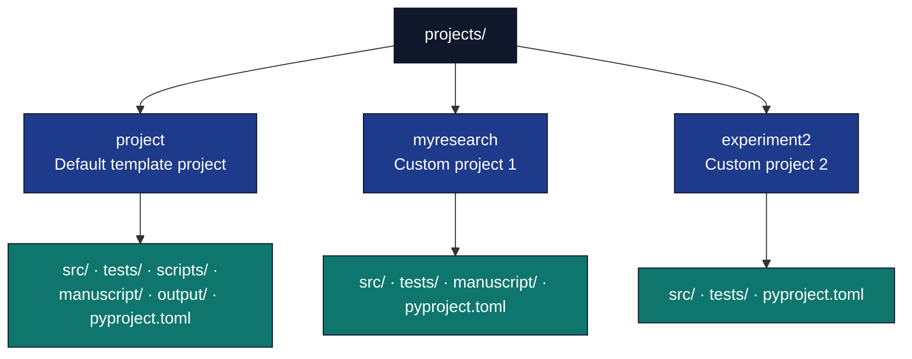

# infrastructure/project/ - Project Management Module

## Purpose

`pdfium_fixture_preparation.py` nominates one actual-platform wheel from `uv.lock`
for the genuine PDFium external-fixture controls. It requires curl 8.4.0 or newer,
disables glob expansion and redirects, and writes only a fresh external physical
scratch directory. Exact bounded hash/size verification precedes its success
receipt. Preparation is DATA, not native execution or Source acceptance.

Audited acceptance launchers suppress bytecode writes during isolated Python
startup (`-IB`), including genuine `.pth` imports before the worker body. The
existing Source audit enables writes only after validating its fresh private
cache prefix. Public imports still require executed-source and cache-byte
verification; selected runtime entries remain read-only. Payload preparation
and portable readback preserve the same exact startup flags and body positions.

Darwin print custody: `auxiliary_print_code.py` binds the actual Source-generated
worker payload to the parent-held spec/run/PID/deadline and retains executed
Code before private cache cleanup. `auxiliary_print_hosted.py` authenticates the
fixed same-run Darwin producer job/artifact using actual API/download results.
Do not construct print originals from parsed receipts or broaden Root's six
artifact roster; the live supervisor/collector owns the capability.

Literature auxiliary adapters use `public_acceptance_literature_diagnostics.py`
to export every producer original before status admission. Keep failed/blocked
receipts and request/response/execution bytes under the cell's ordinary artifact,
with the same absolute operation deadline and stable transport bounds. Error
summaries expose only bounded outcome/issue fields and retained bindings.

Disposable Pitch pipelines obtain repository facts from the complete original
Root as explicitly bound DATA. `public_acceptance_auxiliary_reference.py`
admits its actual Git HEAD and Source fingerprint with `PublicReference` under
the original auxiliary deadline, then nominates the three existing
`TEMPLATE_PUBLIC_REFERENCE_*` fields. The copied execution source still has no
Git metadata; the DATA root never becomes an import path. Preserve both the
held reference's final unchanged check and Pitch's `ReferenceSession` closure.
Missing or conflicting source custody must fail rather than use invented Git
facts or a different SDK.

The `infrastructure/project/` module provides project discovery, validation, and metadata extraction for multi-project support. This enables the template to manage multiple independent research projects within a single repository.

## Key Components

### Acceptance Fixture Preparation (`acceptance_fixture_preparation.py`)

- `parse_fixture_manifest(content)` is the strict stdlib parser shared by the
  preparation action and complete Source readers after Git authentication.
- `prepare_acceptance_fixtures(root, archives=...)` verifies committed manifest
  and seed bytes, exact official archive/member rosters and confined new targets.
  Archive nominations remain subject to every source-pinned check.
- `scripts/fixtures/prepare_acceptance.py` runs before dependency setup with
  `python3 -S`; it neither imports the platform package nor grants acceptance.
- `public_source_body_admission.admit_source_bodies` returns held body hashes
  and `FixtureAdmission`: raw Git/manifest bindings, complete physical fixture
  census and subsequent held directory/absent-group verification. Downloaded
  DATA never overrides a mismatched tracked Git blob or grants import authority.

### Project Discovery (`discovery.py`)

**Core Functions:**

- `discover_projects(repo_root, projects_dir="projects")` - Find all valid projects in the active projects directory
- `resolve_project_root(repo_root, project_name)` - Resolve a project root. A qualified `<subfolder>/<name>` path (head in `templates/`, `active/`, `working/`, `ongoing/`, `archive/`) resolves directly under `projects/<subfolder>/<name>`. A bare name prefers `projects/active/<name>` (if it carries project markers), then `projects/working/<name>`, then a flat standalone `projects/<name>`, then the public `projects/templates/<name>` exemplar, falling back to `projects/active/<name>`
- `validate_project_structure(project_dir)` - Validate required directories exist

### Private Promotion Contracts (`promotion/`)

- `validate_promotion_attestation(payload)` - Validate identity, authorization,
  redaction, secret-storage, route, MCP-boundary, and export-test evidence
  without authenticating or accessing a private project.
- `load_promotion_attestation(path)` - Load the same contract from an offline
  YAML fixture or private-project change record.
- `python -m infrastructure.project.promotion attestation <path> --as-of YYYY-MM-DD`
  - Explicit, deterministic attestation validation.
- `python -m infrastructure.project.promotion candidate --project-root <path>`
  - Candidate security scan plus composite promotion decision.

### Project Metadata (`metadata.py`)

- `get_project_metadata(project_dir)` - Extract configuration from pyproject.toml and config.yaml (includes `[tool.template]` flags such as `skip_combined_pytest`). Defined in `metadata.py` and re-exported from `infrastructure.project` (`from infrastructure.project import get_project_metadata`); it is **not** re-exported by `discovery.py`.

### Public CI Scope (`public_scope.py`)

Single source of truth for which projects are public and which paths CI checks. Imported by `core/health.py`, `documentation/active_projects_doc.py`, and `publishing/repro_bundle.py`; drives Ruff via `python -m infrastructure.project.public_scope lint-paths` and mypy via `... source-paths`.

- `PUBLIC_PROJECT_NAMES: tuple[str, ...]` - canonical roster of git-tracked public exemplar names under `projects/templates/`
- `public_project_names(repo_root)` / `public_project_infos(repo_root)` - resolve roster to names / `ProjectInfo` objects present in the checkout
- `public_ci_lint_paths(repo_root)` - public source, tests, scripts, and notebooks fed to Ruff
- `public_ci_source_paths(repo_root)` - import-safe public `src/` paths fed to mypy
- `main(argv=None)` - CLI entry point for `lint-paths`, `source-paths`, `ci-paths`, and roster subcommands. `ci-paths` prints the same lint/source scopes as ordered `lint_paths=` / `source_paths=` lines for direct CI output redirection.

### Public Template Contract (`public_template_contract.py`)

- `validate_public_template_contract(repo_root, *, public_names=...)` - validate
  the regular marker files, source/test directories, and non-empty test scope
  for every canonical public exemplar without following private symlinks.
- `PublicTemplateContractReport` / `PublicTemplateFinding` - typed structural
  findings used by `scripts/audit/check_public_template_contract.py`.

### Sidecar Symlink Sync (`linking.py`)

Implements the private-projects sidecar symlink sync documented in root `CLAUDE.md`. Imported by `orchestration/cli.py`; auto-runs on `run.sh` / `python -m infrastructure.orchestration` unless `TEMPLATE_SKIP_LINK_SYNC=1`.

- `LIFECYCLE_LINK_DIRS: dict[str, str]` - maps private sidecar subdirs to their `projects/<subfolder>/` link targets (`working/*` → `projects/working/*`, `archive/*` → `projects/archive/*`, optional `active/*`)
- `private_projects_root(repo_root)` - resolve the sidecar root (env `TEMPLATE_PRIVATE_PROJECTS_ROOT` or `.private_projects_root`, default sibling `../projects`)
- `is_managed_symlink(path, private_root)` - classify a `projects/` entry as a managed sidecar symlink
- Env vars: `TEMPLATE_PRIVATE_PROJECTS_ROOT` (root override), `TEMPLATE_SKIP_LINK_SYNC` (disable sync)

### Exemplar Roster (`exemplar_roster.py`)

- `collect_entries(repo_root)` - build `ExemplarEntry` records from each public exemplar's README (H1 title + "When to use this template" section)
- `ExemplarEntry` - structured roster entry; backs `docs/_generated/exemplar_roster.md`

### Package Discovery and Installed Acceptance

- `package_discovery.discover_import_targets(src_root)` describes static source
  import targets without executing or installing project code.
- `installed_acceptance.run_installed_acceptance(...)` executes genuine admitted
  root/public wheels across Python 3.14/3.15 with locked transitives and declared
  provider topology. The complete selection is 52 cells (root plus 25 exemplars
  on 3.14 and 3.15); a diagnostic subset cannot establish complete-matrix
  acceptance.
- Thin gate: `scripts/gates/installed_public.py`; select each installed minor with
  repeated `--python MINOR=/absolute/env/bin/python`, nominate the candidate build
  epoch/provenance, and retain a fresh ignored evidence directory. See
  [`docs/development/installed-wheel-matrix.md`](../../docs/development/installed-wheel-matrix.md).
- `copy_exemplar`/`export_exemplar` remain the canonical source/resource copying
  APIs. A source export or source-path import is distinct from installed evidence.
- `locked_dependency_export.normalize_locked_dependency_export(metadata_root,
  requirements, minor=...)` binds a registry requirement to the same frozen
  scope's exact public PyPI sdist URL and original SHA256. A locked release is
  nominated when it carries no wheels at all, and — with `minor` set — when none
  of its locked wheels can install on that target interpreter (PyYAML 6.0.3
  publishes cp314 wheels and no cp315 wheel). The required hosted warmers,
  `installed_acceptance_runtime.install_runtime` (which forwards the cell minor),
  and native installed preparation share this internal transform. It preserves exact versions,
  markers, extras and other requirement rows; ambiguous locks, alternate URLs,
  hash differences and linked files fail closed. Cold installation retains
  `--offline --no-config --no-build --require-hashes`. Prepare in a fresh private
  job-owned cache with only hash-locked `installed-build` tools visible to the
  source backend, then retain that cache's owner custody through cold execution.
  The locked source archive hash does not authenticate mutable derived cache
  bytes or establish complete installed/native acceptance.

### Public Readiness (`public_readiness.py`)

- `scripts/gates/public_readiness.py --acceptance-matrix` extends the same
  bounded isolated matrix with source-bound runtime and own-source branch
  coverage gates for every supported minor. Select dedicated installed
  environments with repeated `--python MINOR=/absolute/env/bin/python`.
  Whole collection, exact chunk union, actual child exits, finite deadlines,
  project output locks, and source/deliverable custody are required; skips and
  deselection cannot pass. Missing selected interpreters/test tools are blocked.
  See [`public-runtime-matrix.md`](../../docs/development/public-runtime-matrix.md)
  for setup, raw receipts, diagnostic scope, and proof boundaries.

- `run_public_readiness(repo_root)` runs one isolated `stage_01_test.py`
  subprocess for every `PUBLIC_PROJECT_NAMES` entry and records stable
  PASS/FAIL/SKIP results. Exit code 2 is a failure unless the subprocess emits
  an explicit `PUBLIC_READINESS_SKIP:<reason>` marker.
- The gate fails closed when a public exemplar is absent, the report roster is
  empty/incomplete/duplicated, or a passing result has a nonzero exit code.
  Private symlinked lifecycle projects are never included.
- The default outer deadline is 7,200 seconds per project, leaving 300 seconds
  beyond the native verifier budget. Both defaults live in
  `infrastructure.core.pytest_profiles`; `--timeout` accepts a positive integer
  override. Results record the effective timeout and JSON counts are explicitly
  project counts. `--allow-skips` permits project-level skips only.
- Use `scripts/gates/public_readiness.py --json` for machine-readable output;
  `--include-ollama-tests --allow-skips` is reserved for the optional service
  lane.

### Public Capability Inventory (`public_capabilities.py`)

- `audit_public_capability(repo_root, project)` records structure and
  reason-bearing skip contracts plus normalized package identity/import
  targets, full-minor Python compatibility, deterministic render-format
  resolution, compiled/confined hydration entrypoints, and canonical Stage 2
  analysis entrypoints.
- `audit_public_capabilities(repo_root)` emits the versioned manifest, ordered
  roster SHA-256, globally unique normalized distribution identities, and exact
  project/Python CI product without running projects.
- `public_capability_contracts.py` owns the explicit
  `template_template` distribution-name exception, Python-series proof,
  fail-closed source/test parsing, direct hydration compile/main-guard smoke,
  and `@pytest.mark.skip` parsing.
- `build_ci_matrix()` / `validate_ci_matrix()` own the supported Python runtime matrix
  contract consumed by `.github/workflows/ci.yml`.
- Thin gate: `uv run python scripts/gates/public_capabilities.py`; it is also
  part of the unified health registry. `--json` emits the full stable manifest;
  `--ci-matrix-json` emits the compact GitHub Actions include object.

### Domain Profile (`domain_profile.py`)

- `load_domain_profile(project_root, *, default_profile="generic")` - load a project's optional domain profile (validators, render tracks, defaults)
- `DomainProfile` - parsed profile dataclass

### Experiment Plan (`experiment_plan.py`)

- `load_experiment_plan(project_root)` - parse an optional `experiment_plan` config into an `ExperimentPlan`
- `validate_experiment_plan(plan)` - validate roles/metrics/directions, returning `ExperimentPlanValidation`
- `ExperimentPlan`, `ExperimentCondition`, `ExperimentMetric`, `ExperimentPlanValidation` - structured plan dataclasses

### Template Drift (`drift/`)

- `run_drift_checks(repo_root, projects)` - exemplar doc/code drift battery (used by `scripts/audit/check_template_drift.py`)
- `Finding`, `Report` - structured drift findings
- `check_project_scripts` / `check_repo_scripts` (`orchestrator.py`) - AST thin-orchestrator enforcement
- Line-count gate: `infrastructure.validation.line_count.scan_project_scripts` (via `scripts/gates/module_line_count_check.py`)

### Working-project batch render (`working_render.py`)

- `list_working_projects(repo)` — names under `projects/working/`
- `run_project_pipeline(repo, name, *, skip_infra)` — core DAG via `PipelineExecutor`
- `audit_project(repo, name, results, duration_sec)` — `ProjectAudit` record (structure, PDF paths, validation)
- `classify_status(...)` / `write_audit_report(repo, audits)` — rubric status + JSON/Markdown under `output/`
- Thin CLI: `scripts/maintenance/render_working_projects.py` (not discovered by `./run.sh --all-projects`)

### Project Introspection (`info.py`)

- `collect_project_info(project_name, repo_root)` - manuscript/source/output/tests counts
- `display_project_info(info, logger=...)` - formatted logging for `scripts/maintenance/show_project_info.py`

### ProjectInfo Model (`project_info.py`)

- `ProjectInfo` - dataclass describing a discovered project (`name`, `path`, `has_src`/`has_tests`/`has_scripts`/`has_manuscript`, `metadata`, `program`) with `is_valid` and `qualified_name` properties
- `build_project_info(project_dir, program="")` - construct a `ProjectInfo` from a validated project directory, loading metadata via `get_project_metadata`

### Workspace Management (`workspace.py`)

- `sync_workspace()`, `update_workspace()`, `add_dependency()`, `show_workspace_tree()`, `show_workspace_status()` — used by `scripts/maintenance/manage_workspace.py`

### Git Guards (`git_guards.py`)

- `offending_tracked_projects(repo_root)` — non-exemplar paths tracked under `projects/`
- `tracked_generated_artifacts(repo_root)` — committed files under disposable `output/` trees
- `is_generated_artifact_path(path)` — path classifier for generated outputs
- Used by `scripts/audit/check_tracked_all.py` and `scripts/audit/check_tracked_generated_artifacts.py`

### CodeGraph Local Integration (`codegraph.py`)

- `build_codegraph_init_command(path)` — build the recommended local
  `codegraph init <path> --index` command without executing it.
- `build_codegraph_files_command(path)` — build the JSON file-list command used
  for scope checks.
- `verify_codegraph_scope_payload(payload)` — parse CodeGraph file JSON and
  report any indexed non-template path under `projects/`.
- Used by `scripts/maintenance/codegraph_local.py`; see
  [`docs/guides/codegraph-local.md`](../../docs/guides/codegraph-local.md).

CodeGraph indexes (`.codegraph/`) are generated local state and must never be
committed. The generated-artifact guard treats `.codegraph/*` as an offender.

**Project pyproject.toml flags (`[tool.template]`):**

```toml
[tool.template]
skip_combined_pytest = true  # omit from combined multi-project pytest union
# Optional single-project Stage-01 verifier. The generic runner requires a
# fresh structured receipt and independently rechecks the declared coverage floor.
project_test_command = ["python", "scripts/run_full_verification.py"]
```

`project_test_command` is not filename auto-discovery and is not used by the
`--all-projects --public-projects` union runner. GitHub's per-project public
matrix does use the single-project Stage-01 lane and therefore honors the
declaration. Its Python entry point must resolve within the project's `scripts/`
tree; shell strings, traversal, symlink escape, missing or stale receipts,
zero-test receipts, and missing/below-floor coverage all fail.
The adapter validates the existing interpreter against the workspace's exact pytest/Coverage stack without installation, writes and
reads only the selected project's `coverage_project.json`, and requires real
JUnit outcomes plus pytest-produced warning and discovery counts. Its
6,900-second verifier deadline remains below the shared 7,200-second stage
deadline; both boundaries terminate descendants even when nested commands
create new sessions.

**Internal helpers (not exported from `infrastructure.project`)**:

- `get_default_project(repo_root, projects_dir="projects")` - Get the default template project if present

### Project Setup Hook (`setup_hook.py`)

A project may ship an optional one-time bootstrap script that is executed
during Stage 0 (`scripts/pipeline/stage_00_setup.py`). Common uses: install a
toolchain (e.g. Lean/elan), prime a model cache, fetch a dataset.

**Public API:**

- `find_setup_hook(project_dir) -> Path | None` — locate `scripts/setup_hook.py` (preferred) or `scripts/setup_hook.sh` (POSIX-only).
- `preflight_setup_hook(project_dir) -> tuple[bool, list[str]]` — read the optional `setup_hook.yaml` manifest and verify declared `required_tools` are on `PATH`, declared `required_env` vars are set, and honour `skip_if_env`.
- `run_project_setup_hook(project_dir) -> bool` — runs preflight, then the hook (or short-circuits in dry-run).

**Hook resolution & portability:**

| Platform | `setup_hook.py` | `setup_hook.sh` |
| -------- | --------------- | --------------- |
| Linux/macOS | preferred | accepted (executed via `bash`) |
| Windows | **required** | **skipped** with a warning — POSIX shells are not guaranteed |

Authors targeting cross-platform CI must provide `setup_hook.py`.

**Optional `setup_hook.yaml` manifest** (lives next to the hook in `scripts/`):

```yaml
# All fields are optional.
description: "Free-text purpose"
required_tools: ["elan", "lake"]   # binaries that must be on PATH
required_env: ["HF_TOKEN"]          # env vars that must be set (presence only)
timeout_sec: 1800                   # overrides PROJECT_SETUP_HOOK_TIMEOUT_SEC for this project
skip_if_env: ["CI_NO_HOOKS"]        # truthy env vars that disable the hook entirely
```

A project without `setup_hook.yaml` behaves exactly as before — the hook simply runs to completion (or times out).

**Environment knobs:**

| Variable | Purpose | Default |
| --- | --- | --- |
| `PROJECT_SETUP_HOOK_TIMEOUT_SEC` | Global default timeout (s). Manifest `timeout_sec` overrides. | `3600` |
| `PROJECT_SETUP_HOOK_DRY_RUN` | If truthy (`1`/`true`/`yes`/`on`), preflight runs and the resolved invocation is logged, but the hook is **not** executed. Returns `True`. | unset |

**Failure-mode summary** (used by `scripts/pipeline/stage_00_setup.py`):

| Condition | `run_project_setup_hook` returns |
| --- | --- |
| No hook present | `True` (no-op) |
| `skip_if_env` truthy | `True` (skipped) |
| Preflight failure (missing tool/env) | `False` (single actionable error logged; hook **not** invoked) |
| `PROJECT_SETUP_HOOK_DRY_RUN=1` (preflight ok) | `True` (hook **not** invoked) |
| Hook exits non-zero | `False` |
| Hook timeout | `False` |
| Hook exits 0 | `True` |

**ProjectInfo Dataclass:**
```python
@dataclass
class ProjectInfo:
    name: str              # Project directory name
    path: Path             # Absolute path to project
    has_src: bool          # Has src/ directory
    has_tests: bool        # Has tests/ directory
    has_scripts: bool      # Has scripts/ directory
    has_manuscript: bool   # Has manuscript/ directory
    metadata: dict         # Extracted metadata
    program: str           # Parent program directory name ("" for standalone projects)

    @property
    def is_valid(self) -> bool:
        """Check if project has minimum required structure."""

    @property
    def qualified_name(self) -> str:
        """Display name (name or program/name for nested projects)."""
```

## Project Structure Requirements

### Required Directories

A valid project **must** have:
- `src/` - Source code with Python modules
- `tests/` - Test suite

### Optional Directories

Recommended but not required:
- `scripts/` - Project-local analysis scripts (discovered by `scripts/pipeline/stage_02_analysis.py`)
- `manuscript/` - Research manuscript markdown files
- `output/` - Generated outputs (created automatically)

### Example Project Structure



## Discovery Scope and Project Organization

### Rendered vs Non-Rendered Subfolders

All projects live under typed subfolders of `projects/`. The infrastructure distinguishes between **rendered subfolders** (`templates/`, optional `active/`) and **non-rendered subfolders** (`working/`, `ongoing/`, `archive/`):

#### ✅ **Rendered Subfolders (`projects/templates/`, optional `projects/active/`)**
- **Scanned** by `discover_projects()` as program directories (projects get qualified names `templates/<name>`, `active/<name>`)
- **Validated** for structure requirements
- **Listed** in `run.sh` interactive menu
- **Executed** by pipeline scripts

#### ❌ **Non-Rendered Subfolders (`projects/working/`, `projects/archive/`, optional mirrors)**
- **NOT scanned** by `discover_projects()` (skipped via `NON_RENDERED_SUBDIRS`)
- **NOT listed** in `run.sh` menu
- **NOT executed** by pipeline scripts
- **Preserved** for working, archived, or optional sidecar work

```python
# discover_projects() scans projects/ and treats templates/ + optional active/ as program directories;
# working/, ongoing/, archive/ are skipped (NON_RENDERED_SUBDIRS).
projects = discover_projects(repo_root)

# Advanced: scan a different directory explicitly
working_projects = discover_projects(repo_root, projects_dir="projects/working")
```

### Nested Projects (“program directories”)

`discover_projects()` supports nested layouts where a top-level directory is a **program**
containing multiple projects. If a direct child of `projects/` is not itself a valid project,
it will be scanned for valid subprojects and returned with `ProjectInfo.program` set and
`ProjectInfo.qualified_name` formatted as `program/name`.

## Usage

### Discovering All Projects

```python
from infrastructure.project import discover_projects

repo_root = Path("/path/to/template")
projects = discover_projects(repo_root)

for project in projects:
    print(f"Found: {project.name} at {project.path}")
    print(f"  Valid: {project.is_valid}")
    print(f"  Has manuscript: {project.has_manuscript}")
```

### Validating a Project

```python
from infrastructure.project import validate_project_structure

project_dir = Path("projects/myresearch")
is_valid, message = validate_project_structure(project_dir)

if is_valid:
    print(f"✓ {message}")
else:
    print(f"✗ {message}")
```

### Extracting Project Metadata

```python
from infrastructure.project import get_project_metadata

metadata = get_project_metadata(Path("projects/project"))

print(f"Name: {metadata['name']}")
print(f"Version: {metadata['version']}")
print(f"Description: {metadata['description']}")
print(f"Authors: {', '.join(metadata['authors'])}")
```

## Integration with Pipeline

### Script Discovery (`scripts/pipeline/stage_02_analysis.py`)

```python
from infrastructure.project import discover_projects

# Discover all projects
projects = discover_projects(repo_root)

# Run analysis for specific project
project_name = args.project
project_root = repo_root / "projects" / project_name

scripts = discover_analysis_scripts(project_root)
```

### Test Execution (`scripts/pipeline/stage_01_test.py`)

```python
from infrastructure.project import validate_project_structure

project_root = repo_root / "projects" / args.project

# Validate before running tests
is_valid, message = validate_project_structure(project_root)
if not is_valid:
    logger.error(f"Invalid project: {message}")
    return 1

# Run tests
cmd = [sys.executable, "-m", "pytest", str(project_root / "tests")]
```

## Metadata Sources

Metadata is extracted from multiple sources in priority order:

### 1. pyproject.toml (Primary)

```toml
[project]
name = "myresearch"
version = "0.1.0"
description = "Novel optimization framework"
authors = [
    {name = "Dr. Jane Smith", email = "jane@example.com"}
]
```

### 2. manuscript/config.yaml (Secondary)

```yaml
paper:
  title: "Novel Optimization Framework"

authors:
  - name: "Dr. Jane Smith"
    orcid: "0000-0000-0000-0000"
```

### 3. Default Values (Fallback)

If no configuration files found:
```python
{
    "name": "{project_directory_name}",
    "description": "",
    "version": "0.1.0",
    "authors": []
}
```

## Validation Rules

### Project Discovery

Projects are discovered if:
- Located in `projects/` directory
- Not hidden (doesn't start with `.`)
- Has valid structure (passes `validate_project_structure()`)

### Structure Validation

A project is valid if:
- ✅ Directory exists and is readable
- ✅ Has `src/` directory
- ✅ Has `tests/` directory
- ✅ `src/` contains at least one `.py` file

A project is invalid if:
- ❌ Missing `src/` or `tests/` directories
- ❌ `src/` directory is empty (no Python files)
- ❌ Directory is not accessible

## Creating New Projects

### Option 1: Clean-Copy Template

```bash
# Clean-copy the default template project
uv run python scripts/audit/copy_exemplar.py \
  --source templates/template_code_project \
  --dest projects/working/myresearch \
  --new-name myresearch

# Customize pyproject.toml
vim projects/working/myresearch/pyproject.toml

# Add your code
vim projects/working/myresearch/src/mymodule.py
```

### Option 2: Manual Creation

```bash
# Create project structure
mkdir -p projects/myresearch/{src,tests,scripts,manuscript}

# Create pyproject.toml
cat > projects/myresearch/pyproject.toml << EOF
[project]
name = "myresearch"
version = "0.1.0"
description = "My research project"

[build-system]
requires = ["setuptools>=61.0"]
build-backend = "setuptools.build_meta"
EOF

# Add initial module
touch projects/myresearch/src/__init__.py
touch projects/myresearch/src/mymodule.py

# Add initial test
touch projects/myresearch/tests/__init__.py
touch projects/myresearch/tests/test_mymodule.py
```

### Option 3: Migration Script

```bash
# Use the provided migration helper
uv run python -c "
from infrastructure.project import validate_project_structure
from pathlib import Path

project_dir = Path('projects/myresearch')
is_valid, message = validate_project_structure(project_dir)
print(f'Project validation: {message}')
"
```

## Best Practices

### Do's ✅

- Keep each project independent (no cross-project imports)
- Use consistent directory structure across projects
- Include pyproject.toml with project metadata
- Add README.md to each project explaining its purpose
- Use meaningful project names (not `project1`, `project2`)

### Don'ts ❌

- Don't create projects without required `src/` and `tests/` directories
- Don't share code between projects (use infrastructure/ for shared utilities)
- Don't commit `output/` directories (added to `.gitignore`)
- Don't use spaces or special characters in project names

## Error Handling

### Common Validation Errors

**Missing src/ directory:**
```python
(False, "Missing required directory: src")
```
**Solution:** Create `src/` directory with at least one `.py` file

**No Python files in src/:**
```python
(False, "src/ directory contains no Python files")
```
**Solution:** Add Python modules to `src/`

**Project not found:**
```python
(False, "Project directory does not exist: projects/myproject")
```
**Solution:** Check project name spelling or create project

### Debug Mode

Enable debug logging to see project discovery details:

```python
import logging
logging.getLogger("infrastructure.project.discovery").setLevel(logging.DEBUG)

projects = discover_projects(repo_root)
# Outputs:
#   DEBUG: Discovered project: project at /path/to/projects/project
#   DEBUG: Discovered project: myresearch at /path/to/projects/myresearch
#   DEBUG: Skipping invalid: Missing required directory: src
```

## Testing

The module includes tests under `tests/infra_tests/project/`:

```bash
# Run project discovery tests
uv run python -m pytest tests/infra_tests/project/test_discovery.py -v

# Run the full project test suite (discovery, validation, metadata)
uv run python -m pytest tests/infra_tests/project/ -v

# Representative tests:
# test_project_scaffold_factory.py::test_discover_projects_finds_flat_project - Finds valid projects
# test_validation.py::TestValidateProjectStructure::test_returns_true_for_valid_structure - Validates required directories
# test_info.py::test_collect_project_info_happy_path - Extracts metadata correctly
# test_validation.py::TestValidateProjectStructure::test_returns_false_for_nonexistent_dir - Handles invalid projects gracefully
```

## See Also

- [`infrastructure/core/script_discovery.py`](../core/script_discovery.py) - Analysis script discovery
- [`infrastructure/core/files/operations.py`](../core/files/operations.py) - File operations with project support
- [`scripts/AGENTS.md`](../../scripts/AGENTS.md) - Generic entry point orchestrators
- [`AGENTS.md`](../../AGENTS.md) - system documentation

## Summary

The `infrastructure/project/` module enables multi-project support by:
- ✅ Discovering valid projects in `projects/` directory
- ✅ Validating project structure requirements
- ✅ Extracting metadata from configuration files
- ✅ Providing ProjectInfo dataclass for project information
- ✅ Supporting both default and custom projects
- ✅ Enabling project selection in pipeline scripts

## Release acceptance modules

| Module | Role |
| --- | --- |
| `installed_acceptance_artifacts.py` | Exact public exports and installed-wheel provenance for isolated acceptance. |
| `installed_acceptance_runtime.py` | Locked dependency installation without editable/source provider substitution. |
| `installed_acceptance_validation.py` | Require bound actual installed observations across every supported minor. |
| `installed_acceptance_worker.py` | One bounded locked build and outside-source installed-wheel execution. |
| `acceptance_payload.py` | Exact readonly payload and small isolated launcher with held physical/hash observations and closing checks; preserves original exits. |
| `installed_domain_acceptance.py` | Functional installed execution with exported project inputs kept as data. |
| `installed_reference_oracle.py` | Bounded current-reference recomputation, distinct from installed execution. |
| `native_format_library_custody.py` | Bounded installed decoder file observations; hashes alone do not attest origin. |
| `native_linux_calibre_custody.py` | Bounded sparse installed-package DATA for the selected Linux Calibre reader. |
| `native_reader_runtime_custody.py` | Complete bounded native app file observations, independent of loaded-memory claims. |
| `public_acceptance.py` | Source-bound 25-project × supported-runtime acceptance using the existing matrix. |
| `public_acceptance_auxiliary.py` | Source-bound supervision for genuine auxiliary acceptance producers. |
| `public_acceptance_auxiliary_bootstrap.py` | Install the Source-owned executed-code audit before auxiliary imports in genuine and portable children. |
| `public_acceptance_auxiliary_cli.py` | Explicit CLI for source-bound auxiliary acceptance; never publishes. |
| `public_acceptance_auxiliary_domains.py` | Concrete deterministic domain computations and independent raw-value admission. |
| `public_acceptance_auxiliary_native.py` | Adapters for native scientific producers, retaining their complete raw facts. |
| `public_acceptance_auxiliary_pipeline.py` | Portable custody of a genuine complete core pipeline in disposable public source. |
| `public_acceptance_auxiliary_pipeline_environment.py` | Source-confined disposable pipeline setup and its declared environment. |
| `public_acceptance_auxiliary_pipeline_failure.py` | Preserve failed child facts, streams and exit outcomes before positive-report validation. |
| `public_acceptance_auxiliary_reference.py` | Admit original complete Root DATA for disposable Pitch pipelines under the original operation deadline; never import DATA. |
| `public_acceptance_auxiliary_supervision.py` | Actual auxiliary child launch and bounded supervision using exact audited payloads. |
| `public_acceptance_auxiliary_transfer_validation.py` | Independent confinement and envelope validation for portable sandbox evidence. |
| `public_acceptance_auxiliary_validation.py` | Independent admission of raw auxiliary process and scientific evidence. |
| `public_acceptance_auxiliary_worker.py` | Real source-owned auxiliary checks executed only in a supervised child. |
| `public_acceptance_case_observer.py` | Actual Root collection metadata, without invoking fixtures or test cases. |
| `public_acceptance_case_policy.py` | Closed Root case classification; plans do not themselves grant acceptance. |
| `public_acceptance_cases.py` | Source-owned pytest invocation and consumed-source contracts for runtime cells. |
| `public_acceptance_cli.py` | Reusable argument contracts for public diagnostics and runtime acceptance. |
| `public_acceptance_dependencies.py` | Actual installed public providers consumed by source-suite pytest children. |
| `public_acceptance_evidence.py` | Confined evidence and whole-collection accounting for public runtime cells. |
| `public_acceptance_pytest.py` | Real pytest execution with nonce-bound complete collection and case evidence. |
| `public_acceptance_root.py` | Source-bound root runtime cells; unresolved root case policy blocks execution. |
| `public_acceptance_scope.py` | One source-owned path, identity and coverage contract for runtime cells. |
| `public_acceptance_worker.py` | One locked, bounded full-selection public project/runtime acceptance cell. |
| `public_hosted_origin.py` | Exact-run GitHub artifact custody; hosted handoff must authenticate its binding. |
| `public_package_dependencies.py` | Source-owned canonical public package dependency declarations and closure. |
| `public_reference.py` | Complete committed public source DATA, distinct from the loaded platform SDK. |
| `public_reference_git.py` | Read-only native Git custody for an explicitly nominated public reference. |
| `public_reference_session.py` | One finite source DATA admission shared by an own project's consumers. |
| `public_root_case_acceptance.py` | All required Root v2 case cells, original prepared-runtime execution and truthful gates. |
| `public_root_case_admission.py` | Source-owned Root v2 policy, operation eligibility and exact plan admission. |
| `public_root_case_census.py` | Bounded canonical Root collection and independent readback; never runtime acceptance. |
| `public_root_case_contract.py` | Source-owned exact Root census specifications and confined evidence validation. |
| `public_root_case_readback.py` | Independent canonical Root collection evidence reader, separate from producer claims. |
| `public_root_case_units.py` | Source-owned case applicability units; every declared target stays required. |
| `public_root_census_encoding.py` | Lossless original census JSON DAG; limits and every observation remain intact. |
| `public_root_lane_contract.py` | Exact Root v2 lane admission and source-owned pytest invocations. |
| `public_root_lane_coverage.py` | Real in-memory coverage observations, exact source mapping and confined JSON. |
| `public_root_lane_producer.py` | Whole-budget Root v2 lane API; only original supervised outcomes can pass. |
| `public_root_lane_readback.py` | Independently validate exact Root v2 lane processes, source policy and case reports. |
| `public_root_lane_worker.py` | Real exact-node Root v2 execution, guarded chunks and original case outcomes. |
| `public_root_policy_authoring.py` | Draft literal policy only from original census and exhaustive reviewed decisions. |
| `public_root_policy_encoding.py` | Lossless bounded source-policy parts; serialization never grants acceptance. |
| `public_root_portable.py` | Portable Root observations authenticated by the exact hosted artifact origin. |
| `public_root_runtime_contract.py` | Exact source, interpreter and finite budget contract for a Root v2 runtime cohort. |
| `public_root_runtime_producer.py` | Supervised prepared-interpreter Root v2 execution and genuine selected-interpreter readback. |
| `public_root_runtime_readback.py` | Independent Root runtime readback in the genuinely selected interpreter; no cross-minor reconstruction. |
| `public_root_runtime_worker.py` | One genuine full census and exact applicability units in the selected Root interpreter. |
| `exemplar_config_contract.py` | Per-exemplar config blocks, SDK pin/source, `platform_version` and generated-copy consistency. |
| `fork_identity.py` | Forked-copy identity: declared SDK source, author replacement and removal of the source DOI/ORCID/repository/date. |
| `release_versions.py` | Root tag/changelog/notes/artwork identity and each exemplar's intended-versus-published version agreement. |

### Auxiliary project matrix ownership

`auxiliary_matrix_plan.py` owns the complete Source-derived Linux partition;
`auxiliary_matrix_hosted.py` owns actual same-attempt API collection and the
immutable original; `auxiliary_matrix_validation.py` closes every original
project graph against that live authority. Each cell has one 1,800-second
serial operation. Parallel cells change aggregate scheduling allowance.
Never report this as success of the old global deadline. Keep Root's six
artifacts, Darwin print and native-format originals separate, and preserve
held contexts through candidate and fresh release handoff validation.
