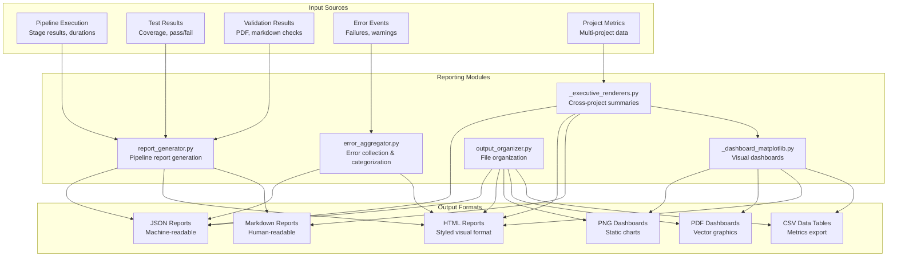
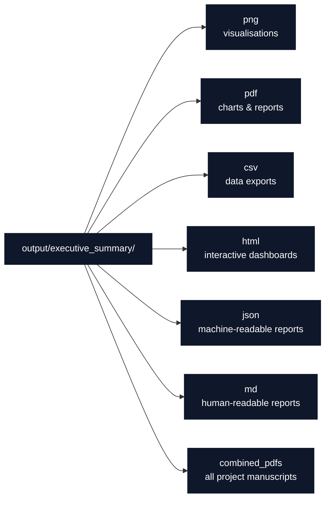
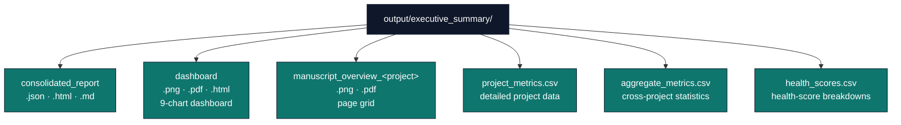

# Reporting Module - Quick Reference

Pipeline reporting and error aggregation utilities.

`native_auxiliary_print_custody.py` owns only the fixed Darwin auxiliary print
role. Its live worker registers actual ToolAPI events; completed replay needs
the genuine original supervisor or authenticated hosted collector. It grants
no full-native, browser, Office, stage, or PDFium authority. Print witness
self-validation and later replay retain all existing Source/font/library/page
and native process predicates.

Hosted transport forwards `GH_TOKEN` only through the fixed installed Source
reader launch. The reader consumes it into a private nomination before work,
then binds that nomination after genuine Source admission. Fixed github.com
API/download operations serve Root, native, candidate and print collectors;
their guardians and ordinary project/native children stay credential-free.
Raw credentials never enter argv or retained evidence, and later-job tokens
are not compared to earlier credential commitments.

The package facade resolves stable exports on first use and returns the original
provider objects. Importing a reporting leaf does not initialize executive,
document-validation, rendering, or plotting providers. Optional dashboard
availability is still observed when its exports or package enumeration request it.

`native_project_provider_batch.py` admits a fixed public provider selection under
one held Source boundary, then closes the original Source, SDK and fixture checks
before returning. `native_preparation_progress.py` emits bounded phase labels and
remaining time for diagnostics; progress output never grants native admission.

`native_worker_startup_diagnostics.py` embeds fixed, bounded startup observations
in the Source-owned native worker command without importing candidate code before
SDK admission. Samples show an anchored worker/bootstrap frame and its callers,
not the active callee. Missing records remain unknown; a blocked diagnostic writer
can outlive cancellation. These observations do not certify execution or cleanup.
During the existing worker execution only, an owner-PID/thread-checked ContextVar
routes fixed begin/returned/raised setup boundaries to that same bounded sink.
Execution phase records do not replace the caller-owned worker/bootstrap sampler
anchor; suspended diagnostic helper frames never become its anchor.
Entry labels bracket the actual context manager entry, not its later body/exit.
Mermaid ToolAPI return is separate from the retained Node process end: producer
verification and retained DATA checks can still run after the process exits.
The unchanged V1 eight-field schema reports wall-clock observations, not process
CPU. Existing queue/event/byte/deadline caps can drop observations; a missing
returned/raised record does not identify an interrupted callee.
The 84 allowlisted phase slots reserve capacity inside the original 96-record
cap: anchored-stack observations may consume at most 12 records across all six
sample times. Diagnostic delivery is still best-effort, never guaranteed.
Retention phases are active only inside the fixed Mermaid Node-version ToolAPI
call; later unrelated tool custody cannot reuse those labels. Post-Node guard
entry and full-guard completion are separate from its DATA/observation body.

## Overview

The reporting module provides reporting capabilities for pipeline execution, including:

- Consolidated pipeline reports (JSON, HTML, Markdown)
- Test results reporting
- Fail-closed structured receipts for explicitly declared chunked project verifiers
- A shared 6,900-second single-project budget: one attempt for an explicitly
  declared verifier, or one total application-owned subprocess-wait and
  retry-admission deadline across generic pytest's coverage-conflict attempts;
  the suite-runner default remains 1,800 seconds per attempt for other callers
- Validation reports with actionable recommendations
- Performance metrics and analysis
- Error aggregation and categorization
- **Executive cross-project summaries and visual dashboards**
- **Unified output organization system**
- Stable output statistics shared with artifact manifests: public exemplars use
  `stable-shippable-output-v1`, while explicitly resolved non-template projects
  may use `stable-local-output-v1`. Build intermediates, logs,
  telemetry/history, hidden paths, snapshots, and runtime-only directories are
  excluded from deterministic reports. Counts cover every inventory category
  and root bundle, use exact-byte ordering for largest files, and declare
  `project-output` or Stage 5 `stage5-delivery-mirror` scope; source and copied
  JSON/text reports are written byte-identically
- **Interactive simulation dashboards** (`interactive_dashboard.py`) — project-agnostic builder for self-contained Plotly dashboards with multi-view linked panels, live controls, and plaintext invariants. See [`AGENTS.md`](AGENTS.md#interactive-simulation-dashboard-interactive_dashboardpy).

## Architecture



## Output Organization

The reporting module includes a unified output organization system that ensures consistent file placement across all reporting operations.

### File Organization

```python
from infrastructure.reporting.output_organizer import OutputOrganizer, FileType

organizer = OutputOrganizer()

# Get organized path for any file type
png_path = organizer.get_output_path("chart.png", output_dir, FileType.PNG)
# Result: output_dir/png/chart.png

csv_path = organizer.get_output_path("data.csv", output_dir, FileType.CSV)
# Result: output_dir/csv/data.csv
```

### Directory Structure

All executive reports are organized by file type:



### Reorganization

Reorganize existing outputs with the provided script:

```bash
# Preview changes
uv run python scripts/maintenance/organize_executive_outputs.py --dry-run

# Apply organization
uv run python scripts/maintenance/organize_executive_outputs.py
```

## Quick Start

### Project-test execution boundary

`scripts/pipeline/stage_01_test.py --project <qualified-name> --project-only`
gives the selected project's generic pytest suite the same 6,900-second
execution capacity as an explicitly declared structured verifier. For generic
pytest, one monotonic deadline bounds subprocess waiting and admission of the
optional coverage-conflict retry; every subprocess receives the smaller of the
per-attempt allowance and the time still remaining. Coverage cleanup before a
retry reduces that remaining allowance. Process-tree cleanup after a subprocess
reaches its wait deadline may finish outside the inner 6,900-second boundary and
remains subject to the applicable outer backstop. A declared verifier has one
6,900-second attempt.

Hosted CI invokes Stage-01 directly, so the 6,900-second inner wait/admission
boundary sits inside the job's 8,100-second backstop and leaves
cleanup/setup/upload margin. When the full pipeline invokes Stage-01, its
separate 7,200-second process-tree boundary also applies. This is timeout
capacity only: a process that receives the larger budget has not thereby
completed, passed tests, met coverage, or produced a valid verifier receipt.

Coverage-conflict retries follow an explicit cleanup policy. Generic
single-project pytest recursively cleans only the selected project root;
infrastructure pytest cleans only root-level coverage files without descending
into project trees. Callers that do not select a policy retain the historical
recursive checkout-root default.

Infrastructure timeout defaults, callers that do not opt into a total deadline,
and the all-project union/matrix outer boundaries retain their existing
contracts.

### Generate Pipeline Report

```python
from infrastructure.reporting import generate_pipeline_report, save_pipeline_report
from pathlib import Path

# Collect stage results
stage_results = [
    {'name': 'setup', 'exit_code': 0, 'duration': 2.5},
    {'name': 'tests', 'exit_code': 0, 'duration': 45.2},
]

# Generate report
report = generate_pipeline_report(
    stage_results=stage_results,
    total_duration=47.7,
    repo_root=Path("."),
    test_results={'summary': {'total_tests': 878, 'total_passed': 878}},
)

# Save in multiple formats
saved_files = save_pipeline_report(report, Path("output/reports"))
# Returns: {'json': Path(...), 'html': Path(...), 'markdown': Path(...)}
```

### Aggregate Errors

```python
from infrastructure.reporting import get_error_aggregator

aggregator = get_error_aggregator()

# Add errors during pipeline execution
aggregator.add_error(
    error_type='test_failure',
    message='Test test_example failed',
    stage='tests',
    suggestions=['Review test output', 'Check test data'],
)

# Generate error summary
summary = aggregator.get_summary()
aggregator.save_report(Path("output/reports"))
```

### Generate Executive Report

```python
from infrastructure.reporting import generate_executive_summary, save_executive_summary
from pathlib import Path

repo_root = Path(".")
project_names = ["template_code_project"]

# Generate cross-project summary
summary = generate_executive_summary(repo_root, project_names)

print(f"Total projects: {summary.total_projects}")
print(f"Total manuscript words: {summary.aggregate_metrics['manuscript']['total_words']:,}")
print(f"Average test coverage: {summary.aggregate_metrics['tests']['average_coverage']:.1f}%")

# Save reports
saved_files = save_executive_summary(summary, Path("output/executive_summary"))
# Returns: {'json': Path(...), 'html': Path(...), 'markdown': Path(...)}
```

### Generate Visual Dashboard

```python
from infrastructure.reporting import generate_all_dashboards

# Create visual dashboards (PNG, PDF, HTML) + CSV data exports
dashboard_files = generate_all_dashboards(summary, Path("output/executive_summary"))
# Returns: {'png': Path(...), 'pdf': Path(...), 'html': Path(...), 'metrics': Path(...), ...}

print(f"Generated {len(dashboard_files)} dashboard and data files")
```

### Multi-Project Reporting

```python
from infrastructure.reporting import generate_multi_project_report

# One-line executive reporting workflow
files = generate_multi_project_report(
    Path("."), ["project1", "project2"], Path("output/executive_summary")
)
# Automatically generates:
# - Executive summary (JSON, HTML, Markdown)
# - Visual dashboards (PNG, PDF, HTML)
# - CSV data tables (metrics, aggregates, health scores)

print(f"Generated {len(files)} report files")
for fmt, path in files.items():
    print(f"  {fmt}: {path.name}")
```

### Generate Validation Report

```python
from infrastructure.reporting import save_validation_report

validation_results = {
    'checks': {
        'pdf_validation': True,
        'markdown_validation': True,
        'output_structure': False,
    },
    'recommendations': [
        {'priority': 'high', 'issue': 'Missing output directories', 'action': '...'},
    ],
}

saved_files = save_validation_report(validation_results, Path("output/reports"))
```

## Module Functions

### Pipeline Reporting

- `generate_pipeline_report()` - Create consolidated pipeline report
- `save_pipeline_report()` - Save report in multiple formats (JSON, HTML, Markdown)
- `generate_test_report()` - Generate test results report
- `save_validation_report()` - Save validation report

Project-only test stages exclude repository-level infrastructure coverage from
their detailed report, even when a previous infrastructure run left
`coverage_infra.json` behind. This keeps each exemplar's report scoped to the
phases executed for that report; combined runs may opt into both coverage
sections.

Validation JSON and Markdown use the same caller-supplied timestamp. When it is
absent, `SOURCE_DATE_EPOCH` (or deterministic mode) controls both; otherwise the
canonical build-time resolver preserves the normal wall-clock behavior.
- `save_performance_report()` - Save performance metrics report
- `save_error_summary()` - Save error summary report

### Executive Reporting

- `generate_executive_summary()` - Generate cross-project metrics and summary
- `save_executive_summary()` - Save executive summary in multiple formats
- `collect_project_metrics()` - Collect all metrics for a single project
- `calculate_project_health_score()` - Calculate project health score
- `ProjectMetrics` - project metrics dataclass
- `ExecutiveSummary` - Executive summary dataclass with health scores

### Multi-Project Orchestration

- `generate_multi_project_report()` - executive reporting workflow
- `generate_csv_data_tables()` - Export metrics as CSV tables

### Dashboard Generation

- `generate_all_dashboards()` - Generate dashboards in all formats (PNG, PDF, HTML)
- `generate_matplotlib_dashboard()` - Generate static charts (PNG/PDF)
- `generate_plotly_dashboard()` - Generate interactive HTML dashboard

### Error Aggregation

- `ErrorAggregator` - Main error aggregation class
- `get_error_aggregator()` - Get global error aggregator instance
- `ErrorEntry` - Single error/warning entry dataclass

### Coverage Trend Dashboard (`coverage_history.py`)

Generates a static `docs/_generated/coverage_history.md` with a 30-day rolling
table and ASCII sparklines per suite. Imported from a thin orchestrator at
`scripts/docgen/coverage_history.py`.

- `CoveragePoint` — frozen dataclass: `(date, suite, percentage, lines_covered, lines_total)`
- `parse_coverage_xml(path) -> CoveragePoint` — Cobertura XML → point (uses `defusedxml`)
- `collect_history_from_dir(directory) -> list[CoveragePoint]` — recursive offline parse
- `collect_history_via_gh(workflow="ci.yml", *, days=30, repo_root=None) -> list[CoveragePoint]` —
  real `gh run list` + `gh run download` (raises `RuntimeError` if `gh` is missing)
- `build_history_markdown(points, *, days=30, today=None) -> str` — pure, deterministic Markdown

## Report Formats

All reports are generated in multiple formats:

- **JSON**: Machine-readable format for programmatic access
- **HTML**: Visual format with styling for browser viewing
- **Markdown**: Human-readable format for documentation

## Integration

The reporting module is automatically integrated into:

- `scripts/runner/execute_pipeline.py` - Generates pipeline report at end
- `scripts/pipeline/stage_01_test.py` - Generates test reports
- `scripts/pipeline/stage_04_validate.py` - Generates validation reports

Reports are saved to `project/output/reports/` by default.

## Features (v2.1)

### Executive Reporting

- **Project Health Scoring**: Automated assessment based on test coverage, manuscript quality, test reliability, and output completeness
- **Statistical Aggregates**: Min/max/median calculations for cross-project comparisons
- **Actionable Recommendations**: Intelligent suggestions based on metrics analysis and best practices
- **Dashboards**: 9 charts including complexity analysis, performance metrics, and health scores

### Multi-Project Integration

- **Automatic Executive Reporting**: Triggered automatically in `run.sh` multi-project options (a, b, c, d)
- **CSV Data Export**: Machine-readable data tables for further analysis
- **Workflow Orchestration**: `generate_multi_project_report()` handles the entire reporting pipeline

### Manuscript Overview Generation

**Visual manuscript previews** for executive reporting. Automatically extracts all pages from each project's manuscript PDF and arranges them as thumbnails in a 4-column grid layout.

```python
from infrastructure.reporting.manuscript_overview import generate_all_manuscript_overviews

# Generate manuscript overviews for all projects
overview_files = generate_all_manuscript_overviews(summary, output_dir, repo_root)
# Creates: manuscript_overview_{project_name}.png/pdf for each project
```

**Features:**

- **Page Thumbnails**: High-quality page previews with page numbers
- **Grid Layout**: 4-column arrangement with automatic row calculation
- **Dual Output**: Both PNG (raster) and PDF (vector) formats
- **Error Resilience**: Gracefully handles missing PDFs or rendering failures

### Output Structure

Executive reports are saved to `output/executive_summary/`:



## See Also

- [`AGENTS.md`](AGENTS.md) - reporting module documentation
- [`../README.md`](../README.md) - Infrastructure layer overview
- [`../AGENTS.md`](../AGENTS.md) - infrastructure documentation

Candidate and published acceptance use the full source-owned public roster; see
[`RELEASE_READINESS.md`](RELEASE_READINESS.md) for required evidence and custody.

### Optional plotting imports

Package imports for pipeline reports, statistics, errors and the interactive
dashboard do not initialize Matplotlib. Requesting `DASHBOARD_AVAILABLE`, an
optional plotting export, or explicit package enumeration loads the original
plotting providers once. Their function identities and import-failure behavior
remain unchanged; the package retains its declared public exports. Import
observations alone do not establish complete execution or a universal speedup.


Native PDF preflight authenticates complete classic or compressed cross-reference
indexes before PDFminer page parsing. Compressed XRef field widths, ranges and
entry bytes, object-stream member headers and exact indexed identities remain
finite and must agree with the native parser. Every original stream has bounded
decoding, with aggregate expansion and repeated page-program costs charged before
page traversal. CMap ranges include their implied mapping/output cost; incomplete
sections, unmatched terminators and inherited maps refuse admission. Shared
CMaps are charged for each declared font construction; uncached direct font
resource dictionaries remain unsupported. Incremental,
encrypted, hybrid, Form, Type3 and pattern programs remain unsupported and blocked.
These controls retain original PDF bytes and do not grant publication acceptance.

`native_stage_child_completion.py` closes one actual fixed child after ToolAPI
return under a fresh synchronous Source boundary. Private DATA validators keep
every original Code/SDK/PID/request/process predicate. Complete Source/Git/SDK
closure and final physical factory/registry checks precede child publication.
No guard spans execution, accepts callbacks or yields reusable verification.
Public independent verification APIs remain fresh; clocks and original signed
failure outcomes retain authority.
