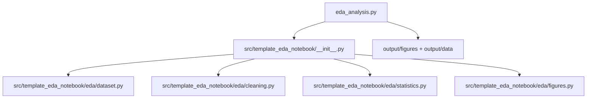

# scripts/ — Analysis Scripts

**Thin orchestrators.** These scripts contain no analysis logic: they import
from `src/template_eda_notebook/eda/`, plot the returned data with matplotlib, and write artifacts to
`output/`. Plotting and file I/O live here, never in the library.

## Quick Start

```bash
# Run the EDA analysis pipeline
uv run python scripts/eda_analysis.py

# Regenerate the deterministic dataset sibling
uv run python scripts/generate_measurements_data.py

# View generated outputs
ls -la ../output/figures/
cat ../output/data/summary_statistics.csv
```

## Scripts

| Script | Role | Pipeline |
| --- | --- | --- |
| `eda_analysis.py` | Loads + cleans the dataset, plots three figures, writes the summary CSV | Required |
| `generate_measurements_data.py` | Regenerates a deterministic sibling of the shipped CSV under `output/data/` | Discovered (stage 02) |

`run_eda(project_root=...)` and `generate_measurements_file(project_root=...)`
accept an output-root override so tests can run them against a temporary
directory; `main()` runs them against the real project root and prints each
output path for manifest collection.

## Architecture



## More Information

See [AGENTS.md](AGENTS.md) for technical documentation and
[CONVENTIONS.md](CONVENTIONS.md) for the thin-orchestrator rules.

## Real notebook acceptance

`execute_notebook.py` is a thin canonical analysis entry point. It delegates
NBClient execution and independent numerical verification to the source runtime
and bounds the worker and descendants through the shared process guardian.
The worker lives in the installed `template_eda_notebook` namespace. Installed
API callers pass the exported project root explicitly; no checkout script is
needed to launch the worker. The configured analysis order is dataset sibling
generation, EDA analysis, then notebook execution. The original shipped input
CSV stays unchanged. Refresh `data/notebook_binding.json` explicitly with
`refresh_notebook_binding.py` before freezing a run; analysis excludes that
authoring utility.
Only successful current runs write the complete local-only receipt at
`output/.pipeline/notebook_execution.json` and the portable scientific summary
at `output/reports/notebook_execution.json`. The summary retains computations
and project-relative source hashes; the interpreter path is represented by an
explicit path-string hash. Exact prior receipts are retained in ignored
`output/.pipeline/notebook_execution_history/` before latest-success pointers
are removed.
