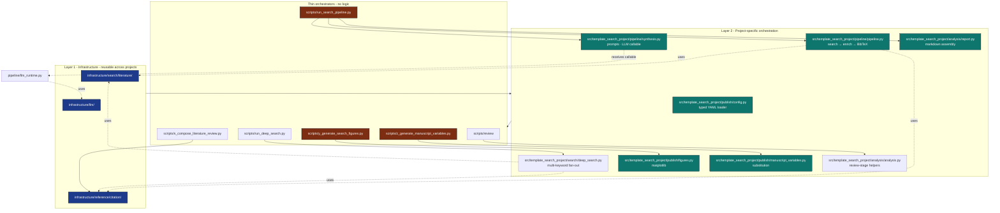

# Architecture

## Two-Layer Compliance

## Module Responsibilities

| Module family | Responsibility | I/O boundary |
| --- | --- | --- |
| `publish/config.py` | Typed domain configuration | Actual YAML loader and validation |
| `pipeline/pipeline.py`, `search/deep_search.py` | Search, filtering, deduplication, enrichment, citation assembly | Generic retrieval and nominated confined caches/output |
| `pipeline/synthesis.py` | Prompt/output assembly | Caller-supplied real callable |
| `pipeline/llm_runtime.py` | Optional real Ollama adapter | Current platform `LLMClient.query_long` |
| `publish/bibliography.py` | Compare/project curated and generated work definitions | Confined actual source/output bytes |
| `publish/deep_custody.py` | Current deep artifact dependency | Bounded source/config/artifact snapshots |
| `pipeline/composition.py`, `publish/manuscript_variables.py` | Generated S02 and manuscript hydration | Exact producer/input/supplement bindings, confined output |
| Figure/report/dashboard modules | Domain presentation and diagnostics | Actual images, markdown, HTML, and JSON |
| Analysis/invariant modules | Domain acceptance checks | Real domain values and files |

The exact generic adapter permissions are declared in
`manuscript/layer_contract.yaml`. Source modules that write or read files are
not pure merely because a script calls them. Controlled callable/local backend
behavior and actual provider execution remain distinct evidence.

## Explicit Core Analysis

`analysis.scripts` in the live/example config declares five scripts:

1. `run_search_pipeline.py` — local search and generated bibliography.
2. `y_generate_search_figures.py` — figures from actual search results.
3. `z_generate_manuscript_variables.py` — hydration and bibliography projection.
4. `zz_generate_review_report.py` — current review diagnostics.
5. `zzz_build_dashboard.py` — corpus dashboard and invariant reports.

Adding a filename does not add it to this explicit allowlist. Deep search and
`s_compose_literature_review.py` remain direct opt-in producers. Composition
requires a current producer dependency receipt and writes generated S02;
hydration checks its actual receipt/input/supplement SHA. Authored S01 remains
source content. The default dashboard does not consume historical deep output.

## Citation-Key Determinism

`paper_to_bibentry()` produces `<author><year><title-word>` keys. When
two papers collide (a real concern for prolific same-year authors),
`pipeline._disambiguate_citation_key` appends `a`, `b`, …, `z`, `aa`, …
The result is deterministic across runs and exposed via
`LiteratureRunArtifacts.citation_keys` so the report and the BibTeX file
agree.

## Hydrated Manuscript and Bibliographies

Authored `manuscript/*.md` and curated `manuscript/*.bib` remain unchanged.
Producers write full databases under `output/bibliography/`; hydration compares
colliding work metadata, keeps curated annotations, and emits only additional
keys to reserved `output/manuscript/generated_search.bib`. Meaningful conflicts
fail. Renderers select the populated hydrated directory and consume its complete
bibliography union.

`output/bibliography_projection.json` records consumed byte hashes and key
origins. Explicit deep composition additionally binds the current producer
receipt, input bytes, and generated S02 SHA. These dependency snapshots are
separate from audited unpaid-provider or installed-runtime acceptance.

## Repeatability Boundaries

Local corpus, citation keys, and projected source bytes can be compared with
fixed inputs. Cache acquisition timestamps and actual operation/model receipts
retain real timing. Renderer/library versions can affect image/PDF bytes and
must be bound when asserting exact artifact repeatability. A seed and temperature
are model controls, not a guarantee of identical responses.

Canonical candidate execution uses a measured nominated candidate epoch and
explicit tool/source/artifact identities. Historical output and earlier test
receipts do not establish a current candidate pass.

## See Also

- [`README.md`](../README.md) — top-level project overview.
- [`AGENTS.md`](../AGENTS.md) — agent-oriented walkthrough.
- [`docs/quickstart.md`](quickstart.md) — getting started.
- [`docs/output_conventions.md`](output_conventions.md) — what lands
  where on disk.
