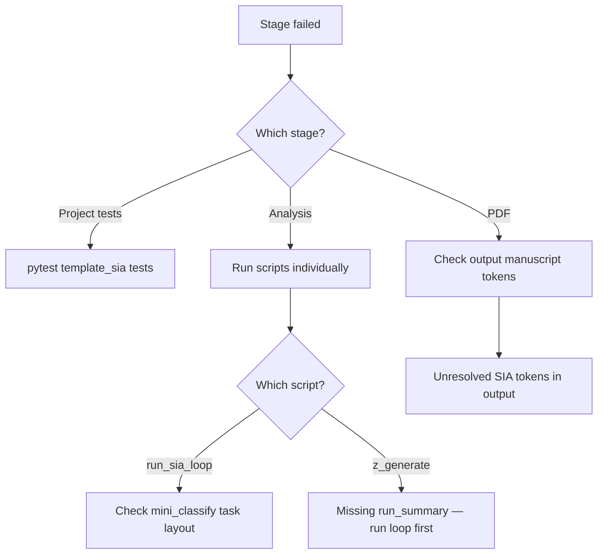

# Troubleshooting — template_sia



## Project tests fail with `unrecognized arguments: --timeout`

Add `pytest-timeout` to project dev dependencies (already in `pyproject.toml`). Run `uv sync --extra dev` inside the project directory.

## `ModuleNotFoundError: No module named 'PIL'`

The variables script must not import `infrastructure.rendering` package init. Use `infrastructure.rendering.manuscript_injection.write_resolved_manuscript_tree` (lazy load of `manuscript_injection.py` only, not the package `__init__.py`).

## `Unknown config key` for a SIA block

SIA keeps its settings under the canonical `project_config` key
(`project_config.sia`), which the shared loader already accepts, so a correct
config produces no warning. If you move those settings to a new top-level key,
declare that key in this project's own `pyproject.toml` instead of editing
Layer 1:

```toml
[tool.template]
config_keys = ["sia"]
```

`infrastructure.core.project_pyproject` reads the declaration and
`infrastructure.core.config.loader.validate_config_keys` accepts it for
`project_config.sia`-style blocks. `src/template_sia/loop/loop_config.py` still
validates the SIA block's own fields strictly.

## Analysis: missing `run_summary.json`

Run `uv run python projects/templates/template_sia/scripts/run_sia_loop.py` before `z_generate_manuscript_variables.py`.

## Live mode hangs or fails

- Confirm `ollama serve` is running
- Use `@pytest.mark.requires_ollama` tests locally only
- Keep `target_timeout_sec` bounded in config

## Drift: missing `.gitignore`

Exemplars must ship `projects/templates/template_sia/.gitignore` and appear in root `.gitignore` allowlist negations.
