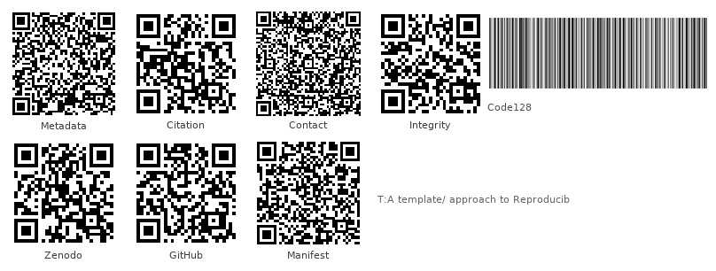

```{=latex}
% transmission-end-bookend
\clearpage
\thispagestyle{empty}
\setlength{\parskip}{0pt}
\setlength{\itemsep}{0pt}
\begin{samepage}
\scriptsize
```

```{=latex}
\section*{END OF TRANSMISSION}\label{end-of-transmission}
```

**Release:** v2.0.0 · DOI `10.5281/zenodo.20419007` · SHA-256 `pending…` · pairing pending

{width=88%}

**Prior:** `v1.0.8` · `10.5281/zenodo.20932076` · `b9bc5cf3…`

```{=latex}
\end{samepage}
```


<!-- END OF TRANSMISSION -->