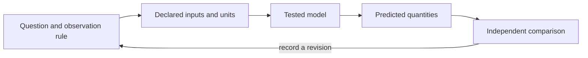

# Core Methods and Tools {#sec:part_0_core_methods}

{#fig:part_0_core_methods width=90%}

<!-- alt: Twenty-five synthetic points follow an increasing trend with a smooth oscillating deviation; a fitted straight line summarizes the trend while leaving visible positive and negative residuals. -->

<!-- chapter-metadata-badge -->
> Guided study · Prerequisites: basic arithmetic and the preceding unit's vocabulary

<!-- curriculum-scaffold-start -->
### Study Blueprint

- **Big idea:** A reproducible method separates input custody, transformation, evaluation and communication.
- **Core concepts:** [**model**](#gl:model), [**parameter**](#gl:parameter), [**observable**](#gl:observable), [**variable**](#gl:variable).
- **Quantitative lens:** [@eq:part_0_core_methods_model].
- **Data skill:** Record transformations and run an exact arithmetic control before analyzing unfamiliar data.
- **Common misconception to repair:** Re-running a command successfully does not establish that its scientific input or interpretation is correct.
- **Primary lab:** [@sec:lab_part_0_core_methods].
- **Question bank:** [@sec:q_part_0_core_methods].
- **Bridge to computation:** `textbook.models.linear_fit`.
<!-- curriculum-scaffold-end -->

## Learning Objectives

1. Trace an output back to its data and transformation.
2. Use an exact synthetic case to verify a fitted-line implementation.
3. Design a negative control that can fail for a concrete reason.

> **Opening example.** Two classmates calculate a calibration line from the same spreadsheet and obtain different slopes. One silently removes a row; the other changes a unit. Their mathematics may be sound, but their methods are different. A useful workflow exposes both choices before either result appears in a figure.

## Make the transformation explicit

Treat a method as a sequence of declared transformations, each with an input
and an output. Reading a file, deciding which rows are eligible, converting
units and fitting a model are different transformations. Their order matters:
averaging before a nonlinear transformation need not give the same result as
transforming before averaging. A workflow diagram is useful only when its
arrows correspond to actual operations. Preserve the source file and express
changes in code or an inspectable table instead of editing an unexplained copy.

## Design a control with a known answer

The exact four-point line in the worked example checks slope, intercept and
predicted values. It is intentionally easier than a research dataset, because
its role is to expose mistakes in computation. A second control should violate
an assumption: input arrays with different lengths must be rejected by the
tested fitting helper. A third control can use observations off the line and
confirm that residuals are not all zero. These cases check different boundaries;
many copies of the exact line would increase a test count without increasing
the range of failures examined.

## Distinguish verification from evaluation

Verification asks whether the implementation behaves as its contract says.
Evaluation asks whether the resulting model is useful for the stated question.
The exact line provides verification evidence. A held-out calibration setting,
an independently collected observation or a residual pattern can provide
evaluation evidence. A perfect result on data used to construct the example
is not an independent evaluation. Name each kind of evidence so that a green
test report is not mistaken for proof that a model describes the world.

## Keep one method in one place

The computational backbone puts fitting in `textbook.models.linear_fit`.
Chapters, labs and figure scripts call it rather than each maintaining another
copy of the formula. This reduces opportunities for two implementations to
drift. The independent numeric assertions in the example still have a separate
role: a single implementation needs an external expectation. Modular scientific
software and executable checks are discussed by Wilson and colleagues
[@wilson2014best]; this book demonstrates those practices with small real
computations instead of simulated test doubles.

## Publish an inspectable method record

Record the original data identity, the transformation choices, software
environment, parameters and command. Also record what failed or remained
unverified. Sandve and colleagues give a primary account of computational
reproducibility practices [@sandve2013ten]. A complete record enables another
person to repeat the procedure, but repeatability still does not validate an
unreliable sensor or an inappropriate study design. Include the observation
protocol and the model's scope so that a precise execution record supports,
rather than obscures, scientific judgment.

## A Worked Formalism

$$ \widehat y(x)=mx+b,\qquad (m,b)=\arg\min_{a,c}\sum_i(y_i-ax_i-c)^2 $$ {#eq:part_0_core_methods_model}

: Quantities and conventions for this chapter's worked example. {#tbl:part_0_core_methods_parameters}

| Symbol | Meaning | Units |
| --- | --- | --- |
| $x_i,y_i$ | Paired observed inputs and outputs | declared data units |
| $m$ | Least-squares slope | output per input |
| $b$ | Intercept | output |
| $\widehat y$ | Fitted output | output |

The four deliberately constructed pairs lie on $y=2x+1$. The slope is two output units per input unit, the intercept is one output unit and every residual is zero, so the reported coefficient of determination is one. The exact fit is an arithmetic control for the implementation; it supplies no evidence about an unobserved real-world mechanism.

```python
import numpy as np
from textbook.models import linear_fit

x = np.array([0.0, 1.0, 2.0, 3.0])
y = np.array([1.0, 3.0, 5.0, 7.0])
fit = linear_fit(x, y)
assert np.isclose(fit.slope, 2.0)
assert np.isclose(fit.intercept, 1.0)
assert np.allclose(fit.predict(x), y)
print(fit)
```

The equation is evaluated by the tested `textbook.models.linear_fit`.
The assertions above are independent expectations for this designed example;
the displayed figure in [@fig:part_0_core_methods] is a deterministic illustration with its
own explicitly stated inputs, not evidence collected from the opening scenario.

## Assumptions and Limits

Least squares here treats the input values as known and fits one straight line with equal observation weights. It does not model error in the inputs, dependence between observations or a changing variance. A large coefficient of determination is a statement about these fitted observations. Generalization requires additional data and an evaluation design appropriate to the question.



This diagram records the direction of a modeling workflow. An arrow names a
relationship to specify; it does not add an unimplemented physical mechanism.
Keep the original prediction when making the recorded revision.

## Summary

A reproducible method separates input custody, transformation, evaluation and communication. The worked example makes a narrow quantitative claim that can
be checked with exact inputs and a tested function. Re-running a command successfully does not establish that its scientific input or interpretation is correct.
State the assumptions, preserve the observation record and choose a comparison
that can distinguish an arithmetic error from an inadequate model. Those habits
make a result inspectable without expanding what its evidence establishes.

## Key Terms

[**model**](#gl:model), [**parameter**](#gl:parameter), [**observable**](#gl:observable), [**variable**](#gl:variable).

## Further Reading

Wilson and colleagues [@wilson2014best] address scientific software practices; Sandve and colleagues [@sandve2013ten] focus on preserving how results were produced.

## Practice

- **Lab:** [@sec:lab_part_0_core_methods] — execute the worked computation and its boundary control.
- **Question bank:** [@sec:q_part_0_core_methods] — compare your reasoning with the supplied solutions.
