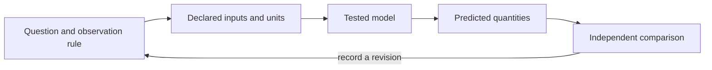

# Orientation to the Field {#sec:part_0_orientation}

{#fig:part_0_orientation width=90%}

<!-- alt: Three smooth S-shaped quantity-versus-time curves start at five units and approach a dashed capacity line at one hundred; higher rates reach the middle of the transition sooner. -->

<!-- chapter-metadata-badge -->
> Guided study · Prerequisites: basic arithmetic and the preceding unit's vocabulary

<!-- curriculum-scaffold-start -->
### Study Blueprint

- **Big idea:** Begin a model by naming a question, a boundary and an observation that could change your mind.
- **Core concepts:** [**system**](#gl:system), [**boundary**](#gl:boundary), [**state**](#gl:state), [**observable**](#gl:observable).
- **Quantitative lens:** [@eq:part_0_orientation_model].
- **Data skill:** Keep observation definitions and model assumptions next to the prediction.
- **Common misconception to repair:** A plausible curve is not a complete explanation of the system.
- **Primary lab:** [@sec:lab_part_0_orientation].
- **Question bank:** [@sec:q_part_0_orientation].
- **Bridge to computation:** `textbook.models.logistic_growth`.
<!-- curriculum-scaffold-end -->

## Learning Objectives

1. Draw a system boundary and classify the inputs that cross it.
2. Distinguish a state, a measurement and a parameter in a concrete example.
3. State what an illustrative model predicts and what evidence would challenge it.

> **Opening example.** Imagine a library planning a new borrowing service. Daily sign-ups rise quickly, then slow. The manager asks whether the service will reach everyone in the town. A smooth curve can organize that question, but the curve alone cannot tell us who was excluded, whether the town changed, or how sign-ups were recorded. Those omissions are where modeling begins.

## A question before an equation

The useful starting question is precise enough to make an observation relevant.
“How does the service work?” is a broad invitation. “How many registered users
will the service have after five time units if current conditions persist?”
defines a quantity, horizon and conditional claim. The conditional phrase is
essential: a prediction is about specified circumstances, not a promise that
those circumstances will continue. Write the question before choosing a familiar
equation, so that convenience does not decide what the study is about.

## Choosing the boundary

A boundary decides which processes the model represents explicitly and which
arrive as inputs or disturbances. For sign-ups, the modeled state might be the
number of registered accounts; publicity, population changes and service outages
may remain outside. Drawing a boundary does not deny those processes. It makes
their omission inspectable. Two investigators can draw different boundaries
around the same service and produce different useful models because they are
answering different questions. Record the choice and the reason rather than
arguing that one diagram is the service itself.

## State is not the measurement

The account count is an observable produced by a counting procedure. A person
may hold two accounts, and a registered account may never borrow anything. A
state representing active participants is therefore not identical to a table
of registrations. Before evaluating a prediction, specify the observation rule,
the time at which counting occurs, and how duplicates are treated. This book's
worked quantities are instructional examples; they do not report actual users
or biological populations. Keeping that distinction prevents synthetic examples
from acquiring false authority merely because they are drawn as precise curves.

## The prediction and its challenge

The logistic illustration combines an initial value, a positive growth rate
and a capacity. Several rate choices produce the family in the chapter figure.
The same initial count can therefore lead to different intermediate forecasts.
If later observations consistently exceed the declared capacity, the model has
failed a useful challenge: revise the capacity assumption or select another
model. Adjusting every parameter after every new observation without preserving
the previous forecast removes this challenge. Keep the original forecast and
compare it with the later outcome before revising the next one.

## An evidence record

For this exercise, keep four items: the question, the observation definition,
the model configuration and the resulting prediction. Attach the input data
and execution command when computation enters the record. A hash identifies
bytes, a test checks selected behavior, and a comparison checks a prediction;
none substitutes for the others. Box discusses iterative contact between theory
and practice [@box1976science]. The lab translates that idea into a small record
that another learner can inspect without knowing what its author intended.

## A Worked Formalism

$$ N(t)=\frac{K}{1+((K-N_0)/N_0)e^{-rt}} $$ {#eq:part_0_orientation_model}

: Quantities and conventions for this chapter's worked example. {#tbl:part_0_orientation_parameters}

| Symbol | Meaning | Units |
| --- | --- | --- |
| $N(t)$ | State at time $t$ | quantity |
| $N_0$ | Initial state, between zero and $K$ | quantity |
| $K$ | Capacity held fixed in this model | quantity |
| $r$ | Positive growth rate | inverse time |

At time zero the denominator is $1+19=20$, so the state is exactly five units. At time two it is $1+19e^{-1.4}$, giving about $17.59$ units. The state approaches $100$ as the exponential term approaches zero. These are predictions of a chosen model, not measured evidence that a real population or service has a fixed capacity.

```python
import numpy as np
from textbook.models import logistic_growth

time = np.array([0.0, 2.0, 5.0])
values = logistic_growth(time, r=0.7, carrying_capacity=100.0, initial=5.0)
assert np.isclose(values[0], 5.0)
assert np.all(np.diff(values) > 0)
assert np.all(values < 100.0)
print(values)
```

The equation is evaluated by the tested `textbook.models.logistic_growth`.
The assertions above are independent expectations for this designed example;
the displayed figure in [@fig:part_0_orientation] is a deterministic illustration with its
own explicitly stated inputs, not evidence collected from the opening scenario.

## Assumptions and Limits

The closed form assumes a constant positive rate and a fixed capacity with an initial state strictly above zero and no larger than capacity. It omits migration, changing resources and random shocks. A discrepancy can therefore reflect a failed assumption rather than a programming error. First inspect the units and initial value, then ask which omitted process could generate the observed discrepancy.



This diagram records the direction of a modeling workflow. An arrow names a
relationship to specify; it does not add an unimplemented physical mechanism.
Keep the original prediction when making the recorded revision.

## Summary

Begin a model by naming a question, a boundary and an observation that could change your mind. The worked example makes a narrow quantitative claim that can
be checked with exact inputs and a tested function. A plausible curve is not a complete explanation of the system.
State the assumptions, preserve the observation record and choose a comparison
that can distinguish an arithmetic error from an inadequate model. Those habits
make a result inspectable without expanding what its evidence establishes.

## Key Terms

[**system**](#gl:system), [**boundary**](#gl:boundary), [**state**](#gl:state), [**observable**](#gl:observable).

## Further Reading

Box [@box1976science] discusses model-building as an iterative scientific activity; compare the role of a model check with changing a parameter.

## Practice

- **Lab:** [@sec:lab_part_0_orientation] — execute the worked computation and its boundary control.
- **Question bank:** [@sec:q_part_0_orientation] — compare your reasoning with the supplied solutions.
