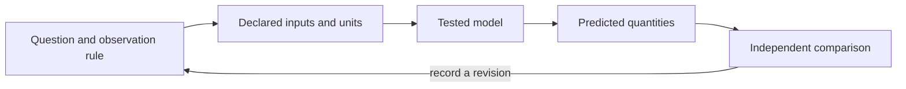

# Quantitative Foundations {#sec:part_0_quantitative_foundations}

{#fig:part_0_quantitative_foundations width=90%}

<!-- alt: A rising cloud of synthetic observations is crossed by a fitted line; the point-to-line deviations remain visible instead of being hidden by an average. -->

<!-- chapter-metadata-badge -->
> Guided study · Prerequisites: basic arithmetic and the preceding unit's vocabulary

<!-- curriculum-scaffold-start -->
### Study Blueprint

- **Big idea:** A number is interpretable only with its units, observation rule and summary convention.
- **Core concepts:** [**variable**](#gl:variable), [**parameter**](#gl:parameter), [**observable**](#gl:observable), [**gradient**](#gl:gradient).
- **Quantitative lens:** [@eq:part_0_quantitative_foundations_model].
- **Data skill:** Check units and divisors, then compare summaries with the original observations.
- **Common misconception to repair:** A small spread of observations and a small uncertainty in an estimate are different quantities.
- **Primary lab:** [@sec:lab_part_0_quantitative_foundations].
- **Question bank:** [@sec:q_part_0_quantitative_foundations].
- **Bridge to computation:** `textbook.models.descriptive_statistics`.
<!-- curriculum-scaffold-end -->

## Learning Objectives

1. Carry units through an arithmetic calculation.
2. Compute a mean and distinguish population from sample spread.
3. Explain why a summary can conceal the organization of observations.

> **Opening example.** A report describes a reading as “five,” without saying whether it means five seconds, five degrees or five normalized units. Another reports “standard deviation,” without its divisor. Neither number is necessarily wrong; both are incomplete. Quantitative foundations supply the missing definitions before a calculation becomes a claim.

## Quantities and units

A quantity combines a numerical value with a unit or an explicit dimensionless
definition. Adding a duration to a distance is not meaningful simply because
both are stored as floating-point numbers. In a rate calculation, quantity
divided by time gives quantity per time; multiplying that rate by time restores
the quantity dimension. These checks are inexpensive ways to reject an equation
before writing code. Keep the chosen unit scale in a data dictionary: changing
seconds to minutes changes the numerical value of a rate even when the
underlying process is unchanged.

## A mean describes a chosen collection

The arithmetic mean distributes a total evenly across a collection. The worked
four-value example makes this definition visible. Equal weighting is a choice:
four measurements collected from four people differ from four repeated readings
on one person. An average that ignores this distinction can overstate the
amount of independent information. Begin with the sampling unit, then decide
which collection the reported mean describes. Keep identifiers long enough to
reconstruct grouping decisions instead of reducing the dataset to an average
at the moment it is read.

## Spread has a convention

Population standard deviation describes dispersion in the supplied collection
using a divisor equal to its size. A sample variance estimator uses a different
divisor under its statistical assumptions. The book's helper explicitly
implements the population version. Neither formula should be silently swapped
into the other's interpretation. A standard error is another quantity again:
it concerns variation in an estimator under a sampling model. An error bar
therefore needs a label describing what it represents, not merely a decorative
line above a plotted point.

## Information lost by summarizing

Collections with the same mean can have different ranges, gaps, clusters or
temporal order. A sequence of gradually increasing readings and an alternating
sequence can share a mean and spread but suggest different processes. Inspect
the raw values and their order before treating a summary as sufficient.
The synthetic scatter figure retains point-to-line deviations for exactly this
reason. Shannon's mathematical treatment of communication [@shannon1948mathematical]
offers further reading on information and encoding; it does not turn a single
mean into a complete representation of a dataset.

## Scale and meaningful comparisons

When two quantities have different units, a normalization can make their ranges
visually comparable. It does not make their physical meanings equivalent. State
the reference bounds or centering rule and retain the original values. For a
time series, preserve time labels even when normalizing the measured quantity.
The lab asks you to change one value and then reorder all values: the first
changes the mean, while the second preserves the arithmetic summary but changes
the sequence. That comparison makes the limits of a statistic observable.

## A Worked Formalism

$$ \mu=\frac{1}{n}\sum_{i=1}^{n}x_i,\qquad \sigma=\sqrt{\frac{1}{n}\sum_{i=1}^{n}(x_i-\mu)^2} $$ {#eq:part_0_quantitative_foundations_model}

: Quantities and conventions for this chapter's worked example. {#tbl:part_0_quantitative_foundations_parameters}

| Symbol | Meaning | Units |
| --- | --- | --- |
| $x_i$ | Values in the described finite collection | data units |
| $n$ | Number of values | count |
| $\mu$ | Arithmetic mean | data units |
| $\sigma$ | Population standard deviation of this collection | data units |

The sum of the four values is twenty, giving a mean of five. The squared deviations are nine, one, one and nine. Their mean is five, so the population standard deviation is $\sqrt{5}$, approximately $2.236$. Dividing the same squared-deviation sum by three instead would estimate sample variance; that is a different convention, not a rounding error.

```python
import numpy as np
from textbook.models import descriptive_statistics

summary = descriptive_statistics([2.0, 4.0, 6.0, 8.0])
assert summary["mean"] == 5.0
assert np.isclose(summary["std"], np.sqrt(5.0))
assert summary["count"] == 4.0
print(summary)
```

The equation is evaluated by the tested `textbook.models.descriptive_statistics`.
The assertions above are independent expectations for this designed example;
the displayed figure in [@fig:part_0_quantitative_foundations] is a deterministic illustration with its
own explicitly stated inputs, not evidence collected from the opening scenario.

## Assumptions and Limits

This summary describes the supplied finite collection using the population divisor. It is not automatically an estimator of uncertainty in a larger population. Missing, censored or dependent observations require an explicit handling rule before summary statistics become interpretable. Keep that rule with the input data rather than silently discarding awkward observations.



This diagram records the direction of a modeling workflow. An arrow names a
relationship to specify; it does not add an unimplemented physical mechanism.
Keep the original prediction when making the recorded revision.

## Summary

A number is interpretable only with its units, observation rule and summary convention. The worked example makes a narrow quantitative claim that can
be checked with exact inputs and a tested function. A small spread of observations and a small uncertainty in an estimate are different quantities.
State the assumptions, preserve the observation record and choose a comparison
that can distinguish an arithmetic error from an inadequate model. Those habits
make a result inspectable without expanding what its evidence establishes.

## Key Terms

[**variable**](#gl:variable), [**parameter**](#gl:parameter), [**observable**](#gl:observable), [**gradient**](#gl:gradient).

## Further Reading

Shannon [@shannon1948mathematical] develops a precise communication model; contrast an encoding problem with the choice of a scientific summary.

## Practice

- **Lab:** [@sec:lab_part_0_quantitative_foundations] — execute the worked computation and its boundary control.
- **Question bank:** [@sec:q_part_0_quantitative_foundations] — compare your reasoning with the supplied solutions.
