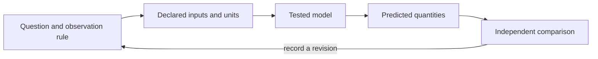

# Building Blocks {#sec:part_I_building_blocks}

{#fig:part_I_building_blocks width=90%}

<!-- alt: Three input-versus-response curves rise from zero toward one and all pass through response one half at input three; larger exponents sharpen the transition around that point. -->

<!-- chapter-metadata-badge -->
> Guided study · Prerequisites: basic arithmetic and the preceding unit's vocabulary

<!-- curriculum-scaffold-start -->
### Study Blueprint

- **Big idea:** Reusable model components need explicit input domains, output meanings and limiting behavior.
- **Core concepts:** [**model**](#gl:model), [**parameter**](#gl:parameter), [**threshold**](#gl:threshold), [**observable**](#gl:observable).
- **Quantitative lens:** [@eq:part_I_building_blocks_model].
- **Data skill:** Probe a model component at designed boundary inputs before composing it.
- **Common misconception to repair:** A steep response curve does not by itself prove a switch or identify a molecular mechanism.
- **Primary lab:** [@sec:lab_part_I_building_blocks].
- **Question bank:** [@sec:q_part_I_building_blocks].
- **Bridge to computation:** `textbook.models.saturating_response`.
<!-- curriculum-scaffold-end -->

## Learning Objectives

1. Distinguish a static response from a dynamic state law.
2. Interpret maximum, half-saturation and shape parameters.
3. Check a component at its zero, midpoint and limiting inputs.

> **Opening example.** A learner links a response curve to a growth model and expects the combined diagram to describe adaptation. The response curve has no memory, and the growth model has no measured input. Connecting the pictures cannot supply the missing state equation. Useful building blocks start with contracts that say what each component can represent.

## Begin with the interface

An interface states which values a component accepts and what its result means.
The response helper accepts non-negative input and positive scale and shape
parameters. It returns a response in the declared output units. This contract
does not mention elapsed time, so a time delay must not be inferred from the
curve. Check domains before connecting components: a downstream function that
requires a positive input cannot safely receive every output of a component
whose valid range includes zero. Composition requires compatible contracts,
not just visually appealing arrows.

## Parameters have different jobs

The maximum sets an output scale, the half-saturation parameter sets an input
scale and the shape exponent adjusts curvature. Changing the maximum multiplies
the response everywhere. Changing the half-saturation moves the midpoint along
the input axis. Changing the exponent preserves the midpoint but changes the
transition around it. The generated figure holds the scales fixed while varying
the exponent, making these roles separable. A parameter name should describe
its mathematical job before a field-specific interpretation is attached to it.

## Boundary cases reveal the model

At zero input the response is zero. At input equal to half-saturation the
response is half of its maximum, for every valid exponent. As input increases
without bound the response approaches its maximum. These checks follow directly
from the equation and provide independent expectations for the implementation.
The worked three-input calculation adds one interior value. Negative inputs
must fail instead of silently producing complex or misleading values for
non-integer exponents. Boundary cases are part of an explanation, not merely
an implementation detail hidden in a test directory.

## Shape does not establish mechanism

Several mechanisms can produce similar saturating observations. A static curve
can summarize them without distinguishing them. To infer a mechanism, collect
observations that separate its predictions from plausible alternatives, such as
a transient response or a controlled intervention. Box's discussion of model
adequacy [@box1976science] is relevant to that evaluation. Do not label the
shape exponent a count of interacting physical units unless a separate
derivation and observation protocol justify that meaning for the application.

## Compose only what is defined

A simple series composition sends one component's output into another's input.
Retain units at the connection and write any conversion explicitly. Feedback
composition is harder because an output affects an input in the same system:
an algebraic equation or a state-update rule must specify how that loop is
resolved. The diagram below shows a declared input, component and observation,
with an evaluation arrow returning to assumptions. It is an explanatory map,
not an executable simulator. The lab evaluates component boundaries and asks
which additional equation a time-dependent claim would require.

## A Worked Formalism

$$ y(x)=M\frac{x^h}{k^h+x^h} $$ {#eq:part_I_building_blocks_model}

: Quantities and conventions for this chapter's worked example. {#tbl:part_I_building_blocks_parameters}

| Symbol | Meaning | Units |
| --- | --- | --- |
| $x$ | Non-negative input | input units |
| $M$ | Positive maximum response | output units |
| $k$ | Input giving half the maximum | input units |
| $h$ | Positive shape exponent | dimensionless |

With a maximum of one, half-saturation input of three and exponent two, the outputs at zero, three and six are zero, one half and four fifths. At the half-saturation input, the numerator and the other denominator term are equal. Doubling the input from three to six therefore does not double the output: the finite ceiling changes the arithmetic.

```python
import numpy as np
from textbook.models import saturating_response

x = np.array([0.0, 3.0, 6.0])
y = saturating_response(x, maximum=1.0, half_saturation=3.0, hill=2.0)
assert np.allclose(y, [0.0, 0.5, 0.8])
print(y)
```

The equation is evaluated by the tested `textbook.models.saturating_response`.
The assertions above are independent expectations for this designed example;
the displayed figure in [@fig:part_I_building_blocks] is a deterministic illustration with its
own explicitly stated inputs, not evidence collected from the opening scenario.

## Assumptions and Limits

This function is a static response curve: it relates an input to an output without a state or elapsed time. It cannot by itself explain adaptation, delays, oscillation or memory. Different exponents describe different shapes but do not uniquely identify a physical mechanism. Interpret the parameters within the declared model rather than treating a fitted shape as a causal discovery.



This diagram records the direction of a modeling workflow. An arrow names a
relationship to specify; it does not add an unimplemented physical mechanism.
Keep the original prediction when making the recorded revision.

## Summary

Reusable model components need explicit input domains, output meanings and limiting behavior. The worked example makes a narrow quantitative claim that can
be checked with exact inputs and a tested function. A steep response curve does not by itself prove a switch or identify a molecular mechanism.
State the assumptions, preserve the observation record and choose a comparison
that can distinguish an arithmetic error from an inadequate model. Those habits
make a result inspectable without expanding what its evidence establishes.

## Key Terms

[**model**](#gl:model), [**parameter**](#gl:parameter), [**threshold**](#gl:threshold), [**observable**](#gl:observable).

## Further Reading

Box [@box1976science] discusses selective checks of model inadequacy; use those checks to distinguish a convenient response family from a mechanism.

## Practice

- **Lab:** [@sec:lab_part_I_building_blocks] — execute the worked computation and its boundary control.
- **Question bank:** [@sec:q_part_I_building_blocks] — compare your reasoning with the supplied solutions.
