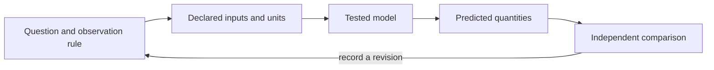

# Structure and Form {#sec:part_I_structure_and_form}

{#fig:part_I_structure_and_form width=90%}

<!-- alt: Three response curves share the same output scale and midpoint but have different slopes near the midpoint; equal normalized range does not make the relationships identical. -->

<!-- chapter-metadata-badge -->
> Guided study · Prerequisites: basic arithmetic and the preceding unit's vocabulary

<!-- curriculum-scaffold-start -->
### Study Blueprint

- **Big idea:** Representation exposes some relationships and suppresses others; retain the mapping back to original quantities.
- **Core concepts:** [**network**](#gl:network), [**boundary**](#gl:boundary), [**model**](#gl:model), [**variable**](#gl:variable).
- **Quantitative lens:** [@eq:part_I_structure_and_form_model].
- **Data skill:** Preserve units, reference bounds and identifiers when transforming a representation.
- **Common misconception to repair:** Equal normalized values do not imply equal original quantities or equal mechanisms.
- **Primary lab:** [@sec:lab_part_I_structure_and_form].
- **Question bank:** [@sec:q_part_I_structure_and_form].
- **Bridge to computation:** `textbook.models.normalize_unit_interval`.
<!-- curriculum-scaffold-end -->

## Learning Objectives

1. Distinguish an interaction structure from the values placed on it.
2. Apply min-max normalization and interpret its degenerate case.
3. Identify information a normalized display does not preserve.

> **Opening example.** Three rooms have readings of ten, twenty and thirty units. A normalized display colors them zero, one half and one. A second building with one hundred, two hundred and three hundred units receives the same colors. The pattern is comparable, but the magnitude has disappeared. A useful representation keeps both the pattern and its reference scale available.

## Separate structure and state

A network describes elements and their relationships. Values on its nodes or
edges describe a state or observation associated with that structure. A room
adjacency network can stay fixed while temperatures change; a contact network
can change while some node attributes remain fixed. Mixing these two layers
makes it difficult to state what a model predicts. Define the node identity,
edge meaning and associated quantity separately. A drawing's position or color
is an encoding choice unless the study explicitly gives it a physical meaning.

## A transformation is a model choice

Min-max normalization uses the smallest and largest supplied observations as
reference bounds. It preserves order for a collection with a nonzero range,
and maps its endpoints to zero and one. This makes a representation convenient
for comparing relative position within that collection. It removes the original
unit scale unless the bounds are retained. The worked example deliberately
uses an exact evenly spaced collection so the transformation can be checked
without relying on an intricate plotting routine or a fitted parameter.

## Degenerate forms need explicit rules

If all observations are equal, the range is zero. The ordinary fraction would
divide by zero, so the tested helper chooses all zeros. This is an interface
convention describing a degenerate case. It is not evidence that every room is
at a physically meaningful zero, nor that no measurement uncertainty exists.
Document the convention in an output record. A downstream visualization can
then distinguish a truly varying range from a constant collection instead of
presenting identical colors as if they conveyed the same information.

## Compare compatible representations

Two independently normalized buildings each fill the entire zero-to-one color
range. Comparing their colors as absolute temperatures would be an error.
Choose shared reference bounds when the task concerns absolute comparisons;
choose within-building bounds when the task concerns relative ordering, and
label that choice. Neither choice is automatically superior. The scientific
question determines which information must survive. The static response figure
similarly shows several shapes on a common scale: equal range and midpoint
do not imply that the functions have the same shape.

## Keep identifiers through the pipeline

A transformed value needs a route back to its source observation. Carry the
room identifier, original units and reference bounds alongside normalized
values; never depend solely on display position. Explicit reusable metadata is
part of the FAIR guidance [@wilkinson2016fair]. Here, that idea becomes a small
data table rather than a claim that a pretty plot is reusable. The lab asks
you to normalize two differently scaled collections and explain exactly which
similarity the shared output establishes and which difference it conceals.

## A Worked Formalism

$$ z_i=\frac{x_i-\min_j x_j}{\max_j x_j-\min_j x_j} $$ {#eq:part_I_structure_and_form_model}

: Quantities and conventions for this chapter's worked example. {#tbl:part_I_structure_and_form_parameters}

| Symbol | Meaning | Units |
| --- | --- | --- |
| $x_i$ | Original value | original units |
| $\min x,\max x$ | Reference bounds | original units |
| $z_i$ | Min-max normalized value | dimensionless |

The reference range is twenty. Subtracting ten from the three observations gives zero, ten and twenty, and division by the range gives zero, one half and one. A constant collection has no nonzero range, so the tested function explicitly returns zeros. That convention prevents division by zero; it does not manufacture variation or an interpretable physical distance.

```python
import numpy as np
from textbook.models import normalize_unit_interval

z = normalize_unit_interval([10.0, 20.0, 30.0])
assert np.allclose(z, [0.0, 0.5, 1.0])
assert np.allclose(normalize_unit_interval([7.0, 7.0]), [0.0, 0.0])
print(z)
```

The equation is evaluated by the tested `textbook.models.normalize_unit_interval`.
The assertions above are independent expectations for this designed example;
the displayed figure in [@fig:part_I_structure_and_form] is a deterministic illustration with its
own explicitly stated inputs, not evidence collected from the opening scenario.

## Assumptions and Limits

Scaling changes representation, not the evidence that generated it. Bounds estimated from one dataset must not be silently recalculated when comparing it with another. The function normalizes one supplied collection; fitting bounds on training data and applying them to future data requires a separately declared transformation. A visually neat scale can conceal these differences unless original units and bounds are retained.



This diagram records the direction of a modeling workflow. An arrow names a
relationship to specify; it does not add an unimplemented physical mechanism.
Keep the original prediction when making the recorded revision.

## Summary

Representation exposes some relationships and suppresses others; retain the mapping back to original quantities. The worked example makes a narrow quantitative claim that can
be checked with exact inputs and a tested function. Equal normalized values do not imply equal original quantities or equal mechanisms.
State the assumptions, preserve the observation record and choose a comparison
that can distinguish an arithmetic error from an inadequate model. Those habits
make a result inspectable without expanding what its evidence establishes.

## Key Terms

[**network**](#gl:network), [**boundary**](#gl:boundary), [**model**](#gl:model), [**variable**](#gl:variable).

## Further Reading

Wilkinson and colleagues [@wilkinson2016fair] describe metadata and reuse principles; consider which metadata makes a normalized value interpretable.

## Practice

- **Lab:** [@sec:lab_part_I_structure_and_form] — execute the worked computation and its boundary control.
- **Question bank:** [@sec:q_part_I_structure_and_form] — compare your reasoning with the supplied solutions.
