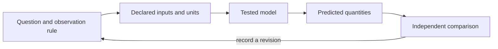

# Dynamics and Change {#sec:part_II_dynamics_and_change}

{#fig:part_II_dynamics_and_change width=90%}

<!-- alt: A smooth quantity-versus-time curve starts at one hundred and decreases toward zero; a vertical dashed line at approximately one point three nine time units marks where the remaining amount is fifty. -->

<!-- chapter-metadata-badge -->
> Guided study · Prerequisites: basic arithmetic and the preceding unit's vocabulary

<!-- curriculum-scaffold-start -->
### Study Blueprint

- **Big idea:** A dynamic law specifies how state changes with time; its rate and timescale must remain distinct.
- **Core concepts:** [**dynamics**](#gl:dynamics), [**state**](#gl:state), [**equilibrium**](#gl:equilibrium), [**parameter**](#gl:parameter).
- **Quantitative lens:** [@eq:part_II_dynamics_and_change_model].
- **Data skill:** Use ratios over equal intervals to inspect a proposed constant fractional loss rate.
- **Common misconception to repair:** Deterministic equations do not automatically provide accurate forecasts for arbitrarily long times.
- **Primary lab:** [@sec:lab_part_II_dynamics_and_change].
- **Question bank:** [@sec:q_part_II_dynamics_and_change].
- **Bridge to computation:** `textbook.models.exponential_decay`.
<!-- curriculum-scaffold-end -->

## Learning Objectives

1. Derive a half-life from a fractional decay law.
2. Compare changes over equal time intervals.
3. State why a deterministic model can still have a limited prediction horizon.

> **Opening example.** A stored quantity falls from one hundred to fifty, then to twenty-five over equal intervals. A straight-line extension would reach zero after the next interval. A fractional-loss model instead predicts twelve and one half. The choice between constant amount and constant fraction is a claim about change, and data can distinguish them.

## From a rate to a trajectory

The decay law says the instantaneous loss rate is proportional to the amount
remaining. In differential form it is $de/dt=-\lambda e$. The closed form in the
worked equation follows by separating variables and applying the initial value.
A trajectory gives the state at requested times; a rate gives change per time.
Confusing these meanings produces errors in both dimensions and interpretation.
Multiplying the decay rate by a time interval gives a dimensionless exponent,
which is a useful unit check before evaluating the expression.

## Equal intervals, unequal losses

For a time increment $\Delta t$, the ratio between successive amounts is
$e(t+\Delta t)/e(t)=e^{-\lambda\Delta t}$. It is independent of the starting time
under the constant-rate model. The absolute loss is not independent of the
remaining amount: larger stocks lose more in the same interval. Use observed
ratios as a diagnostic, but remember that noisy measurements and replenishment
can change them. An exact synthetic sequence verifies the formula; an actual
sequence requires an observation model before the rate can be inferred reliably.

## Timescales help comparisons

The reciprocal rate is a characteristic time, while the half-life includes a
factor of the logarithm of two. Both decrease as the rate increases. Stating a
timescale often makes a comparison easier to interpret than stating a decimal
rate without units. It also makes a dimensional error visible: a half-life
must have time units. At zero rate the amount stays constant and there is no
finite half-life. The helper's rejection of a zero rate in `half_life` preserves
that distinction instead of returning a misleading finite number.

## Initial conditions and forecast limits

Changing the initial amount scales the entire exponential trajectory. Changing
the rate changes its shape on the time axis. In more general nonlinear systems,
small changes in the initial state can have larger effects than simple scaling.
Lorenz's specified nonlinear flow model [@lorenz1963deterministic] provides a
primary example of sensitivity to initial conditions. This book's exponential
exercise is not a simulation of that system. It is a tractable contrast that
shows why forecast claims must be attached to a particular model and domain.

## Check change at several resolutions

A coarse measurement interval can conceal fast transients or an external pulse.
Collecting more decimal places at the same coarse times does not recover those
events. Choose a measurement interval suitable for the proposed timescale, then
preserve timestamps alongside values. Compare predicted and observed quantities
in their original units before normalizing a display. The lab asks you to halve
the measurement interval while retaining the same rate, so that an altered
sampling grid can be distinguished from a genuinely changed process.

## A Worked Formalism

$$ e(t)=e_0e^{-\lambda t},\qquad t_{1/2}=\frac{\ln 2}{\lambda} $$ {#eq:part_II_dynamics_and_change_model}

: Quantities and conventions for this chapter's worked example. {#tbl:part_II_dynamics_and_change_parameters}

| Symbol | Meaning | Units |
| --- | --- | --- |
| $e(t)$ | Non-negative quantity or error magnitude | quantity |
| $e_0$ | Initial magnitude | quantity |
| $\lambda$ | Constant positive decay rate | inverse time |
| $t_{1/2}$ | Time to halve the magnitude | time |

Setting the remaining amount to half its initial value gives $e^{-\lambda t}=1/2$. Taking logarithms yields the half-life in the equation. At rate one half per time unit, the half-life is about $1.386$ time units. Starting at one hundred, successive half-lives give fifty and twenty-five; equal time intervals remove equal fractions, not equal amounts.

```python
import numpy as np
from textbook.models import exponential_decay, half_life

rate = 0.5
t_half = half_life(rate)
values = exponential_decay([0.0, t_half, 2*t_half], initial=100.0, rate=rate)
assert np.allclose(values, [100.0, 50.0, 25.0])
print(t_half, values)
```

The equation is evaluated by the tested `textbook.models.exponential_decay`.
The assertions above are independent expectations for this designed example;
the displayed figure in [@fig:part_II_dynamics_and_change] is a deterministic illustration with its
own explicitly stated inputs, not evidence collected from the opening scenario.

## Assumptions and Limits

The model assumes a constant fractional loss rate with no replenishment. For a feedback interpretation it also assumes a continuous, undelayed ideal controller with an unsaturated actuator. A changing rate, external input or measurement delay breaks the closed-form description. The function permits zero rate as a constant trajectory, but half-life requires a strictly positive rate.



This diagram records the direction of a modeling workflow. An arrow names a
relationship to specify; it does not add an unimplemented physical mechanism.
Keep the original prediction when making the recorded revision.

## Summary

A dynamic law specifies how state changes with time; its rate and timescale must remain distinct. The worked example makes a narrow quantitative claim that can
be checked with exact inputs and a tested function. Deterministic equations do not automatically provide accurate forecasts for arbitrarily long times.
State the assumptions, preserve the observation record and choose a comparison
that can distinguish an arithmetic error from an inadequate model. Those habits
make a result inspectable without expanding what its evidence establishes.

## Key Terms

[**dynamics**](#gl:dynamics), [**state**](#gl:state), [**equilibrium**](#gl:equilibrium), [**parameter**](#gl:parameter).

## Further Reading

Lorenz [@lorenz1963deterministic] studies one specific nonlinear flow model; May [@may1976simple] examines discrete-time dynamics, which should not be conflated with this continuous decay law.

## Practice

- **Lab:** [@sec:lab_part_II_dynamics_and_change] — execute the worked computation and its boundary control.
- **Question bank:** [@sec:q_part_II_dynamics_and_change] — compare your reasoning with the supplied solutions.
