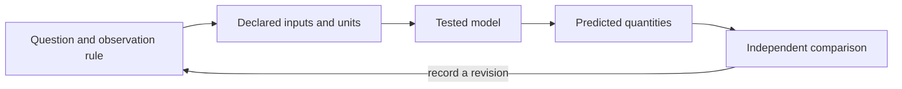

# Regulation and Control {#sec:part_II_regulation_and_control}

{#fig:part_II_regulation_and_control width=90%}

<!-- alt: A smooth quantity-versus-time curve starts at one hundred and decreases toward zero; a vertical dashed line at approximately one point three nine time units marks where the remaining amount is fifty. -->

<!-- chapter-metadata-badge -->
> Guided study · Prerequisites: basic arithmetic and the preceding unit's vocabulary

<!-- curriculum-scaffold-start -->
### Study Blueprint

- **Big idea:** Regulation is a declared relationship between a measured error and an action, with assumptions about timing and limits.
- **Core concepts:** [**feedback**](#gl:feedback), [**regulation**](#gl:regulation), [**state**](#gl:state), [**equilibrium**](#gl:equilibrium).
- **Quantitative lens:** [@eq:part_II_regulation_and_control_model].
- **Data skill:** Keep the controller law, plant law and measurement rule separate before deriving a closed-loop response.
- **Common misconception to repair:** Drawing a negative-feedback loop does not prove that it is stable.
- **Primary lab:** [@sec:lab_part_II_regulation_and_control].
- **Question bank:** [@sec:q_part_II_regulation_and_control].
- **Bridge to computation:** `textbook.models.exponential_decay`.
<!-- curriculum-scaffold-end -->

## Learning Objectives

1. Define a setpoint, measured state and error.
2. Derive ideal proportional error decay for an integrator plant.
3. Identify why delay, saturation or noise invalidates the ideal response.

> **Opening example.** An ideal controller sees a positive gap between a tank level and its target and adds fluid in proportion to that gap. Near the target it acts more gently. A real controller must also wait for measurements, respect pump limits and cope with leakage. The ideal curve is useful because those additional influences can be named as departures from its assumptions.

## Define the error

Let a constant setpoint be $s$, the measured state be $y(t)$ and the signed
error be $e(t)=s-y(t)$. A positive error means the measured state lies below the
target under this convention. Sign conventions are part of the interface:
reversing the error without changing the action law can turn corrective action
into reinforcing action. Write the convention before tuning a gain. Also state
whether the controller acts on a measured state, a delayed observation or an
estimate, since those cases are different closed-loop systems.

## Derive the ideal response

For an ideal integrator plant, $dy/dt=u$, and proportional action is $u=ke$
with positive gain $k$. With a fixed target, differentiating the error gives
$de/dt=-ke$. For an initially positive gap its magnitude is exactly the
exponential decay computed by the helper with rate $k$. This derivation links
a controller, a plant and a trajectory; none of the three can be inferred from
the trajectory alone. The worked equation applies to this narrowly specified
ideal case and does not establish the behavior of an arbitrary controller.

## Gain trades time for other constraints

In the ideal model, a larger positive gain reduces the half-life and leaves
the asymptotic error at zero. The physical action initially equals gain times
error. Increasing gain can therefore require a pump or actuator capacity that
the real system does not have. If action is clipped at a maximum, early-time
behavior follows another law and the single exponential no longer describes
the full response. State the capacity limit before claiming a faster response
from a larger numerical gain. A tested formula cannot remove a physical bound.

## Timing can change the system

The ideal derivation uses the current error continuously. A sampled controller
acts at intervals, and a delayed sensor supplies an earlier state. These changes
can produce overshoot or instability depending on the actual update law.
Nyquist's analysis [@nyquist1932regeneration] gives primary historical treatment
of stability for specified feedback systems. Here the important habit is to
state the delay and sampling assumptions explicitly. A diagram conveys the
connections, but a stability conclusion requires the corresponding mathematics
and a domain of parameter values.

## Evaluate the disturbance story

A constant leak, varying target or noisy observation changes the error dynamics.
Ask which disturbance is relevant before selecting a more elaborate controller.
For example, an ideal action that decays toward zero cannot offset a continuing
unmodeled leak while maintaining the target. The lab first verifies the ideal
halving sequence, then asks why an observed plateau would challenge the
no-disturbance assumption. Keeping a failed prediction in the record supports
model revision; quietly replacing its parameters after observing the plateau
does not establish that the original controller model was adequate.

## A Worked Formalism

$$ e(t)=e_0e^{-\lambda t},\qquad t_{1/2}=\frac{\ln 2}{\lambda} $$ {#eq:part_II_regulation_and_control_model}

: Quantities and conventions for this chapter's worked example. {#tbl:part_II_regulation_and_control_parameters}

| Symbol | Meaning | Units |
| --- | --- | --- |
| $e(t)$ | Non-negative quantity or error magnitude | quantity |
| $e_0$ | Initial magnitude | quantity |
| $\lambda$ | Constant positive decay rate | inverse time |
| $t_{1/2}$ | Time to halve the magnitude | time |

Setting the remaining amount to half its initial value gives $e^{-\lambda t}=1/2$. Taking logarithms yields the half-life in the equation. At rate one half per time unit, the half-life is about $1.386$ time units. Starting at one hundred, successive half-lives give fifty and twenty-five; equal time intervals remove equal fractions, not equal amounts.

```python
import numpy as np
from textbook.models import exponential_decay, half_life

rate = 0.5
t_half = half_life(rate)
values = exponential_decay([0.0, t_half, 2*t_half], initial=100.0, rate=rate)
assert np.allclose(values, [100.0, 50.0, 25.0])
print(t_half, values)
```

The equation is evaluated by the tested `textbook.models.exponential_decay`.
The assertions above are independent expectations for this designed example;
the displayed figure in [@fig:part_II_regulation_and_control] is a deterministic illustration with its
own explicitly stated inputs, not evidence collected from the opening scenario.

## Assumptions and Limits

The model assumes a constant fractional loss rate with no replenishment. For a feedback interpretation it also assumes a continuous, undelayed ideal controller with an unsaturated actuator. A changing rate, external input or measurement delay breaks the closed-form description. The function permits zero rate as a constant trajectory, but half-life requires a strictly positive rate.



This diagram records the direction of a modeling workflow. An arrow names a
relationship to specify; it does not add an unimplemented physical mechanism.
Keep the original prediction when making the recorded revision.

## Summary

Regulation is a declared relationship between a measured error and an action, with assumptions about timing and limits. The worked example makes a narrow quantitative claim that can
be checked with exact inputs and a tested function. Drawing a negative-feedback loop does not prove that it is stable.
State the assumptions, preserve the observation record and choose a comparison
that can distinguish an arithmetic error from an inadequate model. Those habits
make a result inspectable without expanding what its evidence establishes.

## Key Terms

[**feedback**](#gl:feedback), [**regulation**](#gl:regulation), [**state**](#gl:state), [**equilibrium**](#gl:equilibrium).

## Further Reading

Nyquist [@nyquist1932regeneration] treats feedback stability for defined systems; compare the conditions in that analysis with the ideal no-delay derivation here.

## Practice

- **Lab:** [@sec:lab_part_II_regulation_and_control] — execute the worked computation and its boundary control.
- **Question bank:** [@sec:q_part_II_regulation_and_control] — compare your reasoning with the supplied solutions.
