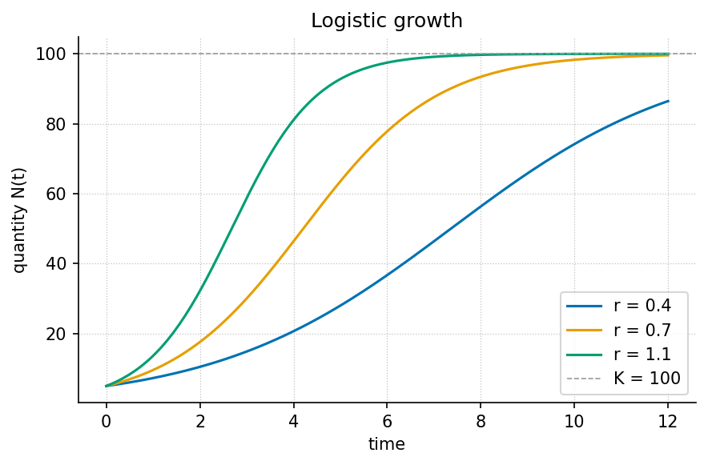
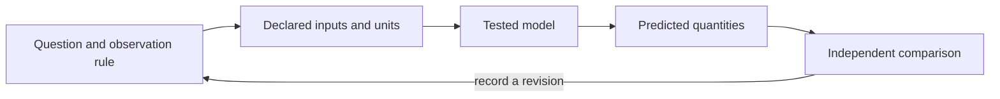

# Systems Overview {#sec:part_II_systems_overview}

{#fig:part_II_systems_overview width=90%}

<!-- alt: Three smooth S-shaped quantity-versus-time curves start at five units and approach a dashed capacity line at one hundred; higher rates reach the middle of the transition sooner. -->

<!-- chapter-metadata-badge -->
> Guided study · Prerequisites: basic arithmetic and the preceding unit's vocabulary

<!-- curriculum-scaffold-start -->
### Study Blueprint

- **Big idea:** A systems description combines a state, an update law, an observation rule and a declared environment.
- **Core concepts:** [**system**](#gl:system), [**state**](#gl:state), [**boundary**](#gl:boundary), [**feedback**](#gl:feedback).
- **Quantitative lens:** [@eq:part_II_systems_overview_model].
- **Data skill:** Track state, update rule and measurement process as separate parts of a system record.
- **Common misconception to repair:** A stable-looking observable is not sufficient evidence that the entire system is at equilibrium.
- **Primary lab:** [@sec:lab_part_II_systems_overview].
- **Question bank:** [@sec:q_part_II_systems_overview].
- **Bridge to computation:** `textbook.models.logistic_growth`.
<!-- curriculum-scaffold-end -->

## Learning Objectives

1. Identify the four components of a systems description.
2. Distinguish state constraints from observed trends.
3. Evaluate a model using both its internal invariants and external observations.

> **Opening example.** A dashboard shows a stock approaching a ceiling. One observer attributes the ceiling to limited capacity; another points to a change in counting rules. Both explanations can produce a flat line. A systems overview asks what changed inside the system, what crossed its boundary, and what the dashboard actually measured.

## The state and its update

The state is the information the model uses to determine subsequent change.
For a one-variable logistic model, the state is the quantity at a time; its
update law depends on the rate and capacity parameters. A larger model may need
several stocks, their interactions and delayed effects. There is no guarantee
that every system can be summarized by one scalar. Choose the state for the
question and horizon at hand, and state which influences the update law omits.
An equation's compactness should make those omissions easier to inspect.

## The environment and observation

External inputs describe conditions outside the chosen boundary. An observation
rule maps the modeled state to a recorded quantity. Neither belongs silently
inside the state equation. A dashboard can flatten because registration stops,
because measurement reaches its range limit, or because the underlying stock
stabilizes. These cases require different follow-up observations. Document any
instrument limit or changed eligibility rule before attributing a change in
the plotted series to an internal system mechanism.

## Invariants as internal checks

With the declared logistic parameter domain and a non-negative time axis, the
computed state remains positive and no larger than capacity. These constraints
can detect an implementation defect or an invalid input. They do not establish
that a measured system actually has this domain or capacity. A model can obey
all its internal invariants and still fail to predict observations. Keep the
two checks separate: internal consistency is necessary for using the equation,
while external comparison determines whether it is useful for the application.

## Equilibrium needs a rule

An equilibrium is a state with zero change under the specified update law.
For logistic growth, the mathematical rate vanishes at zero and at capacity.
The shipped closed-form helper deliberately accepts a strictly positive initial
state no larger than capacity, so its allowed trajectories approach the latter.
That API restriction is narrower than the mathematical equation's full state
space. When discussing a model, distinguish properties of the equation from
properties of the implemented domain. This prevents a valid software guard
from being mistaken for a universal statement about all systems.

## Examine interactions before enlarging the model

Add a component when it resolves a specific inadequacy, such as an omitted
input with a measurable effect. Additional states bring additional parameters,
observations and identifiability questions. An elaborate diagram without an
observation plan can make the original question harder to answer. Nyquist's
primary analysis [@nyquist1932regeneration] illustrates that feedback stability
requires mathematical conditions, not simply a loop drawn with arrows. The lab
uses the small logistic case to practice a complete systems record before
any larger feedback or interaction model is proposed.

## A Worked Formalism

$$ N(t)=\frac{K}{1+((K-N_0)/N_0)e^{-rt}} $$ {#eq:part_II_systems_overview_model}

: Quantities and conventions for this chapter's worked example. {#tbl:part_II_systems_overview_parameters}

| Symbol | Meaning | Units |
| --- | --- | --- |
| $N(t)$ | State at time $t$ | quantity |
| $N_0$ | Initial state, between zero and $K$ | quantity |
| $K$ | Capacity held fixed in this model | quantity |
| $r$ | Positive growth rate | inverse time |

At time zero the denominator is $1+19=20$, so the state is exactly five units. At time two it is $1+19e^{-1.4}$, giving about $17.59$ units. The state approaches $100$ as the exponential term approaches zero. These are predictions of a chosen model, not measured evidence that a real population or service has a fixed capacity.

```python
import numpy as np
from textbook.models import logistic_growth

time = np.array([0.0, 2.0, 5.0])
values = logistic_growth(time, r=0.7, carrying_capacity=100.0, initial=5.0)
assert np.isclose(values[0], 5.0)
assert np.all(np.diff(values) > 0)
assert np.all(values < 100.0)
print(values)
```

The equation is evaluated by the tested `textbook.models.logistic_growth`.
The assertions above are independent expectations for this designed example;
the displayed figure in [@fig:part_II_systems_overview] is a deterministic illustration with its
own explicitly stated inputs, not evidence collected from the opening scenario.

## Assumptions and Limits

The closed form assumes a constant positive rate and a fixed capacity with an initial state strictly above zero and no larger than capacity. It omits migration, changing resources and random shocks. A discrepancy can therefore reflect a failed assumption rather than a programming error. First inspect the units and initial value, then ask which omitted process could generate the observed discrepancy.



This diagram records the direction of a modeling workflow. An arrow names a
relationship to specify; it does not add an unimplemented physical mechanism.
Keep the original prediction when making the recorded revision.

## Summary

A systems description combines a state, an update law, an observation rule and a declared environment. The worked example makes a narrow quantitative claim that can
be checked with exact inputs and a tested function. A stable-looking observable is not sufficient evidence that the entire system is at equilibrium.
State the assumptions, preserve the observation record and choose a comparison
that can distinguish an arithmetic error from an inadequate model. Those habits
make a result inspectable without expanding what its evidence establishes.

## Key Terms

[**system**](#gl:system), [**state**](#gl:state), [**boundary**](#gl:boundary), [**feedback**](#gl:feedback).

## Further Reading

Nyquist [@nyquist1932regeneration] analyzes stability for specified feedback systems; compare a formal condition with an informal loop diagram.

## Practice

- **Lab:** [@sec:lab_part_II_systems_overview] — execute the worked computation and its boundary control.
- **Question bank:** [@sec:q_part_II_systems_overview] — compare your reasoning with the supplied solutions.
