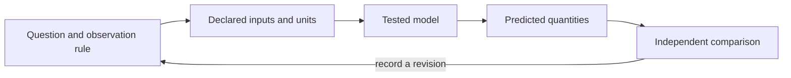

# Applied Models {#sec:part_III_applied_models}

{#fig:part_III_applied_models width=90%}

<!-- alt: Three input-versus-response curves rise from zero toward one and all pass through response one half at input three; larger exponents sharpen the transition around that point. -->

<!-- chapter-metadata-badge -->
> Guided study · Prerequisites: basic arithmetic and the preceding unit's vocabulary

<!-- curriculum-scaffold-start -->
### Study Blueprint

- **Big idea:** Choose a model family by the question and evidence it can represent, then compare alternatives where they differ.
- **Core concepts:** [**model**](#gl:model), [**parameter**](#gl:parameter), [**threshold**](#gl:threshold), [**observable**](#gl:observable).
- **Quantitative lens:** [@eq:part_III_applied_models_model].
- **Data skill:** Compare model predictions at designed inputs that discriminate between families.
- **Common misconception to repair:** The best fit within the existing range need not provide the best prediction outside it.
- **Primary lab:** [@sec:lab_part_III_applied_models].
- **Question bank:** [@sec:q_part_III_applied_models].
- **Bridge to computation:** `textbook.models.saturating_response`.
<!-- curriculum-scaffold-end -->

## Learning Objectives

1. Select a static or dynamic family for a stated observation.
2. Use limiting behavior to distinguish a line from a saturating response.
3. Separate parameter fitting from independent model evaluation.

> **Opening example.** A calibration series covers only low inputs, where a straight line and a saturating curve are almost indistinguishable. Both fit well, but they predict different outputs at higher inputs. The next useful observation is therefore not necessarily another low-input replicate: it may be a safe, controlled input where the two predictions diverge.

## Match the family to the question

A static input-output calibration calls for a response function; a state evolving
over time calls for a dynamic law. A model family should represent the kind of
claim being made before its parameters are fitted. The backbone offers both
types, with deliberately limited contracts. Do not use a saturating response
to claim adaptation time, or a logistic time trajectory to imply that a measured
input caused the change. Naming the independent variable and its units is an
effective first check of whether a proposed family fits the question.

## Examine limiting behavior

A fitted straight line increases or decreases without a ceiling. The response
curve has a finite positive maximum. In a narrow range both can resemble the
same local trend. Their disagreement at other inputs supplies a possible
evaluation design, subject to safety and feasibility in the actual application.
The worked response calculation illustrates diminishing gains without claiming
that every physical process must saturate. Write each alternative's limiting
behavior next to its data-range fit, so that a convenient interpolation does
not quietly become an unlimited extrapolation.

## Fitting uses information

Parameters estimated from observations have already used those observations.
Judging predictions on the same data therefore answers a different question
from judging future or held-out observations. Preserve the fitting set and
declare the evaluation set before checking results when possible. Avoid choosing
a model after repeatedly examining an evaluation set and then describing that
set as untouched. For a very small instructional dataset, it can be more honest
to call the fit a descriptive exercise and identify independent evaluation as
the next needed step.

## Inspect residuals and domain restrictions

A single fit score compresses several forms of inadequacy. Inspect residuals
in original units and against the input: a consistent curve, a changed spread
or an isolated outlier can suggest different failures. Also check whether the
parameter values lie within the implementation's accepted domain. A numerical
optimizer returning a value does not make that value meaningful. Box's primary
discussion [@box1976science] connects selective concern about model inadequacies
with scientific iteration; this chapter's small comparisons practice that
judgment without inventing a universal model-selection rule.

## Communicate a bounded recommendation

A recommendation should state the application range, observation rule, fitted
parameters, evaluation evidence and remaining uncertainty. In the low-input
calibration vignette, a defensible conclusion is that both families describe
the measured range and that a discriminating observation is needed for their
different high-input predictions. It is not that one equation has discovered
the mechanism. The lab uses exact response values and a simple line to make
the disagreement explicit. Its arithmetic is reproducible, while the question
of which family describes a real system remains an empirical task.

## A Worked Formalism

$$ y(x)=M\frac{x^h}{k^h+x^h} $$ {#eq:part_III_applied_models_model}

: Quantities and conventions for this chapter's worked example. {#tbl:part_III_applied_models_parameters}

| Symbol | Meaning | Units |
| --- | --- | --- |
| $x$ | Non-negative input | input units |
| $M$ | Positive maximum response | output units |
| $k$ | Input giving half the maximum | input units |
| $h$ | Positive shape exponent | dimensionless |

With a maximum of one, half-saturation input of three and exponent two, the outputs at zero, three and six are zero, one half and four fifths. At the half-saturation input, the numerator and the other denominator term are equal. Doubling the input from three to six therefore does not double the output: the finite ceiling changes the arithmetic.

```python
import numpy as np
from textbook.models import saturating_response

x = np.array([0.0, 3.0, 6.0])
y = saturating_response(x, maximum=1.0, half_saturation=3.0, hill=2.0)
assert np.allclose(y, [0.0, 0.5, 0.8])
print(y)
```

The equation is evaluated by the tested `textbook.models.saturating_response`.
The assertions above are independent expectations for this designed example;
the displayed figure in [@fig:part_III_applied_models] is a deterministic illustration with its
own explicitly stated inputs, not evidence collected from the opening scenario.

## Assumptions and Limits

This function is a static response curve: it relates an input to an output without a state or elapsed time. It cannot by itself explain adaptation, delays, oscillation or memory. Different exponents describe different shapes but do not uniquely identify a physical mechanism. Interpret the parameters within the declared model rather than treating a fitted shape as a causal discovery.



This diagram records the direction of a modeling workflow. An arrow names a
relationship to specify; it does not add an unimplemented physical mechanism.
Keep the original prediction when making the recorded revision.

## Summary

Choose a model family by the question and evidence it can represent, then compare alternatives where they differ. The worked example makes a narrow quantitative claim that can
be checked with exact inputs and a tested function. The best fit within the existing range need not provide the best prediction outside it.
State the assumptions, preserve the observation record and choose a comparison
that can distinguish an arithmetic error from an inadequate model. Those habits
make a result inspectable without expanding what its evidence establishes.

## Key Terms

[**model**](#gl:model), [**parameter**](#gl:parameter), [**threshold**](#gl:threshold), [**observable**](#gl:observable).

## Further Reading

Box [@box1976science] offers primary guidance on confronting model inadequacy; compare a residual diagnostic with collecting a new discriminating observation.

## Practice

- **Lab:** [@sec:lab_part_III_applied_models] — execute the worked computation and its boundary control.
- **Question bank:** [@sec:q_part_III_applied_models] — compare your reasoning with the supplied solutions.
