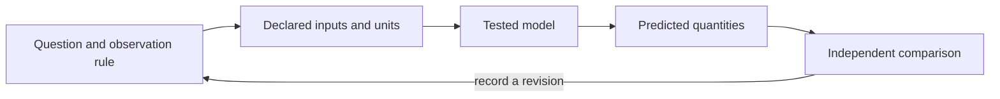

# Frontiers and Open Problems {#sec:part_III_frontiers}

{#fig:part_III_frontiers width=90%}

<!-- alt: Three response curves share the same output scale and midpoint but have different slopes near the midpoint; equal normalized range does not make the relationships identical. -->

<!-- chapter-metadata-badge -->
> Guided study · Prerequisites: basic arithmetic and the preceding unit's vocabulary

<!-- curriculum-scaffold-start -->
### Study Blueprint

- **Big idea:** An open problem becomes productive when its uncertainty is turned into a discriminating observation or a falsifiable computation.
- **Core concepts:** [**model**](#gl:model), [**observable**](#gl:observable), [**boundary**](#gl:boundary), [**emergence**](#gl:emergence).
- **Quantitative lens:** [@eq:part_III_frontiers_model].
- **Data skill:** Write a claim, a discriminating check and an explicit boundary around the result.
- **Common misconception to repair:** Reproducible execution is valuable evidence about a procedure, but it is not proof of scientific truth.
- **Primary lab:** [@sec:lab_part_III_frontiers].
- **Question bank:** [@sec:q_part_III_frontiers].
- **Bridge to computation:** `textbook.models.normalize_unit_interval`.
<!-- curriculum-scaffold-end -->

## Learning Objectives

1. Distinguish a computation limit from a scientific evidence gap.
2. Design a small negative control for an ambitious claim.
3. Describe reproducibility, reuse and validity as separate properties.

> **Opening example.** A team can regenerate every figure, yet two rival explanations still fit the data. Another team has a plausible theory but cannot reconstruct which input produced its graph. The first faces an evidence gap; the second faces a custody gap. Calling both problems “more research needed” conceals the different next actions that could resolve them.

## Classify the uncertainty

Some uncertainty concerns arithmetic or implementation: does the code return
the expected result on a known case? Some concerns model adequacy: do the
observations distinguish this explanation from another? Some concerns custody:
can an output be traced to exact inputs and transformations? Some concerns
generalization: would the relationship persist in another setting? These gaps
need different checks. Begin an open-problem note by naming the gap, then state
the evidence that would reduce it. A large experiment or elaborate software
system is not automatically the smallest useful next step.

## Negative controls constrain a claim

An ambitious claim needs a case that would expose its failure. A procedure
claiming to preserve all meaningful differences during normalization should be
challenged with two collections that differ only by scale: their normalized
outputs coincide. That simple counterexample reveals exactly what the procedure
does not preserve. It does not make normalization useless; it narrows its
appropriate claim. A negative control is strongest when it fails for the
reason relevant to the claim rather than through an unrelated missing file
or a unavailable tool.

## Computational limits need precise statements

Terminating on several tested inputs establishes behavior on those inputs,
not termination for every possible input. Turing's primary computability paper
[@turing1937computable] is further reading on formal limits of computation.
This book does not infer an impossibility theorem from a timed-out program.
A finite deadline provides a practical execution boundary and an observable
failure result. State that boundary and preserve its receipt instead of
turning timeout into a successful numeric answer or a general theoretical
conclusion.

## Reproducibility and reuse

Reproducing a calculation means preserving enough of the procedure and inputs
to obtain it again under a declared environment. Reuse adds interpretation:
someone must understand the quantities, conventions, scope and licensing.
FAIR guidance [@wilkinson2016fair] describes principles for data stewardship,
including metadata and access conditions. It does not require exposing private
records merely to make a demonstration look open. Use shareable instructional
fixtures and describe the boundary around confidential material. A readable
record can be reproducible while an unsupported causal interpretation remains
unsupported.

## Turn a frontier into a next action

For each open problem, record a producer, expected artifact, consumer and
negative control. In the normalization case, the producer is the tested helper,
the artifact is the transformed collection and its bounds, the consumer is a
comparison, and the control is a scale-shifted collection. In a model comparison,
the next artifact may be a new measurement rather than more code. Robustness
practices discussed by Taschuk and Wilson [@taschuk2017ten] help make procedures
portable, but they do not decide which observations answer a scientific
question. That decision remains part of the authored research plan.

## A Worked Formalism

$$ z_i=\frac{x_i-\min_j x_j}{\max_j x_j-\min_j x_j} $$ {#eq:part_III_frontiers_model}

: Quantities and conventions for this chapter's worked example. {#tbl:part_III_frontiers_parameters}

| Symbol | Meaning | Units |
| --- | --- | --- |
| $x_i$ | Original value | original units |
| $\min x,\max x$ | Reference bounds | original units |
| $z_i$ | Min-max normalized value | dimensionless |

The reference range is twenty. Subtracting ten from the three observations gives zero, ten and twenty, and division by the range gives zero, one half and one. A constant collection has no nonzero range, so the tested function explicitly returns zeros. That convention prevents division by zero; it does not manufacture variation or an interpretable physical distance.

```python
import numpy as np
from textbook.models import normalize_unit_interval

z = normalize_unit_interval([10.0, 20.0, 30.0])
assert np.allclose(z, [0.0, 0.5, 1.0])
assert np.allclose(normalize_unit_interval([7.0, 7.0]), [0.0, 0.0])
print(z)
```

The equation is evaluated by the tested `textbook.models.normalize_unit_interval`.
The assertions above are independent expectations for this designed example;
the displayed figure in [@fig:part_III_frontiers] is a deterministic illustration with its
own explicitly stated inputs, not evidence collected from the opening scenario.

## Assumptions and Limits

Scaling changes representation, not the evidence that generated it. Bounds estimated from one dataset must not be silently recalculated when comparing it with another. The function normalizes one supplied collection; fitting bounds on training data and applying them to future data requires a separately declared transformation. A visually neat scale can conceal these differences unless original units and bounds are retained.



This diagram records the direction of a modeling workflow. An arrow names a
relationship to specify; it does not add an unimplemented physical mechanism.
Keep the original prediction when making the recorded revision.

## Summary

An open problem becomes productive when its uncertainty is turned into a discriminating observation or a falsifiable computation. The worked example makes a narrow quantitative claim that can
be checked with exact inputs and a tested function. Reproducible execution is valuable evidence about a procedure, but it is not proof of scientific truth.
State the assumptions, preserve the observation record and choose a comparison
that can distinguish an arithmetic error from an inadequate model. Those habits
make a result inspectable without expanding what its evidence establishes.

## Key Terms

[**model**](#gl:model), [**observable**](#gl:observable), [**boundary**](#gl:boundary), [**emergence**](#gl:emergence).

## Further Reading

Turing [@turing1937computable] addresses formal computability; Taschuk and Wilson [@taschuk2017ten] address practical software robustness. Keep those proof boundaries distinct.

## Practice

- **Lab:** [@sec:lab_part_III_frontiers] — execute the worked computation and its boundary control.
- **Question bank:** [@sec:q_part_III_frontiers] — compare your reasoning with the supplied solutions.
