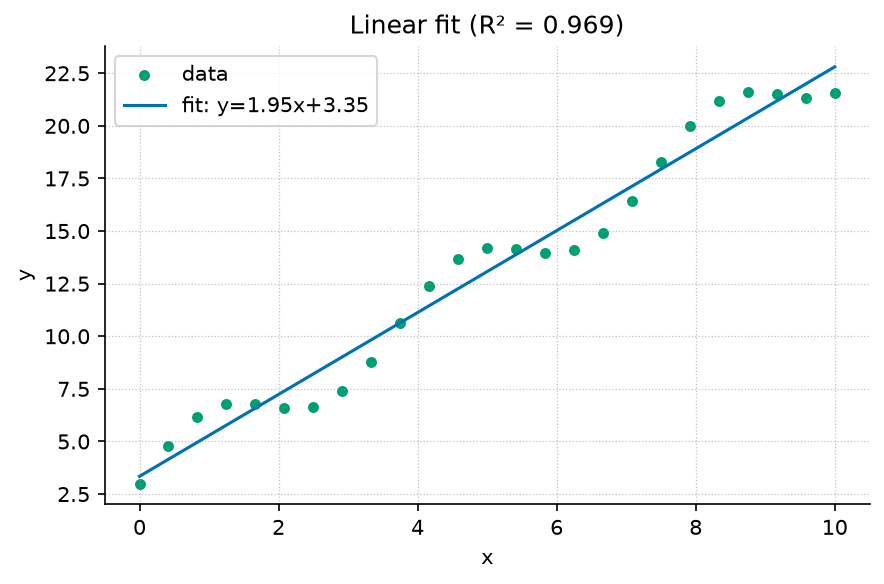
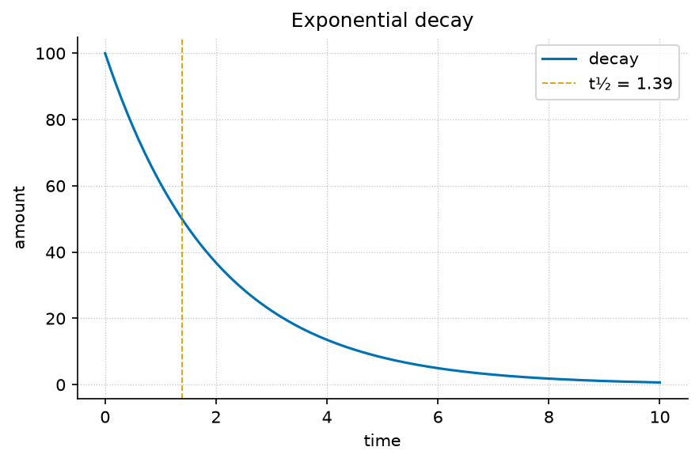
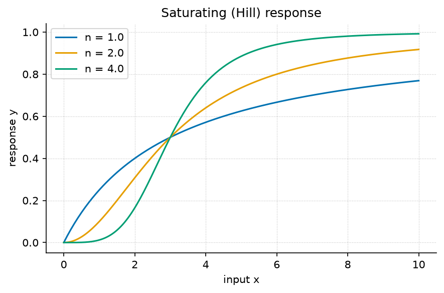
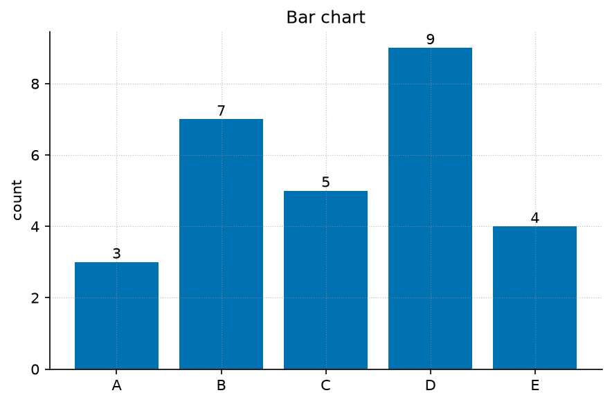
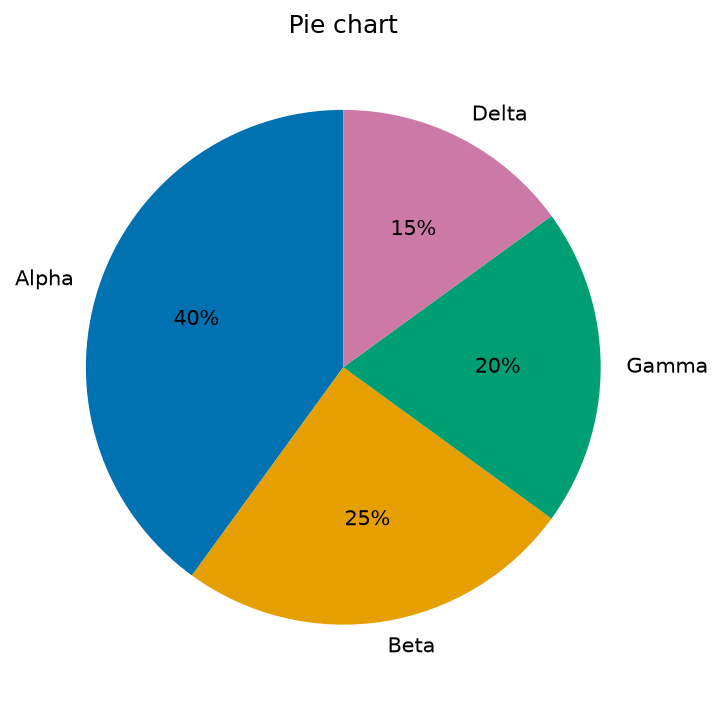
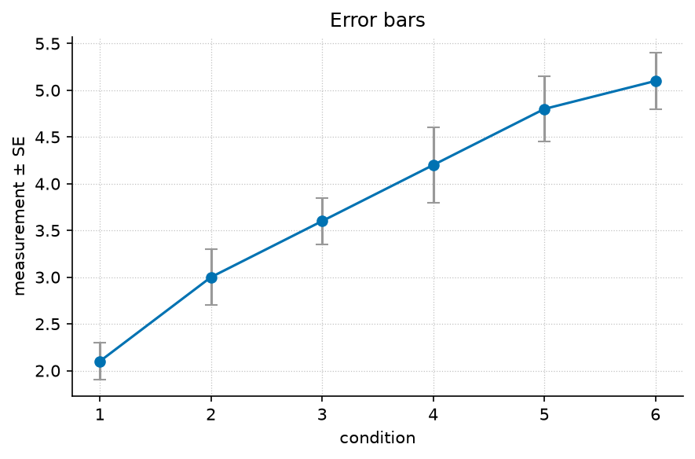

# Front Matter {#sec:front_matter}

## About this book

*The Template Textbook* is an authored introduction to systems, models and
reproducible research. Its chapters combine a question, a mathematical formalism,
a deterministic figure, a worked computation and paired practice. Every
instructional example declares its assumptions. The book's structure is read
from `manuscript/config.yaml`; chapter numbering and cross-references are derived
at render time rather than maintained as duplicated prose.

## Reading and computation

The source is Markdown. The computational backbone is Python with NumPy, and
figures are regenerated through the supplied scripts. Install the project or
run from its documented environment before executing a code block. Run the
worked examples in a fresh interpreter to avoid hidden state from an earlier
calculation. Preserve the original input and record a changed-input experiment
as a new comparison.

The canonical manuscript is complete at the declared content boundary. It also
contains an authoring appendix because the underlying engine can scaffold other
books. Draft scaffolding is a separate workflow: it must not replace canonical
chapters during an ordinary build. The strict audit and manuscript tests keep
that distinction visible.

## Evidence and scope

The logistic, decay, response, normalization and fitted-line examples use
constructed inputs. The case-study observations come from the bundled
`assets/data/sample_dataset.csv` fixture. These are teaching records rather
than new empirical findings. An exact synthetic answer checks a computation;
an observation plan and independent data are needed to evaluate a real system.

Source files and generated figures support inspection and reuse. A test receipt
is local evidence for the revision that produced it. Previously published PDFs,
DOIs and artifact URLs retain their historical version meanings, and an intended
release does not become published through editing this manuscript.

## Licensing

Book content uses the configured Creative Commons Attribution 4.0 license; the
computational code uses the configured Apache-2.0 license. Consult the repository
license files for the governing text. Bibliography entries identify verified
primary publications; they are not placeholders or invented reading suggestions.
No ISBN or new publication identifier is asserted here.


```{=latex}
\newpage
```


# Preface {#sec:preface}

## Purpose

This book introduces systems, quantitative models and reproducible computational
reasoning through a small tested backbone. Its aim is to help a learner say what
an equation represents, what a computation checks and what observation would
challenge a prediction. A precise number is useful only when its meaning and
custody remain visible. The chapters therefore pair equations with input domains,
worked arithmetic, deterministic figures, labs and answer discussions.

The examples are instructional. A smooth growth curve does not document a real
population; a six-row fixture does not report a new experiment. Synthetic inputs
make selected mathematical properties transparent, while the bundled case-study
CSV binds one worked example to exact source values. The distinction between
these demonstrations and empirical research is part of the lesson, not an
incidental disclaimer.

## Audience and prerequisites

Readers need basic arithmetic, familiarity with graphs and a willingness to work
through a short Python call. Derivatives and logarithms are explained where they
enter a formalism, and the mathematical review supplies additional examples.
The book is suitable for a guided introductory course or self-directed study.
It is not a domain-specific engineering design manual, an experimental protocol
or a claim that a single family of models explains every system.

## How to use the book

Begin with a question and a written prediction before running a computation.
Read the quantities and assumptions in the parameter table. Run the example in
a fresh interpreter, preserve its output and compare it with the stated boundary
case. In the lab, change one input while holding the rest fixed. In the question
bank, explain your reasoning before reading the solution. A failed expectation
is useful evidence if its inputs and cause remain inspectable.

The units progress from observation and methods to model components, dynamic
systems and applications. Cross-references connect each chapter to its lab and
questions, while the glossary defines recurring terms. The reference appendices
cover notation, derivations, authoring conventions, rendering primitives and a
section-based index. Their purpose is to support the authored examples rather
than hide unfinished sections behind an attractive table of contents.

## Computational record

The mathematical functions live in `textbook.models`; figures and analysis
scripts call the tested source rather than maintaining separate formulas.
Tests exercise real arrays and files, with explicit negative controls for the
content gate. The canonical complete-manuscript audit checks every configured
rendered section. The separate scaffold API still creates drafts for new books,
and tests those drafts independently of this finished canonical content.

A passing content gate establishes structure and absence of declared draft
markers. It does not establish scientific validity, hosted execution or a new
publication deposit. Historical publication identifiers continue to identify
the releases to which they were assigned. This source is an authored teaching
record whose computations and interpretation can be inspected and improved.


```{=latex}
\newpage
```


# Orientation and Methods {#sec:part_0_intro}

This unit establishes the record that makes a calculation interpretable: a question, a system boundary, an observation definition and a transformation. Orientation starts with what a model represents; Core Methods turns that description into an inspectable workflow; Quantitative Foundations checks units and summary conventions before those workflows become evidence. The running examples are synthetic or bundled instructional data. They demonstrate arithmetic and reasoning without claiming new measurements from a real service, organism or instrument.

Read the chapters in order and keep one notebook of definitions and predictions. Before each computation, write a boundary value or a qualitative expectation. After running it, retain the original expectation alongside the output rather than replacing it. In the labs, compare a valid designed case with one boundary or invalid case. This habit separates a calculation that works from a scientific explanation that still needs an observation plan.

## Chapters

- [@sec:part_0_orientation]
- [@sec:part_0_core_methods]
- [@sec:part_0_quantitative_foundations]

## Study Route

Read the chapter, work the paired lab in a fresh Python interpreter, and then
answer the question bank before comparing your reasoning with its solutions.
Retain units, assumptions and failed predictions in the study record.


```{=latex}
\newpage
```


# Orientation to the Field {#sec:part_0_orientation}

{#fig:part_0_orientation width=90%}

<!-- alt: Three smooth S-shaped quantity-versus-time curves start at five units and approach a dashed capacity line at one hundred; higher rates reach the middle of the transition sooner. -->

<!-- chapter-metadata-badge -->
> Guided study · Prerequisites: basic arithmetic and the preceding unit's vocabulary

<!-- curriculum-scaffold-start -->
### Study Blueprint

- **Big idea:** Begin a model by naming a question, a boundary and an observation that could change your mind.
- **Core concepts:** [**system**](#gl:system), [**boundary**](#gl:boundary), [**state**](#gl:state), [**observable**](#gl:observable).
- **Quantitative lens:** [@eq:part_0_orientation_model].
- **Data skill:** Keep observation definitions and model assumptions next to the prediction.
- **Common misconception to repair:** A plausible curve is not a complete explanation of the system.
- **Primary lab:** [@sec:lab_part_0_orientation].
- **Question bank:** [@sec:q_part_0_orientation].
- **Bridge to computation:** `textbook.models.logistic_growth`.
<!-- curriculum-scaffold-end -->

## Learning Objectives

1. Draw a system boundary and classify the inputs that cross it.
2. Distinguish a state, a measurement and a parameter in a concrete example.
3. State what an illustrative model predicts and what evidence would challenge it.

> **Opening example.** Imagine a library planning a new borrowing service. Daily sign-ups rise quickly, then slow. The manager asks whether the service will reach everyone in the town. A smooth curve can organize that question, but the curve alone cannot tell us who was excluded, whether the town changed, or how sign-ups were recorded. Those omissions are where modeling begins.

## A question before an equation

The useful starting question is precise enough to make an observation relevant.
“How does the service work?” is a broad invitation. “How many registered users
will the service have after five time units if current conditions persist?”
defines a quantity, horizon and conditional claim. The conditional phrase is
essential: a prediction is about specified circumstances, not a promise that
those circumstances will continue. Write the question before choosing a familiar
equation, so that convenience does not decide what the study is about.

## Choosing the boundary

A boundary decides which processes the model represents explicitly and which
arrive as inputs or disturbances. For sign-ups, the modeled state might be the
number of registered accounts; publicity, population changes and service outages
may remain outside. Drawing a boundary does not deny those processes. It makes
their omission inspectable. Two investigators can draw different boundaries
around the same service and produce different useful models because they are
answering different questions. Record the choice and the reason rather than
arguing that one diagram is the service itself.

## State is not the measurement

The account count is an observable produced by a counting procedure. A person
may hold two accounts, and a registered account may never borrow anything. A
state representing active participants is therefore not identical to a table
of registrations. Before evaluating a prediction, specify the observation rule,
the time at which counting occurs, and how duplicates are treated. This book's
worked quantities are instructional examples; they do not report actual users
or biological populations. Keeping that distinction prevents synthetic examples
from acquiring false authority merely because they are drawn as precise curves.

## The prediction and its challenge

The logistic illustration combines an initial value, a positive growth rate
and a capacity. Several rate choices produce the family in the chapter figure.
The same initial count can therefore lead to different intermediate forecasts.
If later observations consistently exceed the declared capacity, the model has
failed a useful challenge: revise the capacity assumption or select another
model. Adjusting every parameter after every new observation without preserving
the previous forecast removes this challenge. Keep the original forecast and
compare it with the later outcome before revising the next one.

## An evidence record

For this exercise, keep four items: the question, the observation definition,
the model configuration and the resulting prediction. Attach the input data
and execution command when computation enters the record. A hash identifies
bytes, a test checks selected behavior, and a comparison checks a prediction;
none substitutes for the others. Box discusses iterative contact between theory
and practice [@box1976science]. The lab translates that idea into a small record
that another learner can inspect without knowing what its author intended.

## A Worked Formalism

$$ N(t)=\frac{K}{1+((K-N_0)/N_0)e^{-rt}} $$ {#eq:part_0_orientation_model}

: Quantities and conventions for this chapter's worked example. {#tbl:part_0_orientation_parameters}

| Symbol | Meaning | Units |
| --- | --- | --- |
| $N(t)$ | State at time $t$ | quantity |
| $N_0$ | Initial state, between zero and $K$ | quantity |
| $K$ | Capacity held fixed in this model | quantity |
| $r$ | Positive growth rate | inverse time |

At time zero the denominator is $1+19=20$, so the state is exactly five units. At time two it is $1+19e^{-1.4}$, giving about $17.59$ units. The state approaches $100$ as the exponential term approaches zero. These are predictions of a chosen model, not measured evidence that a real population or service has a fixed capacity.

```python
import numpy as np
from textbook.models import logistic_growth

time = np.array([0.0, 2.0, 5.0])
values = logistic_growth(time, r=0.7, carrying_capacity=100.0, initial=5.0)
assert np.isclose(values[0], 5.0)
assert np.all(np.diff(values) > 0)
assert np.all(values < 100.0)
print(values)
```

The equation is evaluated by the tested `textbook.models.logistic_growth`.
The assertions above are independent expectations for this designed example;
the displayed figure in [@fig:part_0_orientation] is a deterministic illustration with its
own explicitly stated inputs, not evidence collected from the opening scenario.

## Assumptions and Limits

The closed form assumes a constant positive rate and a fixed capacity with an initial state strictly above zero and no larger than capacity. It omits migration, changing resources and random shocks. A discrepancy can therefore reflect a failed assumption rather than a programming error. First inspect the units and initial value, then ask which omitted process could generate the observed discrepancy.


\begin{figure}[htbp]
\centering
\includegraphics[width=0.82\linewidth,height=4.2in,keepaspectratio,alt={Mermaid diagram}]{../figures/mermaid_inline/inline_mermaid_0001_cfd4b27bda2f.png}
\caption{Mermaid diagram}
\end{figure}


This diagram records the direction of a modeling workflow. An arrow names a
relationship to specify; it does not add an unimplemented physical mechanism.
Keep the original prediction when making the recorded revision.

## Summary

Begin a model by naming a question, a boundary and an observation that could change your mind. The worked example makes a narrow quantitative claim that can
be checked with exact inputs and a tested function. A plausible curve is not a complete explanation of the system.
State the assumptions, preserve the observation record and choose a comparison
that can distinguish an arithmetic error from an inadequate model. Those habits
make a result inspectable without expanding what its evidence establishes.

## Key Terms

[**system**](#gl:system), [**boundary**](#gl:boundary), [**state**](#gl:state), [**observable**](#gl:observable).

## Further Reading

Box [@box1976science] discusses model-building as an iterative scientific activity; compare the role of a model check with changing a parameter.

## Practice

- **Lab:** [@sec:lab_part_0_orientation] — execute the worked computation and its boundary control.
- **Question bank:** [@sec:q_part_0_orientation] — compare your reasoning with the supplied solutions.


```{=latex}
\newpage
```


# Core Methods and Tools {#sec:part_0_core_methods}

{#fig:part_0_core_methods width=90%}

<!-- alt: Twenty-five synthetic points follow an increasing trend with a smooth oscillating deviation; a fitted straight line summarizes the trend while leaving visible positive and negative residuals. -->

<!-- chapter-metadata-badge -->
> Guided study · Prerequisites: basic arithmetic and the preceding unit's vocabulary

<!-- curriculum-scaffold-start -->
### Study Blueprint

- **Big idea:** A reproducible method separates input custody, transformation, evaluation and communication.
- **Core concepts:** [**model**](#gl:model), [**parameter**](#gl:parameter), [**observable**](#gl:observable), [**variable**](#gl:variable).
- **Quantitative lens:** [@eq:part_0_core_methods_model].
- **Data skill:** Record transformations and run an exact arithmetic control before analyzing unfamiliar data.
- **Common misconception to repair:** Re-running a command successfully does not establish that its scientific input or interpretation is correct.
- **Primary lab:** [@sec:lab_part_0_core_methods].
- **Question bank:** [@sec:q_part_0_core_methods].
- **Bridge to computation:** `textbook.models.linear_fit`.
<!-- curriculum-scaffold-end -->

## Learning Objectives

1. Trace an output back to its data and transformation.
2. Use an exact synthetic case to verify a fitted-line implementation.
3. Design a negative control that can fail for a concrete reason.

> **Opening example.** Two classmates calculate a calibration line from the same spreadsheet and obtain different slopes. One silently removes a row; the other changes a unit. Their mathematics may be sound, but their methods are different. A useful workflow exposes both choices before either result appears in a figure.

## Make the transformation explicit

Treat a method as a sequence of declared transformations, each with an input
and an output. Reading a file, deciding which rows are eligible, converting
units and fitting a model are different transformations. Their order matters:
averaging before a nonlinear transformation need not give the same result as
transforming before averaging. A workflow diagram is useful only when its
arrows correspond to actual operations. Preserve the source file and express
changes in code or an inspectable table instead of editing an unexplained copy.

## Design a control with a known answer

The exact four-point line in the worked example checks slope, intercept and
predicted values. It is intentionally easier than a research dataset, because
its role is to expose mistakes in computation. A second control should violate
an assumption: input arrays with different lengths must be rejected by the
tested fitting helper. A third control can use observations off the line and
confirm that residuals are not all zero. These cases check different boundaries;
many copies of the exact line would increase a test count without increasing
the range of failures examined.

## Distinguish verification from evaluation

Verification asks whether the implementation behaves as its contract says.
Evaluation asks whether the resulting model is useful for the stated question.
The exact line provides verification evidence. A held-out calibration setting,
an independently collected observation or a residual pattern can provide
evaluation evidence. A perfect result on data used to construct the example
is not an independent evaluation. Name each kind of evidence so that a green
test report is not mistaken for proof that a model describes the world.

## Keep one method in one place

The computational backbone puts fitting in `textbook.models.linear_fit`.
Chapters, labs and figure scripts call it rather than each maintaining another
copy of the formula. This reduces opportunities for two implementations to
drift. The independent numeric assertions in the example still have a separate
role: a single implementation needs an external expectation. Modular scientific
software and executable checks are discussed by Wilson and colleagues
[@wilson2014best]; this book demonstrates those practices with small real
computations instead of simulated test doubles.

## Publish an inspectable method record

Record the original data identity, the transformation choices, software
environment, parameters and command. Also record what failed or remained
unverified. Sandve and colleagues give a primary account of computational
reproducibility practices [@sandve2013ten]. A complete record enables another
person to repeat the procedure, but repeatability still does not validate an
unreliable sensor or an inappropriate study design. Include the observation
protocol and the model's scope so that a precise execution record supports,
rather than obscures, scientific judgment.

## A Worked Formalism

$$ \widehat y(x)=mx+b,\qquad (m,b)=\arg\min_{a,c}\sum_i(y_i-ax_i-c)^2 $$ {#eq:part_0_core_methods_model}

: Quantities and conventions for this chapter's worked example. {#tbl:part_0_core_methods_parameters}

| Symbol | Meaning | Units |
| --- | --- | --- |
| $x_i,y_i$ | Paired observed inputs and outputs | declared data units |
| $m$ | Least-squares slope | output per input |
| $b$ | Intercept | output |
| $\widehat y$ | Fitted output | output |

The four deliberately constructed pairs lie on $y=2x+1$. The slope is two output units per input unit, the intercept is one output unit and every residual is zero, so the reported coefficient of determination is one. The exact fit is an arithmetic control for the implementation; it supplies no evidence about an unobserved real-world mechanism.

```python
import numpy as np
from textbook.models import linear_fit

x = np.array([0.0, 1.0, 2.0, 3.0])
y = np.array([1.0, 3.0, 5.0, 7.0])
fit = linear_fit(x, y)
assert np.isclose(fit.slope, 2.0)
assert np.isclose(fit.intercept, 1.0)
assert np.allclose(fit.predict(x), y)
print(fit)
```

The equation is evaluated by the tested `textbook.models.linear_fit`.
The assertions above are independent expectations for this designed example;
the displayed figure in [@fig:part_0_core_methods] is a deterministic illustration with its
own explicitly stated inputs, not evidence collected from the opening scenario.

## Assumptions and Limits

Least squares here treats the input values as known and fits one straight line with equal observation weights. It does not model error in the inputs, dependence between observations or a changing variance. A large coefficient of determination is a statement about these fitted observations. Generalization requires additional data and an evaluation design appropriate to the question.


\begin{figure}[htbp]
\centering
\includegraphics[width=0.82\linewidth,height=4.2in,keepaspectratio,alt={Mermaid diagram}]{../figures/mermaid_inline/inline_mermaid_0002_cfd4b27bda2f.png}
\caption{Mermaid diagram}
\end{figure}


This diagram records the direction of a modeling workflow. An arrow names a
relationship to specify; it does not add an unimplemented physical mechanism.
Keep the original prediction when making the recorded revision.

## Summary

A reproducible method separates input custody, transformation, evaluation and communication. The worked example makes a narrow quantitative claim that can
be checked with exact inputs and a tested function. Re-running a command successfully does not establish that its scientific input or interpretation is correct.
State the assumptions, preserve the observation record and choose a comparison
that can distinguish an arithmetic error from an inadequate model. Those habits
make a result inspectable without expanding what its evidence establishes.

## Key Terms

[**model**](#gl:model), [**parameter**](#gl:parameter), [**observable**](#gl:observable), [**variable**](#gl:variable).

## Further Reading

Wilson and colleagues [@wilson2014best] address scientific software practices; Sandve and colleagues [@sandve2013ten] focus on preserving how results were produced.

## Practice

- **Lab:** [@sec:lab_part_0_core_methods] — execute the worked computation and its boundary control.
- **Question bank:** [@sec:q_part_0_core_methods] — compare your reasoning with the supplied solutions.


```{=latex}
\newpage
```


# Quantitative Foundations {#sec:part_0_quantitative_foundations}

{#fig:part_0_quantitative_foundations width=90%}

<!-- alt: A rising cloud of synthetic observations is crossed by a fitted line; the point-to-line deviations remain visible instead of being hidden by an average. -->

<!-- chapter-metadata-badge -->
> Guided study · Prerequisites: basic arithmetic and the preceding unit's vocabulary

<!-- curriculum-scaffold-start -->
### Study Blueprint

- **Big idea:** A number is interpretable only with its units, observation rule and summary convention.
- **Core concepts:** [**variable**](#gl:variable), [**parameter**](#gl:parameter), [**observable**](#gl:observable), [**gradient**](#gl:gradient).
- **Quantitative lens:** [@eq:part_0_quantitative_foundations_model].
- **Data skill:** Check units and divisors, then compare summaries with the original observations.
- **Common misconception to repair:** A small spread of observations and a small uncertainty in an estimate are different quantities.
- **Primary lab:** [@sec:lab_part_0_quantitative_foundations].
- **Question bank:** [@sec:q_part_0_quantitative_foundations].
- **Bridge to computation:** `textbook.models.descriptive_statistics`.
<!-- curriculum-scaffold-end -->

## Learning Objectives

1. Carry units through an arithmetic calculation.
2. Compute a mean and distinguish population from sample spread.
3. Explain why a summary can conceal the organization of observations.

> **Opening example.** A report describes a reading as “five,” without saying whether it means five seconds, five degrees or five normalized units. Another reports “standard deviation,” without its divisor. Neither number is necessarily wrong; both are incomplete. Quantitative foundations supply the missing definitions before a calculation becomes a claim.

## Quantities and units

A quantity combines a numerical value with a unit or an explicit dimensionless
definition. Adding a duration to a distance is not meaningful simply because
both are stored as floating-point numbers. In a rate calculation, quantity
divided by time gives quantity per time; multiplying that rate by time restores
the quantity dimension. These checks are inexpensive ways to reject an equation
before writing code. Keep the chosen unit scale in a data dictionary: changing
seconds to minutes changes the numerical value of a rate even when the
underlying process is unchanged.

## A mean describes a chosen collection

The arithmetic mean distributes a total evenly across a collection. The worked
four-value example makes this definition visible. Equal weighting is a choice:
four measurements collected from four people differ from four repeated readings
on one person. An average that ignores this distinction can overstate the
amount of independent information. Begin with the sampling unit, then decide
which collection the reported mean describes. Keep identifiers long enough to
reconstruct grouping decisions instead of reducing the dataset to an average
at the moment it is read.

## Spread has a convention

Population standard deviation describes dispersion in the supplied collection
using a divisor equal to its size. A sample variance estimator uses a different
divisor under its statistical assumptions. The book's helper explicitly
implements the population version. Neither formula should be silently swapped
into the other's interpretation. A standard error is another quantity again:
it concerns variation in an estimator under a sampling model. An error bar
therefore needs a label describing what it represents, not merely a decorative
line above a plotted point.

## Information lost by summarizing

Collections with the same mean can have different ranges, gaps, clusters or
temporal order. A sequence of gradually increasing readings and an alternating
sequence can share a mean and spread but suggest different processes. Inspect
the raw values and their order before treating a summary as sufficient.
The synthetic scatter figure retains point-to-line deviations for exactly this
reason. Shannon's mathematical treatment of communication [@shannon1948mathematical]
offers further reading on information and encoding; it does not turn a single
mean into a complete representation of a dataset.

## Scale and meaningful comparisons

When two quantities have different units, a normalization can make their ranges
visually comparable. It does not make their physical meanings equivalent. State
the reference bounds or centering rule and retain the original values. For a
time series, preserve time labels even when normalizing the measured quantity.
The lab asks you to change one value and then reorder all values: the first
changes the mean, while the second preserves the arithmetic summary but changes
the sequence. That comparison makes the limits of a statistic observable.

## A Worked Formalism

$$ \mu=\frac{1}{n}\sum_{i=1}^{n}x_i,\qquad \sigma=\sqrt{\frac{1}{n}\sum_{i=1}^{n}(x_i-\mu)^2} $$ {#eq:part_0_quantitative_foundations_model}

: Quantities and conventions for this chapter's worked example. {#tbl:part_0_quantitative_foundations_parameters}

| Symbol | Meaning | Units |
| --- | --- | --- |
| $x_i$ | Values in the described finite collection | data units |
| $n$ | Number of values | count |
| $\mu$ | Arithmetic mean | data units |
| $\sigma$ | Population standard deviation of this collection | data units |

The sum of the four values is twenty, giving a mean of five. The squared deviations are nine, one, one and nine. Their mean is five, so the population standard deviation is $\sqrt{5}$, approximately $2.236$. Dividing the same squared-deviation sum by three instead would estimate sample variance; that is a different convention, not a rounding error.

```python
import numpy as np
from textbook.models import descriptive_statistics

summary = descriptive_statistics([2.0, 4.0, 6.0, 8.0])
assert summary["mean"] == 5.0
assert np.isclose(summary["std"], np.sqrt(5.0))
assert summary["count"] == 4.0
print(summary)
```

The equation is evaluated by the tested `textbook.models.descriptive_statistics`.
The assertions above are independent expectations for this designed example;
the displayed figure in [@fig:part_0_quantitative_foundations] is a deterministic illustration with its
own explicitly stated inputs, not evidence collected from the opening scenario.

## Assumptions and Limits

This summary describes the supplied finite collection using the population divisor. It is not automatically an estimator of uncertainty in a larger population. Missing, censored or dependent observations require an explicit handling rule before summary statistics become interpretable. Keep that rule with the input data rather than silently discarding awkward observations.


\begin{figure}[htbp]
\centering
\includegraphics[width=0.82\linewidth,height=4.2in,keepaspectratio,alt={Mermaid diagram}]{../figures/mermaid_inline/inline_mermaid_0003_cfd4b27bda2f.png}
\caption{Mermaid diagram}
\end{figure}


This diagram records the direction of a modeling workflow. An arrow names a
relationship to specify; it does not add an unimplemented physical mechanism.
Keep the original prediction when making the recorded revision.

## Summary

A number is interpretable only with its units, observation rule and summary convention. The worked example makes a narrow quantitative claim that can
be checked with exact inputs and a tested function. A small spread of observations and a small uncertainty in an estimate are different quantities.
State the assumptions, preserve the observation record and choose a comparison
that can distinguish an arithmetic error from an inadequate model. Those habits
make a result inspectable without expanding what its evidence establishes.

## Key Terms

[**variable**](#gl:variable), [**parameter**](#gl:parameter), [**observable**](#gl:observable), [**gradient**](#gl:gradient).

## Further Reading

Shannon [@shannon1948mathematical] develops a precise communication model; contrast an encoding problem with the choice of a scientific summary.

## Practice

- **Lab:** [@sec:lab_part_0_quantitative_foundations] — execute the worked computation and its boundary control.
- **Question bank:** [@sec:q_part_0_quantitative_foundations] — compare your reasoning with the supplied solutions.


```{=latex}
\newpage
```


# Fundamentals {#sec:part_I_intro}

This unit develops the relationship between a mathematical law and its computational interface. First Principles derives a constrained growth trajectory. Building Blocks examines a static saturating response and the meaning of its parameters. Structure and Form explores representations, reference bounds and the information a transformation discards. Together the chapters distinguish a state law, an input-output component and a display convention, even when their figures look superficially similar.

Use the worked functions to evaluate designed values and their limiting cases. Carry units through every connection between components. A mathematical derivation and a successful implementation check answer different questions; keep both in the record. When comparing normalized values, preserve the original units and bounds. The question banks include solutions, but the most useful exercise is explaining why a tempting interpretation exceeds the calculation.

## Chapters

- [@sec:part_I_first_principles]
- [@sec:part_I_building_blocks]
- [@sec:part_I_structure_and_form]

## Study Route

Read the chapter, work the paired lab in a fresh Python interpreter, and then
answer the question bank before comparing your reasoning with its solutions.
Retain units, assumptions and failed predictions in the study record.


```{=latex}
\newpage
```


# First Principles {#sec:part_I_first_principles}

{#fig:part_I_first_principles width=85%}

<!-- alt: Three S-shaped curves rising from a small initial value and levelling
off at a horizontal asymptote labelled K = 100; steeper curves correspond to
larger growth rates. -->

<!-- chapter-metadata-badge -->
> Level 1/3 · 25 min read · 40 min lecture · Prerequisites: none

> **This chapter develops a worked growth model.** Its assumptions, derivation,
> numerical example, lab, and question bank provide complementary ways to inspect
> the same relationship. Later chapters examine alternative models and limits.

## Learning Objectives

By the end of this chapter you should be able to:

1. Explain what it means to model a [**system**](#gl:system) as a small set of
   [**state**](#gl:state) variables and a rule for how they change.
2. Distinguish a [**parameter**](#gl:parameter) from a [**variable**](#gl:variable),
   and identify each in a worked model.
3. Derive and interpret the logistic growth law and predict its long-run
   behaviour toward an [**equilibrium**](#gl:equilibrium).
4. Compute model values with the tested function
   `textbook.models.logistic_growth` rather than re-deriving arithmetic by hand.

<!-- curriculum-scaffold-start -->
### Study Blueprint

- **Big idea:** A great deal of change in the world is captured by a handful of
  variables and a single rule relating their rates — the *first principle* of
  quantitative modelling.
- **Core concepts:** [**system**](#gl:system), [**state**](#gl:state),
  [**parameter**](#gl:parameter), [**equilibrium**](#gl:equilibrium).
- **Quantitative lens:** the logistic law in [@eq:part_I_first_principles_model].
- **Data skill:** read an S-curve and estimate its carrying capacity by eye, then
  confirm numerically.
- **Common misconception to repair:** "exponential" and "logistic" are not the
  same — unbounded growth is an early-time approximation, not the rule.
- **Primary lab:** [@sec:lab_part_I_first_principles].
- **Question bank:** [@sec:q_part_I_first_principles].
- **Bridge to computation:** `textbook.models.logistic_growth`.
<!-- curriculum-scaffold-end -->

---

> **Opening Vignette: Counting before you explain.**
>
> A population biologist watches a colony double, then double again, then —
> unexpectedly — slow. A start-up tracks users that grow the same way before the
> market saturates. A chemist measures a reaction that races, then crawls as
> substrate runs low. Three unrelated fields, one shape. The job of a first model
> is not to capture everything; it is to capture *that shape* with as few moving
> parts as possible.

---

## From a system to a model

A **model** is a deliberate simplification. We choose a small number of
[**state**](#gl:state) variables — here, a single quantity $N(t)$ — and write a
rule for how the state changes. The art is leaving things out: a first model that
fits on one line teaches more than a faithful one that fills a page.

The variables are what change; the [**parameter**](#gl:parameter)s are what we
hold fixed while we reason. In the growth model below, $N$ is the variable, while
the rate $r$ and the carrying capacity $K$ are parameters. Confusing the two is
the most common beginner error: if you find yourself "solving for $K$ over time,"
you have mislabelled a parameter as a variable.

## A first quantitative law

Unbounded (exponential) growth assumes nothing ever pushes back. Some bounded systems
can be approximated by a saturating model. One simple law that grows fast when small and levels off when large
is the **logistic** equation, written as a rate of change in
[@eq:part_I_first_principles_rate] and in closed form in
[@eq:part_I_first_principles_model]:

$$ \frac{dN}{dt} = rN\left(1 - \frac{N}{K}\right) $$ {#eq:part_I_first_principles_rate}

$$ N(t) = \frac{K}{1 + \left(\dfrac{K - N_0}{N_0}\right) e^{-rt}} $$ {#eq:part_I_first_principles_model}

Read [@eq:part_I_first_principles_rate] aloud: the rate of change is proportional
to how much there is ($rN$) *times* how much room remains ($1 - N/K$). When $N$ is
small the second factor is near $1$ and growth is nearly exponential; as $N$
approaches $K$ the factor approaches $0$ and growth stalls. The parameters are
collected in [@tbl:part_I_first_principles_parameters].

: Parameters of the logistic model. Variables change over time; parameters are
held fixed while reasoning. {#tbl:part_I_first_principles_parameters}

| Symbol | Name              | Role      | Example value          |
| ------ | ----------------- | --------- | ---------------------- |
| $N(t)$ | quantity          | variable  | computed               |
| $r$    | intrinsic rate    | parameter | $0.8\ \mathrm{s^{-1}}$ |
| $K$    | carrying capacity | parameter | $100$ units            |
| $N_0$  | initial value     | parameter | $5$ units              |

## Worked example

Take $r = 0.8$, $K = 100$, and $N_0 = 5$. Rather than evaluate the exponential by
hand, call the tested backbone:

```python
import numpy as np
from textbook import models

t = np.array([0.0, 2.0, 5.0, 10.0])
N = models.logistic_growth(t, r=0.8, carrying_capacity=100.0, initial=5.0)
# N -> [ 5.00, 20.68, 74.18, 99.37 ]
```

The trajectory starts at $N(0) = 5.00$, reaches $N(2) = 20.68$, passes the
steep middle near $t = 5$ with $N(5) = 74.18$, and by $t = 10$ has all but
arrived at $N(10) = 99.37$ — within one part in a hundred of the carrying
capacity. This is the S-curve plotted in [@fig:part_I_first_principles]: an early
near-exponential rise, an inflection, and a long approach to the asymptote.

The long-run behaviour is exact, not approximate. Because $r > 0$, the term
$e^{-rt} \to 0$, so $N(t) \to K$. The proof is one line and is recorded as
Theorem 1 in [@sec:appendix_formalisms]; the same fact is asserted numerically by
the test suite, so the prose and the code cannot silently disagree.

## How the pieces connect


\begin{figure}[htbp]
\centering
\includegraphics[width=0.82\linewidth,height=4.2in,keepaspectratio,alt={Mermaid diagram}]{../figures/mermaid_inline/inline_mermaid_0004_29eae841232d.png}
\caption{Mermaid diagram}
\end{figure}


This loop — choose, write, solve, predict, compare — is the first principle the
rest of the book elaborates. Box discusses scientific model adequacy and revision [@box1976science]. May
examines the complicated dynamics of simple discrete models [@may1976simple];
that work also cautions against conflating a continuous rate law with a discrete
recurrence that happens to share a name.

## Summary

A model trades completeness for clarity: a few [**state**](#gl:state) variables
and one rule. The logistic law adds a single idea — finite room — to exponential
growth, and that idea changes the long-run behaviour from unbounded increase to a
stable [**equilibrium**](#gl:equilibrium) at the carrying capacity $K$. Compute
with the tested `logistic_growth` function so your worked numbers are reproducible
and open to independent arithmetic checks.

## Key Terms

[**system**](#gl:system), [**model**](#gl:model), [**state**](#gl:state),
[**parameter**](#gl:parameter), [**equilibrium**](#gl:equilibrium).

## Further Reading

- @box1976science — scientific reasoning about the adequacy and revision of
  models; compare the usefulness of an approximation with its assumptions.
- @may1976simple — a primary analysis of complex behavior in simple discrete
  models; distinguish its recurrence dynamics from this continuous solution.

## Practice

- **Lab:** [@sec:lab_part_I_first_principles] — measure an S-curve and estimate
  its parameters.
- **Question bank:** [@sec:q_part_I_first_principles] — recall through synthesis.


```{=latex}
\newpage
```


# Building Blocks {#sec:part_I_building_blocks}

{#fig:part_I_building_blocks width=90%}

<!-- alt: Three input-versus-response curves rise from zero toward one and all pass through response one half at input three; larger exponents sharpen the transition around that point. -->

<!-- chapter-metadata-badge -->
> Guided study · Prerequisites: basic arithmetic and the preceding unit's vocabulary

<!-- curriculum-scaffold-start -->
### Study Blueprint

- **Big idea:** Reusable model components need explicit input domains, output meanings and limiting behavior.
- **Core concepts:** [**model**](#gl:model), [**parameter**](#gl:parameter), [**threshold**](#gl:threshold), [**observable**](#gl:observable).
- **Quantitative lens:** [@eq:part_I_building_blocks_model].
- **Data skill:** Probe a model component at designed boundary inputs before composing it.
- **Common misconception to repair:** A steep response curve does not by itself prove a switch or identify a molecular mechanism.
- **Primary lab:** [@sec:lab_part_I_building_blocks].
- **Question bank:** [@sec:q_part_I_building_blocks].
- **Bridge to computation:** `textbook.models.saturating_response`.
<!-- curriculum-scaffold-end -->

## Learning Objectives

1. Distinguish a static response from a dynamic state law.
2. Interpret maximum, half-saturation and shape parameters.
3. Check a component at its zero, midpoint and limiting inputs.

> **Opening example.** A learner links a response curve to a growth model and expects the combined diagram to describe adaptation. The response curve has no memory, and the growth model has no measured input. Connecting the pictures cannot supply the missing state equation. Useful building blocks start with contracts that say what each component can represent.

## Begin with the interface

An interface states which values a component accepts and what its result means.
The response helper accepts non-negative input and positive scale and shape
parameters. It returns a response in the declared output units. This contract
does not mention elapsed time, so a time delay must not be inferred from the
curve. Check domains before connecting components: a downstream function that
requires a positive input cannot safely receive every output of a component
whose valid range includes zero. Composition requires compatible contracts,
not just visually appealing arrows.

## Parameters have different jobs

The maximum sets an output scale, the half-saturation parameter sets an input
scale and the shape exponent adjusts curvature. Changing the maximum multiplies
the response everywhere. Changing the half-saturation moves the midpoint along
the input axis. Changing the exponent preserves the midpoint but changes the
transition around it. The generated figure holds the scales fixed while varying
the exponent, making these roles separable. A parameter name should describe
its mathematical job before a field-specific interpretation is attached to it.

## Boundary cases reveal the model

At zero input the response is zero. At input equal to half-saturation the
response is half of its maximum, for every valid exponent. As input increases
without bound the response approaches its maximum. These checks follow directly
from the equation and provide independent expectations for the implementation.
The worked three-input calculation adds one interior value. Negative inputs
must fail instead of silently producing complex or misleading values for
non-integer exponents. Boundary cases are part of an explanation, not merely
an implementation detail hidden in a test directory.

## Shape does not establish mechanism

Several mechanisms can produce similar saturating observations. A static curve
can summarize them without distinguishing them. To infer a mechanism, collect
observations that separate its predictions from plausible alternatives, such as
a transient response or a controlled intervention. Box's discussion of model
adequacy [@box1976science] is relevant to that evaluation. Do not label the
shape exponent a count of interacting physical units unless a separate
derivation and observation protocol justify that meaning for the application.

## Compose only what is defined

A simple series composition sends one component's output into another's input.
Retain units at the connection and write any conversion explicitly. Feedback
composition is harder because an output affects an input in the same system:
an algebraic equation or a state-update rule must specify how that loop is
resolved. The diagram below shows a declared input, component and observation,
with an evaluation arrow returning to assumptions. It is an explanatory map,
not an executable simulator. The lab evaluates component boundaries and asks
which additional equation a time-dependent claim would require.

## A Worked Formalism

$$ y(x)=M\frac{x^h}{k^h+x^h} $$ {#eq:part_I_building_blocks_model}

: Quantities and conventions for this chapter's worked example. {#tbl:part_I_building_blocks_parameters}

| Symbol | Meaning | Units |
| --- | --- | --- |
| $x$ | Non-negative input | input units |
| $M$ | Positive maximum response | output units |
| $k$ | Input giving half the maximum | input units |
| $h$ | Positive shape exponent | dimensionless |

With a maximum of one, half-saturation input of three and exponent two, the outputs at zero, three and six are zero, one half and four fifths. At the half-saturation input, the numerator and the other denominator term are equal. Doubling the input from three to six therefore does not double the output: the finite ceiling changes the arithmetic.

```python
import numpy as np
from textbook.models import saturating_response

x = np.array([0.0, 3.0, 6.0])
y = saturating_response(x, maximum=1.0, half_saturation=3.0, hill=2.0)
assert np.allclose(y, [0.0, 0.5, 0.8])
print(y)
```

The equation is evaluated by the tested `textbook.models.saturating_response`.
The assertions above are independent expectations for this designed example;
the displayed figure in [@fig:part_I_building_blocks] is a deterministic illustration with its
own explicitly stated inputs, not evidence collected from the opening scenario.

## Assumptions and Limits

This function is a static response curve: it relates an input to an output without a state or elapsed time. It cannot by itself explain adaptation, delays, oscillation or memory. Different exponents describe different shapes but do not uniquely identify a physical mechanism. Interpret the parameters within the declared model rather than treating a fitted shape as a causal discovery.


\begin{figure}[htbp]
\centering
\includegraphics[width=0.82\linewidth,height=4.2in,keepaspectratio,alt={Mermaid diagram}]{../figures/mermaid_inline/inline_mermaid_0005_cfd4b27bda2f.png}
\caption{Mermaid diagram}
\end{figure}


This diagram records the direction of a modeling workflow. An arrow names a
relationship to specify; it does not add an unimplemented physical mechanism.
Keep the original prediction when making the recorded revision.

## Summary

Reusable model components need explicit input domains, output meanings and limiting behavior. The worked example makes a narrow quantitative claim that can
be checked with exact inputs and a tested function. A steep response curve does not by itself prove a switch or identify a molecular mechanism.
State the assumptions, preserve the observation record and choose a comparison
that can distinguish an arithmetic error from an inadequate model. Those habits
make a result inspectable without expanding what its evidence establishes.

## Key Terms

[**model**](#gl:model), [**parameter**](#gl:parameter), [**threshold**](#gl:threshold), [**observable**](#gl:observable).

## Further Reading

Box [@box1976science] discusses selective checks of model inadequacy; use those checks to distinguish a convenient response family from a mechanism.

## Practice

- **Lab:** [@sec:lab_part_I_building_blocks] — execute the worked computation and its boundary control.
- **Question bank:** [@sec:q_part_I_building_blocks] — compare your reasoning with the supplied solutions.


```{=latex}
\newpage
```


# Structure and Form {#sec:part_I_structure_and_form}

{#fig:part_I_structure_and_form width=90%}

<!-- alt: Three response curves share the same output scale and midpoint but have different slopes near the midpoint; equal normalized range does not make the relationships identical. -->

<!-- chapter-metadata-badge -->
> Guided study · Prerequisites: basic arithmetic and the preceding unit's vocabulary

<!-- curriculum-scaffold-start -->
### Study Blueprint

- **Big idea:** Representation exposes some relationships and suppresses others; retain the mapping back to original quantities.
- **Core concepts:** [**network**](#gl:network), [**boundary**](#gl:boundary), [**model**](#gl:model), [**variable**](#gl:variable).
- **Quantitative lens:** [@eq:part_I_structure_and_form_model].
- **Data skill:** Preserve units, reference bounds and identifiers when transforming a representation.
- **Common misconception to repair:** Equal normalized values do not imply equal original quantities or equal mechanisms.
- **Primary lab:** [@sec:lab_part_I_structure_and_form].
- **Question bank:** [@sec:q_part_I_structure_and_form].
- **Bridge to computation:** `textbook.models.normalize_unit_interval`.
<!-- curriculum-scaffold-end -->

## Learning Objectives

1. Distinguish an interaction structure from the values placed on it.
2. Apply min-max normalization and interpret its degenerate case.
3. Identify information a normalized display does not preserve.

> **Opening example.** Three rooms have readings of ten, twenty and thirty units. A normalized display colors them zero, one half and one. A second building with one hundred, two hundred and three hundred units receives the same colors. The pattern is comparable, but the magnitude has disappeared. A useful representation keeps both the pattern and its reference scale available.

## Separate structure and state

A network describes elements and their relationships. Values on its nodes or
edges describe a state or observation associated with that structure. A room
adjacency network can stay fixed while temperatures change; a contact network
can change while some node attributes remain fixed. Mixing these two layers
makes it difficult to state what a model predicts. Define the node identity,
edge meaning and associated quantity separately. A drawing's position or color
is an encoding choice unless the study explicitly gives it a physical meaning.

## A transformation is a model choice

Min-max normalization uses the smallest and largest supplied observations as
reference bounds. It preserves order for a collection with a nonzero range,
and maps its endpoints to zero and one. This makes a representation convenient
for comparing relative position within that collection. It removes the original
unit scale unless the bounds are retained. The worked example deliberately
uses an exact evenly spaced collection so the transformation can be checked
without relying on an intricate plotting routine or a fitted parameter.

## Degenerate forms need explicit rules

If all observations are equal, the range is zero. The ordinary fraction would
divide by zero, so the tested helper chooses all zeros. This is an interface
convention describing a degenerate case. It is not evidence that every room is
at a physically meaningful zero, nor that no measurement uncertainty exists.
Document the convention in an output record. A downstream visualization can
then distinguish a truly varying range from a constant collection instead of
presenting identical colors as if they conveyed the same information.

## Compare compatible representations

Two independently normalized buildings each fill the entire zero-to-one color
range. Comparing their colors as absolute temperatures would be an error.
Choose shared reference bounds when the task concerns absolute comparisons;
choose within-building bounds when the task concerns relative ordering, and
label that choice. Neither choice is automatically superior. The scientific
question determines which information must survive. The static response figure
similarly shows several shapes on a common scale: equal range and midpoint
do not imply that the functions have the same shape.

## Keep identifiers through the pipeline

A transformed value needs a route back to its source observation. Carry the
room identifier, original units and reference bounds alongside normalized
values; never depend solely on display position. Explicit reusable metadata is
part of the FAIR guidance [@wilkinson2016fair]. Here, that idea becomes a small
data table rather than a claim that a pretty plot is reusable. The lab asks
you to normalize two differently scaled collections and explain exactly which
similarity the shared output establishes and which difference it conceals.

## A Worked Formalism

$$ z_i=\frac{x_i-\min_j x_j}{\max_j x_j-\min_j x_j} $$ {#eq:part_I_structure_and_form_model}

: Quantities and conventions for this chapter's worked example. {#tbl:part_I_structure_and_form_parameters}

| Symbol | Meaning | Units |
| --- | --- | --- |
| $x_i$ | Original value | original units |
| $\min x,\max x$ | Reference bounds | original units |
| $z_i$ | Min-max normalized value | dimensionless |

The reference range is twenty. Subtracting ten from the three observations gives zero, ten and twenty, and division by the range gives zero, one half and one. A constant collection has no nonzero range, so the tested function explicitly returns zeros. That convention prevents division by zero; it does not manufacture variation or an interpretable physical distance.

```python
import numpy as np
from textbook.models import normalize_unit_interval

z = normalize_unit_interval([10.0, 20.0, 30.0])
assert np.allclose(z, [0.0, 0.5, 1.0])
assert np.allclose(normalize_unit_interval([7.0, 7.0]), [0.0, 0.0])
print(z)
```

The equation is evaluated by the tested `textbook.models.normalize_unit_interval`.
The assertions above are independent expectations for this designed example;
the displayed figure in [@fig:part_I_structure_and_form] is a deterministic illustration with its
own explicitly stated inputs, not evidence collected from the opening scenario.

## Assumptions and Limits

Scaling changes representation, not the evidence that generated it. Bounds estimated from one dataset must not be silently recalculated when comparing it with another. The function normalizes one supplied collection; fitting bounds on training data and applying them to future data requires a separately declared transformation. A visually neat scale can conceal these differences unless original units and bounds are retained.


\begin{figure}[htbp]
\centering
\includegraphics[width=0.82\linewidth,height=4.2in,keepaspectratio,alt={Mermaid diagram}]{../figures/mermaid_inline/inline_mermaid_0006_cfd4b27bda2f.png}
\caption{Mermaid diagram}
\end{figure}


This diagram records the direction of a modeling workflow. An arrow names a
relationship to specify; it does not add an unimplemented physical mechanism.
Keep the original prediction when making the recorded revision.

## Summary

Representation exposes some relationships and suppresses others; retain the mapping back to original quantities. The worked example makes a narrow quantitative claim that can
be checked with exact inputs and a tested function. Equal normalized values do not imply equal original quantities or equal mechanisms.
State the assumptions, preserve the observation record and choose a comparison
that can distinguish an arithmetic error from an inadequate model. Those habits
make a result inspectable without expanding what its evidence establishes.

## Key Terms

[**network**](#gl:network), [**boundary**](#gl:boundary), [**model**](#gl:model), [**variable**](#gl:variable).

## Further Reading

Wilkinson and colleagues [@wilkinson2016fair] describe metadata and reuse principles; consider which metadata makes a normalized value interpretable.

## Practice

- **Lab:** [@sec:lab_part_I_structure_and_form] — execute the worked computation and its boundary control.
- **Question bank:** [@sec:q_part_I_structure_and_form] — compare your reasoning with the supplied solutions.


```{=latex}
\newpage
```


# Core Systems {#sec:part_II_intro}

This unit combines state, observation, time and feedback. Systems Overview names the components of a systems description and separates internal invariants from observed adequacy. Dynamics and Change derives an exponential timescale and tests the difference between a constant fractional loss and a constant absolute loss. Regulation and Control connects that tractable trajectory to a narrowly defined ideal controller, then explains why timing, disturbance and capacity limits change the conclusion.

A loop diagram is a guide to specifying equations, not evidence of stability. For each model, record the update law, the observation rule and the assumptions about sampling and delay. Compare equal time intervals with equal fractions before interpreting a curve. Keep the ideal example separate from an engineering recommendation: real plant dynamics and observations would be required for the latter.

## Chapters

- [@sec:part_II_systems_overview]
- [@sec:part_II_dynamics_and_change]
- [@sec:part_II_regulation_and_control]

## Study Route

Read the chapter, work the paired lab in a fresh Python interpreter, and then
answer the question bank before comparing your reasoning with its solutions.
Retain units, assumptions and failed predictions in the study record.


```{=latex}
\newpage
```


# Systems Overview {#sec:part_II_systems_overview}

{#fig:part_II_systems_overview width=90%}

<!-- alt: Three smooth S-shaped quantity-versus-time curves start at five units and approach a dashed capacity line at one hundred; higher rates reach the middle of the transition sooner. -->

<!-- chapter-metadata-badge -->
> Guided study · Prerequisites: basic arithmetic and the preceding unit's vocabulary

<!-- curriculum-scaffold-start -->
### Study Blueprint

- **Big idea:** A systems description combines a state, an update law, an observation rule and a declared environment.
- **Core concepts:** [**system**](#gl:system), [**state**](#gl:state), [**boundary**](#gl:boundary), [**feedback**](#gl:feedback).
- **Quantitative lens:** [@eq:part_II_systems_overview_model].
- **Data skill:** Track state, update rule and measurement process as separate parts of a system record.
- **Common misconception to repair:** A stable-looking observable is not sufficient evidence that the entire system is at equilibrium.
- **Primary lab:** [@sec:lab_part_II_systems_overview].
- **Question bank:** [@sec:q_part_II_systems_overview].
- **Bridge to computation:** `textbook.models.logistic_growth`.
<!-- curriculum-scaffold-end -->

## Learning Objectives

1. Identify the four components of a systems description.
2. Distinguish state constraints from observed trends.
3. Evaluate a model using both its internal invariants and external observations.

> **Opening example.** A dashboard shows a stock approaching a ceiling. One observer attributes the ceiling to limited capacity; another points to a change in counting rules. Both explanations can produce a flat line. A systems overview asks what changed inside the system, what crossed its boundary, and what the dashboard actually measured.

## The state and its update

The state is the information the model uses to determine subsequent change.
For a one-variable logistic model, the state is the quantity at a time; its
update law depends on the rate and capacity parameters. A larger model may need
several stocks, their interactions and delayed effects. There is no guarantee
that every system can be summarized by one scalar. Choose the state for the
question and horizon at hand, and state which influences the update law omits.
An equation's compactness should make those omissions easier to inspect.

## The environment and observation

External inputs describe conditions outside the chosen boundary. An observation
rule maps the modeled state to a recorded quantity. Neither belongs silently
inside the state equation. A dashboard can flatten because registration stops,
because measurement reaches its range limit, or because the underlying stock
stabilizes. These cases require different follow-up observations. Document any
instrument limit or changed eligibility rule before attributing a change in
the plotted series to an internal system mechanism.

## Invariants as internal checks

With the declared logistic parameter domain and a non-negative time axis, the
computed state remains positive and no larger than capacity. These constraints
can detect an implementation defect or an invalid input. They do not establish
that a measured system actually has this domain or capacity. A model can obey
all its internal invariants and still fail to predict observations. Keep the
two checks separate: internal consistency is necessary for using the equation,
while external comparison determines whether it is useful for the application.

## Equilibrium needs a rule

An equilibrium is a state with zero change under the specified update law.
For logistic growth, the mathematical rate vanishes at zero and at capacity.
The shipped closed-form helper deliberately accepts a strictly positive initial
state no larger than capacity, so its allowed trajectories approach the latter.
That API restriction is narrower than the mathematical equation's full state
space. When discussing a model, distinguish properties of the equation from
properties of the implemented domain. This prevents a valid software guard
from being mistaken for a universal statement about all systems.

## Examine interactions before enlarging the model

Add a component when it resolves a specific inadequacy, such as an omitted
input with a measurable effect. Additional states bring additional parameters,
observations and identifiability questions. An elaborate diagram without an
observation plan can make the original question harder to answer. Nyquist's
primary analysis [@nyquist1932regeneration] illustrates that feedback stability
requires mathematical conditions, not simply a loop drawn with arrows. The lab
uses the small logistic case to practice a complete systems record before
any larger feedback or interaction model is proposed.

## A Worked Formalism

$$ N(t)=\frac{K}{1+((K-N_0)/N_0)e^{-rt}} $$ {#eq:part_II_systems_overview_model}

: Quantities and conventions for this chapter's worked example. {#tbl:part_II_systems_overview_parameters}

| Symbol | Meaning | Units |
| --- | --- | --- |
| $N(t)$ | State at time $t$ | quantity |
| $N_0$ | Initial state, between zero and $K$ | quantity |
| $K$ | Capacity held fixed in this model | quantity |
| $r$ | Positive growth rate | inverse time |

At time zero the denominator is $1+19=20$, so the state is exactly five units. At time two it is $1+19e^{-1.4}$, giving about $17.59$ units. The state approaches $100$ as the exponential term approaches zero. These are predictions of a chosen model, not measured evidence that a real population or service has a fixed capacity.

```python
import numpy as np
from textbook.models import logistic_growth

time = np.array([0.0, 2.0, 5.0])
values = logistic_growth(time, r=0.7, carrying_capacity=100.0, initial=5.0)
assert np.isclose(values[0], 5.0)
assert np.all(np.diff(values) > 0)
assert np.all(values < 100.0)
print(values)
```

The equation is evaluated by the tested `textbook.models.logistic_growth`.
The assertions above are independent expectations for this designed example;
the displayed figure in [@fig:part_II_systems_overview] is a deterministic illustration with its
own explicitly stated inputs, not evidence collected from the opening scenario.

## Assumptions and Limits

The closed form assumes a constant positive rate and a fixed capacity with an initial state strictly above zero and no larger than capacity. It omits migration, changing resources and random shocks. A discrepancy can therefore reflect a failed assumption rather than a programming error. First inspect the units and initial value, then ask which omitted process could generate the observed discrepancy.


\begin{figure}[htbp]
\centering
\includegraphics[width=0.82\linewidth,height=4.2in,keepaspectratio,alt={Mermaid diagram}]{../figures/mermaid_inline/inline_mermaid_0007_cfd4b27bda2f.png}
\caption{Mermaid diagram}
\end{figure}


This diagram records the direction of a modeling workflow. An arrow names a
relationship to specify; it does not add an unimplemented physical mechanism.
Keep the original prediction when making the recorded revision.

## Summary

A systems description combines a state, an update law, an observation rule and a declared environment. The worked example makes a narrow quantitative claim that can
be checked with exact inputs and a tested function. A stable-looking observable is not sufficient evidence that the entire system is at equilibrium.
State the assumptions, preserve the observation record and choose a comparison
that can distinguish an arithmetic error from an inadequate model. Those habits
make a result inspectable without expanding what its evidence establishes.

## Key Terms

[**system**](#gl:system), [**state**](#gl:state), [**boundary**](#gl:boundary), [**feedback**](#gl:feedback).

## Further Reading

Nyquist [@nyquist1932regeneration] analyzes stability for specified feedback systems; compare a formal condition with an informal loop diagram.

## Practice

- **Lab:** [@sec:lab_part_II_systems_overview] — execute the worked computation and its boundary control.
- **Question bank:** [@sec:q_part_II_systems_overview] — compare your reasoning with the supplied solutions.


```{=latex}
\newpage
```


# Dynamics and Change {#sec:part_II_dynamics_and_change}

{#fig:part_II_dynamics_and_change width=90%}

<!-- alt: A smooth quantity-versus-time curve starts at one hundred and decreases toward zero; a vertical dashed line at approximately one point three nine time units marks where the remaining amount is fifty. -->

<!-- chapter-metadata-badge -->
> Guided study · Prerequisites: basic arithmetic and the preceding unit's vocabulary

<!-- curriculum-scaffold-start -->
### Study Blueprint

- **Big idea:** A dynamic law specifies how state changes with time; its rate and timescale must remain distinct.
- **Core concepts:** [**dynamics**](#gl:dynamics), [**state**](#gl:state), [**equilibrium**](#gl:equilibrium), [**parameter**](#gl:parameter).
- **Quantitative lens:** [@eq:part_II_dynamics_and_change_model].
- **Data skill:** Use ratios over equal intervals to inspect a proposed constant fractional loss rate.
- **Common misconception to repair:** Deterministic equations do not automatically provide accurate forecasts for arbitrarily long times.
- **Primary lab:** [@sec:lab_part_II_dynamics_and_change].
- **Question bank:** [@sec:q_part_II_dynamics_and_change].
- **Bridge to computation:** `textbook.models.exponential_decay`.
<!-- curriculum-scaffold-end -->

## Learning Objectives

1. Derive a half-life from a fractional decay law.
2. Compare changes over equal time intervals.
3. State why a deterministic model can still have a limited prediction horizon.

> **Opening example.** A stored quantity falls from one hundred to fifty, then to twenty-five over equal intervals. A straight-line extension would reach zero after the next interval. A fractional-loss model instead predicts twelve and one half. The choice between constant amount and constant fraction is a claim about change, and data can distinguish them.

## From a rate to a trajectory

The decay law says the instantaneous loss rate is proportional to the amount
remaining. In differential form it is $de/dt=-\lambda e$. The closed form in the
worked equation follows by separating variables and applying the initial value.
A trajectory gives the state at requested times; a rate gives change per time.
Confusing these meanings produces errors in both dimensions and interpretation.
Multiplying the decay rate by a time interval gives a dimensionless exponent,
which is a useful unit check before evaluating the expression.

## Equal intervals, unequal losses

For a time increment $\Delta t$, the ratio between successive amounts is
$e(t+\Delta t)/e(t)=e^{-\lambda\Delta t}$. It is independent of the starting time
under the constant-rate model. The absolute loss is not independent of the
remaining amount: larger stocks lose more in the same interval. Use observed
ratios as a diagnostic, but remember that noisy measurements and replenishment
can change them. An exact synthetic sequence verifies the formula; an actual
sequence requires an observation model before the rate can be inferred reliably.

## Timescales help comparisons

The reciprocal rate is a characteristic time, while the half-life includes a
factor of the logarithm of two. Both decrease as the rate increases. Stating a
timescale often makes a comparison easier to interpret than stating a decimal
rate without units. It also makes a dimensional error visible: a half-life
must have time units. At zero rate the amount stays constant and there is no
finite half-life. The helper's rejection of a zero rate in `half_life` preserves
that distinction instead of returning a misleading finite number.

## Initial conditions and forecast limits

Changing the initial amount scales the entire exponential trajectory. Changing
the rate changes its shape on the time axis. In more general nonlinear systems,
small changes in the initial state can have larger effects than simple scaling.
Lorenz's specified nonlinear flow model [@lorenz1963deterministic] provides a
primary example of sensitivity to initial conditions. This book's exponential
exercise is not a simulation of that system. It is a tractable contrast that
shows why forecast claims must be attached to a particular model and domain.

## Check change at several resolutions

A coarse measurement interval can conceal fast transients or an external pulse.
Collecting more decimal places at the same coarse times does not recover those
events. Choose a measurement interval suitable for the proposed timescale, then
preserve timestamps alongside values. Compare predicted and observed quantities
in their original units before normalizing a display. The lab asks you to halve
the measurement interval while retaining the same rate, so that an altered
sampling grid can be distinguished from a genuinely changed process.

## A Worked Formalism

$$ e(t)=e_0e^{-\lambda t},\qquad t_{1/2}=\frac{\ln 2}{\lambda} $$ {#eq:part_II_dynamics_and_change_model}

: Quantities and conventions for this chapter's worked example. {#tbl:part_II_dynamics_and_change_parameters}

| Symbol | Meaning | Units |
| --- | --- | --- |
| $e(t)$ | Non-negative quantity or error magnitude | quantity |
| $e_0$ | Initial magnitude | quantity |
| $\lambda$ | Constant positive decay rate | inverse time |
| $t_{1/2}$ | Time to halve the magnitude | time |

Setting the remaining amount to half its initial value gives $e^{-\lambda t}=1/2$. Taking logarithms yields the half-life in the equation. At rate one half per time unit, the half-life is about $1.386$ time units. Starting at one hundred, successive half-lives give fifty and twenty-five; equal time intervals remove equal fractions, not equal amounts.

```python
import numpy as np
from textbook.models import exponential_decay, half_life

rate = 0.5
t_half = half_life(rate)
values = exponential_decay([0.0, t_half, 2*t_half], initial=100.0, rate=rate)
assert np.allclose(values, [100.0, 50.0, 25.0])
print(t_half, values)
```

The equation is evaluated by the tested `textbook.models.exponential_decay`.
The assertions above are independent expectations for this designed example;
the displayed figure in [@fig:part_II_dynamics_and_change] is a deterministic illustration with its
own explicitly stated inputs, not evidence collected from the opening scenario.

## Assumptions and Limits

The model assumes a constant fractional loss rate with no replenishment. For a feedback interpretation it also assumes a continuous, undelayed ideal controller with an unsaturated actuator. A changing rate, external input or measurement delay breaks the closed-form description. The function permits zero rate as a constant trajectory, but half-life requires a strictly positive rate.


\begin{figure}[htbp]
\centering
\includegraphics[width=0.82\linewidth,height=4.2in,keepaspectratio,alt={Mermaid diagram}]{../figures/mermaid_inline/inline_mermaid_0008_cfd4b27bda2f.png}
\caption{Mermaid diagram}
\end{figure}


This diagram records the direction of a modeling workflow. An arrow names a
relationship to specify; it does not add an unimplemented physical mechanism.
Keep the original prediction when making the recorded revision.

## Summary

A dynamic law specifies how state changes with time; its rate and timescale must remain distinct. The worked example makes a narrow quantitative claim that can
be checked with exact inputs and a tested function. Deterministic equations do not automatically provide accurate forecasts for arbitrarily long times.
State the assumptions, preserve the observation record and choose a comparison
that can distinguish an arithmetic error from an inadequate model. Those habits
make a result inspectable without expanding what its evidence establishes.

## Key Terms

[**dynamics**](#gl:dynamics), [**state**](#gl:state), [**equilibrium**](#gl:equilibrium), [**parameter**](#gl:parameter).

## Further Reading

Lorenz [@lorenz1963deterministic] studies one specific nonlinear flow model; May [@may1976simple] examines discrete-time dynamics, which should not be conflated with this continuous decay law.

## Practice

- **Lab:** [@sec:lab_part_II_dynamics_and_change] — execute the worked computation and its boundary control.
- **Question bank:** [@sec:q_part_II_dynamics_and_change] — compare your reasoning with the supplied solutions.


```{=latex}
\newpage
```


# Regulation and Control {#sec:part_II_regulation_and_control}

{#fig:part_II_regulation_and_control width=90%}

<!-- alt: A smooth quantity-versus-time curve starts at one hundred and decreases toward zero; a vertical dashed line at approximately one point three nine time units marks where the remaining amount is fifty. -->

<!-- chapter-metadata-badge -->
> Guided study · Prerequisites: basic arithmetic and the preceding unit's vocabulary

<!-- curriculum-scaffold-start -->
### Study Blueprint

- **Big idea:** Regulation is a declared relationship between a measured error and an action, with assumptions about timing and limits.
- **Core concepts:** [**feedback**](#gl:feedback), [**regulation**](#gl:regulation), [**state**](#gl:state), [**equilibrium**](#gl:equilibrium).
- **Quantitative lens:** [@eq:part_II_regulation_and_control_model].
- **Data skill:** Keep the controller law, plant law and measurement rule separate before deriving a closed-loop response.
- **Common misconception to repair:** Drawing a negative-feedback loop does not prove that it is stable.
- **Primary lab:** [@sec:lab_part_II_regulation_and_control].
- **Question bank:** [@sec:q_part_II_regulation_and_control].
- **Bridge to computation:** `textbook.models.exponential_decay`.
<!-- curriculum-scaffold-end -->

## Learning Objectives

1. Define a setpoint, measured state and error.
2. Derive ideal proportional error decay for an integrator plant.
3. Identify why delay, saturation or noise invalidates the ideal response.

> **Opening example.** An ideal controller sees a positive gap between a tank level and its target and adds fluid in proportion to that gap. Near the target it acts more gently. A real controller must also wait for measurements, respect pump limits and cope with leakage. The ideal curve is useful because those additional influences can be named as departures from its assumptions.

## Define the error

Let a constant setpoint be $s$, the measured state be $y(t)$ and the signed
error be $e(t)=s-y(t)$. A positive error means the measured state lies below the
target under this convention. Sign conventions are part of the interface:
reversing the error without changing the action law can turn corrective action
into reinforcing action. Write the convention before tuning a gain. Also state
whether the controller acts on a measured state, a delayed observation or an
estimate, since those cases are different closed-loop systems.

## Derive the ideal response

For an ideal integrator plant, $dy/dt=u$, and proportional action is $u=ke$
with positive gain $k$. With a fixed target, differentiating the error gives
$de/dt=-ke$. For an initially positive gap its magnitude is exactly the
exponential decay computed by the helper with rate $k$. This derivation links
a controller, a plant and a trajectory; none of the three can be inferred from
the trajectory alone. The worked equation applies to this narrowly specified
ideal case and does not establish the behavior of an arbitrary controller.

## Gain trades time for other constraints

In the ideal model, a larger positive gain reduces the half-life and leaves
the asymptotic error at zero. The physical action initially equals gain times
error. Increasing gain can therefore require a pump or actuator capacity that
the real system does not have. If action is clipped at a maximum, early-time
behavior follows another law and the single exponential no longer describes
the full response. State the capacity limit before claiming a faster response
from a larger numerical gain. A tested formula cannot remove a physical bound.

## Timing can change the system

The ideal derivation uses the current error continuously. A sampled controller
acts at intervals, and a delayed sensor supplies an earlier state. These changes
can produce overshoot or instability depending on the actual update law.
Nyquist's analysis [@nyquist1932regeneration] gives primary historical treatment
of stability for specified feedback systems. Here the important habit is to
state the delay and sampling assumptions explicitly. A diagram conveys the
connections, but a stability conclusion requires the corresponding mathematics
and a domain of parameter values.

## Evaluate the disturbance story

A constant leak, varying target or noisy observation changes the error dynamics.
Ask which disturbance is relevant before selecting a more elaborate controller.
For example, an ideal action that decays toward zero cannot offset a continuing
unmodeled leak while maintaining the target. The lab first verifies the ideal
halving sequence, then asks why an observed plateau would challenge the
no-disturbance assumption. Keeping a failed prediction in the record supports
model revision; quietly replacing its parameters after observing the plateau
does not establish that the original controller model was adequate.

## A Worked Formalism

$$ e(t)=e_0e^{-\lambda t},\qquad t_{1/2}=\frac{\ln 2}{\lambda} $$ {#eq:part_II_regulation_and_control_model}

: Quantities and conventions for this chapter's worked example. {#tbl:part_II_regulation_and_control_parameters}

| Symbol | Meaning | Units |
| --- | --- | --- |
| $e(t)$ | Non-negative quantity or error magnitude | quantity |
| $e_0$ | Initial magnitude | quantity |
| $\lambda$ | Constant positive decay rate | inverse time |
| $t_{1/2}$ | Time to halve the magnitude | time |

Setting the remaining amount to half its initial value gives $e^{-\lambda t}=1/2$. Taking logarithms yields the half-life in the equation. At rate one half per time unit, the half-life is about $1.386$ time units. Starting at one hundred, successive half-lives give fifty and twenty-five; equal time intervals remove equal fractions, not equal amounts.

```python
import numpy as np
from textbook.models import exponential_decay, half_life

rate = 0.5
t_half = half_life(rate)
values = exponential_decay([0.0, t_half, 2*t_half], initial=100.0, rate=rate)
assert np.allclose(values, [100.0, 50.0, 25.0])
print(t_half, values)
```

The equation is evaluated by the tested `textbook.models.exponential_decay`.
The assertions above are independent expectations for this designed example;
the displayed figure in [@fig:part_II_regulation_and_control] is a deterministic illustration with its
own explicitly stated inputs, not evidence collected from the opening scenario.

## Assumptions and Limits

The model assumes a constant fractional loss rate with no replenishment. For a feedback interpretation it also assumes a continuous, undelayed ideal controller with an unsaturated actuator. A changing rate, external input or measurement delay breaks the closed-form description. The function permits zero rate as a constant trajectory, but half-life requires a strictly positive rate.


\begin{figure}[htbp]
\centering
\includegraphics[width=0.82\linewidth,height=4.2in,keepaspectratio,alt={Mermaid diagram}]{../figures/mermaid_inline/inline_mermaid_0009_cfd4b27bda2f.png}
\caption{Mermaid diagram}
\end{figure}


This diagram records the direction of a modeling workflow. An arrow names a
relationship to specify; it does not add an unimplemented physical mechanism.
Keep the original prediction when making the recorded revision.

## Summary

Regulation is a declared relationship between a measured error and an action, with assumptions about timing and limits. The worked example makes a narrow quantitative claim that can
be checked with exact inputs and a tested function. Drawing a negative-feedback loop does not prove that it is stable.
State the assumptions, preserve the observation record and choose a comparison
that can distinguish an arithmetic error from an inadequate model. Those habits
make a result inspectable without expanding what its evidence establishes.

## Key Terms

[**feedback**](#gl:feedback), [**regulation**](#gl:regulation), [**state**](#gl:state), [**equilibrium**](#gl:equilibrium).

## Further Reading

Nyquist [@nyquist1932regeneration] treats feedback stability for defined systems; compare the conditions in that analysis with the ideal no-delay derivation here.

## Practice

- **Lab:** [@sec:lab_part_II_regulation_and_control] — execute the worked computation and its boundary control.
- **Question bank:** [@sec:q_part_II_regulation_and_control] — compare your reasoning with the supplied solutions.


```{=latex}
\newpage
```


# Applications and Synthesis {#sec:part_III_intro}

This unit asks what a result can justify. Applied Models compares families where their predictions differ. Case Studies uses the bundled instructional fixture to practice grouping, fitting and the limits of interpolation. Frontiers and Open Problems turns vague uncertainty into a specific evidence gap and a next discriminating check. The emphasis is an inspectable recommendation with a declared domain, rather than a compelling fit presented as a universal explanation.

Reuse the numerical backbone while keeping the fitting and evaluation records distinct. In the case study, the CSV is the source of the illustrated values; it is not a claim that a new pilot experiment was conducted for this book. In the final lab, design a negative control for a proposed claim and state which result would change the claim. The resulting artifact should tell another learner both what was established and what remains unverified.

## Chapters

- [@sec:part_III_applied_models]
- [@sec:part_III_case_studies]
- [@sec:part_III_frontiers]

## Study Route

Read the chapter, work the paired lab in a fresh Python interpreter, and then
answer the question bank before comparing your reasoning with its solutions.
Retain units, assumptions and failed predictions in the study record.


```{=latex}
\newpage
```


# Applied Models {#sec:part_III_applied_models}

{#fig:part_III_applied_models width=90%}

<!-- alt: Three input-versus-response curves rise from zero toward one and all pass through response one half at input three; larger exponents sharpen the transition around that point. -->

<!-- chapter-metadata-badge -->
> Guided study · Prerequisites: basic arithmetic and the preceding unit's vocabulary

<!-- curriculum-scaffold-start -->
### Study Blueprint

- **Big idea:** Choose a model family by the question and evidence it can represent, then compare alternatives where they differ.
- **Core concepts:** [**model**](#gl:model), [**parameter**](#gl:parameter), [**threshold**](#gl:threshold), [**observable**](#gl:observable).
- **Quantitative lens:** [@eq:part_III_applied_models_model].
- **Data skill:** Compare model predictions at designed inputs that discriminate between families.
- **Common misconception to repair:** The best fit within the existing range need not provide the best prediction outside it.
- **Primary lab:** [@sec:lab_part_III_applied_models].
- **Question bank:** [@sec:q_part_III_applied_models].
- **Bridge to computation:** `textbook.models.saturating_response`.
<!-- curriculum-scaffold-end -->

## Learning Objectives

1. Select a static or dynamic family for a stated observation.
2. Use limiting behavior to distinguish a line from a saturating response.
3. Separate parameter fitting from independent model evaluation.

> **Opening example.** A calibration series covers only low inputs, where a straight line and a saturating curve are almost indistinguishable. Both fit well, but they predict different outputs at higher inputs. The next useful observation is therefore not necessarily another low-input replicate: it may be a safe, controlled input where the two predictions diverge.

## Match the family to the question

A static input-output calibration calls for a response function; a state evolving
over time calls for a dynamic law. A model family should represent the kind of
claim being made before its parameters are fitted. The backbone offers both
types, with deliberately limited contracts. Do not use a saturating response
to claim adaptation time, or a logistic time trajectory to imply that a measured
input caused the change. Naming the independent variable and its units is an
effective first check of whether a proposed family fits the question.

## Examine limiting behavior

A fitted straight line increases or decreases without a ceiling. The response
curve has a finite positive maximum. In a narrow range both can resemble the
same local trend. Their disagreement at other inputs supplies a possible
evaluation design, subject to safety and feasibility in the actual application.
The worked response calculation illustrates diminishing gains without claiming
that every physical process must saturate. Write each alternative's limiting
behavior next to its data-range fit, so that a convenient interpolation does
not quietly become an unlimited extrapolation.

## Fitting uses information

Parameters estimated from observations have already used those observations.
Judging predictions on the same data therefore answers a different question
from judging future or held-out observations. Preserve the fitting set and
declare the evaluation set before checking results when possible. Avoid choosing
a model after repeatedly examining an evaluation set and then describing that
set as untouched. For a very small instructional dataset, it can be more honest
to call the fit a descriptive exercise and identify independent evaluation as
the next needed step.

## Inspect residuals and domain restrictions

A single fit score compresses several forms of inadequacy. Inspect residuals
in original units and against the input: a consistent curve, a changed spread
or an isolated outlier can suggest different failures. Also check whether the
parameter values lie within the implementation's accepted domain. A numerical
optimizer returning a value does not make that value meaningful. Box's primary
discussion [@box1976science] connects selective concern about model inadequacies
with scientific iteration; this chapter's small comparisons practice that
judgment without inventing a universal model-selection rule.

## Communicate a bounded recommendation

A recommendation should state the application range, observation rule, fitted
parameters, evaluation evidence and remaining uncertainty. In the low-input
calibration vignette, a defensible conclusion is that both families describe
the measured range and that a discriminating observation is needed for their
different high-input predictions. It is not that one equation has discovered
the mechanism. The lab uses exact response values and a simple line to make
the disagreement explicit. Its arithmetic is reproducible, while the question
of which family describes a real system remains an empirical task.

## A Worked Formalism

$$ y(x)=M\frac{x^h}{k^h+x^h} $$ {#eq:part_III_applied_models_model}

: Quantities and conventions for this chapter's worked example. {#tbl:part_III_applied_models_parameters}

| Symbol | Meaning | Units |
| --- | --- | --- |
| $x$ | Non-negative input | input units |
| $M$ | Positive maximum response | output units |
| $k$ | Input giving half the maximum | input units |
| $h$ | Positive shape exponent | dimensionless |

With a maximum of one, half-saturation input of three and exponent two, the outputs at zero, three and six are zero, one half and four fifths. At the half-saturation input, the numerator and the other denominator term are equal. Doubling the input from three to six therefore does not double the output: the finite ceiling changes the arithmetic.

```python
import numpy as np
from textbook.models import saturating_response

x = np.array([0.0, 3.0, 6.0])
y = saturating_response(x, maximum=1.0, half_saturation=3.0, hill=2.0)
assert np.allclose(y, [0.0, 0.5, 0.8])
print(y)
```

The equation is evaluated by the tested `textbook.models.saturating_response`.
The assertions above are independent expectations for this designed example;
the displayed figure in [@fig:part_III_applied_models] is a deterministic illustration with its
own explicitly stated inputs, not evidence collected from the opening scenario.

## Assumptions and Limits

This function is a static response curve: it relates an input to an output without a state or elapsed time. It cannot by itself explain adaptation, delays, oscillation or memory. Different exponents describe different shapes but do not uniquely identify a physical mechanism. Interpret the parameters within the declared model rather than treating a fitted shape as a causal discovery.


\begin{figure}[htbp]
\centering
\includegraphics[width=0.82\linewidth,height=4.2in,keepaspectratio,alt={Mermaid diagram}]{../figures/mermaid_inline/inline_mermaid_0010_cfd4b27bda2f.png}
\caption{Mermaid diagram}
\end{figure}


This diagram records the direction of a modeling workflow. An arrow names a
relationship to specify; it does not add an unimplemented physical mechanism.
Keep the original prediction when making the recorded revision.

## Summary

Choose a model family by the question and evidence it can represent, then compare alternatives where they differ. The worked example makes a narrow quantitative claim that can
be checked with exact inputs and a tested function. The best fit within the existing range need not provide the best prediction outside it.
State the assumptions, preserve the observation record and choose a comparison
that can distinguish an arithmetic error from an inadequate model. Those habits
make a result inspectable without expanding what its evidence establishes.

## Key Terms

[**model**](#gl:model), [**parameter**](#gl:parameter), [**threshold**](#gl:threshold), [**observable**](#gl:observable).

## Further Reading

Box [@box1976science] offers primary guidance on confronting model inadequacy; compare a residual diagnostic with collecting a new discriminating observation.

## Practice

- **Lab:** [@sec:lab_part_III_applied_models] — execute the worked computation and its boundary control.
- **Question bank:** [@sec:q_part_III_applied_models] — compare your reasoning with the supplied solutions.


```{=latex}
\newpage
```


# Case Studies {#sec:part_III_case_studies}

{#fig:part_III_case_studies width=75%}

<!-- alt: Six instructional fixture values increase across control, low-treatment, and
high-treatment conditions; each point has a vertical standard-error interval. -->

<!-- chapter-metadata-badge -->
> Level 2/3 · 30 min read · 45 min lecture · Prerequisites: First Principles

> **This chapter is a worked reference** in a different style from
> [@sec:part_I_first_principles]: where that chapter *derives* a model, this one
> *applies* one to a small dataset. The book uses both styles to connect model assumptions with computations.

## Learning Objectives

By the end of this chapter you should be able to:

1. Frame a real question as a comparison between a [**system**](#gl:system) under
   control and treatment conditions.
2. Summarise grouped [**observable**](#gl:observable) data with means and a
   measure of spread, and read an error-bar figure.
3. Fit a simple dose–response trend with `textbook.models.linear_fit` and state
   what its slope and $R^2$ mean.
4. Distinguish a defensible interpolation from an unjustified extrapolation.

<!-- curriculum-scaffold-start -->
### Study Blueprint

- **Big idea:** A case study turns a general [**model**](#gl:model) into a
  decision about a specific dataset — and into an honest statement of its limits.
- **Core concepts:** [**observable**](#gl:observable), [**gradient**](#gl:gradient),
  [**threshold**](#gl:threshold).
- **Quantitative lens:** a linear dose–response fit, [@eq:part_III_case_studies_fit].
- **Data skill:** group, average, and fit; then sanity-check the fit against the
  raw numbers in [@tbl:part_III_case_studies_data].
- **Common misconception to repair:** a high $R^2$ on three points is not strong
  evidence — it is an invitation to collect more.
- **Primary lab:** [@sec:lab_part_III_case_studies].
- **Question bank:** [@sec:q_part_III_case_studies].
- **Bridge to computation:** `textbook.models.linear_fit`, `descriptive_statistics`.
<!-- curriculum-scaffold-end -->

---

> **Opening Vignette: From a spreadsheet to a decision.**
>
> Consider an instructional scenario with a control condition and two treatment levels, two
> replicates each. These illustrative numbers are supplied in a spreadsheet; no new empirical pilot is reported. The question is not "are
> they different?" — they obviously are — but "by how much, how confidently, and
> what should we predict next?" A case study is the discipline of answering those
> three questions without overreaching.

---

## The data

The bundled instructional fixture contains six values across three conditions, recorded in
`assets/data/sample_dataset.csv` and reproduced in
[@tbl:part_III_case_studies_data].

: The instructional dataset: two replicates per condition. {#tbl:part_III_case_studies_data}

| Condition        | Replicate | Measurement | Standard error |
| ---------------- | --------: | ----------: | -------------: |
| control          |         1 |        2.10 |           0.20 |
| control          |         2 |        2.30 |           0.18 |
| treatment (low)  |         1 |        3.60 |           0.25 |
| treatment (low)  |         2 |        3.40 |           0.22 |
| treatment (high) |         1 |        4.80 |           0.35 |
| treatment (high) |         2 |        5.10 |           0.30 |

Grouping and averaging — the first move in almost every case study — gives means
of $2.20$ (control), $3.50$ (low), and $4.95$ (high). Across all six points the
mean is $3.55$ with a standard deviation of $1.13$
(`textbook.models.descriptive_statistics`). The error-bar view is
[@fig:part_III_case_studies]. The supplied row errors are fixture annotations;
they are not calculated from these two replicates. The reported overall spread
uses the population denominator and is not an estimated standard error.

## Fitting a trend

Encode the dose as $0, 1, 2$ for control, low, and high, and fit a line with
`textbook.models.linear_fit`:

```python
import numpy as np
from textbook import models

dose = np.array([0.0, 1.0, 2.0])
response = np.array([2.20, 3.50, 4.95])   # condition means
fit = models.linear_fit(dose, response)
# fit.slope ≈ 1.375, fit.intercept ≈ 2.175, fit.r_squared ≈ 0.999
```

The fitted relationship in [@eq:part_III_case_studies_fit] is

$$ \widehat{y}(d) = 1.375\,d + 2.175 $$ {#eq:part_III_case_studies_fit}

with $R^2 = 0.999$. The slope says each dose step adds about $1.4$ units of
response; the intercept, $2.175$, is close to the measured control mean of
$2.20$, a reassuring internal check.

## Interpolation versus extrapolation

Using [@eq:part_III_case_studies_fit] to estimate the response at an
*intermediate* dose is reasonable: the model interpolates within the range it was
fit on. Using it to predict a *much higher* dose — say $d = 3$, giving
$\widehat{y} = 6.3$ — is an **extrapolation** the data cannot support. An alternative
dose–response model could saturate (recall the
[**threshold**](#gl:threshold) behaviour of the saturating response in
[@sec:appendix_math_review]); a straight line would overpredict if the system
approached a ceiling. The fixture does not establish which mechanism applies.


\begin{figure}[htbp]
\centering
\includegraphics[width=0.82\linewidth,height=4.2in,keepaspectratio,alt={Mermaid diagram}]{../figures/mermaid_inline/inline_mermaid_0011_258c2154784d.png}
\caption{Mermaid diagram}
\end{figure}


> **Warning.** A linear fit through three averaged points reports $R^2 = 0.999$,
> but that number describes how well the line passes through three dots — not how
> well it predicts the next experiment. Treat it as a reason to collect more data,
> not as a conclusion. Box discusses the adequacy of scientific models
> [@box1976science]; reproducible handling of the calculation is a distinct concern
> addressed by Sandve and colleagues [@sandve2013ten].

## Summary

A case study moves from raw [**observable**](#gl:observable)s to a summary, a
fitted trend, and — crucially — an honest boundary around what the trend can
claim. Here, averaging and a `linear_fit` recovered a clean dose–response slope of
about $1.4$ units per step with an intercept that matched the control, but the
same fit must not be pushed beyond the measured range. The reusable move is:
summarise, fit, then state the limits.

## Key Terms

[**observable**](#gl:observable), [**gradient**](#gl:gradient),
[**threshold**](#gl:threshold), [**model**](#gl:model).

## Further Reading

- @box1976science — reasoning about models as useful approximations, which
  motivates explicitly stating the limits of this fitted trend.
- @sandve2013ten — reproducible computational research practices; use them to
  preserve the fixture, code, parameters, and resulting calculation.

## Practice

- **Lab:** [@sec:lab_part_III_case_studies] — re-run the grouping and fit, then
  add a fourth condition and watch the fit change.
- **Question bank:** [@sec:q_part_III_case_studies] — recall through synthesis.


```{=latex}
\newpage
```


# Frontiers and Open Problems {#sec:part_III_frontiers}

{#fig:part_III_frontiers width=90%}

<!-- alt: Three response curves share the same output scale and midpoint but have different slopes near the midpoint; equal normalized range does not make the relationships identical. -->

<!-- chapter-metadata-badge -->
> Guided study · Prerequisites: basic arithmetic and the preceding unit's vocabulary

<!-- curriculum-scaffold-start -->
### Study Blueprint

- **Big idea:** An open problem becomes productive when its uncertainty is turned into a discriminating observation or a falsifiable computation.
- **Core concepts:** [**model**](#gl:model), [**observable**](#gl:observable), [**boundary**](#gl:boundary), [**emergence**](#gl:emergence).
- **Quantitative lens:** [@eq:part_III_frontiers_model].
- **Data skill:** Write a claim, a discriminating check and an explicit boundary around the result.
- **Common misconception to repair:** Reproducible execution is valuable evidence about a procedure, but it is not proof of scientific truth.
- **Primary lab:** [@sec:lab_part_III_frontiers].
- **Question bank:** [@sec:q_part_III_frontiers].
- **Bridge to computation:** `textbook.models.normalize_unit_interval`.
<!-- curriculum-scaffold-end -->

## Learning Objectives

1. Distinguish a computation limit from a scientific evidence gap.
2. Design a small negative control for an ambitious claim.
3. Describe reproducibility, reuse and validity as separate properties.

> **Opening example.** A team can regenerate every figure, yet two rival explanations still fit the data. Another team has a plausible theory but cannot reconstruct which input produced its graph. The first faces an evidence gap; the second faces a custody gap. Calling both problems “more research needed” conceals the different next actions that could resolve them.

## Classify the uncertainty

Some uncertainty concerns arithmetic or implementation: does the code return
the expected result on a known case? Some concerns model adequacy: do the
observations distinguish this explanation from another? Some concerns custody:
can an output be traced to exact inputs and transformations? Some concerns
generalization: would the relationship persist in another setting? These gaps
need different checks. Begin an open-problem note by naming the gap, then state
the evidence that would reduce it. A large experiment or elaborate software
system is not automatically the smallest useful next step.

## Negative controls constrain a claim

An ambitious claim needs a case that would expose its failure. A procedure
claiming to preserve all meaningful differences during normalization should be
challenged with two collections that differ only by scale: their normalized
outputs coincide. That simple counterexample reveals exactly what the procedure
does not preserve. It does not make normalization useless; it narrows its
appropriate claim. A negative control is strongest when it fails for the
reason relevant to the claim rather than through an unrelated missing file
or a unavailable tool.

## Computational limits need precise statements

Terminating on several tested inputs establishes behavior on those inputs,
not termination for every possible input. Turing's primary computability paper
[@turing1937computable] is further reading on formal limits of computation.
This book does not infer an impossibility theorem from a timed-out program.
A finite deadline provides a practical execution boundary and an observable
failure result. State that boundary and preserve its receipt instead of
turning timeout into a successful numeric answer or a general theoretical
conclusion.

## Reproducibility and reuse

Reproducing a calculation means preserving enough of the procedure and inputs
to obtain it again under a declared environment. Reuse adds interpretation:
someone must understand the quantities, conventions, scope and licensing.
FAIR guidance [@wilkinson2016fair] describes principles for data stewardship,
including metadata and access conditions. It does not require exposing private
records merely to make a demonstration look open. Use shareable instructional
fixtures and describe the boundary around confidential material. A readable
record can be reproducible while an unsupported causal interpretation remains
unsupported.

## Turn a frontier into a next action

For each open problem, record a producer, expected artifact, consumer and
negative control. In the normalization case, the producer is the tested helper,
the artifact is the transformed collection and its bounds, the consumer is a
comparison, and the control is a scale-shifted collection. In a model comparison,
the next artifact may be a new measurement rather than more code. Robustness
practices discussed by Taschuk and Wilson [@taschuk2017ten] help make procedures
portable, but they do not decide which observations answer a scientific
question. That decision remains part of the authored research plan.

## A Worked Formalism

$$ z_i=\frac{x_i-\min_j x_j}{\max_j x_j-\min_j x_j} $$ {#eq:part_III_frontiers_model}

: Quantities and conventions for this chapter's worked example. {#tbl:part_III_frontiers_parameters}

| Symbol | Meaning | Units |
| --- | --- | --- |
| $x_i$ | Original value | original units |
| $\min x,\max x$ | Reference bounds | original units |
| $z_i$ | Min-max normalized value | dimensionless |

The reference range is twenty. Subtracting ten from the three observations gives zero, ten and twenty, and division by the range gives zero, one half and one. A constant collection has no nonzero range, so the tested function explicitly returns zeros. That convention prevents division by zero; it does not manufacture variation or an interpretable physical distance.

```python
import numpy as np
from textbook.models import normalize_unit_interval

z = normalize_unit_interval([10.0, 20.0, 30.0])
assert np.allclose(z, [0.0, 0.5, 1.0])
assert np.allclose(normalize_unit_interval([7.0, 7.0]), [0.0, 0.0])
print(z)
```

The equation is evaluated by the tested `textbook.models.normalize_unit_interval`.
The assertions above are independent expectations for this designed example;
the displayed figure in [@fig:part_III_frontiers] is a deterministic illustration with its
own explicitly stated inputs, not evidence collected from the opening scenario.

## Assumptions and Limits

Scaling changes representation, not the evidence that generated it. Bounds estimated from one dataset must not be silently recalculated when comparing it with another. The function normalizes one supplied collection; fitting bounds on training data and applying them to future data requires a separately declared transformation. A visually neat scale can conceal these differences unless original units and bounds are retained.


\begin{figure}[htbp]
\centering
\includegraphics[width=0.82\linewidth,height=4.2in,keepaspectratio,alt={Mermaid diagram}]{../figures/mermaid_inline/inline_mermaid_0012_cfd4b27bda2f.png}
\caption{Mermaid diagram}
\end{figure}


This diagram records the direction of a modeling workflow. An arrow names a
relationship to specify; it does not add an unimplemented physical mechanism.
Keep the original prediction when making the recorded revision.

## Summary

An open problem becomes productive when its uncertainty is turned into a discriminating observation or a falsifiable computation. The worked example makes a narrow quantitative claim that can
be checked with exact inputs and a tested function. Reproducible execution is valuable evidence about a procedure, but it is not proof of scientific truth.
State the assumptions, preserve the observation record and choose a comparison
that can distinguish an arithmetic error from an inadequate model. Those habits
make a result inspectable without expanding what its evidence establishes.

## Key Terms

[**model**](#gl:model), [**observable**](#gl:observable), [**boundary**](#gl:boundary), [**emergence**](#gl:emergence).

## Further Reading

Turing [@turing1937computable] addresses formal computability; Taschuk and Wilson [@taschuk2017ten] address practical software robustness. Keep those proof boundaries distinct.

## Practice

- **Lab:** [@sec:lab_part_III_frontiers] — execute the worked computation and its boundary control.
- **Question bank:** [@sec:q_part_III_frontiers] — compare your reasoning with the supplied solutions.


```{=latex}
\newpage
```


# Lab — Orientation to the Field {#sec:lab_part_0_orientation}

<!-- chapter-metadata-badge -->
> Guided lab · Materials: Python environment, notebook or terminal, and a written observation record

## Objectives

Execute `textbook.models.logistic_growth` with the declared inputs, compare
its output with an independently worked expectation, and explain which part of
the chapter's claim the result checks. Keep observation definitions and model assumptions next to the prediction.

## Background

Linked chapter: [@sec:part_0_orientation]. Imagine a library planning a new borrowing service. Daily sign-ups rise quickly, then slow. The manager asks whether the service will reach everyone in the town. A smooth curve can organize that question, but the curve alone cannot tell us who was excluded, whether the town changed, or how sign-ups were recorded. Those omissions are where modeling begins.
The values below are instructional inputs. No experiment on people, organisms
or services is being reported. The exercise checks mathematical behavior under
the model's assumptions rather than supplying evidence that the scenario is real.

## Procedure

1. Write the input quantities, units and assumptions from [@tbl:part_0_orientation_parameters].
2. Before running code, predict one boundary value and one interior value using
   [@eq:part_0_orientation_model]. Keep the prediction even if it proves incorrect.
3. Run the workflow below in a fresh interpreter. Preserve the command and output.
4. Change one allowed input or parameter and explain which qualitative feature
   should change. Run again as a separately recorded comparison.
5. Try one invalid or degenerate case from the function's documented contract;
   record whether it is rejected or handled by an explicit convention.

## Analysis

At time zero the denominator is $1+19=20$, so the state is exactly five units. At time two it is $1+19e^{-1.4}$, giving about $17.59$ units. The state approaches $100$ as the exponential term approaches zero. These are predictions of a chosen model, not measured evidence that a real population or service has a fixed capacity.

Check both the value and its interpretation. A discrepancy in arithmetic should
lead you to inspect units, input order and the declared convention. Agreement
on these synthetic inputs establishes a limited computational result; it does
not establish the opening scenario's observation rule or empirical adequacy.

## Computational Workflow

```python
import numpy as np
from textbook.models import logistic_growth

time = np.array([0.0, 2.0, 5.0])
values = logistic_growth(time, r=0.7, carrying_capacity=100.0, initial=5.0)
assert np.isclose(values[0], 5.0)
assert np.all(np.diff(values) > 0)
assert np.all(values < 100.0)
print(values)
```

The code calls the shared model implementation and asserts independently known
properties. Add the changed-input result to the same record without overwriting
the first one. If an assertion fails, preserve the failing inputs and exception
before changing the computation.

## Reflection

- Why can registrations differ from active users? Explain your answer before consulting the question bank.
- How would you preserve a forecast while improving the model?
- Which observation, not included in this synthetic exercise, would be needed
  to decide whether the model is useful for a real instance of the scenario?

## Worked Solution

They follow different observation definitions; duplicate or inactive accounts can separate the two quantities. Keep the original inputs, parameters and forecast, evaluate it against later data, then record a separately versioned revision.
The code's assertions give the expected numerical control. The changed-input
comparison should identify what changed and what was held fixed, while the
boundary case should be tied to the documented input domain. A real evaluation
would need an observation protocol, actual data and a comparison capable of
challenging the model rather than another copy of its constructed example.


```{=latex}
\newpage
```


# Lab — Core Methods and Tools {#sec:lab_part_0_core_methods}

<!-- chapter-metadata-badge -->
> Guided lab · Materials: Python environment, notebook or terminal, and a written observation record

## Objectives

Execute `textbook.models.linear_fit` with the declared inputs, compare
its output with an independently worked expectation, and explain which part of
the chapter's claim the result checks. Record transformations and run an exact arithmetic control before analyzing unfamiliar data.

## Background

Linked chapter: [@sec:part_0_core_methods]. Two classmates calculate a calibration line from the same spreadsheet and obtain different slopes. One silently removes a row; the other changes a unit. Their mathematics may be sound, but their methods are different. A useful workflow exposes both choices before either result appears in a figure.
The values below are instructional inputs. No experiment on people, organisms
or services is being reported. The exercise checks mathematical behavior under
the model's assumptions rather than supplying evidence that the scenario is real.

## Procedure

1. Write the input quantities, units and assumptions from [@tbl:part_0_core_methods_parameters].
2. Before running code, predict one boundary value and one interior value using
   [@eq:part_0_core_methods_model]. Keep the prediction even if it proves incorrect.
3. Run the workflow below in a fresh interpreter. Preserve the command and output.
4. Change one allowed input or parameter and explain which qualitative feature
   should change. Run again as a separately recorded comparison.
5. Try one invalid or degenerate case from the function's documented contract;
   record whether it is rejected or handled by an explicit convention.

## Analysis

The four deliberately constructed pairs lie on $y=2x+1$. The slope is two output units per input unit, the intercept is one output unit and every residual is zero, so the reported coefficient of determination is one. The exact fit is an arithmetic control for the implementation; it supplies no evidence about an unobserved real-world mechanism.

Check both the value and its interpretation. A discrepancy in arithmetic should
lead you to inspect units, input order and the declared convention. Agreement
on these synthetic inputs establishes a limited computational result; it does
not establish the opening scenario's observation rule or empirical adequacy.

## Computational Workflow

```python
import numpy as np
from textbook.models import linear_fit

x = np.array([0.0, 1.0, 2.0, 3.0])
y = np.array([1.0, 3.0, 5.0, 7.0])
fit = linear_fit(x, y)
assert np.isclose(fit.slope, 2.0)
assert np.isclose(fit.intercept, 1.0)
assert np.allclose(fit.predict(x), y)
print(fit)
```

The code calls the shared model implementation and asserts independently known
properties. Add the changed-input result to the same record without overwriting
the first one. If an assertion fails, preserve the failing inputs and exception
before changing the computation.

## Reflection

- What is a negative control? Explain your answer before consulting the question bank.
- How can one implementation and an independent oracle coexist?
- Which observation, not included in this synthetic exercise, would be needed
  to decide whether the model is useful for a real instance of the scenario?

## Worked Solution

A designed case expected to fail a specific contract, such as unequal input lengths. Production callers share one tested helper, while controls derive expected answers separately.
The code's assertions give the expected numerical control. The changed-input
comparison should identify what changed and what was held fixed, while the
boundary case should be tied to the documented input domain. A real evaluation
would need an observation protocol, actual data and a comparison capable of
challenging the model rather than another copy of its constructed example.


```{=latex}
\newpage
```


# Lab — Quantitative Foundations {#sec:lab_part_0_quantitative_foundations}

<!-- chapter-metadata-badge -->
> Guided lab · Materials: Python environment, notebook or terminal, and a written observation record

## Objectives

Execute `textbook.models.descriptive_statistics` with the declared inputs, compare
its output with an independently worked expectation, and explain which part of
the chapter's claim the result checks. Check units and divisors, then compare summaries with the original observations.

## Background

Linked chapter: [@sec:part_0_quantitative_foundations]. A report describes a reading as “five,” without saying whether it means five seconds, five degrees or five normalized units. Another reports “standard deviation,” without its divisor. Neither number is necessarily wrong; both are incomplete. Quantitative foundations supply the missing definitions before a calculation becomes a claim.
The values below are instructional inputs. No experiment on people, organisms
or services is being reported. The exercise checks mathematical behavior under
the model's assumptions rather than supplying evidence that the scenario is real.

## Procedure

1. Write the input quantities, units and assumptions from [@tbl:part_0_quantitative_foundations_parameters].
2. Before running code, predict one boundary value and one interior value using
   [@eq:part_0_quantitative_foundations_model]. Keep the prediction even if it proves incorrect.
3. Run the workflow below in a fresh interpreter. Preserve the command and output.
4. Change one allowed input or parameter and explain which qualitative feature
   should change. Run again as a separately recorded comparison.
5. Try one invalid or degenerate case from the function's documented contract;
   record whether it is rejected or handled by an explicit convention.

## Analysis

The sum of the four values is twenty, giving a mean of five. The squared deviations are nine, one, one and nine. Their mean is five, so the population standard deviation is $\sqrt{5}$, approximately $2.236$. Dividing the same squared-deviation sum by three instead would estimate sample variance; that is a different convention, not a rounding error.

Check both the value and its interpretation. A discrepancy in arithmetic should
lead you to inspect units, input order and the declared convention. Agreement
on these synthetic inputs establishes a limited computational result; it does
not establish the opening scenario's observation rule or empirical adequacy.

## Computational Workflow

```python
import numpy as np
from textbook.models import descriptive_statistics

summary = descriptive_statistics([2.0, 4.0, 6.0, 8.0])
assert summary["mean"] == 5.0
assert np.isclose(summary["std"], np.sqrt(5.0))
assert summary["count"] == 4.0
print(summary)
```

The code calls the shared model implementation and asserts independently known
properties. Add the changed-input result to the same record without overwriting
the first one. If an assertion fails, preserve the failing inputs and exception
before changing the computation.

## Reflection

- Which variance convention does descriptive_statistics use? Explain your answer before consulting the question bank.
- What must accompany an error bar?
- Which observation, not included in this synthetic exercise, would be needed
  to decide whether the model is useful for a real instance of the scenario?

## Worked Solution

Population variance with divisor equal to the supplied count. Its statistical meaning, units, observation grouping and any sampling assumptions.
The code's assertions give the expected numerical control. The changed-input
comparison should identify what changed and what was held fixed, while the
boundary case should be tied to the documented input domain. A real evaluation
would need an observation protocol, actual data and a comparison capable of
challenging the model rather than another copy of its constructed example.


```{=latex}
\newpage
```


# Lab — First Principles {#sec:lab_part_I_first_principles}

<!-- chapter-metadata-badge -->
> Lab · 60 min · Materials: a computer with the project installed (`uv sync`), or
> graph paper and a calculator

## Objectives

After this lab you will be able to (1) generate a logistic trajectory for chosen
parameters, (2) read its carrying capacity and half-rise time from a plot, and
(3) recover the growth rate from data with a simple fit.

## Background

This lab makes the chapter concrete: see [@sec:part_I_first_principles] for the
logistic law and the meaning of $r$, $K$, and $N_0$. You will produce the same
S-curve shown in [@fig:part_I_first_principles] and then work backwards from
numbers to parameters.

## Procedure

1. Install the project: `uv sync`. Confirm the tests pass:
   `uv run --extra dev python -m pytest tests/test_models.py -q`.
2. Generate a trajectory for $r = 0.8$, $K = 100$, $N_0 = 5$ at
   $t = 0, 1, 2, \dots, 12$ using the computational workflow below.
3. Plot $N$ against $t$. Mark the value the curve approaches and the time at
   which $N$ first exceeds $K/2 = 50$.
4. Repeat for $r = 0.4$ and $r = 1.2$, keeping $K$ and $N_0$ fixed. Overlay the
   three curves.

## Analysis

Summarise each trajectory with
`textbook.models.descriptive_statistics(N)` and tabulate the maximum value and
the time-to-half-capacity for each $r$. Describe, in one sentence, how increasing
$r$ changes the curve without changing where it ends.

## Computational Workflow

```python
import numpy as np
from textbook import models

t = np.arange(0, 13, 1.0)
for r in (0.4, 0.8, 1.2):
    N = models.logistic_growth(t, r=r, carrying_capacity=100.0, initial=5.0)
    t_half = t[np.argmax(N > 50)]
    print(f"r={r}: N(12)={N[-1]:.1f}, first t with N>50 is t={t_half:.0f}")
    print("  stats:", models.descriptive_statistics(N))
```

## Reflection

1. Two of your three curves end at almost the same value. Which parameter sets
   that value, and why is it independent of $r$?
2. A colleague claims the population "will keep growing forever." Using
   [@eq:part_I_first_principles_model], explain in one sentence why it will not.
3. If your measured data rose past $K$ and then fell back, what would that tell
   you about the adequacy of the logistic model for that system?

## Worked Solution

With $N_0=5$ and $K=100$, the continuous half-capacity time solves
$1+19e^{-rt}=2$, so $t=\ln(19)/r$. At rates $0.4$, $0.8$, and $1.2$, these
times are approximately $7.361$, $3.681$, and $2.454$. Sampling only integer
times therefore first exceeds half-capacity at $8$, $4$, and $3$. The final
sample at twelve is approximately $86.478$, $99.871$, and $99.999$ respectively.
A higher rate advances the transition without changing the limiting value.

Recovering a rate requires more than reading a final point. For values strictly
between zero and $K$, the transformed quantity $\ln[N/(K-N)]$ equals
$rt+\ln[N_0/(K-N_0)]$. Fit this transform against time for the generated
trajectory; its slope recovers the known rate. This exact instructional case
has no measurement error, so it does not establish the reliability of fitting
noisy observations.

```python
import numpy as np
from textbook import models

t = np.arange(0., 13.)
N = models.logistic_growth(t, r=.8, carrying_capacity=100., initial=5.)
transformed = np.log(N / (100. - N))
recovered = models.linear_fit(t, transformed)
assert abs(recovered.slope - .8) < 1e-12
assert abs(recovered.intercept + np.log(19.)) < 1e-12
```

The carrying capacity sets the asymptote under the model assumptions. The
trajectory remains below that value because its denominator is greater than
one. Overshoot followed by decline would contradict this particular monotone
trajectory; possible revisions include a time-varying environment or another
state variable, which would need separate assumptions and tests.


```{=latex}
\newpage
```


# Lab — Building Blocks {#sec:lab_part_I_building_blocks}

<!-- chapter-metadata-badge -->
> Guided lab · Materials: Python environment, notebook or terminal, and a written observation record

## Objectives

Execute `textbook.models.saturating_response` with the declared inputs, compare
its output with an independently worked expectation, and explain which part of
the chapter's claim the result checks. Probe a model component at designed boundary inputs before composing it.

## Background

Linked chapter: [@sec:part_I_building_blocks]. A learner links a response curve to a growth model and expects the combined diagram to describe adaptation. The response curve has no memory, and the growth model has no measured input. Connecting the pictures cannot supply the missing state equation. Useful building blocks start with contracts that say what each component can represent.
The values below are instructional inputs. No experiment on people, organisms
or services is being reported. The exercise checks mathematical behavior under
the model's assumptions rather than supplying evidence that the scenario is real.

## Procedure

1. Write the input quantities, units and assumptions from [@tbl:part_I_building_blocks_parameters].
2. Before running code, predict one boundary value and one interior value using
   [@eq:part_I_building_blocks_model]. Keep the prediction even if it proves incorrect.
3. Run the workflow below in a fresh interpreter. Preserve the command and output.
4. Change one allowed input or parameter and explain which qualitative feature
   should change. Run again as a separately recorded comparison.
5. Try one invalid or degenerate case from the function's documented contract;
   record whether it is rejected or handled by an explicit convention.

## Analysis

With a maximum of one, half-saturation input of three and exponent two, the outputs at zero, three and six are zero, one half and four fifths. At the half-saturation input, the numerator and the other denominator term are equal. Doubling the input from three to six therefore does not double the output: the finite ceiling changes the arithmetic.

Check both the value and its interpretation. A discrepancy in arithmetic should
lead you to inspect units, input order and the declared convention. Agreement
on these synthetic inputs establishes a limited computational result; it does
not establish the opening scenario's observation rule or empirical adequacy.

## Computational Workflow

```python
import numpy as np
from textbook.models import saturating_response

x = np.array([0.0, 3.0, 6.0])
y = saturating_response(x, maximum=1.0, half_saturation=3.0, hill=2.0)
assert np.allclose(y, [0.0, 0.5, 0.8])
print(y)
```

The code calls the shared model implementation and asserts independently known
properties. Add the changed-input result to the same record without overwriting
the first one. If an assertion fails, preserve the failing inputs and exception
before changing the computation.

## Reflection

- What does half_saturation specify? Explain your answer before consulting the question bank.
- What must be checked before composing two components?
- Which observation, not included in this synthetic exercise, would be needed
  to decide whether the model is useful for a real instance of the scenario?

## Worked Solution

The positive input at which output is exactly half the maximum. Input/output domains, units, meaning and the rule for any temporal or feedback connection.
The code's assertions give the expected numerical control. The changed-input
comparison should identify what changed and what was held fixed, while the
boundary case should be tied to the documented input domain. A real evaluation
would need an observation protocol, actual data and a comparison capable of
challenging the model rather than another copy of its constructed example.


```{=latex}
\newpage
```


# Lab — Structure and Form {#sec:lab_part_I_structure_and_form}

<!-- chapter-metadata-badge -->
> Guided lab · Materials: Python environment, notebook or terminal, and a written observation record

## Objectives

Execute `textbook.models.normalize_unit_interval` with the declared inputs, compare
its output with an independently worked expectation, and explain which part of
the chapter's claim the result checks. Preserve units, reference bounds and identifiers when transforming a representation.

## Background

Linked chapter: [@sec:part_I_structure_and_form]. Three rooms have readings of ten, twenty and thirty units. A normalized display colors them zero, one half and one. A second building with one hundred, two hundred and three hundred units receives the same colors. The pattern is comparable, but the magnitude has disappeared. A useful representation keeps both the pattern and its reference scale available.
The values below are instructional inputs. No experiment on people, organisms
or services is being reported. The exercise checks mathematical behavior under
the model's assumptions rather than supplying evidence that the scenario is real.

## Procedure

1. Write the input quantities, units and assumptions from [@tbl:part_I_structure_and_form_parameters].
2. Before running code, predict one boundary value and one interior value using
   [@eq:part_I_structure_and_form_model]. Keep the prediction even if it proves incorrect.
3. Run the workflow below in a fresh interpreter. Preserve the command and output.
4. Change one allowed input or parameter and explain which qualitative feature
   should change. Run again as a separately recorded comparison.
5. Try one invalid or degenerate case from the function's documented contract;
   record whether it is rejected or handled by an explicit convention.

## Analysis

The reference range is twenty. Subtracting ten from the three observations gives zero, ten and twenty, and division by the range gives zero, one half and one. A constant collection has no nonzero range, so the tested function explicitly returns zeros. That convention prevents division by zero; it does not manufacture variation or an interpretable physical distance.

Check both the value and its interpretation. A discrepancy in arithmetic should
lead you to inspect units, input order and the declared convention. Agreement
on these synthetic inputs establishes a limited computational result; it does
not establish the opening scenario's observation rule or empirical adequacy.

## Computational Workflow

```python
import numpy as np
from textbook.models import normalize_unit_interval

z = normalize_unit_interval([10.0, 20.0, 30.0])
assert np.allclose(z, [0.0, 0.5, 1.0])
assert np.allclose(normalize_unit_interval([7.0, 7.0]), [0.0, 0.0])
print(z)
```

The code calls the shared model implementation and asserts independently known
properties. Add the changed-input result to the same record without overwriting
the first one. If an assertion fails, preserve the failing inputs and exception
before changing the computation.

## Reflection

- What is lost if normalization bounds are discarded? Explain your answer before consulting the question bank.
- Why are separately normalized buildings not an absolute comparison?
- Which observation, not included in this synthetic exercise, would be needed
  to decide whether the model is useful for a real instance of the scenario?

## Worked Solution

The original unit scale and the ability to reconstruct original magnitudes. Each uses different reference bounds; matching relative positions can hide different magnitudes.
The code's assertions give the expected numerical control. The changed-input
comparison should identify what changed and what was held fixed, while the
boundary case should be tied to the documented input domain. A real evaluation
would need an observation protocol, actual data and a comparison capable of
challenging the model rather than another copy of its constructed example.


```{=latex}
\newpage
```


# Lab — Systems Overview {#sec:lab_part_II_systems_overview}

<!-- chapter-metadata-badge -->
> Guided lab · Materials: Python environment, notebook or terminal, and a written observation record

## Objectives

Execute `textbook.models.logistic_growth` with the declared inputs, compare
its output with an independently worked expectation, and explain which part of
the chapter's claim the result checks. Track state, update rule and measurement process as separate parts of a system record.

## Background

Linked chapter: [@sec:part_II_systems_overview]. A dashboard shows a stock approaching a ceiling. One observer attributes the ceiling to limited capacity; another points to a change in counting rules. Both explanations can produce a flat line. A systems overview asks what changed inside the system, what crossed its boundary, and what the dashboard actually measured.
The values below are instructional inputs. No experiment on people, organisms
or services is being reported. The exercise checks mathematical behavior under
the model's assumptions rather than supplying evidence that the scenario is real.

## Procedure

1. Write the input quantities, units and assumptions from [@tbl:part_II_systems_overview_parameters].
2. Before running code, predict one boundary value and one interior value using
   [@eq:part_II_systems_overview_model]. Keep the prediction even if it proves incorrect.
3. Run the workflow below in a fresh interpreter. Preserve the command and output.
4. Change one allowed input or parameter and explain which qualitative feature
   should change. Run again as a separately recorded comparison.
5. Try one invalid or degenerate case from the function's documented contract;
   record whether it is rejected or handled by an explicit convention.

## Analysis

At time zero the denominator is $1+19=20$, so the state is exactly five units. At time two it is $1+19e^{-1.4}$, giving about $17.59$ units. The state approaches $100$ as the exponential term approaches zero. These are predictions of a chosen model, not measured evidence that a real population or service has a fixed capacity.

Check both the value and its interpretation. A discrepancy in arithmetic should
lead you to inspect units, input order and the declared convention. Agreement
on these synthetic inputs establishes a limited computational result; it does
not establish the opening scenario's observation rule or empirical adequacy.

## Computational Workflow

```python
import numpy as np
from textbook.models import logistic_growth

time = np.array([0.0, 2.0, 5.0])
values = logistic_growth(time, r=0.7, carrying_capacity=100.0, initial=5.0)
assert np.isclose(values[0], 5.0)
assert np.all(np.diff(values) > 0)
assert np.all(values < 100.0)
print(values)
```

The code calls the shared model implementation and asserts independently known
properties. Add the changed-input result to the same record without overwriting
the first one. If an assertion fails, preserve the failing inputs and exception
before changing the computation.

## Reflection

- Does a flat dashboard establish equilibrium? Explain your answer before consulting the question bank.
- When should an omitted component be added?
- Which observation, not included in this synthetic exercise, would be needed
  to decide whether the model is useful for a real instance of the scenario?

## Worked Solution

No: measurement limits or observation-rule changes can also flatten it. When it addresses a specific observed inadequacy and its parameters can be supported by an observation plan.
The code's assertions give the expected numerical control. The changed-input
comparison should identify what changed and what was held fixed, while the
boundary case should be tied to the documented input domain. A real evaluation
would need an observation protocol, actual data and a comparison capable of
challenging the model rather than another copy of its constructed example.


```{=latex}
\newpage
```


# Lab — Dynamics and Change {#sec:lab_part_II_dynamics_and_change}

<!-- chapter-metadata-badge -->
> Guided lab · Materials: Python environment, notebook or terminal, and a written observation record

## Objectives

Execute `textbook.models.exponential_decay` with the declared inputs, compare
its output with an independently worked expectation, and explain which part of
the chapter's claim the result checks. Use ratios over equal intervals to inspect a proposed constant fractional loss rate.

## Background

Linked chapter: [@sec:part_II_dynamics_and_change]. A stored quantity falls from one hundred to fifty, then to twenty-five over equal intervals. A straight-line extension would reach zero after the next interval. A fractional-loss model instead predicts twelve and one half. The choice between constant amount and constant fraction is a claim about change, and data can distinguish them.
The values below are instructional inputs. No experiment on people, organisms
or services is being reported. The exercise checks mathematical behavior under
the model's assumptions rather than supplying evidence that the scenario is real.

## Procedure

1. Write the input quantities, units and assumptions from [@tbl:part_II_dynamics_and_change_parameters].
2. Before running code, predict one boundary value and one interior value using
   [@eq:part_II_dynamics_and_change_model]. Keep the prediction even if it proves incorrect.
3. Run the workflow below in a fresh interpreter. Preserve the command and output.
4. Change one allowed input or parameter and explain which qualitative feature
   should change. Run again as a separately recorded comparison.
5. Try one invalid or degenerate case from the function's documented contract;
   record whether it is rejected or handled by an explicit convention.

## Analysis

Setting the remaining amount to half its initial value gives $e^{-\lambda t}=1/2$. Taking logarithms yields the half-life in the equation. At rate one half per time unit, the half-life is about $1.386$ time units. Starting at one hundred, successive half-lives give fifty and twenty-five; equal time intervals remove equal fractions, not equal amounts.

Check both the value and its interpretation. A discrepancy in arithmetic should
lead you to inspect units, input order and the declared convention. Agreement
on these synthetic inputs establishes a limited computational result; it does
not establish the opening scenario's observation rule or empirical adequacy.

## Computational Workflow

```python
import numpy as np
from textbook.models import exponential_decay, half_life

rate = 0.5
t_half = half_life(rate)
values = exponential_decay([0.0, t_half, 2*t_half], initial=100.0, rate=rate)
assert np.allclose(values, [100.0, 50.0, 25.0])
print(t_half, values)
```

The code calls the shared model implementation and asserts independently known
properties. Add the changed-input result to the same record without overwriting
the first one. If an assertion fails, preserve the failing inputs and exception
before changing the computation.

## Reflection

- How does half-life change if a positive rate doubles? Explain your answer before consulting the question bank.
- Why can better timestamp resolution matter more than extra decimal places?
- Which observation, not included in this synthetic exercise, would be needed
  to decide whether the model is useful for a real instance of the scenario?

## Worked Solution

It halves. A coarse grid can omit transients; precision at the same times cannot reconstruct omitted events.
The code's assertions give the expected numerical control. The changed-input
comparison should identify what changed and what was held fixed, while the
boundary case should be tied to the documented input domain. A real evaluation
would need an observation protocol, actual data and a comparison capable of
challenging the model rather than another copy of its constructed example.


```{=latex}
\newpage
```


# Lab — Regulation and Control {#sec:lab_part_II_regulation_and_control}

<!-- chapter-metadata-badge -->
> Guided lab · Materials: Python environment, notebook or terminal, and a written observation record

## Objectives

Execute `textbook.models.exponential_decay` with the declared inputs, compare
its output with an independently worked expectation, and explain which part of
the chapter's claim the result checks. Keep the controller law, plant law and measurement rule separate before deriving a closed-loop response.

## Background

Linked chapter: [@sec:part_II_regulation_and_control]. An ideal controller sees a positive gap between a tank level and its target and adds fluid in proportion to that gap. Near the target it acts more gently. A real controller must also wait for measurements, respect pump limits and cope with leakage. The ideal curve is useful because those additional influences can be named as departures from its assumptions.
The values below are instructional inputs. No experiment on people, organisms
or services is being reported. The exercise checks mathematical behavior under
the model's assumptions rather than supplying evidence that the scenario is real.

## Procedure

1. Write the input quantities, units and assumptions from [@tbl:part_II_regulation_and_control_parameters].
2. Before running code, predict one boundary value and one interior value using
   [@eq:part_II_regulation_and_control_model]. Keep the prediction even if it proves incorrect.
3. Run the workflow below in a fresh interpreter. Preserve the command and output.
4. Change one allowed input or parameter and explain which qualitative feature
   should change. Run again as a separately recorded comparison.
5. Try one invalid or degenerate case from the function's documented contract;
   record whether it is rejected or handled by an explicit convention.

## Analysis

Setting the remaining amount to half its initial value gives $e^{-\lambda t}=1/2$. Taking logarithms yields the half-life in the equation. At rate one half per time unit, the half-life is about $1.386$ time units. Starting at one hundred, successive half-lives give fifty and twenty-five; equal time intervals remove equal fractions, not equal amounts.

Check both the value and its interpretation. A discrepancy in arithmetic should
lead you to inspect units, input order and the declared convention. Agreement
on these synthetic inputs establishes a limited computational result; it does
not establish the opening scenario's observation rule or empirical adequacy.

## Computational Workflow

```python
import numpy as np
from textbook.models import exponential_decay, half_life

rate = 0.5
t_half = half_life(rate)
values = exponential_decay([0.0, t_half, 2*t_half], initial=100.0, rate=rate)
assert np.allclose(values, [100.0, 50.0, 25.0])
print(t_half, values)
```

The code calls the shared model implementation and asserts independently known
properties. Add the changed-input result to the same record without overwriting
the first one. If an assertion fails, preserve the failing inputs and exception
before changing the computation.

## Reflection

- Which plant assumption yields exponential error decay under proportional action? Explain your answer before consulting the question bank.
- What additional evidence is needed for a real stability claim?
- Which observation, not included in this synthetic exercise, would be needed
  to decide whether the model is useful for a real instance of the scenario?

## Worked Solution

An ideal integrator plant with state derivative equal to the action. The plant and controller update laws, measurement timing, limits, parameter domain and appropriate mathematical or observed checks.
The code's assertions give the expected numerical control. The changed-input
comparison should identify what changed and what was held fixed, while the
boundary case should be tied to the documented input domain. A real evaluation
would need an observation protocol, actual data and a comparison capable of
challenging the model rather than another copy of its constructed example.


```{=latex}
\newpage
```


# Lab — Applied Models {#sec:lab_part_III_applied_models}

<!-- chapter-metadata-badge -->
> Guided lab · Materials: Python environment, notebook or terminal, and a written observation record

## Objectives

Execute `textbook.models.saturating_response` with the declared inputs, compare
its output with an independently worked expectation, and explain which part of
the chapter's claim the result checks. Compare model predictions at designed inputs that discriminate between families.

## Background

Linked chapter: [@sec:part_III_applied_models]. A calibration series covers only low inputs, where a straight line and a saturating curve are almost indistinguishable. Both fit well, but they predict different outputs at higher inputs. The next useful observation is therefore not necessarily another low-input replicate: it may be a safe, controlled input where the two predictions diverge.
The values below are instructional inputs. No experiment on people, organisms
or services is being reported. The exercise checks mathematical behavior under
the model's assumptions rather than supplying evidence that the scenario is real.

## Procedure

1. Write the input quantities, units and assumptions from [@tbl:part_III_applied_models_parameters].
2. Before running code, predict one boundary value and one interior value using
   [@eq:part_III_applied_models_model]. Keep the prediction even if it proves incorrect.
3. Run the workflow below in a fresh interpreter. Preserve the command and output.
4. Change one allowed input or parameter and explain which qualitative feature
   should change. Run again as a separately recorded comparison.
5. Try one invalid or degenerate case from the function's documented contract;
   record whether it is rejected or handled by an explicit convention.

## Analysis

With a maximum of one, half-saturation input of three and exponent two, the outputs at zero, three and six are zero, one half and four fifths. At the half-saturation input, the numerator and the other denominator term are equal. Doubling the input from three to six therefore does not double the output: the finite ceiling changes the arithmetic.

Check both the value and its interpretation. A discrepancy in arithmetic should
lead you to inspect units, input order and the declared convention. Agreement
on these synthetic inputs establishes a limited computational result; it does
not establish the opening scenario's observation rule or empirical adequacy.

## Computational Workflow

```python
import numpy as np
from textbook.models import saturating_response

x = np.array([0.0, 3.0, 6.0])
y = saturating_response(x, maximum=1.0, half_saturation=3.0, hill=2.0)
assert np.allclose(y, [0.0, 0.5, 0.8])
print(y)
```

The code calls the shared model implementation and asserts independently known
properties. Add the changed-input result to the same record without overwriting
the first one. If an assertion fails, preserve the failing inputs and exception
before changing the computation.

## Reflection

- How do a positive-slope line and a saturating response differ at large inputs? Explain your answer before consulting the question bank.
- What belongs in a bounded recommendation?
- Which observation, not included in this synthetic exercise, would be needed
  to decide whether the model is useful for a real instance of the scenario?

## Worked Solution

The line grows without bound; the response approaches a finite maximum. Range, observation rule, parameters, evaluation evidence, competing explanations and remaining uncertainty.
The code's assertions give the expected numerical control. The changed-input
comparison should identify what changed and what was held fixed, while the
boundary case should be tied to the documented input domain. A real evaluation
would need an observation protocol, actual data and a comparison capable of
challenging the model rather than another copy of its constructed example.


```{=latex}
\newpage
```


# Lab — Case Studies {#sec:lab_part_III_case_studies}

<!-- chapter-metadata-badge -->
> Lab · 75 min · Materials: the project installed (`uv sync`),
> `assets/data/sample_dataset.csv`

## Objectives

After this lab you will be able to (1) load grouped data, (2) compute per-group
means and an overall summary, (3) fit a dose–response trend, and (4) state where
the fit may and may not be trusted.

## Background

This lab operationalises [@sec:part_III_case_studies]. You will reproduce the
chapter's numbers (group means $2.20$, $3.50$, $4.95$; fitted slope $\approx
1.375$) and then probe the fit's limits by adding a condition.

## Procedure

1. Read `assets/data/sample_dataset.csv` into three groups (control, low, high).
2. Compute each group's mean and the overall summary with
   `textbook.models.descriptive_statistics`.
3. Encode dose as $0, 1, 2$ and fit a line with `textbook.models.linear_fit`.
   Confirm slope $\approx 1.375$, intercept $\approx 2.175$, $R^2 \approx 0.999$.
4. Add a hypothetical fourth condition (dose `3`) with a *saturating* response —
   use the fixture value `5.3` rather than the line's `6.3` prediction — refit,
   and compare the new slope and $R^2$.

## Analysis

Tabulate the slope, intercept, and $R^2$ for the three-point and four-point fits.
In two sentences, explain why the four-point fit's slope falls and what that
implies about extrapolating the original line.

## Computational Workflow

```python
import csv
import numpy as np
from textbook import models

rows = list(csv.DictReader(open("manuscript/assets/data/sample_dataset.csv")))
groups: dict[str, list[float]] = {}
for r in rows:
    groups.setdefault(r["condition"], []).append(float(r["measurement"]))

means = {k: float(np.mean(v)) for k, v in groups.items()}
dose = np.array([0.0, 1.0, 2.0])
response = np.array([means["control"], means["treatment_low"], means["treatment_high"]])
print(models.linear_fit(dose, response))
```

## Reflection

1. The intercept of the fit was close to the control mean. Why is that a useful
   internal consistency check?
2. Your four-point fit changed the slope. Which is the more honest summary of the
   system, and what would you measure next to decide?
3. When is a straight-line dose–response model adequate, and when does the
   saturating model from [@sec:appendix_math_review] become necessary?

## Worked Solution

The three condition means are $2.20$, $3.50$, and $4.95$. Least squares gives
slope $1.375$ and intercept $2.175$. At the hypothetical next dose the original
line predicts $6.30$. Adding an explicitly invented instructional value of
$5.30$ and fitting four points gives slope $1.075$, intercept $2.375$, and
$R^2\approx0.9501$. The fourth point reduces the slope because it lies below
the original extrapolation; it does not establish a saturation mechanism.

```python
import numpy as np
from textbook import models

three = models.linear_fit(np.array([0., 1., 2.]), np.array([2.2, 3.5, 4.95]))
four = models.linear_fit(np.array([0., 1., 2., 3.]), np.array([2.2, 3.5, 4.95, 5.3]))
assert abs(three.slope - 1.375) < 1e-12
assert abs(float(three.predict(3.)) - 6.3) < 1e-12
assert abs(four.slope - 1.075) < 1e-12
assert abs(four.intercept - 2.375) < 1e-12
assert .95 < four.r_squared < .951
```

The intercept agreement is a useful arithmetic check within the fixture.
Neither fit is an established description of an empirical system: the data are
bundled teaching material and the fourth condition is hypothetical. A real
follow-up would define its observations and uncertainty in advance, then
compare linear and saturating models on values excluded from fitting. The
supplied row error bars are fixture annotations, not standard errors derived
from the two replicates in this lab.


```{=latex}
\newpage
```


# Lab — Frontiers and Open Problems {#sec:lab_part_III_frontiers}

<!-- chapter-metadata-badge -->
> Guided lab · Materials: Python environment, notebook or terminal, and a written observation record

## Objectives

Execute `textbook.models.normalize_unit_interval` with the declared inputs, compare
its output with an independently worked expectation, and explain which part of
the chapter's claim the result checks. Write a claim, a discriminating check and an explicit boundary around the result.

## Background

Linked chapter: [@sec:part_III_frontiers]. A team can regenerate every figure, yet two rival explanations still fit the data. Another team has a plausible theory but cannot reconstruct which input produced its graph. The first faces an evidence gap; the second faces a custody gap. Calling both problems “more research needed” conceals the different next actions that could resolve them.
The values below are instructional inputs. No experiment on people, organisms
or services is being reported. The exercise checks mathematical behavior under
the model's assumptions rather than supplying evidence that the scenario is real.

## Procedure

1. Write the input quantities, units and assumptions from [@tbl:part_III_frontiers_parameters].
2. Before running code, predict one boundary value and one interior value using
   [@eq:part_III_frontiers_model]. Keep the prediction even if it proves incorrect.
3. Run the workflow below in a fresh interpreter. Preserve the command and output.
4. Change one allowed input or parameter and explain which qualitative feature
   should change. Run again as a separately recorded comparison.
5. Try one invalid or degenerate case from the function's documented contract;
   record whether it is rejected or handled by an explicit convention.

## Analysis

The reference range is twenty. Subtracting ten from the three observations gives zero, ten and twenty, and division by the range gives zero, one half and one. A constant collection has no nonzero range, so the tested function explicitly returns zeros. That convention prevents division by zero; it does not manufacture variation or an interpretable physical distance.

Check both the value and its interpretation. A discrepancy in arithmetic should
lead you to inspect units, input order and the declared convention. Agreement
on these synthetic inputs establishes a limited computational result; it does
not establish the opening scenario's observation rule or empirical adequacy.

## Computational Workflow

```python
import numpy as np
from textbook.models import normalize_unit_interval

z = normalize_unit_interval([10.0, 20.0, 30.0])
assert np.allclose(z, [0.0, 0.5, 1.0])
assert np.allclose(normalize_unit_interval([7.0, 7.0]), [0.0, 0.0])
print(z)
```

The code calls the shared model implementation and asserts independently known
properties. Add the changed-input result to the same record without overwriting
the first one. If an assertion fails, preserve the failing inputs and exception
before changing the computation.

## Reflection

- What makes a negative control useful? Explain your answer before consulting the question bank.
- How would you specify a productive next step?
- Which observation, not included in this synthetic exercise, would be needed
  to decide whether the model is useful for a real instance of the scenario?

## Worked Solution

It can fail the particular claim for a relevant, inspectable reason. Name the gap, producer, artifact, consumer, discriminating check and the scope of any resulting conclusion.
The code's assertions give the expected numerical control. The changed-input
comparison should identify what changed and what was held fixed, while the
boundary case should be tied to the documented input domain. A real evaluation
would need an observation protocol, actual data and a comparison capable of
challenging the model rather than another copy of its constructed example.


```{=latex}
\newpage
```


# Question Bank — Orientation to the Field {#sec:q_part_0_orientation}

Linked chapter: [@sec:part_0_orientation]. Write your reasoning before checking the answer;
for numeric questions retain units and the model assumption that licenses the calculation.

## Recall

1. What does a system boundary decide?

   *(Answer: Which processes are explicit and which enter as external inputs or omitted influences.)*

2. Why can registrations differ from active users?

   *(Answer: They follow different observation definitions; duplicate or inactive accounts can separate the two quantities.)*

## Application

3. What is the initial value when capacity is one hundred and the logistic denominator at zero is twenty?

   *(Answer: Five units, obtained by dividing one hundred by twenty.)*

4. What does a count above the assumed capacity challenge?

   *(Answer: The fixed-capacity logistic description under its declared observation rule.)*

## Synthesis

5. How would you preserve a forecast while improving the model?

   *(Answer: Keep the original inputs, parameters and forecast, evaluate it against later data, then record a separately versioned revision.)*

## Solution Discussion

Begin a model by naming a question, a boundary and an observation that could change your mind. A plausible curve is not a complete explanation of the system.
A complete response distinguishes a designed arithmetic control from an empirical
claim, names the quantities being compared and preserves the limits of the model.


```{=latex}
\newpage
```


# Question Bank — Core Methods and Tools {#sec:q_part_0_core_methods}

Linked chapter: [@sec:part_0_core_methods]. Write your reasoning before checking the answer;
for numeric questions retain units and the model assumption that licenses the calculation.

## Recall

1. Name four separate operations in the calibration workflow.

   *(Answer: Input reading, eligibility selection, unit conversion and model fitting.)*

2. What is a negative control?

   *(Answer: A designed case expected to fail a specific contract, such as unequal input lengths.)*

## Application

3. What slope and intercept fit the pairs (0,1), (1,3), (2,5), (3,7)?

   *(Answer: Slope two and intercept one; every residual is zero.)*

4. Does this exact fit establish real sensor accuracy?

   *(Answer: No. It checks arithmetic for constructed data, not the sensor or observation protocol.)*

## Synthesis

5. How can one implementation and an independent oracle coexist?

   *(Answer: Production callers share one tested helper, while controls derive expected answers separately.)*

## Solution Discussion

A reproducible method separates input custody, transformation, evaluation and communication. Re-running a command successfully does not establish that its scientific input or interpretation is correct.
A complete response distinguishes a designed arithmetic control from an empirical
claim, names the quantities being compared and preserves the limits of the model.


```{=latex}
\newpage
```


# Question Bank — Quantitative Foundations {#sec:q_part_0_quantitative_foundations}

Linked chapter: [@sec:part_0_quantitative_foundations]. Write your reasoning before checking the answer;
for numeric questions retain units and the model assumption that licenses the calculation.

## Recall

1. Why must a rate include a time unit?

   *(Answer: Its value depends on the time scale, and rate multiplied by time must have the state quantity units.)*

2. Which variance convention does descriptive_statistics use?

   *(Answer: Population variance with divisor equal to the supplied count.)*

## Application

3. What are the mean and population standard deviation of 2,4,6,8?

   *(Answer: Mean five and standard deviation square root of five.)*

4. Does rearranging those four readings change their mean?

   *(Answer: No, although it can change their temporal interpretation.)*

## Synthesis

5. What must accompany an error bar?

   *(Answer: Its statistical meaning, units, observation grouping and any sampling assumptions.)*

## Solution Discussion

A number is interpretable only with its units, observation rule and summary convention. A small spread of observations and a small uncertainty in an estimate are different quantities.
A complete response distinguishes a designed arithmetic control from an empirical
claim, names the quantities being compared and preserves the limits of the model.


```{=latex}
\newpage
```


# Question Bank — First Principles {#sec:q_part_I_first_principles}

Linked chapter: [@sec:part_I_first_principles]. Answers follow each question in
italics; in a print build, move them to an answer key if you prefer.

## Recall

1. In the logistic model $N(t)$, which symbols are parameters and which is the
   variable?
   *(Answer: $r$, $K$, and $N_0$ are parameters held fixed; $N(t)$ is the variable
   that changes with time $t$.)*
2. What value does a logistic trajectory approach as $t \to \infty$ when $r > 0$?
   *(Answer: the carrying capacity $K$.)*

## Application

3. With $r = 0.8$, $K = 100$, $N_0 = 5$, the chapter reports $N(5) = 74.18$ and
   $N(10) = 99.37$. Roughly what fraction of the carrying capacity remains
   unfilled at $t = 10$?
   *(Answer: about $0.63\%$ — $N(10)$ is within one part in a hundred of $K$.)*
4. Doubling $r$ from $0.4$ to $0.8$ changes the curve in what way, and what does
   it leave unchanged?
   *(Answer: the curve rises and reaches the neighbourhood of $K$ sooner — a
   steeper S — but the final level $K$ is unchanged because $K$ is a separate
   parameter.)*

## Synthesis

5. A dataset grows nearly exponentially at first, then levels off, but the plateau
   sits well below the resources you believe are available. Propose one
   modification to the logistic model that could explain a lower-than-expected
   plateau, and name the parameter it would change.
   *(Answer: any mechanism that effectively lowers the carrying capacity —
   competition, a toxin, or a resource cap — would reduce $K$; the plateau tracks
   $K$, not the nominal resource supply. Accept reasoned alternatives.)*


```{=latex}
\newpage
```


# Question Bank — Building Blocks {#sec:q_part_I_building_blocks}

Linked chapter: [@sec:part_I_building_blocks]. Write your reasoning before checking the answer;
for numeric questions retain units and the model assumption that licenses the calculation.

## Recall

1. Is a saturating response a dynamic model?

   *(Answer: No: it has an input-output relationship but no state or elapsed time.)*

2. What does half_saturation specify?

   *(Answer: The positive input at which output is exactly half the maximum.)*

## Application

3. What are outputs for inputs 0,3,6 with maximum one, midpoint three and exponent two?

   *(Answer: Zero, one half and four fifths.)*

4. What changes when the exponent increases but the two scales stay fixed?

   *(Answer: Curvature and steepness around the shared midpoint; not the midpoint response.)*

## Synthesis

5. What must be checked before composing two components?

   *(Answer: Input/output domains, units, meaning and the rule for any temporal or feedback connection.)*

## Solution Discussion

Reusable model components need explicit input domains, output meanings and limiting behavior. A steep response curve does not by itself prove a switch or identify a molecular mechanism.
A complete response distinguishes a designed arithmetic control from an empirical
claim, names the quantities being compared and preserves the limits of the model.


```{=latex}
\newpage
```


# Question Bank — Structure and Form {#sec:q_part_I_structure_and_form}

Linked chapter: [@sec:part_I_structure_and_form]. Write your reasoning before checking the answer;
for numeric questions retain units and the model assumption that licenses the calculation.

## Recall

1. What is the difference between network structure and node state?

   *(Answer: Structure defines elements and relationships; state assigns values at an observation or time.)*

2. What is lost if normalization bounds are discarded?

   *(Answer: The original unit scale and the ability to reconstruct original magnitudes.)*

## Application

3. Normalize 10,20,30 using their own bounds.

   *(Answer: Zero, one half and one.)*

4. What does the helper return for 7,7?

   *(Answer: Two zeros by its explicit constant-range convention.)*

## Synthesis

5. Why are separately normalized buildings not an absolute comparison?

   *(Answer: Each uses different reference bounds; matching relative positions can hide different magnitudes.)*

## Solution Discussion

Representation exposes some relationships and suppresses others; retain the mapping back to original quantities. Equal normalized values do not imply equal original quantities or equal mechanisms.
A complete response distinguishes a designed arithmetic control from an empirical
claim, names the quantities being compared and preserves the limits of the model.


```{=latex}
\newpage
```


# Question Bank — Systems Overview {#sec:q_part_II_systems_overview}

Linked chapter: [@sec:part_II_systems_overview]. Write your reasoning before checking the answer;
for numeric questions retain units and the model assumption that licenses the calculation.

## Recall

1. Name the four components of the systems record.

   *(Answer: State, update law, observation rule and environment or boundary inputs.)*

2. Does a flat dashboard establish equilibrium?

   *(Answer: No: measurement limits or observation-rule changes can also flatten it.)*

## Application

3. Which bounds hold for the allowed logistic example at non-negative times?

   *(Answer: The state is positive and no larger than the fixed capacity.)*

4. Why does satisfying these bounds not establish model usefulness?

   *(Answer: Internal consistency does not test whether actual observations follow the assumed dynamics.)*

## Synthesis

5. When should an omitted component be added?

   *(Answer: When it addresses a specific observed inadequacy and its parameters can be supported by an observation plan.)*

## Solution Discussion

A systems description combines a state, an update law, an observation rule and a declared environment. A stable-looking observable is not sufficient evidence that the entire system is at equilibrium.
A complete response distinguishes a designed arithmetic control from an empirical
claim, names the quantities being compared and preserves the limits of the model.


```{=latex}
\newpage
```


# Question Bank — Dynamics and Change {#sec:q_part_II_dynamics_and_change}

Linked chapter: [@sec:part_II_dynamics_and_change]. Write your reasoning before checking the answer;
for numeric questions retain units and the model assumption that licenses the calculation.

## Recall

1. What does constant fractional loss mean?

   *(Answer: Equal time intervals multiply the remaining amount by the same factor.)*

2. How does half-life change if a positive rate doubles?

   *(Answer: It halves.)*

## Application

3. What remains after two half-lives starting from one hundred?

   *(Answer: Twenty-five.)*

4. Does a zero decay rate have a finite half-life?

   *(Answer: No; the amount is constant, and the half-life helper rejects zero rate.)*

## Synthesis

5. Why can better timestamp resolution matter more than extra decimal places?

   *(Answer: A coarse grid can omit transients; precision at the same times cannot reconstruct omitted events.)*

## Solution Discussion

A dynamic law specifies how state changes with time; its rate and timescale must remain distinct. Deterministic equations do not automatically provide accurate forecasts for arbitrarily long times.
A complete response distinguishes a designed arithmetic control from an empirical
claim, names the quantities being compared and preserves the limits of the model.


```{=latex}
\newpage
```


# Question Bank — Regulation and Control {#sec:q_part_II_regulation_and_control}

Linked chapter: [@sec:part_II_regulation_and_control]. Write your reasoning before checking the answer;
for numeric questions retain units and the model assumption that licenses the calculation.

## Recall

1. What is the chosen signed-error convention?

   *(Answer: Setpoint minus measured state.)*

2. Which plant assumption yields exponential error decay under proportional action?

   *(Answer: An ideal integrator plant with state derivative equal to the action.)*

## Application

3. What is the error magnitude after one half-life from one hundred?

   *(Answer: Fifty.)*

4. Why can an actuator limit invalidate the exponential response?

   *(Answer: The action no longer equals gain times error when clipped, changing the state law.)*

## Synthesis

5. What additional evidence is needed for a real stability claim?

   *(Answer: The plant and controller update laws, measurement timing, limits, parameter domain and appropriate mathematical or observed checks.)*

## Solution Discussion

Regulation is a declared relationship between a measured error and an action, with assumptions about timing and limits. Drawing a negative-feedback loop does not prove that it is stable.
A complete response distinguishes a designed arithmetic control from an empirical
claim, names the quantities being compared and preserves the limits of the model.


```{=latex}
\newpage
```


# Question Bank — Applied Models {#sec:q_part_III_applied_models}

Linked chapter: [@sec:part_III_applied_models]. Write your reasoning before checking the answer;
for numeric questions retain units and the model assumption that licenses the calculation.

## Recall

1. Which family is appropriate for a static calibration?

   *(Answer: A declared input-output family, rather than a time-evolution law without a justified connection.)*

2. How do a positive-slope line and a saturating response differ at large inputs?

   *(Answer: The line grows without bound; the response approaches a finite maximum.)*

## Application

3. What is the response at input six with maximum one, midpoint three and exponent two?

   *(Answer: Four fifths.)*

4. Is the fitting dataset an independent evaluation dataset?

   *(Answer: No; it has already influenced the parameters or model choice.)*

## Synthesis

5. What belongs in a bounded recommendation?

   *(Answer: Range, observation rule, parameters, evaluation evidence, competing explanations and remaining uncertainty.)*

## Solution Discussion

Choose a model family by the question and evidence it can represent, then compare alternatives where they differ. The best fit within the existing range need not provide the best prediction outside it.
A complete response distinguishes a designed arithmetic control from an empirical
claim, names the quantities being compared and preserves the limits of the model.


```{=latex}
\newpage
```


# Question Bank — Case Studies {#sec:q_part_III_case_studies}

Linked chapter: [@sec:part_III_case_studies]. Answers follow each question in
italics.

## Recall

1. What two summary numbers does the chapter report for each condition group, and
   which function computes them?
   *(Answer: the per-group mean — e.g. $2.20$, $3.50$, $4.95$ — plus an overall
   spread from `textbook.models.descriptive_statistics`, which returns mean, std,
   min, max, and count.)*
2. What do the slope and intercept of the fitted line
   [@eq:part_III_case_studies_fit] represent?
   *(Answer: the slope ($\approx 1.375$) is the response added per dose step; the
   intercept ($\approx 2.175$) is the predicted response at dose $0$, which should
   match the control mean.)*

## Application

3. The intercept ($2.175$) is close to the control mean ($2.20$). Why is this a
   useful check rather than a coincidence to ignore?
   *(Answer: a fit whose dose-$0$ prediction matches the measured control is
   internally consistent; a large mismatch would signal a coding error or a poor
   model.)*
4. The line predicts $\widehat{y}(3) = 6.3$. Why should this prediction be
   flagged?
   *(Answer: dose $3$ is outside the measured range $[0, 2]$ — it is an
   extrapolation, and real dose–response curves usually saturate, so a line will
   overpredict.)*

## Synthesis

5. With only three averaged points the fit reports $R^2 = 0.999$. Explain why this
   is weak evidence and describe one experiment that would strengthen — or
   overturn — the linear conclusion.
   *(Answer: $R^2$ near $1$ on three points mostly reflects that a line can pass
   through three dots; it says little about prediction. Collecting more doses,
   especially higher ones, would reveal curvature/saturation and test whether the
   linear model generalises. Accept reasoned alternatives.)*


```{=latex}
\newpage
```


# Question Bank — Frontiers and Open Problems {#sec:q_part_III_frontiers}

Linked chapter: [@sec:part_III_frontiers]. Write your reasoning before checking the answer;
for numeric questions retain units and the model assumption that licenses the calculation.

## Recall

1. Name an evidence gap distinct from a custody gap.

   *(Answer: Two model explanations can fit the observations even when every calculation is reproducible.)*

2. What makes a negative control useful?

   *(Answer: It can fail the particular claim for a relevant, inspectable reason.)*

## Application

3. Normalize 100,200,300 using their own bounds.

   *(Answer: Zero, one half and one, matching the differently scaled 10,20,30 collection.)*

4. Does a timed-out program prove an impossibility theorem?

   *(Answer: No; it establishes failure within the chosen practical deadline.)*

## Synthesis

5. How would you specify a productive next step?

   *(Answer: Name the gap, producer, artifact, consumer, discriminating check and the scope of any resulting conclusion.)*

## Solution Discussion

An open problem becomes productive when its uncertainty is turned into a discriminating observation or a falsifiable computation. Reproducible execution is valuable evidence about a procedure, but it is not proof of scientific truth.
A complete response distinguishes a designed arithmetic control from an empirical
claim, names the quantities being compared and preserves the limits of the model.


```{=latex}
\newpage
```


# Appendix A — Authoring and Verification {#sec:appendix_authoring_guide}

<!-- chapter-metadata-badge -->
> Reference appendix · For authors and contributors.

A technical book needs a traceable path from an idea to an explanation, a computation, and a checked artifact. This appendix describes that path for this book. The canonical chapters are authored examples. The separate scaffolding API creates draft outlines for new work; generating an outline does not establish that a chapter is ready to teach.

## Declare the structure

The live structure uses `units:` in `config.yaml`. Each unit declares a directory, an introduction, and a list of chapter files. The chapter stem connects its source to its lab, question bank, and figure. For example, `part_II/dynamics_and_change.md` connects to `labs/part_II/lab_dynamics_and_change.md` and `questions/part_II/q_dynamics_and_change.md`. A renamed file requires all three entries and their section references to move together. Keep software release metadata separate from publication evidence; an intended version does not turn an old DOI into a new deposit.

The engine derives the table of contents from this configuration. Authors supply stable labels such as `{#sec:part_II_dynamics_and_change}`; rendering supplies display numbers. Do not write a second chapter roster in a script or assume that changing a display title changes the source filename.

## Create a draft without replacing authored work

From the project directory, `uv run python scripts/scaffold_chapter.py` creates only missing files. Its structural contract supplies headings, a learning blueprint, a labelled formalism, and companion locations. Fill each instructional element with a purpose, assumptions, an example, and an answer that a learner can inspect. Retain useful structure while replacing draft markers with authored material. Keep generation tests in temporary directories so tests never rewrite the canonical manuscript.

A chapter should answer a concrete question. Name its state, observations, units, model, and limits before choosing a computation. A lab should make a prediction before running code, show the resulting arithmetic, and discuss a failure case. A question bank should include answers with reasoning, rather than simply repeating definitions. A correct calculation under explicit assumptions is a useful result even when it does not establish a real-world claim.

## Bind prose to computation

Put reusable mathematics in `src/textbook/models.py`; scripts coordinate calls and file output. For a worked numerical example, independently derive a small exact case and assert it in runnable Python. For growth, the initial condition and carrying-capacity limit are separate checks. For decay, compare a half-life ratio with a direct exponential evaluation. For a fit, inspect residuals as well as the displayed slope.

Figures come from `src/visualization/plots.py`. Run `uv run python scripts/generate_figures.py` to generate deterministic plots from declared model parameters and the bundled instructional fixture. Explain the axes, units, and uncertainty convention in the caption and supply meaningful alt text. A fixed random seed can make an illustration reproducible; it cannot make simulated observations into empirical measurements.

Mermaid specifications live in `src/mermaid/diagram_specs.yaml`. Run `uv run python scripts/generate_diagrams.py` to produce diagram assets. Where a rendering backend is unavailable, a saved source specification preserves the diagram's content but is not evidence that a graphical artifact rendered successfully.

## Cite and cross-reference responsibly

Citations resolve to `references.bib`. Record publisher-verified authors, title, year, and DOI or URL; explain precisely why the source is useful. This book uses primary publications for model adequacy, scientific computing, communication, computation, dynamics, and reproducibility. A citation does not transfer every claim in a chapter to its source. Mathematical examples derived here should identify their assumptions and derivation.

Glossary links use the anchors declared in `GLOSSARY_ANCHORS` and authored in `glossary.md`. Figures, tables, equations, and sections use `[@fig:...]`, `[@tbl:...]`, `[@eq:...]`, and `[@sec:...]`. Keep labels unique. A section reference is preferable to a hand-written page number because pagination varies across PDF, HTML, and EPUB.

## Require content completion

Run `uv run python scripts/audit_textbook_quality.py --require-complete`. The completion mode requires every configured chapter, introduction, front-matter file, lab, question bank, and reference section to exist and contain no draft markers. Structural mode remains available for deliberate new outlines. Neither mode can infer scientific truth from the absence of markers.

Run the isolated project test suite after source changes. Its model cases, configuration controls, manuscript integrity checks, and runnable examples provide distinct evidence. Inspect the changed source and final artifacts as well. A passing test suite does not certify that every explanation is sufficient for every audience, and a render that finishes does not establish that its numeric claims match the source.

## Contributor checklist

Before accepting a chapter, verify its question, assumptions, numerical example, figure, citations, lab solution, and question answers. Preserve the source data and release history. Record the interpreter and commands used for local verification, identify missing rendering backends, and keep publication pending until the intended artifacts actually exist. This practice follows the reproducible computational workflow discussed by Sandve and colleagues [@sandve2013ten] and the tested software practices discussed by Wilson and colleagues [@wilson2014best].


```{=latex}
\newpage
```


# Appendix B — Notation and Symbols {#sec:appendix_notation}

<!-- chapter-metadata-badge -->
> Reference appendix · Symbol and unit conventions for the worked models.

A symbol acquires meaning from its definition, units, and domain. The same letter can represent different quantities in different models; a local parameter table therefore governs the chapter in which it appears. These conventions summarize the computational examples rather than imposing a universal scientific vocabulary.

## Conventions

Scalars are italic; vectors and arrays are collections of scalar observations. Subscript zero denotes an initial value. A hat denotes a prediction. Time is nonnegative in the examples. SI units are used when a physical unit is declared; otherwise time and response units are explicitly illustrative. Counts have a unit of counted entities even when their numeric representation is dimensionless.

| Symbol | Meaning | Units | Convention |
| --- | --- | --- | --- |
| $t$ | elapsed time | time | Origin is the stated initial observation. |
| $N(t)$ | evolving quantity | entities or response | Positive in the logistic example. |
| $N_0$ | initial quantity | same as $N$ | Satisfies $N(0)=N_0$. |
| $r$ | logistic rate | inverse time | Positive rates used for growth. |
| $K$ | carrying capacity | same as $N$ | Positive finite reference scale. |
| $\lambda$ | decay rate | inverse time | Positive for declining trajectories. |
| $t_{1/2}$ | half-life | time | $\ln(2)/\lambda$. |
| $V_{\max}$ | response ceiling | response | Positive scale in the response example. |
| $K_m$ | half-response input | input | Positive; does not denote a sharp cutoff. |
| $x_i,y_i$ | paired observations | input, response | Index $i$ identifies the same pair. |
| $m,b$ | line slope and intercept | response/input, response | Prediction is $\widehat y=mx+b$. |
| $\overline x,\sigma$ | mean and population spread | data units | Statistics helper uses denominator $n$. |
| $s$ | sample spread | data units | Uses denominator $n-1$, when defined. |
| $e,u,k$ | control error, command, gain | state, state/time, inverse time | Ideal integrator example only. |
| $z$ | normalized value | dimensionless | Depends on the chosen reference bounds. |
| $R^2$ | fraction of fitted variation explained | dimensionless | Descriptive fit score, not future accuracy. |

## A dimensional check

The exponent in $e^{-rt}$ must be dimensionless, so $r$ has inverse-time units. If $r=0.7$ per day and $t=2$ days, then $rt=1.4$. Replacing days with hours changes the numeric rate to $0.7/24$ per hour while preserving the product at $t=48$ hours. Keeping the old rate with the new time would change the model rather than its notation.

In $v=V_{\max}x/(K_m+x)$, the denominator sums quantities with the same input unit. Their ratio is dimensionless, and the result has the response unit of $V_{\max}$. In a line, the intercept retains response units while the slope converts input increments into response increments. Normalize deliberately: removing units from a representation does not remove them from the interpretation.

## Distinguish indices and parameters

An index enumerates observations; a parameter specifies a model. The six rows in the case-study fixture are not six independent estimates of a physical law. Their condition labels and supplied error magnitudes remain part of the record. A change in an observation requires a new computation, while a change in an assumed parameter requires a new scenario. Both changes should be documented before comparing results.

See [@sec:appendix_math_review] for numerical examples and [@sec:appendix_formalisms] for mathematical domains.


```{=latex}
\newpage
```


# Appendix C — Mathematical Review {#sec:appendix_math_review}

<!-- chapter-metadata-badge -->
> Reference appendix · From explicit assumptions to runnable calculations.

This review derives the arithmetic used by the book's examples. The functions in `textbook.models` implement these formulas under declared input restrictions. Mathematical reasoning and numerical tests supply different checks: a formula explains a relationship, while an executable example checks a specific implementation and finite input.

## Functions and rescaling

A function assigns an output to each input in its domain. With reference minimum $a$ and maximum $b>a$, define $z=(x-a)/(b-a)$. For $x=[10,20,30]$, $a=10$ and $b=30$ give $z=[0,0.5,1]$. Values outside these reference bounds would lie outside the interval. The helper derives bounds from the supplied array, so fitting bounds separately to two groups can hide their absolute difference. For a constant array it returns zeros by an explicit convention, rather than dividing by zero.

```python
import numpy as np
from textbook import models

np.testing.assert_allclose(models.normalize_unit_interval(np.array([10., 20., 30.])), [0., .5, 1.])
np.testing.assert_allclose(models.normalize_unit_interval(np.array([4., 4.])), [0., 0.])
```

## Logistic growth

The rate law is $N'=rN(1-N/K)$. For $r>0$, $K>0$, and positive initial $N_0$, its solution is $N(t)=K/(1+A e^{-rt})$, where $A=(K-N_0)/N_0$. At $t=0$, the denominator is $K/N_0$, recovering the initial condition. As $t$ increases without bound, the exponential tends to zero and the quantity tends to $K$. This limit does not establish that a real population has a fixed capacity.

Take $r=0.8$, $K=100$, $N_0=5$, and $t=5$. Then $A=19$ and $e^{-4}\approx0.0183156$. The denominator is $1+19(0.0183156)\approx1.347997$, giving $N(5)\approx74.1841$. A reproducible calculation retains more precision than the printed explanation:

```python
from math import exp
from textbook import models

expected = 100. / (1. + 19. * exp(-4.))
observed = models.logistic_growth(5., r=.8, carrying_capacity=100., initial=5.)
assert abs(float(observed) - expected) < 1e-12
```

## Exponential decay

For $N'=-\lambda N$, $N(t)=N_0e^{-\lambda t}$. Solving $N(t_{1/2})=N_0/2$ gives $t_{1/2}=\ln(2)/\lambda$. If $\lambda=\ln(2)$ per time unit, the half-life is one unit: a quantity beginning at $100$ reaches $50$ at one and $25$ at two. This states a multiplicative rate; it is not a subtraction of the same amount at every step.

```python
from math import log
import numpy as np
from textbook import models

np.testing.assert_allclose(models.exponential_decay(np.array([0., 1., 2.]), initial=100., rate=log(2.)), [100., 50., 25.])
assert abs(models.half_life(log(2.)) - 1.) < 1e-12
```

## Saturating response

For positive $V_{\max}$ and $K_m$, $v(x)=V_{\max}x/(K_m+x)$ at nonnegative $x$. At zero the response is zero. At $x=K_m$ the response is $V_{\max}/2$. For large input it approaches $V_{\max}$. With $V_{\max}=1$ and $K_m=3$, inputs $0,3,12$ produce $0,0.5,0.8$. The shape is illustrative; it does not identify a biochemical mechanism from a curve alone.

```python
import numpy as np
from textbook import models

np.testing.assert_allclose(models.saturating_response(np.array([0., 3., 12.]), maximum=1., half_saturation=3.), [0., .5, .8])
```

## Least-squares fitting

A line predicts $\widehat y_i=mx_i+b$. Least squares minimizes the sum of squared residuals. If $x=[0,1,2]$ and $y=[1,3,5]$, the exact relation is $y=2x+1$ and the residuals vanish. For the case-study means $[2.20,3.50,4.95]$, the fitted slope is $1.375$ and intercept $2.175$; predictions are $[2.175,3.55,4.925]$, with residuals $[0.025,-0.05,0.025]$. Their sum is zero up to roundoff. The small residuals describe these three points, not an unseen dose.

```python
import numpy as np
from textbook import models

fit = models.linear_fit(np.array([0., 1., 2.]), np.array([1., 3., 5.]))
assert abs(fit.slope - 2.) < 1e-12
assert abs(fit.intercept - 1.) < 1e-12
```

## Means and spread

For $x=[2,4,6,8]$, the mean is $5$ and the squared deviations sum to $20$. Population variance divides by $4$, yielding $5$ and standard deviation $\sqrt5$. Sample variance divides by $3$, yielding $20/3$. Neither quantity is automatically a standard error of a mean. Reporting which denominator was used is part of reporting the result.

```python
from math import sqrt
from textbook import models

stats = models.descriptive_statistics([2., 4., 6., 8.])
assert abs(stats["mean"] - 5.) < 1e-12
assert abs(stats["std"] - sqrt(5.)) < 1e-12
```

## Exercise and solution

A learner changes the time unit from days to hours but keeps the decay rate's numeric value unchanged. Will the predicted half-life describe the same process? No: the rate must be divided by twenty-four when time is measured in hours. The numeric half-life then multiplies by twenty-four. Check units before interpreting a change in a graph.


```{=latex}
\newpage
```


# Appendix — Formalisms {#sec:appendix_formalisms}

A worked example of every **formal** element a technical book uses: definitions,
theorems with proofs, lemmas, algorithms in pseudocode, step-by-step
derivations, systems of numbered equations, and dimensioned quantities. The growth, decay, and line-fit results connect to tested functions in
`src/textbook/models.py`. The illustrative predator–prey equations demonstrate
notation and are not implemented or empirically validated here. Each result applies under its stated mathematical assumptions;
none is a claim that an observed system necessarily follows the model.

> **Convention.** Theorem-like environments below use a portable bold-label
> block-quote form that renders in every target. If your render profile loads
> `amsthm` (the preamble does), you may instead use native LaTeX `theorem`,
> `lemma`, `definition`, and `proof` environments.

---

## 1. Definitions

> **Definition 1 (Equilibrium).** A state $N^{*}$ of a dynamical system
> $\dot N = f(N)$ is an *equilibrium* if $f(N^{*}) = 0$. See
> [**equilibrium**](#gl:equilibrium).

> **Definition 2 (Carrying capacity).** For logistic dynamics, the *carrying
> capacity* $K$ is the non-zero equilibrium toward which trajectories converge.

---

## 2. A theorem with proof

> **Theorem 1 (Logistic limit).** For the logistic model in
> [@eq:formalisms_logistic] with $r > 0$ and $0 < N_0 \le K$, the trajectory
> satisfies $\lim_{t \to \infty} N(t) = K$.

$$ N(t) = \frac{K}{1 + A e^{-rt}}, \qquad A = \frac{K - N_0}{N_0} . $$ {#eq:formalisms_logistic}

*Proof.* Because $r > 0$, the term $e^{-rt} \to 0$ as $t \to \infty$. Hence the
denominator $1 + A e^{-rt} \to 1$, and therefore $N(t) \to K/1 = K$. The
constant $A \ge 0$ follows from $0 < N_0 \le K$, so $N(t)$ is nondecreasing. When $N_0<K$, it approaches the
limit from below; when $N_0=K$, it is constant. $\qquad\blacksquare$

This is exactly the asymptotic behaviour the test
`tests/test_models.py::test_logistic_growth_starts_at_initial_and_approaches_capacity`
checks at finite sample values. That numerical check supports the implementation
case; it does not prove the infinite-time limit.

---

## 3. A lemma

> **Lemma 1 (Half-life).** For exponential decay $y(t) = y_0 e^{-\lambda t}$ with
> $\lambda > 0$ and $y_0>0$, the time at which $y$ falls to half its initial value is
> $t_{1/2} = \ln 2 / \lambda$, independent of $y_0$.

*Proof.* Set $y(t_{1/2}) = y_0/2$. Then $e^{-\lambda t_{1/2}} = 1/2$, so
$-\lambda t_{1/2} = -\ln 2$, giving $t_{1/2} = \ln 2 / \lambda$. The result does
not depend on $y_0$. $\qquad\blacksquare$

Implemented as `textbook.models.half_life`.

---

## 4. Algorithms (pseudocode)

Where the preamble provides an algorithm package, use it; otherwise this fenced
form renders everywhere.

```text
Algorithm 1: Ordinary least-squares line fit
Input : points (x_i, y_i), i = 1..n,  n >= 2, with at least two distinct x values
Output: slope m, intercept b, coefficient of determination R^2
1  x_bar <- mean(x);  y_bar <- mean(y)
2  m <- sum((x_i - x_bar)(y_i - y_bar)) / sum((x_i - x_bar)^2)
3  b <- y_bar - m * x_bar
4  SS_res <- sum((y_i - (m x_i + b))^2)
5  SS_tot <- sum((y_i - y_bar)^2)
6  R^2 <- 1 - SS_res / SS_tot      (define R^2 = 1 when SS_tot = 0)
7  return (m, b, R^2)
```

This is `textbook.models.linear_fit`; Step 6's degenerate case is covered by
`tests/test_models.py::test_linear_fit_constant_y_gives_r_squared_one`.

---

## 5. A step-by-step derivation

For $0<N_0<K$, separating variables in the logistic differential equation gives:

$$
\begin{aligned}
\frac{dN}{dt} &= rN\left(1 - \frac{N}{K}\right) \\
\int \frac{dN}{N(1 - N/K)} &= \int r \, dt \\
\ln\!\left(\frac{N}{K - N}\right) &= rt + C \\
N(t) &= \frac{K}{1 + A e^{-rt}}, \qquad A = e^{-C},
\end{aligned}
$$

which recovers [@eq:formalisms_logistic]. The boundary case $N_0=K$ has
the constant solution and is handled separately because the logarithm above
is undefined there. Each line is one algebraic move; show
your work at this granularity so readers can follow without gaps.

---

## 6. A system of numbered equations

A simple predator–prey system, with each equation individually referenceable
([@eq:formalisms_prey], [@eq:formalisms_pred]):

$$ \frac{dx}{dt} = \alpha x - \beta x y $$ {#eq:formalisms_prey}

$$ \frac{dy}{dt} = \delta x y - \gamma y $$ {#eq:formalisms_pred}

The vector-field figure style for such systems is demonstrated by the quiver plot
in the format gallery ([@sec:appendix_format_gallery]).

---

## 7. Dimensioned quantities

State parameters with units explicitly, in math mode so they render in every
target:

: Worked-model parameters with representative dimensioned values.
{#tbl:formalisms_units}

| Symbol     | Quantity            | Example value             |
| ---------- | ------------------- | ------------------------- |
| $r$        | intrinsic rate      | $0.8\ \mathrm{s^{-1}}$    |
| $\lambda$  | decay constant      | $0.5\ \mathrm{s^{-1}}$    |
| $t_{1/2}$  | half-life           | $1.386\ \mathrm{s}$       |
| $K$        | carrying capacity   | $100$ individuals         |

---

## 8. Notation summary

The notation and unit conventions are collected in [@sec:appendix_notation].
Keep the mathematical domain distinct from a computational input restriction:
a numerical helper may intentionally support a narrower class of inputs.
Symbols used throughout are collected in the notation appendix
([@sec:appendix_notation]); glossary definitions for narrative terms such as
[**gradient**](#gl:gradient) and [**threshold**](#gl:threshold) are in the master
glossary.


```{=latex}
\newpage
```


# Appendix — Format Gallery {#sec:appendix_format_gallery}

This appendix is a **kitchen-sink demonstration**: a working example of every
content primitive this template supports. Copy any block into a chapter and
adapt it. Each example is real and renders through the standard pipeline; figures
are produced deterministically by `src/visualization/` and embedded from
`../figures/`. Each example demonstrates a rendering convention, not a new measurement.

> **How to read this appendix.** Headings group primitives by kind: text, lists,
> callouts, tables, math, figures, diagrams, code, cross-references, media, and
> pedagogy blocks. The Markdown source is the example — view it next to the
> rendered output.

---

## 1. Text and inline formatting

Plain paragraph text wraps and flows normally. Inline styles: **bold**,
*italic*, ***bold italic***, `inline code`, ~~strikethrough~~, H~2~O with a
subscript, E = mc^2^ with a superscript, and a footnote.[^demo]

[^demo]: Footnotes collect at the end of the document (or page, in PDF). Use them
for asides that would interrupt the sentence.

You can hard-break a line with a backslash at the line end.\
The next line begins after that break; separate paragraphs with a blank line. Escape
literal Markdown with a backslash: \*not italic\*.

---

## 2. Lists

Unordered, with nesting:

- First item
- Second item
  - Nested item
  - Another nested item
    - Third level
- Third item

Ordered:

1. Step one
2. Step two
   1. Sub-step a
   2. Sub-step b
3. Step three

Task list (renders as checkboxes in many targets):

- [x] Scaffold the chapter
- [x] Generate figures
- [ ] Fill the prose
- [ ] Write the assessment answers

Definition list:

Parameter
:   A fixed quantity that configures a model (see [**parameter**](#gl:parameter)).

Variable
:   A quantity that changes across states (see [**variable**](#gl:variable)).

---

## 3. Block quotes and callouts

A plain block quote:

> "Form follows function." Use quotes for epigraphs and primary-source extracts.

Portable callouts (a bold label inside a block quote — renders in every target):

> **Note.** A neutral aside that adds context.

> **Tip.** A practical suggestion the reader can act on.

> **Warning.** A caveat, common error, or safety note.

> **Example.** A short worked illustration inline in the text.

> **Definition.** A precise statement of a term, often paired with a glossary
> entry such as [**equilibrium**](#gl:equilibrium).

Pandoc fenced-div callout (richer styling where supported; falls back gracefully):

::: {.callout-note}
This is a Pandoc fenced `div`. If your render profile styles `.callout-note`, it
appears as a boxed admonition; otherwise it renders as a normal block.
:::

---

## 4. Tables

A simple table with column alignment and a cross-referencable caption
([@tbl:gallery_alignment]):

: Column alignment — left, centre, right. {#tbl:gallery_alignment}

| Left      |  Centre  |    Right |
| :-------- | :------: | -------: |
| alpha     |    1     |     10.0 |
| beta      |    22    |      2.5 |
| gamma     |   333    |    0.125 |

The values above are mirrored in `manuscript/assets/data/format_gallery.csv` so
rendering examples remain evidence-addressable fixtures rather than anonymous
literals.

A multi-line / grid table (cells may contain longer wrapped text):

+----------------+--------------------------------+----------------+
| Symbol         | Meaning                        | Typical range  |
+================+================================+================+
| $r$            | intrinsic rate of change       | 0.1 – 2.0      |
+----------------+--------------------------------+----------------+
| $K$            | carrying capacity / saturation | problem-       |
|                | level the system approaches    | dependent      |
+----------------+--------------------------------+----------------+

---

## 5. Mathematics and units

Inline math: the half-life is $t_{1/2} = \ln 2 / \lambda$.

A numbered display equation, cross-referenced as [@eq:gallery_logistic]:

$$ N(t) = \frac{K}{1 + \left(\dfrac{K - N_0}{N_0}\right) e^{-rt}} $$ {#eq:gallery_logistic}

Multi-line aligned derivation:

$$
\begin{aligned}
\frac{dN}{dt} &= rN\left(1 - \frac{N}{K}\right) \\
              &= rN - \frac{r}{K}N^2 .
\end{aligned}
$$

A matrix and a piecewise definition:

$$
\mathbf{A} = \begin{bmatrix} a_{11} & a_{12} \\ a_{21} & a_{22} \end{bmatrix},
\qquad
f(x) = \begin{cases} 0 & x < 0 \\ 1 & x \ge 0 . \end{cases}
$$

Physical quantities with units, written in math mode so they render in **every**
target (PDF, HTML, slides): a rate of $0.5\ \mathrm{s^{-1}}$, a length of
$2.0\ \mathrm{m}$, and a concentration of $1.5\ \mathrm{mol\,L^{-1}}$. (For
PDF-only builds you may instead use `siunitx` macros such as `\SI{0.5}{\per\second}`,
which the preamble loads — but math-mode units are the portable choice.)

---

## 6. Figures

A single figure with caption, label, and alt text, cross-referenced as
[@fig:gallery_line]:

{#fig:gallery_line width=80%}

<!-- alt: Line plot with three sinusoidal curves of increasing frequency. -->

Two figures side by side (Pandoc fenced div; falls back to stacked):

::: {layout-ncol=2}
{#fig:gallery_bar width=48%}

{#fig:gallery_pie width=48%}
:::

A multi-panel composite ([@fig:gallery_multipanel]):

{#fig:gallery_multipanel width=85%}

The full plot-type gallery lives in `../figures/gallery/` and includes:
line, scatter-with-fit, bar, grouped bar, horizontal bar, histogram, box,
violin, heatmap, contour, quiver field, step, stacked area, error bars, log-log,
pie, annotated, and multi-panel. The chapters use the model curves and instructional error bars; the remaining plots demonstrate alternative presentations.

---

## 7. Diagrams (Mermaid)

The pipeline renders fenced `mermaid` blocks to figures (and falls back to the
`.mmd` source if the Mermaid CLI is absent). One worked example of each kind the
builders in `src/mermaid/diagrams.py` support:

Flowchart:


\begin{figure}[htbp]
\centering
\includegraphics[width=0.82\linewidth,height=4.2in,keepaspectratio,alt={Mermaid diagram}]{../figures/mermaid_inline/inline_mermaid_0013_0c47d0ecfd54.png}
\caption{Mermaid diagram}
\end{figure}


Sequence:


\begin{figure}[htbp]
\centering
\includegraphics[width=0.82\linewidth,height=4.2in,keepaspectratio,alt={Mermaid diagram}]{../figures/mermaid_inline/inline_mermaid_0014_292217dd39b3.png}
\caption{Mermaid diagram}
\end{figure}


State:


\begin{figure}[htbp]
\centering
\includegraphics[width=0.82\linewidth,height=4.2in,keepaspectratio,alt={Mermaid diagram}]{../figures/mermaid_inline/inline_mermaid_0015_988c820acb70.png}
\caption{Mermaid diagram}
\end{figure}


Class:


\begin{figure}[htbp]
\centering
\includegraphics[width=0.82\linewidth,height=4.2in,keepaspectratio,alt={Mermaid diagram}]{../figures/mermaid_inline/inline_mermaid_0016_cfcd765b5afa.png}
\caption{Mermaid diagram}
\end{figure}


Entity-relationship:


\begin{figure}[htbp]
\centering
\includegraphics[width=0.82\linewidth,height=4.2in,keepaspectratio,alt={Mermaid diagram}]{../figures/mermaid_inline/inline_mermaid_0017_7df2b5706613.png}
\caption{Mermaid diagram}
\end{figure}


Pie, Gantt, mindmap, timeline, quadrant, and user-journey diagrams are also
supported — see `src/mermaid/diagram_specs.yaml` for a worked spec of each.

---

## 8. Code

Inline code: call `textbook.models.logistic_growth(t, r=..., ...)`.

A fenced code block with a language (syntax-highlighted) and a caption
([@lst:gallery_code]):

```{#lst:gallery_code .python caption="Calling the tested computational backbone."}
from textbook import models
import numpy as np

t = np.linspace(0, 10, 100)
n = models.logistic_growth(t, r=0.8, carrying_capacity=100.0, initial=5.0)
print(n[-1])  # -> approaches the carrying capacity
```

A shell example:

```bash
uv run python scripts/generate_figures.py
uv run --extra dev python -m pytest tests/ --cov=src
```

---

## 9. Cross-references and citations

Cross-references resolve by label: figure [@fig:gallery_line], table
[@tbl:gallery_alignment], equation [@eq:gallery_logistic], and section
[@sec:appendix_formalisms]. Never hand-number — Pandoc fills these in.

Citations resolve against `references.bib`: a single source [@box1976science],
multiple sources [@sandve2013ten; @nyquist1932regeneration], and an in-text form —
@lorenz1963deterministic showed the effect first. A locator narrows the reference
[@may1976simple, pp. 12–14].

---

## 10. Media and data

Embedded raster image (any PNG/JPG works the same way as a figure):

{#fig:gallery_media width=60%}

Audio and video embed in HTML targets (PDF shows the caption + link). Syntax:

```markdown

{width=70%}
```

A downloadable data file lives at
[`assets/data/sample_dataset.csv`](../assets/data/sample_dataset.csv); a
four-row excerpt appears below:

: Four-row excerpt from `assets/data/sample_dataset.csv`. {#tbl:gallery_data}

| condition      | replicate | measurement | standard_error |
| -------------- | --------: | ----------: | -------------: |
| control        |         1 |        2.10 |           0.20 |
| control        |         2 |        2.30 |           0.18 |
| treatment_low  |         1 |        3.60 |           0.25 |
| treatment_high |         1 |        4.80 |           0.35 |

The error-bar figure [@fig:gallery_errorbar] visualises this kind of data:

{#fig:gallery_errorbar width=70%}

---

## 11. Pedagogical blocks

These are the reusable teaching elements chapters draw on.

> **Learning objective.** After this section a reader can identify which Markdown
> primitive to use for a given purpose. Explain a selected primitive, identify its label, and justify its use in a worked example.

> **Worked example.** Given $r = 0.8$, $K = 100$, $N_0 = 5$, evaluate $N(10)$ via
> [@eq:gallery_logistic] using `textbook.models.logistic_growth`. The result
> approaches $K$. At $t=10$, the denominator is $1+19e^{-8}=1.0063738$, so $N(10)=99.3667$.

> **Try it.** Change $r$ to $1.5$ and predict, then check, how the curve shifts.
> Expected answer: a larger positive rate advances the rise at positive time while preserving the initial value and the limiting capacity.

> **Key terms.** [**model**](#gl:model), [**parameter**](#gl:parameter),
> [**state**](#gl:state).

> **Summary.** This appendix demonstrated text, lists, callouts, tables, math and
> units, figures, diagrams, code, cross-references, media, and pedagogy blocks —
> the complete primitive set. Check these examples in each selected output format when changing the rendering toolchain.

---

## 12. Miscellany

A horizontal rule separates major shifts in topic (three or more dashes):

---

Raw inline HTML is supported only inside `<details>`, `<aside>`, or `<callout>`
per project style; everything else uses Markdown. Unicode renders directly:
α, β, γ, Δ, ∑, ∞, ≈, →. For PDF math, prefer LaTeX (`$\alpha$`) over raw Unicode
in equations.


```{=latex}
\newpage
```


# Master Glossary {#sec:glossary}

Definitions follow the conventions used in this book. They specify roles in a
model and do not claim that one representation captures every application.

## Boundary {#gl:boundary}

The declared separation between processes modeled explicitly and influences represented as external inputs or omitted conditions. A boundary is chosen for a question; it is not evidence that external influences do not exist.

## Dynamics {#gl:dynamics}

A rule describing how state changes with time or a sequence of updates. A static input-output curve is not a dynamic law unless a separate temporal rule supplies state and timing.

## Emergence {#gl:emergence}

A system-level pattern arising from interactions among components under a stated observation and scale. Naming a pattern emergent does not by itself explain its mechanism or establish that a component model predicts it.

## Equilibrium {#gl:equilibrium}

A state whose net change is zero under a specified update law and fixed conditions. A flat recorded observable can have other causes, such as a measurement limit, so the law and observation rule matter.

## Feedback {#gl:feedback}

A connection through which an output or measured state influences a subsequent input or action. The connection must have a sign, timing rule and mathematical relationship before a stability claim can be evaluated.

## Gradient {#gl:gradient}

A rate of change with respect to a coordinate or variable, or the vector of such rates for a scalar function. Its units depend on both the quantity and coordinate; a plotted slope is one particular representation.

## Model {#gl:model}

An explicit representation connecting assumptions, quantities and predictions for a declared question. A model can be internally consistent yet empirically inadequate; its use depends on checks appropriate to its scope.

## Network {#gl:network}

A set of identified elements and relationships, often represented as nodes and edges. Node values, edge weights and display positions have separate meanings that must not be inferred from the picture alone.

## Observable {#gl:observable}

A quantity recorded through a specified measurement or counting procedure. It need not equal the model state: aggregation, noise, duplicate records and instrument limits can intervene.

## Parameter {#gl:parameter}

A quantity held fixed within a specified model calculation that configures its behavior. A parameter may be estimated or revised between calculations; that does not make it a time-varying state inside the original model.

## Regulation {#gl:regulation}

Action intended to keep a declared quantity near a target or within a range. Evaluating regulation requires a plant law, action law, observation rule and assumptions about timing and disturbances.

## State {#gl:state}

The modeled information at a time or update that the rule uses to determine subsequent change. The chosen state depends on the question and need not include every recorded attribute of a real system.

## System {#gl:system}

A declared collection of interacting components considered together for a question. Its definition includes a boundary and relevant quantities; the label alone does not supply a model or measurement protocol.

## Threshold {#gl:threshold}

A stated value at which a decision rule changes or a model exhibits a specified qualitative transition. A visually steep response can suggest a threshold but does not establish a discontinuity or a causal mechanism.

## Variable {#gl:variable}

A quantity that can take different values across observations, states or inputs. Its role and units must be declared; storage as a numeric array does not make unlike variables scientifically interchangeable.


```{=latex}
\newpage
```


# Appendix G — Index of Key Terms {#sec:appendix_index}

<!-- chapter-metadata-badge -->
> Reference appendix · Curated section index.

This authored index points to sections rather than page numbers, so its links remain useful in PDF, HTML, and EPUB. It is a navigation aid, not the output of an indexing service. Definitions appear in [@sec:glossary]; the entries below identify the main explanations and worked uses.

- **Boundary** — choosing a system and its environment: [@sec:part_0_orientation]; scope of inference: [@sec:part_III_frontiers].
- **Dynamics** — rate laws, ratios, and half-lives: [@sec:part_II_dynamics_and_change].
- **Emergence** — limits of inferring interactions from overall behavior: [@sec:part_I_structure_and_form].
- **Equilibrium** — logistic limit: [@sec:part_I_first_principles]; state and invariant distinctions: [@sec:part_II_systems_overview].
- **Feedback** — error, gain, and the ideal integrator: [@sec:part_II_regulation_and_control].
- **Gradient** — interpreting fitted slopes: [@sec:part_III_case_studies]; scale and composition: [@sec:part_I_building_blocks].
- **Model** — assumptions and adequacy: [@sec:part_0_orientation]; choosing alternative families: [@sec:part_III_applied_models].
- **Network** — connections, local state, and normalized representations: [@sec:part_I_structure_and_form].
- **Observable** — measurement versus state: [@sec:part_II_systems_overview]; paired fixture observations: [@sec:part_III_case_studies].
- **Parameter** — fixed inputs versus evolving quantities: [@sec:part_I_first_principles]; dimensional checks: [@sec:appendix_notation].
- **Regulation** — setpoints and ideal error dynamics: [@sec:part_II_regulation_and_control].
- **State** — variables needed for a declared update rule: [@sec:part_II_systems_overview].
- **System** — specifying a boundary and a question: [@sec:part_0_orientation].
- **Threshold** — distinguishing a half-response scale from a sharp cutoff: [@sec:part_I_building_blocks]; extrapolation limits: [@sec:part_III_case_studies].
- **Variable** — changing inputs and unit conventions: [@sec:part_0_quantitative_foundations]; [@sec:appendix_notation].

For verification and source custody, see [@sec:part_0_core_methods] and [@sec:appendix_authoring_guide]. For worked arithmetic, see [@sec:appendix_math_review]. For assumptions behind mathematical limits, see [@sec:appendix_formalisms].
