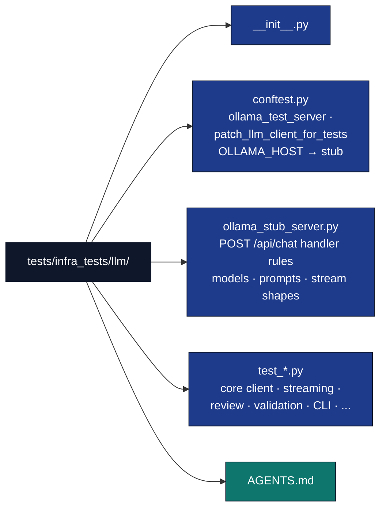

# LLM Module Tests

## Overview

Tests for `infrastructure.llm` follow the **no mocks** rule: `MagicMock` /
`unittest.mock.patch` are not used. Deterministic HTTP uses **pytest_httpserver**
(`ollama_test_server`). Subprocess-oriented helpers (for example
`pull_ollama_model`) use **real stub scripts** and optional injectable ``which`` /
``run`` parameters instead of patching `subprocess.run`.

Keep protocol/state tests deterministic and real-provider acceptance separately
source-bound; neither layer substitutes for the other.

**Coverage (informal):** re-measure after substantive edits (live aggregate → [`docs/development/coverage-gaps.md`](../../../docs/development/coverage-gaps.md)):

```bash
uv run pytest tests/infra_tests/llm/ -m "not requires_ollama" \
  --cov=infrastructure.llm --cov-report=term-missing --cov-fail-under=0
```

## Layout



Groupings (non-exhaustive):

| Area | Examples |
|------|----------|
| Client / connection / streaming | `test_core.py`, `test_connection_mixin.py`, `test_streaming.py`, `test_stream_helpers.py`, `test_response_saver.py` |
| Config / context | `test_config.py`, `test_context.py` |
| Utils / server | `test_ollama_utils.py`, `test_server.py`, `test_heartbeat*.py` |
| Review / manuscript | `test_review_*.py`, `test_manuscript_*.py`, `test_llm_review.py` |
| Validation / sanitization | `test_validation.py`, `test_validation_*coverage*.py`, `test_sanitization*.py` |
| CLI / prompts / templates | `test_cli.py` (direct command functions); optional subprocess tests calling `python -m infrastructure.llm.cli` for `main()` exit codes |
| Review pipeline | `test_llm_review.py` and related `test_review_*.py` modules |

## Test Categories

### 1. Deterministic (`-m "not requires_ollama"`)

Default for CI and local runs: **pytest_httpserver** stubs Ollama’s HTTP API.
`patch_llm_client_for_tests` sets `OLLAMA_HOST` to the stub unless the test is
marked `@pytest.mark.no_patch_llm_client`.

**Stub prompt markers** (handled in `ollama_stub_server.build_chat_handler`):

- `__OLLAMA_HTTP_EMPTY_STREAM__` — single final stream chunk with empty content
- `__OLLAMA_HTTP_BAD_NDJSON_LINE__` — non-JSON first line, then valid chunks (parser skips bad lines)

Model names `primary-model` / `fallback1` still yield HTTP 500 for fallback tests.

### 2. Real daemon (`@pytest.mark.requires_ollama`)

Real-daemon cases check availability, explicit model selection, absent-model lookup and preload outcomes against an owned prepared daemon.

**These tests FAIL (not skip) when Ollama is unavailable — by design.** The
session fixture auto-starts Ollama first and, if it cannot, fails with concrete
setup steps (install → `ollama serve` → `ollama pull <model>`). A silent skip
would let LLM regressions slip through on a machine that is meant to run the LLM
path. To run **without** the LLM surface, deselect it explicitly:

```bash
uv run pytest tests/infra_tests/llm/ -m "not requires_ollama"
```

Full opt-out commands, setup steps, env vars, and the LaTeX/pandoc gate are in
the [optional-dependencies capability matrix](../../../docs/development/optional-dependencies.md).

## Running Tests

```bash
# Deterministic suite (fake Ollama HTTP server)
uv run pytest tests/infra_tests/llm/ -m "not requires_ollama" -v

# Real-daemon smoke tests
uv run pytest tests/infra_tests/llm/ -m requires_ollama -v

# Full LLM suite
uv run pytest tests/infra_tests/llm/ -v

# With coverage
uv run pytest tests/infra_tests/llm/ --cov=infrastructure/llm --cov-report=term-missing

# Quick summary
uv run pytest tests/infra_tests/llm/ -q
```

## Key Fixtures (conftest.py)

### Configuration Fixtures

```python
@pytest.fixture
def default_config():
    """OllamaClientConfig with auto-discovered model from Ollama.
    Falls back to the configured default if Ollama is not available."""


@pytest.fixture
def config_with_system_prompt():
    """OllamaClientConfig with auto_inject_system_prompt=True."""


@pytest.fixture
def generation_options():
    """Sample GenerationOptions for testing."""
```

### Environment Fixtures

```python
@pytest.fixture
def clean_llm_env():
    """Removes all LLM_* and OLLAMA_* environment variables.
    Restores after test for isolation."""
```

### Sample Data Fixtures

```python
@pytest.fixture
def sample_messages():
    """List of conversation messages for context testing."""


@pytest.fixture
def sample_json_responses():
    """Dict of valid/invalid JSON strings for validation testing."""


@pytest.fixture
def sample_schema():
    """JSON schema for structured response validation."""
```

## Integration Test Behavior

### Consumer contracts versus model-runtime evidence

Owned HTTP endpoints exercise response parsing, transport failures, retry counts,
stream reconstruction and conversation state. These fixtures are protocol inputs,
not a fabricated model backend or evidence of real inference.

The `requires_ollama` layer retains actual daemon status, model selection,
missing-model lookup and preload state. Do not add smokes whose only oracle is
nonempty output, response length, canned wording, history-count growth or forwarded
defaults. Deterministic conversation-state contracts do not certify real inference.

Actual generation remains required by the Source-owned local-provider/native
`local-review` and `translation` consumers. They retain the selected model digest,
exact request and response, completion/token evidence, prompt identity and
unchanged manuscript inputs. Daemon health or HTTP fixtures cannot satisfy that
obligation.

### Failure and timeout boundaries

`ensure_ollama_for_tests` fails loudly when its real daemon/model prerequisite is
unavailable. Release workflows provide authenticated pinned bytes and an owned
daemon, with implicit model acquisition disabled.

A successful short warm-up proves actual inference, not throughput for a later
prompt or output budget. Preserve each consumer's request, pytest and operation
clocks, model, seed, prompt and token budget. Diagnose actual cancellation,
loading, prefill and generation from retained owned-daemon output. Do not
reinterpret a whole-response timeout as a streaming idle timeout to hide failure.

## Coverage Summary

Do not rely on static percentages in this file: run `--cov=infrastructure.llm`
as in the Overview. The deterministic suite targets user-facing branches; some
CLI and daemon-only paths stay thin until exercised manually or with
`requires_ollama`.

## Adding Tests

Assert an observable consumer invariant: exact decoded data, accumulated
conversation state, transformed output, request-count boundaries or a refusal
that occurs before external work. Existing HTTP fixtures and owned subprocesses
should exercise the real client implementation.

Generated prose presence, length, guessed wording and copied configuration
defaults are not permanent correctness tests. Delete such cases instead of
re-pinning their expectations or increasing clocks until they pass.

Use `requires_ollama` only when the invariant genuinely depends on a prepared
daemon. Keep actual provider acceptance source-bound and distinct from fixture
coverage, and never replace it with an HTTP echo server.

## Pipeline Integration

Repository marker defaults exclude `requires_ollama`; that default profile does
not establish live-provider acceptance. Run the explicit daemon contracts only
against an owned prepared daemon:

```bash
OLLAMA_SKIP_TEST_MODEL_PULL=1 uv run pytest tests/infra_tests/llm/ -m requires_ollama -v
```

The release owner separately executes the complete Source-bound native
local-provider obligations with the existing pinned preparation and
identity-checked daemon cleanup.

## Troubleshooting

- If daemon cases are not selected, inspect the actual marker selection; a
  deselected case is not a passing case.
- If a request times out, retain the owned daemon's output and exact consumer
  command/result. Separate loading, prompt evaluation, generation and actual
  cancellation before proposing a source change.
- Invalid or incomplete provider responses remain failures. Do not acquire a
  replacement model, suppress an exception, reduce the workload or extend clocks
  to make a prose smoke pass.

## See Also

- [`../../../docs/development/optional-dependencies.md`](../../../docs/development/optional-dependencies.md) - Optional-dependency capability matrix (Ollama / LaTeX / pandoc gating + opt-out)
- [`../../../infrastructure/llm/AGENTS.md`](../../../infrastructure/llm/AGENTS.md) - Module documentation
- [`../../../infrastructure/llm/README.md`](../../../infrastructure/llm/README.md) - Quick reference
- [`conftest.py`](conftest.py) - Fixture definitions
